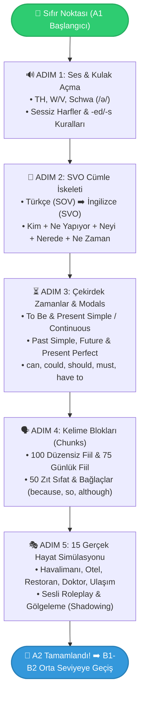

# 🐣 Modül 01: Temel Seviye (A1 - A2)
### *Sıfırdan Hayatta Kalma, Cümle Kurma Mantığı ve Korkusuz Konuşma Rehberi*

-2ecc71?style=for-the-badge)

**[🏠 Ana Sayfaya Dön](../README.md)** • **[⚡ Hızlı Cheat Sheet](./A1-A2-Hizli-Tekrar-Cheat-Sheet.md)** • **[🧠 Gramer Mantığı](./Temel-Gramer-Mantigi-ve-Zamanlar.md)** • **[🎭 15 Günlük Diyalog](./Gunluk-Hayat-Senaryolari-ve-Diyaloglar.md)** • **[➡️ Sonraki Faz: B1-B2](../02-Orta-Seviye-B1-B2/README.md)**

---

> **🎯 Bu Modülün Amacı:** İngilizcenin ses sistemine ve cümle kurulum mantığına sıfır ezberle alışmak, günlük hayatta en sık kullanılan **1.500+ çekirdek kelime ve hazır kalıpla (chunks)** kendinizi ifade edebilmek ve 15 gerçek hayat senaryosunda korkmadan konuşmaya başlamak.

---

## 🗂️ Bu Klasördeki Rehberler (A1-A2 Tam Külliyat — 6 Dosya)

Bu modül birbirini tamamlayan **6 kapsamlı rehberden** oluşmaktadır. Sıfırdan başlıyorsanız aşağıdaki sırayla ilerlemeniz önerilir:

| # | Rehber Dosyası | Odak Noktası ve İçerik Özeti | Tahmini Süre | Zorluk |
| :-: | :--- | :--- | :---: | :---: |
| **1** | 📍 **[A1-A2 Yol Haritası (Bu Dosya)](./README.md)** | Seviye hedefleri, hızlı özet kartları, ücretsiz kaynaklar ve **8 haftalık çalışma programı**. | `15 dk` | 🟢 `A1` |
| **2** | 🔊 **[Temel Telaffuz ve Sesletim Rehberi](./Temel-Telaffuz-ve-Sesletim-Rehberi.md)** | Türklerin en çok zorlandığı 7 ses (`th`, `w/v`, `r`, `schwa /ə/`, `ɪ/iː`), okunmayan harfler, **yanlış okunan 30 kelime**, ulama (`gonna/wanna`) ve tekerlemeler. | `45 dk` | 🟢 `A1-A2` |
| **3** | 🧠 **[Temel Gramer Mantığı ve Zamanlar](./Temel-Gramer-Mantigi-ve-Zamanlar.md)** | Türkçe (`SOV`) vs. İngilizce (`SVO`) düşünce farkı, `To Be`, 6 temel zaman, `Modal Verbs`, `in/on/at` mantığı, `5N1K` soruları ve **12 mini test + cevap anahtarı**. | `90 dk` | 🟢 `A1-A2` |
| **4** | 🗣️ **[En Sık Kullanılan Kalıplar ve Kelimeler](./En-Sik-Kullanilan-Kalip-ve-Kelimeler.md)** | Hayatta kalma cümleleri, doğal tepkiler, saat/tarih okuma, günlük rutin blokları, zıt anlamlı 40 sıfat ve **en kritik 75 fiil (V1-V2)** tablosu. | `60 dk` | 🟢 `A1-A2` |
| **5** | 🎭 **[Günlük Hayat Senaryoları ve Diyaloglar](./Gunluk-Hayat-Senaryolari-ve-Diyaloglar.md)** | Havalimanı, otel, restoran, kafe, süpermarket, mağaza, doktor, eczane, yol tarifi, metro/taksi, telefon, banka, kuaför, ofis ve acil durum dahil **15 gerçek hayat diyaloğu**. | `75 dk` | 🟡 `A1-A2+` |
| **6** | ⚡ **[A1-A2 Hızlı Tekrar Başucu Kağıdı (Cheat Sheet)](./A1-A2-Hizli-Tekrar-Cheat-Sheet.md)** | Tek sayfada tüm gramer tabloları, **okunuşlarıyla en sık 100 düzensiz fiil (Irregular Verbs)**, sayı/fiyat okunuşları, 50 sıfat zıtlığı ve **60 tek cümlelik kurtarıcı**. | `20 dk` | ⚡ `Başucu` |

---

## 🧭 A1'den A2 Sonuna Öğrenme Mimarisi

---

## ⚡ Hızlı Önizleme Kartları (Tıkla & Hemen Öğren)

Dosyalara girmeden önce A1-A2 seviyesinin en kritik 4 sırrını aşağıdaki açılır-kapanır kartlardan hemen inceleyebilirsiniz:

💡 <b>1. Türkçe (SOV) vs. İngilizce (SVO) Cümle Kurulum Sırrı (Tıkla & Aç)</b>

 

Türkçede en önemli bilgi (eylem) cümlenin **en sonunda** yer alır. İngilizcede ise **en başta** yer alır! Cümle kurarken zihninizde her zaman şu 5 vagonu sırasıyla bağlayın:

| 1. KİM? (`Subject`) | 2. NE YAPIYOR? (`Verb`) | 3. NEYİ / KİMİ? (`Object`) | 4. NEREDE? (`Place`) | 5. NE ZAMAN? (`Time`) |
| :--- | :--- | :--- | :--- | :--- |
| **I** *(Ben)* | **drink** *(içerim)* | **coffee** *(kahve)* | **at the office** *(ofiste)* | **every morning.** *(her sabah.)* |
| **She** *(O)* | **bought** *(satın aldı)* | **a new laptop** *(yeni bir laptop)* | **from the store** *(mağazadan)* | **yesterday.** *(dün.)* |

> 🚨 **Altın Kural (`Place before Time`):** İngilizcede cümlenin sonunda hem **Yer** hem **Zaman** varsa, her zaman **önce YER, sonra ZAMAN** gelir (*I go **to work** **every day**.*).
> 👉 Detaylar ve alıştırmalar için: **[🧠 Temel Gramer Mantığı ve Zamanlar](./Temel-Gramer-Mantigi-ve-Zamanlar.md)**

🔊 <b>2. Türklerin En Sık Yanlış Okuduğu 10 Günlük Kelime (Tıkla & Aç)</b>

 

| Kelime | Anlamı | ❌ Yanlış Okunuş | ✅ Doğru Okunuş | Neden? |
| :--- | :--- | :--- | :--- | :--- |
| **Comfortable** | Rahat | *Kom-for-tey-bıl* | **KAMF-tı-bıl** | Ortadaki `or` yutulur, 3 hecelidir! |
| **Vegetable** | Sebze | *Ve-ce-tey-bıl* | **VEC-tı-bıl** | İkinci `e` hiç okunmaz, 3 hecelidir! |
| **Wednesday** | Çarşamba | *Ved-nes-dey* | **VENZ-dey** | İlk `d` sessiz harftir (silent letter). |
| **Clothes** | Kıyafetler | *Klot-hıs* | **KLOĞZ** | Kapamak fiili olan *close* ile neredeyse aynı okunur! |
| **Receipt** | Fiş / Makbuz | *Re-sept* | **ri-SİİT** | Sondaki `p` harfi hiç okunmaz! |
| **Recipe** | Yemek tarifi | *Re-sayp* | **RE-sı-pi** | Sondaki `e` harfi "i" olarak okunur. |
| **Island / Aisle**| Ada / Koridor | *İz-land / A-is-le* | **AY-lınd / AYL** | İçlerindeki `s` harfi tamamen sessizdir! |
| **Salmon** | Somon | *Sal-mon* | **SE-mın** | İçindeki `l` harfi hiç okunmaz! |
| **Women** | Kadınlar | *Vu-men* | **Vİ-min** | Çoğul olduğunda ilk hecedeki `o` harfi "i" diye okunur! |
| **Queue** | Sıra / Kuyruk | *Ku-e-u-e* | **KYUU** | Sadece `Q` harfini okumak yeterlidir, geri kalan 4 harf sessizdir! |

> 👉 Tam 30 kelimelik tablo, `th / schwa` kuralları ve tekerlemeler için: **[🔊 Temel Telaffuz ve Sesletim Rehberi](./Temel-Telaffuz-ve-Sesletim-Rehberi.md)**

🆘 <b>3. Konuşurken Tıkandığınızda Hayat Kurtaran 10 Cümle (Tıkla & Aç)</b>

 

1. **Could you speak a bit slower, please?** *(Biraz daha yavaş konuşabilir misiniz lütfen?)*
2. **Sorry, I didn't catch that. Could you repeat it?** *(Kusura bakmayın, yakalayamadım. Tekrar edebilir misiniz?)*
3. **What does "..." mean?** *("..." ne anlama geliyor?)*
4. **How do you say "..." in English?** *(İngilizcede "..." nasıl denir?)*
5. **Let me think for a second.** *(Bir saniye düşüneyim.)*
6. **It's on the tip of my tongue!** *(Dilimin ucunda!)*
7. **What I mean is...** *(Demek istediğim şey şu...)*
8. **I'm still learning English, please bear with me.** *(Hâlâ İngilizce öğreniyorum, lütfen bana sabır gösterin.)*
9. **Could you write it down for me, please?** *(Bunu benim için yazabilir misiniz lütfen?)*
10. **Does that make sense?** *(Anlatabildim mi / Mantıklı geldi mi?)*

> 👉 60 tek cümlelik kurtarıcı ve 100 düzensiz fiil için: **[⚡ A1-A2 Hızlı Tekrar Cheat Sheet](./A1-A2-Hizli-Tekrar-Cheat-Sheet.md)**

🚨 <b>4. A1-A2 Seviyesinde En Sık Yapılan 5 Kronik Gramer Hatası (Tıkla & Aç)</b>

 

* ❌ *I am work in a bank.* ➡️ ✅ **I work in a bank.** *(Geniş zamanda eylem varsa `am/is/are` ASLA kullanılmaz!)*
* ❌ *I have 24 years old.* ➡️ ✅ **I am 24 years old.** *(Yaş, açlık, susuzluk `have` ile değil, `am/is/are` ile söylenir!)*
* ❌ *I didn't went to work yesterday.* ➡️ ✅ **I didn't go to work yesterday.** *(`didn't` ve `Did` olan cümlede fiil yalın `V1` haline döner!)*
* ❌ *I am going to home now.* ➡️ ✅ **I am going home now.** *(`home`, `here`, `there` kelimelerinden önce `to` gelmez!)*
* ❌ *Can you give me an advice?* ➡️ ✅ **Can you give me some advice?** *(`advice`, `information`, `money`, `traffic` sayılamaz; `an` veya `-s` almaz!)*

---

## 📑 İçindekiler

1. [🎯 A1 ve A2 Yetkinlik Kontrol Listesi (Checklist)](#-a1-ve-a2-yetkinlik-kontrol-listesi-checklist)
2. [🔊 Adım 1: Seslere Alışma ve Telaffuz Temelleri (Özet)](#-adım-1-seslere-alışma-ve-telaffuz-temelleri-özet)
3. [🧱 Adım 2: Çekirdek Cümle İskeleti ve Sıfır Ezberle Gramer (Özet)](#-adım-2-çekirdek-cümle-iskeleti-ve-sıfır-ezberle-gramer-özet)
4. [⚡ Adım 3: A1-A2 İçin Doğru Çalışma Metodolojisi (Nasıl Çalışmalı?)](#-adım-3-a1-a2-için-doğru-çalışma-metodolojisi-nasıl-çalışmalı)
5. [📚 Adım 4: A1-A2 İçin En İyi Ücretsiz Kaynaklar](#-adım-4-a1-a2-için-en-iyi-ücretsiz-kaynaklar)
6. [🗓️ 8 Haftalık Sıfırdan A2 Sonuna Çalışma Programı](#️-8-haftalık-sıfırdan-a2-sonuna-çalışma-programı)

---

## 🎯 A1 ve A2 Yetkinlik Kontrol Listesi (Checklist)

Bu modülü tamamladığınızda aşağıdaki kutucukların tamamını işaretleyebiliyor olacaksınız:

### 🌱 A1 (Başlangıç / Breakthrough) Hedefleri
- [ ] Kendimi, ailemi, yaşadığım yeri, mesleğimi ve hobilerimi 5-10 cümleyle tanıtabilirim.
- [ ] Sayıları, saatleri, günleri, tarihleri ve fiyatları tek seferde anlayıp söyleyebilirim.
- [ ] Kafede kahve, restoranda yemek siparişi verebilir; markette ve mağazada fiyat/beden sorabilirim.
- [ ] `To Be (am/is/are)`, `Present Simple` (günlük rutin) ve `Present Continuous` (şu an) ile temel olumlu, olumsuz ve soru cümleleri kurabilirim.
- [ ] Karşı taraf hızlı konuştuğunda *"Could you speak a bit slower, please?"* gibi hayatta kalma kalıplarıyla iletişimi sürdürebilirim.

### 🌿 A2 (Temel / Waystage) Hedefleri
- [ ] Havalimanında pasaport kontrolünden geçebilir, otelde check-in yapabilir ve oda sorunlarını bildirebilirim.
- [ ] Sokakta yol tarifi sorup verebilir, metro/otobüs/taksi kullanabilir, doktorda veya eczanede şikayetimi anlatabilirim.
- [ ] Dün yaşadığım bir olayı (`Past Simple`), gelecek planlarımı (`going to / will`) ve hayat tecrübelerimi (`Present Perfect: Have you ever...?`) anlatabilirim.
- [ ] `because, so, but, although, while, before, after` bağlaçlarını kullanarak kısa cümleleri birbirine bağlayabilirim.
- [ ] Yavaş ve net konuşulan İngilizce videoları veya *A2 Graded Reader* hikaye kitaplarını Türkçe çeviriye ihtiyaç duymadan **%80 oranında** anlayabilirim.

---

## 🔊 Adım 1: Seslere Alışma ve Telaffuz Temelleri (Özet)

Türkçe **yazıldığı gibi okunan (fonetik)** bir dildir; İngilizce ise öyle değildir. Bu yüzden kelimeleri sadece gözünüzle okuyarak öğrenirseniz yanlış telaffuz edersiniz ve bir İngiliz/Amerikalı o kelimeyi söylediğinde tanıyamazsınız.

### Türklerin En Sık Düştüğü 5 Telaffuz Tuzağı

| Ses / Kural | Açıklama | Doğru Örnekler |
| :--- | :--- | :--- |
| **1. `TH` Sesi (`/θ/` ve `/ð/`)** | Dilinizin ucu üst ön dişlerinize hafifçe değmelidir. `T`, `D`, `S` veya `Z` değildir! | *Think* (`/θɪŋk/`), *Thank*, *This* (`/ðɪs/`), *Mother* |
| **2. `W` vs `V` Farkı** | `W` sesinde dudaklar "u" der gibi yuvarlanır, dişler dudağa değmez. `V` sesinde üst dişler alt dudağa değer. | *West* vs *Vest*, *Wine* vs *Vine*, *Why* |
| **3. Sessiz Harfler (Silent Letters)** | İngilizcede bazı harfler yazılır ama **hiç okunmaz**. | **K**now, **W**rite, Lis**t**en, I**s**land, Dou**b**t, We**d**nesday, Recei**p**t |
| **4. Schwa Sesi (`/ə/`)** | İngilizcedeki en yaygın sestir! Vurgusuz hecelerdeki sesli harfler kısa ve tembel bir "ı/e" karışımı olarak çıkar. | *About* (`/əˈbaʊt/`), *Teacher* (`/ˈtiːtʃər/`), *Today* (`/təˈdeɪ/`), *Comfortable* (`/ˈkʌmftəbəl/`) |
| **5. Kelime Sonundaki `-ed` Takısı** | Geçmiş zaman eki her zaman "-ıd" diye okunmaz! Çoğu zaman sadece `/t/` veya `/d/` sesi çıkar. | *Worked* (`/wɜːrkt/` - "vörkt"), *Played* (`/pleɪd/`), *Wanted* (`/ˈwɒntɪd/`) |

> 👉 **Detaylı anlatım, yanlış okunan 30 kelime tablosu ve sesli tekerlemeler için:** **[🔊 Temel Telaffuz ve Sesletim Rehberi](./Temel-Telaffuz-ve-Sesletim-Rehberi.md)** dosyasına gidin!

---

## 🧱 Adım 2: Çekirdek Cümle İskeleti ve Sıfır Ezberle Gramer (Özet)

Türkçe cümle dizilimi **Özne + Nesne + Yüklem (SOV)** (*Ben kahve içerim*) şeklindedir.
İngilizce cümle dizilimi ise **Özne + Yüklem + Nesne (SVO)** (*Ben içerim kahve -> I drink coffee*) şeklindedir.

İngilizce düşünmeye başlamak için cümle kurarken zihninizde her zaman önce **"Kim?"**, hemen ardından **"Ne yapıyor?"** sorusunu sorun.

### 1. Temel Zamanlar Özeti (Tek Tabloda Tüm İskelet)

| Zaman (Tense) | Ne Zaman Kullanılır? | Olumlu Cümle | Olumsuz Cümle | Soru Cümlesi |
| :--- | :--- | :--- | :--- | :--- |
| **To Be (Durum)** | İsim, sıfat, yer, yaş belirtirken (*-dır/-dir*) | `I am tired.` `She is at home.` | `I am not tired.` `She isn't at home.` | `Are you tired?` `Is she at home?` |
| **Simple Present** | Alışkanlıklar, rutinler, genel doğrular | `I work every day.` `He works here.` | `I don't work.` `He doesn't work.` | `Do you work?` `Does he work?` |
| **Present Continuous** | Şu anda (konuşma anında) yapılan eylemler | `I am working now.` `They are eating.` | `I'm not working.` `They aren't eating.` | `Are you working?` `What are you doing?` |
| **Simple Past** | Geçmişte belirli bir zamanda bitmiş olaylar | `I went yesterday.` `She watched TV.` | `I didn't go.` `She didn't watch.` | `Did you go?` `Where did you go?` |
| **Future (`going to` / `will`)** | Planlanan gelecek (`going to`) / Anlık kararlar (`will`) | `I'm going to travel.` `I will call you.` | `I'm not going to go.` `I won't (will not) call.` | `Are you going to go?` `Will you help me?` |
| **Present Perfect** | Hayat tecrübesi / Geçmişte olup etkisi süren olaylar | `I have seen that film.` `She has just left.` | `I haven't been there.` `He hasn't arrived yet.` | `Have you ever tried sushi?` |

### 2. Yer ve Zaman Edatları (`in`, `on`, `at`) Altın Üçgeni

Genelden özele doğru daralan bir huni gibi düşünün:

| Edat | Zaman İçin Kullanımı | Yer / Mekan İçin Kullanımı |
| :---: | :--- | :--- |
| **`IN`** *(En Geniş / Kapalı Alan)* | Yıllar, Aylar, Mevsimler, Günün Bölümleri 👉 `in 2026`, `in May`, `in summer`, `in the morning` | Ülkeler, Şehirler, Kapalı Mekanlar 👉 `in Turkey`, `in Istanbul`, `in the room`, `in my pocket` |
| **`ON`** *(Günler / Yüzey Üzeri)* | Günler, Tam Tarihler 👉 `on Monday`, `on Friday morning`, `on May 15th` | Yüzeyler, Cadde/Sokaklar, Toplu Taşıma, Dijital Ekranlar 👉 `on the table`, `on the bus`, `on the internet`, `on TV` |
| **`AT`** *(Tam Nokta / Saat)* | Saatler, Belirli Anlar, *Night/Weekend* 👉 `at 8 o'clock`, `at night`, `at the moment` | Belirli Noktalar, Kurumlar, Etkinlikler 👉 `at home`, `at work`, `at the bus stop`, `at the door` |

> 👉 **12 bölümün tamamı, detaylı mantık açıklamaları ve cevap anahtarlı mini testler için:** **[🧠 Temel Gramer Mantığı ve Zamanlar](./Temel-Gramer-Mantigi-ve-Zamanlar.md)** dosyasına gidin!

---

## ⚡ Adım 3: A1-A2 İçin Doğru Çalışma Metodolojisi (Nasıl Çalışmalı?)

1. **Kelime Ezberlemeyin, "Chunk" (Kalıp) Öğrenin:** Deftere `decision = karar` yazıp ezberlerseniz konuşurken hangi fiille kullanacağınızı bilemezsiniz. Bunun yerine **`make a decision`** *(karar vermek)* veya **`It depends on the weather`** *(Havaya bağlı)* şeklinde tam blok olarak öğrenin.
2. **Anlaşılır Girdi (Comprehensible Input) Alın:** Anlamadığınız ağır filmleri altyazısız izlemek A1 seviyesinde sadece moral bozar. Bunun yerine **%70-%80'ini anlayabildiğiniz** seviyeli hikayeler (*Graded Readers*) okuyun ve başlangıç seviyesi videolar izleyin.
3. **Gölgeleme (Shadowing) Tekniği Uygulayın:** Dinlediğiniz bir cümleyi durdurun ve konuşmacının tonlamasını, vurgusunu taklit ederek **yüksek sesle** tekrar edin. Ağzınızdan çıkmayan bir cümleyi gerçek hayatta kuramazsınız!
4. **Kendi Kendinize Konuşun (Self-Talk):** Sabah kahve hazırlarken yaptığınız her hareketi içinizden değil, fısıltıyla bile olsa İngilizce söyleyin: *"Now I am boiling the water. Where did I put my mug? Oh, it is on the table."*

---

## 📚 Adım 4: A1-A2 İçin En İyi Ücretsiz Kaynaklar

### 📺 YouTube Kanalları (Comprehensible Input Odaklı)
* **[English Comprehensible Input for Beginners](https://www.youtube.com/@ComprehensibleInput)** (`A1-A2`): Çizimler, görseller ve beden diliyle sıfır Türkçe kullanarak İngilizce hikayeler anlatır. Başlangıç için en etkili kanaldır.
* **[Easy English](https://www.youtube.com/@EasyEnglishVideos)** (`A1-B1`): Sokak röportajları ve günlük hayat diyalogları (Altyazılı). Gerçek insanların nasıl konuştuğunu görmek için harikadır.
* **[BBC Learning English](https://www.youtube.com/@bbclearningenglish)** (`A2-B2`): Kısa, net ve çok kaliteli öğretici seriler.
* **[English Addict with Mr Duncan](https://www.youtube.com/@duncaninchina)** (`A2-B1`): Eğlenceli ve anlaşılır anlatımıyla günlük ifadeleri öğretir.

### 🎧 Podcastler ve Dinleme Siteleri
* **[Voice of America (VOA) - Learning English](https://learningenglish.voanews.com/)** (`A1-A2`): Normalden %30 daha yavaş okunan güncel haberler ve hikayeler (hem sesli hem yazılı metinli).
* **[British Council - LearnEnglish Listening (A1-A2)](https://learnenglish.britishcouncil.org/skills/listening)** (`A1-A2`): Dinleme parçaları ve hemen altında anlama testleri bulunan ücretsiz resmi platform.
* **[Culips Everyday English](https://www.culips.com/)** (`A2-B1`): Günlük konuşma kalıplarını yavaş ve anlaşılır şekilde açıklar.

### 📖 Okuma Kaynakları (Graded Readers)
* **[English e-Reader](https://english-e-reader.net/)** (`A1-C2`): Seviyelere (`Starter/A1`, `Elementary/A2`) göre sadeleştirilmiş yüzlerce kitap ve sesli kitap.
* **[News in Levels](https://www.newsinlevels.com/)** (`A1-B1`): Aynı haberi Level 1 (A1-A2), Level 2 (B1) ve Level 3 (B2+) olarak 3 farklı zorlukta sunar. Her gün 1 haber okuyup dinleyin!

---

## 🗓️ 8 Haftalık Sıfırdan A2 Sonuna Çalışma Programı

Her gün **35-45 dakika** ayırarak bu klasördeki 6 rehberi adım adım bitireceğiniz eylem planı:

| Hafta | Ana Odak | Bu Klasörden Çalışılacak Bölümler ve Günlük Görevler |
| :---: | :--- | :--- |
| **1. Hafta** | **Sesler, SVO Mantığı & *To Be*** | • [Telaffuz Rehberi](./Temel-Telaffuz-ve-Sesletim-Rehberi.md) Bölüm 1-4'ü sesli çalış. • [Gramer Rehberi](./Temel-Gramer-Mantigi-ve-Zamanlar.md) Bölüm 1-3'ü oku ve mini testlerini çöz. • [Diyaloglar](./Gunluk-Hayat-Senaryolari-ve-Diyaloglar.md) **Senaryo 1 (Tanışma)** diyaloğunu sesli canlandır. |
| **2. Hafta** | **Günlük Rutinler (*Present Simple*)** | • [Gramer Rehberi](./Temel-Gramer-Mantigi-ve-Zamanlar.md) Bölüm 4'ü bitir. • [Kalıplar Rehberi](./En-Sik-Kullanilan-Kalip-ve-Kelimeler.md) içindeki **Günlük Rutin Blokları** ile kendi gününü anlatan 10 cümle yaz. • *News in Levels* Level 1'den her gün 1 kısa haber oku ve dinle. |
| **3. Hafta** | **Şimdiki Zaman, Sorular & Kafe/Restoran** | • [Gramer Rehberi](./Temel-Gramer-Mantigi-ve-Zamanlar.md) Bölüm 5 (Present Continuous) ve Bölüm 11 (5N1K Soruları) alıştırmalarını çöz. • [Diyaloglar](./Gunluk-Hayat-Senaryolari-ve-Diyaloglar.md) **Senaryo 4, 5, 6 ve 7** (Kafe, Restoran, Market, Mağaza) diyaloglarını sesli çalış. |
| **4. Hafta** | **Edatlar (`in/on/at`), Yön Tarifi & Seyahat** | • [Gramer Rehberi](./Temel-Gramer-Mantigi-ve-Zamanlar.md) Bölüm 10 (Edatlar) ve Bölüm 12 (`There is/are`) konularını bitir. • [Diyaloglar](./Gunluk-Hayat-Senaryolari-ve-Diyaloglar.md) **Senaryo 2, 3, 8 ve 9** (Havalimanı, Otel, Yol Tarifi, Metro/Taksi) senaryolarını canlandır. |
| **5. Hafta** | **Geçmiş Zaman (*Past Simple*) & 100 Fiil** | • [Gramer Rehberi](./Temel-Gramer-Mantigi-ve-Zamanlar.md) Bölüm 6 (Past Simple) ve [Telaffuz Rehberi](./Temel-Telaffuz-ve-Sesletim-Rehberi.md) `-ed` okunuş kurallarını çalış. • [Cheat Sheet](./A1-A2-Hizli-Tekrar-Cheat-Sheet.md) içindeki **100 Düzensiz Fiil** tablosunu ses gruplarına göre tamamla. • Her akşam "Bugün ne yaptım?" sorusuna 5 cümlelik sesli cevap ver. |
| **6. Hafta** | **Gelecek Planları & *Modal Verbs*** | • [Gramer Rehberi](./Temel-Gramer-Mantigi-ve-Zamanlar.md) Bölüm 7 (`will` vs `going to`) ve Bölüm 9 (`can/should/must/have to`) testlerini çöz. • [Diyaloglar](./Gunluk-Hayat-Senaryolari-ve-Diyaloglar.md) **Senaryo 10, 11 ve 12** (Doktor/Eczane, Telefon, Banka) diyaloglarını çalış. |
| **7. Hafta** | **Present Perfect, Karşılaştırma & Bağlaçlar** | • [Gramer Rehberi](./Temel-Gramer-Mantigi-ve-Zamanlar.md) Bölüm 8 (`Present Perfect`) ve sıfat karşılaştırmalarını (`bigger than`) bitir. • [Kalıplar Rehberi](./En-Sik-Kullanilan-Kalip-ve-Kelimeler.md) içindeki **40 Zıt Sıfat** ve **Bağlaçlar** tablolarıyla cümlelerini uzat. • İlk *Elementary (A2) Graded Reader* hikaye kitabını bitir. |
| **8. Hafta** | **Tam Konuşma Simülasyonu & B1'e Geçiş** | • [Diyaloglar](./Gunluk-Hayat-Senaryolari-ve-Diyaloglar.md) **Senaryo 13, 14 ve 15**'i tamamla. • [Cheat Sheet](./A1-A2-Hizli-Tekrar-Cheat-Sheet.md) ile tüm modülü 15 dakikada tekrar et. • [AI Promptları](../04-Yapay-Zeka-Promptlari/README.md) klasöründeki **Roleplay Promptlarını** kullanarak yapay zeka ile 15 senaryoyu sesli canlandır! |

---

### 🚀 Hemen Başlayın!

**[🔊 1. Telaffuz Rehberi](./Temel-Telaffuz-ve-Sesletim-Rehberi.md)** • **[🧠 2. Gramer Mantığı](./Temel-Gramer-Mantigi-ve-Zamanlar.md)** • **[🗣️ 3. Kalıplar & Kelimeler](./En-Sik-Kullanilan-Kalip-ve-Kelimeler.md)** • **[🎭 4. 15 Günlük Diyalog](./Gunluk-Hayat-Senaryolari-ve-Diyaloglar.md)** • **[⚡ 5. Hızlı Cheat Sheet](./A1-A2-Hizli-Tekrar-Cheat-Sheet.md)**

