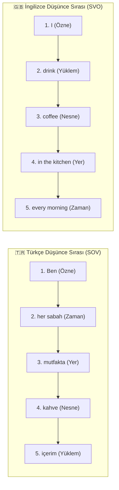
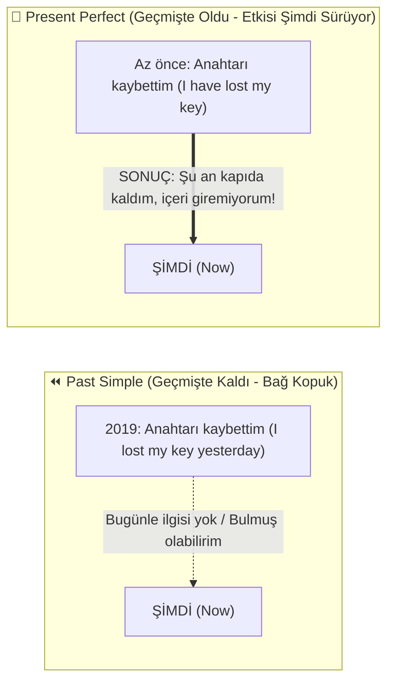

# 🧠 A1 - A2 Temel Gramer Mantığı ve Zamanlar (Sıfır Ezber Rehberi)

[⬅️ A1-A2 Ana Rehbere Dön](./README.md) | [🗣️ Kalıplar ve Kelimeler](./En-Sik-Kullanilan-Kalip-ve-Kelimeler.md) | [🎭 Günlük Diyaloglar](./Gunluk-Hayat-Senaryolari-ve-Diyaloglar.md) | [🔊 Telaffuz Rehberi](./Temel-Telaffuz-ve-Sesletim-Rehberi.md) | [🏠 Ana Sayfa](../README.md)

> **Bu Rehberin Felsefesi:** İngilizce gramer bir matematik formülü (`S + V2 + O`) ezberleme işi değildir; **düşünceyi sıralama mantığıdır**. Türkçede cümlenin sonuna sakladığımız bilgiyi, İngilizcede en başa koyarız. Bu rehberde kuralları ezberlemek yerine **İngilizce düşünen bir beynin cümleyi nasıl inşa ettiğini** öğreneceksiniz.

---

## 📑 İçindekiler

1. [🔄 Bölüm 1: Türkçe (SOV) vs. İngilizce (SVO) Cümle Kurulum Mantığı](#-bölüm-1-türkçe-sov-vs-i̇ngilizce-svo-cümle-kurulum-mantığı)
2. [🪞 Bölüm 2: Zamirler, İyelik ve Temel Yapı Taşları (Pronouns & Articles)](#-bölüm-2-zamirler-i̇yelik-ve-temel-yapı-taşları-pronouns--articles)
3. [⚓ Bölüm 3: "To Be" Fiili (`am / is / are / was / were`) — Eylemsiz Cümleler](#-bölüm-3-to-be-fiili-am--is--are--was--were--eylemsiz-cümleler)
4. [🔁 Bölüm 4: Present Simple (Geniş Zaman) — Rutinler ve Gerçekler](#-bölüm-4-present-simple-geniş-zaman--rutinler-ve-gerçekler)
5. [🎬 Bölüm 5: Present Continuous (Şimdiki Zaman) — Tam Şu An](#-bölüm-5-present-continuous-şimdiki-zaman--tam-şu-an)
6. [⏪ Bölüm 6: Past Simple (Geçmiş Zaman) — Biten Hikayeler](#-bölüm-6-past-simple-geçmiş-zaman--biten-hikayeler)
7. [🚀 Bölüm 7: Future Tenses (`will` vs. `be going to`) — Gelecek Planları](#-bölüm-7-future-tenses-will-vs-be-going-to--gelecek-planları)
8. [🌉 Bölüm 8: Present Perfect'e Giriş (`have / has + V3`) — Geçmişten Bugüne Köprü](#-bölüm-8-present-perfecte-giriş-have--has--v3--geçmişten-bugüne-köprü)
9. [🛠️ Bölüm 9: Modal Verbs (`can / could / should / must / have to / would like`)](#-bölüm-9-modal-verbs-can--could--should--must--have-to--would-like)
10. [📍 Bölüm 10: Edatların Mantığı (`in / on / at` ve Yön Edatları)](#-bölüm-10-edatların-mantığı-in--on--at-ve-yön-edatları)
11. [❓ Bölüm 11: Soru Kalıpları (5N1K / `Wh-` Questions) ve Cevaplama Mantığı](#-bölüm-11-soru-kalıpları-5n1k--wh--questions-ve-cevaplama-mantığı)
12. [⚖️ Bölüm 12: Sayılabilen/Sayılamayan İsimler, `There is/are` ve Karşılaştırma Sıfatları](#️-bölüm-12-sayılabilensayılamayan-i̇simler-there-isare-ve-karşılaştırma-sıfatları)

---

## 🔄 Bölüm 1: Türkçe (SOV) vs. İngilizce (SVO) Cümle Kurulum Mantığı

Türklerin İngilizce konuşurken takılmasının **1 numaralı sebebi**, zihinlerinde Türkçe cümle kurup bunu kelime kelime İngilizceye çevirmeye çalışmalarıdır. Neden mi? Çünkü iki dilin mimarisi birbirinin tam tersidir!

### 1. Temel Mimari Fark: Yüklem Nerede?

* **Türkçe (`S - O - V` / Özne - Nesne - Yüklem):** Türkçede kimin yaptığı söylenir, araya bütün detaylar (zaman, yer, nesne) sıkıştırılır ve **en sonda** ne yapıldığı açıklanır. Cümle bitene kadar eylemin ne olduğunu bilemezsiniz.
* **İngilizce (`S - V - O` / Özne - Yüklem - Nesne):** İngilizce sabırsız bir dildir! Önce **"Kim?" (Subject)**, hemen arkasından **"Ne yapıyor?" (Verb)** söylenir. Geri kalan tüm detaylar arkadan gelir.

### 2. Altın Formül: `KİM + NE YAPIYOR + NEYİ + NEREDE + NE ZAMAN`

İngilizcede bir cümleyi kurarken tren vagonlarını şu sırayla birbirine bağlayın:

| 1. Vagon: KİM? (`Subject`) | 2. Vagon: NE YAPIYOR? (`Verb`) | 3. Vagon: NEYİ / KİMİ? (`Object`) | 4. Vagon: NEREDE? (`Place`) | 5. Vagon: NE ZAMAN? (`Time`) |
| :--- | :--- | :--- | :--- | :--- |
| **I** *(Ben)* | **read** *(okurum)* | **a book** *(bir kitap)* | **in my room** *(odamda)* | **every night.** *(her gece.)* |
| **She** *(O)* | **bought** *(satın aldı)* | **a new phone** *(yeni bir telefon)* | **from the mall** *(AVM'den)* | **yesterday.** *(dün.)* |
| **We** *(Biz)* | **are watching** *(izliyoruz)* | **a movie** *(bir film)* | **at home** *(evde)* | **right now.** *(tam şu an.)* |

> 💡 **Konuşma Sırrı (Yer vs. Zaman):** İngilizcede cümlenin sonunda hem **Yer (Place)** hem **Zaman (Time)** varsa, kural her zaman **`Önce YER, sonra ZAMAN`** şeklindedir (**P**lace before **T**ime — alfabetik sıra gibi düşünün: **P** -> **T**).
> * ❌ *I go every day to work.* (Yanlış)
> * ✅ *I go **to work** (Yer) **every day** (Zaman).* (Doğru)

### 3. Sondan Eklemeli Dil (Türkçe) vs. Önden Kelimeli Dil (İngilizce)

Türkçede kelimenin sonuna ekler getirerek anlamı değiştiririz:
* *Ev* -> *Ev**im*** -> *Ev**imde*** -> *Ev**imden***

İngilizcede ise kelimenin sonuna ek gelmez; **önüne küçük kelimeler (edatlar/iyelikler)** gelir. Yani Türkçedeki ekleri **sondan başa doğru** dizeriz:
* *Ev - im - de* ➔ **in** *(de)* **my** *(im)* **house** *(ev)* -> **`in my house`**
* *Arkadaş - lar - ım - la* ➔ **with** *(la)* **my** *(ım)* **friend-s** *(arkadaşlar)* -> **`with my friends`**

---

### ✍️ Bölüm 1 Mini Alıştırma

Aşağıdaki Türkçe cümleleri İngilizce düşünce sırasına (`Kim + Ne yapıyor + Neyi + Nerede + Ne zaman`) göre sıralayın:

1. *(Ben / İngilizce / çalışırım / evde / her akşam)* -> `I / every evening / study / at home / English`
2. *(O [erkek] / içer / çay / ofiste / sabahları)* -> `in the morning / drinks / He / at the office / tea`
3. *(Annemle / telefonla / konuştum / dün)* -> `(with my mom = annemle)` -> `I / yesterday / talked / with my mom / on the phone`

🔑 <b>Cevap Anahtarını Görmek İçin Tıklayın</b>

1. **I study English at home every evening.** *(Kim: I | Ne yapar: study | Neyi: English | Nerede: at home | Ne zaman: every evening)*
2. **He drinks tea at the office in the morning.** *(Kim: He | Ne yapar: drinks | Neyi: tea | Nerede: at the office | Ne zaman: in the morning)*
3. **I talked with my mom on the phone yesterday.** *(Kim: I | Ne yaptı: talked | Kiminle: with my mom | Nerede/Nasıl: on the phone | Ne zaman: yesterday)*

---

## 🪞 Bölüm 2: Zamirler, İyelik ve Temel Yapı Taşları (Pronouns & Articles)

Cümle kurarken isimleri sürekli tekrar etmemek için **zamirleri (Pronouns)** ve isimlerin önüne gelen **belirteçleri (`a / an / the`)** doğru kullanmalıyız.

### 1. Zamirler Tablosu (Hepsi Bir Arada)

| Özne Zamiri *(Cümle Başında: KİM?)* | Nesne Zamiri *(Fiilden/Edattan Sonra: KİMİ/KİME?)* | İyelik Sıfatı *(İsimden Önce: KİMİN ...'sı?)* | İyelik Zamiri *(Tek Başına: KİMİNKİ?)* |
| :--- | :--- | :--- | :--- |
| **I** *(Ben)* | **me** *(beni / bana)* | **my** *(benim ...)* -> *my car* | **mine** *(benimki)* |
| **You** *(Sen / Siz)* | **you** *(seni / sana)* | **your** *(senin ...)* -> *your book* | **yours** *(seninki)* |
| **He** *(O - Erkek)* | **him** *(onu / ona)* | **his** *(onun ...)* -> *his job* | **his** *(onunki)* |
| **She** *(O - Kadın)* | **her** *(onu / ona)* | **her** *(onun ...)* -> *her bag* | **hers** *(onunki)* |
| **It** *(O - Cansız/Hayvan)* | **it** *(onu / ona)* | **its** *(onun ...)* -> *its color* | **-** |
| **We** *(Biz)* | **us** *(bizi / bize)* | **our** *(bizim ...)* -> *our house* | **ours** *(bizimki)* |
| **They** *(Onlar)* | **them** *(onları / onlara)* | **their** *(onların ...)* -> *their plan* | **theirs** *(onlarınki)* |

**Örneklerle Farkı Görün:**
* **She** loves **him**, but **he** doesn't love **her**. *(O [kadın] onu [erkeği] seviyor ama o [erkek] onu [kadını] sevmiyor.)*
* This is **my** coffee. That one is **yours**. *(Bu benim kahvem. Şu ise seninki.)*
* Can you give **me** **your** phone number? *(Bana telefon numaranı verebilir misin?)*

### 2. `a` / `an` / `the` Mantığı (Articles)

Türkçede *"the"* diye bir kelime olmadığı için bu konu başta garip gelir. Oysa mantığı çok basittir:

1. **`a` / `an` (Herhangi bir tane — Sayılabilir Tekil İsimler):**
   * Dinleyicinin **henüz bilmediği**, ilk kez bahsettiğiniz, "herhangi bir" tekil nesne için kullanılır.
   * **Sessiz sesle** başlayan kelimelerden önce **`a`**: *a book, a car, a university* (Dikkat: *university* "yu" sesiyle başlar, bu yüzden `a` alır!).
   * **Sesli sesle (a, e, i, o, u)** başlayan kelimelerden önce **`an`**: *an apple, an umbrella, an hour* (Dikkat: *hour* kelimesinde `h` okunmaz, "auır" diye başlar, bu yüzden `an` alır!).
2. **`the` (Belirli, Bilinen — Hem Tekil Hem Çoğul):**
   * Konuşan ve dinleyen kişinin **hangisinden bahsedildiğini bildiği** veya dünyada tek olan şeyler için kullanılır.
   * *I bought **a** laptop yesterday. **The** laptop is very fast.* (Dün **bir** laptop aldım [henüz hangisi olduğu belirsiz]. **O** laptop [artık ikimiz de hangi laptoptan bahsettiğimi biliyoruz] çok hızlı.)
   * *Can you close **the** door?* (Kapıyı kapatır mısın? — Odadaki hangi kapı olduğu belli.)
   * ***The** sun, **the** internet, **the** world* (Dünyada tek olan şeyler).
3. **Sıfır Article (Hiçbir şey gelmeyen durumlar):**
   * Genel anlamda çoğul isimlerden veya sayılamayan kavramlardan bahsederken `the` kullanılmaz:
   * *I love **music** and **cats**.* (Genel olarak müziği ve kedileri severim.)

---

### ✍️ Bölüm 2 Mini Alıştırma

Boşlukları uygun zamir (`I, me, my, mine, her, them` vb.) veya belirteç (`a, an, the`) ile doldurun:

1. I saw Ali and Ayşe yesterday, and I invited _______ to _______ birthday party.
2. Excuse me, is this _______ (senin) umbrella? No, it isn't _______ (benimki).
3. It takes _______ hour to go to _______ airport by bus.
4. I bought _______ new shirt. _______ shirt is blue.

🔑 <b>Cevap Anahtarını Görmek İçin Tıklayın</b>

1. **them / my** *(Fiilden sonra nesne zamiri: `them` [onları]; isimden önce iyelik sıfatı: `my` [benim])*
2. **your / mine** *(`umbrella` isminden önce `your`; cümlenin sonunda tek başına `mine`)*
3. **an / the** *(`hour` sesli okunduğu için `an hour`; şehirdeki belirli havalimanı olduğu için `the airport`)*
4. **a / The** *(İlk bahsedildiğinde herhangi bir gömlek `a new shirt`; ikinci cümlede artık bilinen gömlek `The shirt`)*

---

## ⚓ Bölüm 3: "To Be" Fiili (`am / is / are / was / were`) — Eylemsiz Cümleler

### 1. Neden "To Be" Diye Bir Şey Var?

Türkçede *"Ben öğretmenim"*, *"Hava soğuk"*, *"Biz evdeyiz"* cümlelerinde **fiil (hareket)** yoktur.
Ancak İngilizcenin **1 numaralı anayasa kuralı** şudur: **Fiilsiz (yüklemsiz) hiçbir İngilizce cümle kurulamaz!**

Eğer cümlenizde *koşmak, yemek, gitmek, çalışmak* gibi bir **hareket/aksiyon yoksa**, sadece bir **durum, isim, sıfat, yaş veya yer** bildiriyorsanız, İngilizce o boşluğu doldurmak için **`To Be` (`am / is / are`)** yardımcı fiilini kullanır.

> 🚨 **En Büyük Türk Hatası:** `am / is / are` sadece aksiyon OLMAYAN durum cümlelerinde veya `-ing` (şimdiki zaman) ile kullanılır. Geniş zamanda normal bir fiille **ASLA** yan yana gelmez!
> * ❌ *I am work in a bank.* (Yanlış! Hem `am` hem `work` olmaz!)
> * ✅ *I **am** a banker.* (Durum cümlesi -> `am` var)
> * ✅ *I **work** in a bank.* (Eylem cümlesi -> `am` yok, direkt fiil!)

### 2. Şimdiki Durum (`am / is / are`) ve Geçmiş Durum (`was / were`) Tablosu

| Özne | Şimdiki Durum (Present) | Geçmiş Durum (Past) | Örnek Cümle (Şimdi -> Geçmiş) |
| :--- | :---: | :---: | :--- |
| **I** | **am** (`'m`) / **am not** | **was** / **wasn't** | *I **am** tired today.* -> *I **was** tired yesterday.* |
| **He / She / It** | **is** (`'s`) / **isn't** | **was** / **wasn't** | *She **is** at work now.* -> *She **was** at work an hour ago.* |
| **You / We / They** | **are** (`'re`) / **aren't** | **were** / **weren't** | *We **are** happy.* -> *We **were** in London last week.* |

* **Soru Yapmak Çok Kolaydır:** Yardımcı fiili (`Am / Is / Are / Was / Were`) öznenin önüne alın:
  * *You **are** ready.* ➔ ***Are** you ready?* (Hazır mısın?) — *Yes, I am. / No, I'm not.*
  * *He **was** at home.* ➔ ***Was** he at home?* (O evde miydi?) — *Yes, he was. / No, he wasn't.*

> ⚠️ **Yaş ve Açlık/Susuzluk Tuzağı:** Türkçede *"25 yaşındayım (yaşına sahibim)"* veya *"karnım aç"* derken, İngilizcede bunlar `have` ile değil, **`am / is / are`** ile söylenir:
> * ❌ *I have 25 years old.* -> ✅ *I **am** 25 years old.*
> * ✅ *I **am** hungry / thirsty / cold / right / afraid.* (Açım / susadım / üşüdüm / haklıyım / korkuyorum.)

---

### ✍️ Bölüm 3 Mini Alıştırma

Boşlukları `am, is, are, was, were` (veya olumsuz halleri) ile doldurun:

1. My brother _______ an engineer, and my parents _______ retired.
2. Where _______ you yesterday evening? I called you, but you _______ (not) at home.
3. _______ the weather cold in Ankara last winter?
4. Don't buy that sandwich; I _______ (not) hungry right now.

🔑 <b>Cevap Anahtarını Görmek İçin Tıklayın</b>

1. **is / are** *(`My brother` = He -> `is`; `my parents` = They -> `are`)*
2. **were / weren't** *(`yesterday evening` geçmiş zaman olduğu için `you` ile `were` ve `weren't` kullanılır)*
3. **Was** *(`the weather` = It ve `last winter` geçmiş zaman olduğu için `Was`)*
4. **am not (`'m not`)** *(`right now` şu an olduğu için `I am not`)*

---

## 🔁 Bölüm 4: Present Simple (Geniş Zaman) — Rutinler ve Gerçekler

### 1. Mantığı Nedir? Ne Zaman Kullanılır?

Present Simple, **tam şu an ne yaptığınızı değil**, genel olarak **kim olduğunuzu, alışkanlıklarınızı, rutinlerinizi, sevdiğiniz şeyleri ve doğa kanunlarını** anlatır.

* **Rutinler ve Alışkanlıklar:** *I wake up at 7:00 AM every day.* (Her gün sabah 7'de uyanırım.)
* **Genel Durumlar ve İş:** *She lives in Izmir and works at a hospital.* (İzmir'de yaşıyor ve bir hastanede çalışıyor.)
* **Duygular ve Düşünceler:** *I like coffee, but I don't like tea.* (Kahveyi severim ama çayı sevmem.)
* **Bilimsel / Genel Doğrular:** *Water boils at 100 degrees.* (Su 100 derecede kaynar.)

### 2. Kurulum Tablosu ve "Süpermen `-s`" Kuralı

Olumlu cümlede **`He / She / It`** öznelerinde fiilin sonuna **`-s / -es / -ies`** takısı gelir. Ancak olumsuz (`doesn't`) ve soru (`Does`) cümlelerinde `does` kelimesi o `-s` takısını yuttuğu için **fiil yalın (ek almamış) haline döner!**

| Cümle Türü | `I / You / We / They` | `He / She / It` |
| :--- | :--- | :--- |
| **Olumlu (+)** | `I work.` / `They live here.` | `He work**s**.` / `She live**s** here.` |
| **Olumsuz (-)** | `I **don't** work.` | `He **doesn't** work.` *(Dikkat: works değil!)* |
| **Soru (?)** | `**Do** you work?` | `**Does** he work?` *(Dikkat: works değil!)* |

**`-s` Takısı Yazım İpuçları:**
* Çoğu fiil: *work -> works, eat -> eats*
* `-ch, -sh, -ss, -x, -o` ile bitenler `-es` alır: *watch -> watch**es**, wash -> wash**es**, go -> go**es**, do -> do**es***
* Sessiz harf + `y` ile bitenler `-ies` alır: *study -> stud**ies**, try -> tr**ies*** (Ama sesli + `y` ise sadece `-s`: *play -> play**s***)
* Özel düzensiz: *have -> **has*** (*She has a cat.*)

### 3. Sıklık Zarfları (Adverbs of Frequency)

Geniş zamanın en yakın dostlarıdır. **Normal fiillerden ÖNCE**, ama **`am/is/are` fiilinden SONRA** gelirler:

`always (%100 - her zaman)` > `usually (%80 - genellikle)` > `often (%60 - sık sık)` > `sometimes (%40 - bazen)` > `rarely / seldom (%10 - nadiren)` > `never (%0 - asla)`

* *I **always** drink water in the morning.* (Normal fiilden önce: `always drink`)
* *He **is always** late for meetings.* (`To be` fiilinden sonra: `is always`)
* *She **never** eats fast food.* (`never` cümleyi zaten olumsuz yapar; `doesn't never` denmez!)

---

### ✍️ Bölüm 4 Mini Alıştırma

Parantez içindeki fiilleri Present Simple kuralına göre doğru şekilde yerleştirin:

1. My sister _______ (live) in Berlin, and she _______ (speak) German very well.
2. _______ you _______ (drink) coffee at night? No, I _______ (not / drink) coffee after 6 PM.
3. What time _______ the bank _______ (open) in the morning?
4. Ahmet _______ (not / have) a car, so he _______ (usually / go) to work by metro.

🔑 <b>Cevap Anahtarını Görmek İçin Tıklayın</b>

1. **lives / speaks** *(`My sister` = She olduğu için olumlu cümlede fiiller `-s` alır)*
2. **Do ... drink / don't drink** *(`you` ve `I` özneleriyle `Do` ve `don't` kullanılır)*
3. **does ... open** *(`the bank` = It olduğu için soru `does` ile sorulur, fiil yalın kalır: `open`)*
4. **doesn't have / usually goes** *(Olumsuzda `doesn't have` [has değil!]; olumluda `He usually goes`)*

---

## 🎬 Bölüm 5: Present Continuous (Şimdiki Zaman) — Tam Şu An

### 1. Mantığı Nedir? Ne Zaman Kullanılır?

Present Continuous (`am / is / are + V-ing`), **konuşma anında devam etmekte olan** veya **bu günlerde geçici olarak yaptığımız** eylemleri anlatır.

* **Tam Şu An:** *Look! It **is raining** outside.* (Bak! Dışarıda yağmur yağıyor.)
* **Bu Dönemde (Geçici):** *I **am reading** a great book this week.* (Bu hafta harika bir kitap okuyorum — tam şu saniye elimde olmasa bile bu hafta bu süreçteyim.)
* **Kesinleşmiş Yakın Gelecek Planı:** *We **are meeting** Ali tonight at 8:00.* (Bu akşam 8'de Ali ile buluşuyoruz.)

### 2. Kurulum Formülü: `am / is / are + Fiil-ing`

> ⚠️ **Kritik Kural:** `am / is / are` ile `-ing` et ve tırnak gibidir; şimdiki zamanda biri olmadan diğeri olmaz!
> * ❌ *I working now.* (Yanlış — `am` eksik!)
> * ✅ *I **am working** now.* (Doğru)

| Cümle Türü | Örnek Cümleler | Zaman İpuçları |
| :--- | :--- | :--- |
| **Olumlu (+)** | `I **am studying** right now.` `She **is cooking** dinner.` `They **are waiting** for the bus.` | `now` *(şimdi)* `right now` *(tam şu an)* `at the moment` *(şu anda)* `currently` *(halihazırda)* `today / this week` *(bugün / bu hafta)* `Look! / Listen!` *(Bak! / Dinle!)* |
| **Olumsuz (-)** | `I **'m not watching** TV.` `He **isn't sleeping**.` | |
| **Soru (?)** | `**Are** you **listening** to me?` `What **is** she **doing**?` | |

### 3. 🚨 Durum Fiilleri Tuzağı (Non-Progressive / Stative Verbs)

Türkçede *"Seni anlıyorum"*, *"Biliyorum"*, *"Bir kahve istiyorum"* derken `-yor` eki kullanırız. Ancak İngilizcede **duygu, düşünce ve sahiplik** bildiren fiiller fiziksel bir hareket olmadığı için **`-ing` ALMAZLAR**, her zaman **Present Simple** ile kullanılırlar:

* ❌ *I am knowing the answer.* ➔ ✅ *I **know** the answer.* (Cevabı biliyorum.)
* ❌ *I am not understanding you.* ➔ ✅ *I **don't understand** you.* (Seni anlamıyorum.)
* ❌ *She is wanting some water.* ➔ ✅ *She **wants** some water.* (Biraz su istiyor.)
* **En Sık Kullanılan `-ing` Almayan Fiiller:** `know` (bilmek), `understand` (anlamak), `remember` (hatırlamak), `believe` (inanmak), `need` (ihtiyaç duymak), `want` (istemek), `like / love / hate` (sevmek/nefret etmek), `prefer` (tercih etmek).

---

### ✍️ Bölüm 5 Mini Alıştırma (Present Simple vs. Present Continuous)

Cümlenin anlamına göre **Geniş Zaman (`V1`)** mı yoksa **Şimdiki Zaman (`am/is/are + V-ing`)** mı gerektiğine karar verin:

1. Be quiet, please! The baby _______ (sleep) in the next room right now.
2. Normally I _______ (go) to work by bus, but today I _______ (take) a taxi because I'm late.
3. Sorry, I can't understand this word. _______ you _______ (know) what it means?
4. Look at Selin! Why _______ she _______ (run) so fast?

🔑 <b>Cevap Anahtarını Görmek İçin Tıklayın</b>

1. **is sleeping** *(`Be quiet!` ve `right now` şu an devam eden bir eylemi gösterir)*
2. **go / am taking** *(`Normally` genel rutin -> `go`; `today` geçici/şu anki durum -> `am taking`)*
3. **Do ... know** *(`know` durum fiilidir [stative verb], tam şu an konuşuluyor olsa bile `-ing` almaz!)*
4. **is ... running** *(`Look!` ifadesi eylemin tam o saniyede gözümüzün önünde olduğunu gösterir)*

---

## ⏪ Bölüm 6: Past Simple (Geçmiş Zaman) — Biten Hikayeler

### 1. Mantığı Nedir? Ne Zaman Kullanılır?

Geçmişte **belirli bir zamanda başlamış ve bitmiş** tüm olaylar için Past Simple kullanılır. Olayın 5 dakika önce mi yoksa 500 yıl önce mi olduğunun hiçbir önemi yoktur; önemli olan **zamanın geçmişte kalmış (bitmiş) olmasıdır**.

* **Zaman İpuçları:** `yesterday` *(dün)*, `last night / last week / last year` *(geçen gece/hafta/yıl)*, `two days ago / five minutes ago` *(iki gün önce / beş dakika önce)*, `in 2020`, `when I was a child` *(çocukken)*.

### 2. Kurulum Mantığı: Düzenli (`-ed`) ve Düzensiz (`V2`) Fiiller

Geçmiş zamanda harika bir haber var: **`I / You / He / She / It / We / They` ayrımı yoktur!** Bütün özneler aynı kuralı kullanır.

1. **Olumlu Cümlede (`+`):** Fiilin **2. hali (`V2`)** kullanılır.
   * **Düzenli Fiiller (Regular):** Sonuna `-ed / -d / -ied` alır: *work -> work**ed**, arrive -> arrive**d**, study -> stud**ied**, stop -> stop**ped***
   * **Düzensiz Fiiller (Irregular):** Kökten değişir: *go -> **went**, see -> **saw**, buy -> **bought**, eat -> **ate**, have -> **had**, make -> **made***
2. **Olumsuz (`-`) ve Soru (`?`) Cümlelerinde:** Sahneye **`did` / `didn't`** çıkar ve mıknatıs gibi geçmiş zamanı kendine çeker. Bu yüzden **fiil 1. (yalın) haline (`V1`) geri döner!**

| Cümle Türü | Düzenli Fiil (`watch`) | Düzensiz Fiil (`go`) |
| :--- | :--- | :--- |
| **Olumlu (+)** | `I **watched** a movie last night.` | `We **went** to Antalya last summer.` |
| **Olumsuz (-)** | `I **didn't watch** TV.` *(watched değil!)* | `We **didn't go** there.` *(didn't went değil!)* |
| **Soru (?)** | `**Did** you **watch** the game?` | `Where **did** you **go** yesterday?` |

### 3. En Kritik 25 Düzensiz Fiil Hızlı Tablosu (`V1 -> V2 -> V3`)

| V1 (Yalın) | V2 (Past) | V3 (Perfect) | Anlamı | V1 (Yalın) | V2 (Past) | V3 (Perfect) | Anlamı |
| :--- | :--- | :--- | :--- | :--- | :--- | :--- | :--- |
| **go** | went | gone | gitmek | **take** | took | taken | almak/götürmek |
| **come** | came | come | gelmek | **give** | gave | given | vermek |
| **see** | saw | seen | görmek | **find** | found | found | bulmak |
| **do** | did | done | yapmak | **think** | thought | thought | düşünmek |
| **make** | made | made | yapmak/üretmek | **buy** | bought | bought | satın almak |
| **have** | had | had | sahip olmak | **bring** | brought | brought | getirmek |
| **get** | got | got/gotten | almak/ulaşmak | **leave** | left | left | ayrılmak/bırakmak |
| **say** | said | said | söylemek | **feel** | felt | felt | hissetmek |
| **tell** | told | told | anlatmak | **meet** | met | met | buluşmak/tanışmak |
| **know** | knew | known | bilmek | **pay** | paid | paid | ödemek |
| **eat** | ate | eaten | yemek | **write** | wrote | written | yazmak |
| **drink** | drank | drunk | içmek | **speak** | spoke | spoken | konuşmak |
| **sleep** | slept | slept | uyumak | **understand**| understood | understood | anlamak |

---

### ✍️ Bölüm 6 Mini Alıştırma

Parantez içindeki fiilleri Past Simple kuralına göre doldurun:

1. Yesterday morning, I _______ (wake) up late, so I _______ (not / have) breakfast.
2. What time _______ you _______ (leave) the office last night?
3. We _______ (buy) tickets for the concert, but we _______ (not / go) because it rained.
4. She _______ (study) hard for the exam and _______ (pass) it easily.

🔑 <b>Cevap Anahtarını Görmek İçin Tıklayın</b>

1. **woke / didn't have** *(`wake` düzensiz fiilinin V2 hali `woke`; olumsuzda `didn't` + yalın fiil `have`)*
2. **did ... leave** *(Soruda `did` kullanıldığı için fiil yalın kalır: `leave`)*
3. **bought / didn't go** *(`buy` -> `bought`; olumsuzda `didn't go` [didn't went değil!])*
4. **studied / passed** *(İkisi de olumlu düzenli fiil: `study` -> `studied`, `pass` -> `passed`)*

---

## 🚀 Bölüm 7: Future Tenses (`will` vs. `be going to`) — Gelecek Planları

Türkçede her ikisini de **"-ecek / -acak"** diye çeviririz ama İngilizcede `will` ve `be going to` birbirinden çok farklı iki durumu anlatır:

| Özellik | `WILL + V1` *(Kısaltması: `'ll` / Olumsuzu: `won't`)* | `AM / IS / ARE + GOING TO + V1` *(Konuşmada: `gonna`)* |
| :--- | :--- | :--- |
| **1. Karar Anı** | **Konuşma anında (spontane)** verilen kararlar. 👉 *Telefon çalıyor: "I'**ll answer** it!" (Ben bakarım!)* 👉 *Restoranda: "I'**ll have** the chicken soup." (Tavuk çorbası alayım.)* | **Konuşmadan ÖNCE** planlanmış, niyet edilmiş kararlar. 👉 *I **am going to visit** my family this weekend.* (Bu hafta sonu ailemi ziyaret edeceğim — önceden planladım.) |
| **2. Tahminler** | **Kişisel tahminler** (`I think, I guess, probably, maybe`). 👉 *I think it **will rain** tomorrow.* (Bence yarın yağmur yağacak.) | **Gözle görülür kanıta dayalı** tahminler. 👉 *Look at those black clouds! It **is going to rain**!* (Şu kara bulutlara bak! Yağmur yağacak!) |
| **3. Söz & Teklif** | Söz verme, teklif etme, rica etme. 👉 *Don't worry, I **won't tell** anyone.* (Merak etme, kimseye söylemeyeceğim.) 👉 *I'**ll help** you with those bags.* (O çantalarla sana yardım edeyim.) | - |

---

### ✍️ Bölüm 7 Mini Alıştırma

Cümlenin bağlamına göre **`will ('ll / won't)`** mi yoksa **`am/is/are going to`** mu daha doğal olur?

1. **A:** We don't have any milk left for coffee. **B:** Really? Okay, I _______ go to the market and buy some right now.
2. **A:** Why did you buy two train tickets? **B:** Because my wife and I _______ travel to Eskişehir on Saturday.
3. I promise I _______ be late again!
4. Watch out! You _______ drop your coffee cup!

🔑 <b>Cevap Anahtarını Görmek İçin Tıklayın</b>

1. **will (`'ll`)** *(B kişisi sütün bittiğini o an öğrendi ve kararı konuşma anında verdi -> `I'll go`)*
2. **are going to** *(Biletler önceden alınmış, yani önceden yapılmış bir plan var -> `are going to travel`)*
3. **won't (will not)** *(Söz verme [`I promise`] durumlarında her zaman `will / won't` kullanılır)*
4. **are going to** *(Göz önünde gerçekleşmek üzere olan kanıtlı durum -> `are going to drop`)*

---

## 🌉 Bölüm 8: Present Perfect'e Giriş (`have / has + V3`) — Geçmişten Bugüne Köprü

A2 seviyesinin en önemli eşiği **Present Perfect Tense**'tir. Türkçede birebir karşılığı olmadığı için karıştırılır, ancak mantığını bir kez kavradığınızda çok seveceksiniz!

### 1. Past Simple (`V2`) ile Present Perfect (`have/has V3`) Farkı Nedir?

* **Past Simple (`I ate dinner at 7 PM`):** Odak noktası **"Ne zaman?"** sorusudur. Olay dün, geçen hafta veya 2 saat önce olmuş ve kapanmıştır. Cümlede `yesterday, ago, in 2022` gibi **net bir geçmiş zaman varsa KESİNLİKLE Past Simple** kullanılır.
* **Present Perfect (`I have eaten dinner`):** Odak noktası zaman değil, **şimdiki sonuç veya hayat tecrübesidir**. *"Yemek yedim (ne zaman yediğim önemli değil, sonuç olarak şu an tokum!)"* demektir.

### 2. A2 Seviyesinde Present Perfect'in 3 Ana Kullanımı

| Kullanım Amacı | Anahtar Kelimeler | Doğal Örnek Cümle ve Mantığı |
| :--- | :--- | :--- |
| **1. Hayat Tecrübesi** *(Bugüne kadar hiç yaptın mı?)* | **ever** *(hiç - soruda)* **never** *(hiç - olumsuz anlam)* **before** *(daha önce)* | • ***Have** you **ever been** to Rome?* (Hayatında hiç Roma'da bulundun mu? — *Not: `gone` gitti ve hâlâ orada; `been` gidip döndü/bulundu demektir!*) • *I **have never eaten** sushi.* (Hayatımda hiç suşi yemedim.) |
| **2. Yeni Biten / Beklenen Eylemler** *(Sonucu şu an ortada)* | **just** *(az önce / yeni)* **already** *(çoktan / zaten)* **yet** *(henüz - olumsuz ve soruda cümle sonunda)* | • *I **have just finished** my report.* (Raporumu az önce bitirdim — işte masada duruyor.) • *She **has already left**.* (O çoktan çıktı.) • *I **haven't seen** that movie **yet**.* (O filmi henüz izlemedim.) |
| **3. Geçmişte Başlayıp Hâlâ Süren Durumlar** | **for** *(-dır/-dir -> süreç: `for 3 years`)* **since** *(-den beri -> başlangıç: `since 2021`)* | • *I **have lived** in Istanbul **since** 2020.* (2020'den beri İstanbul'da yaşıyorum — geçmişte taşındım ve **hâlâ** buradayım!) • *We **have known** each other **for** ten years.* (10 yıldır birbirimizi tanıyoruz.) |

---

### ✍️ Bölüm 8 Mini Alıştırma

Boşlukları **Past Simple (`V2`)** veya **Present Perfect (`have/has + V3`)** ile doldurun:

1. _______ you ever _______ (try) Mexican food in your life?
2. Yes, I _______ (eat) tacos when I _______ (be) in Madrid last year.
3. Where is Can? He _______ just _______ (go) out to buy some bread.
4. We haven't finished the project _______ (already / yet / ever), because we started it only two days _______.

🔑 <b>Cevap Anahtarını Görmek İçin Tıklayın</b>

1. **Have ... tried** *(Hayat tecrübesi soruluyor, net geçmiş zaman yok, `ever` var -> Present Perfect)*
2. **ate / was** *(Cümlede `last year` ve `when I was in Madrid` gibi net, bitmiş bir geçmiş zaman var -> Past Simple!)*
3. **has ... gone** *(`just` var ve şu an burada değil, etkisi sürüyor -> Present Perfect)*
4. **yet / ago** *(Olumsuz Present Perfect cümlesinin sonunda "henüz" anlamında `yet`; Past Simple cümlesinin sonunda "iki gün önce" anlamında `ago`)*

---

## 🛠️ Bölüm 9: Modal Verbs (`can / could / should / must / have to / would like`)

Modal fiillerin en güzel yanı şudur: **Özne ne olursa olsun (`I, He, She, They`) hiç değişmezler (`-s` almazlar) ve kendilerinden sonra gelen fiil HER ZAMAN yalın (`V1`) kalır!**

| Modal Yapısı | Anlamı ve Tonu | Örnek Cümleler |
| :--- | :--- | :--- |
| **`can` / `can't`** | **1. Yetenek:** *-ebilmek* **2. Günlük İzin/Rica:** *Samimi ortam* | • *I **can speak** a little English, but I **can't speak** French.* • ***Can** I sit here?* / ***Can** you open the window?* |
| **`could` / `couldn't`** | **1. Geçmiş Yetenek:** *eskiden -ebilirdim* **2. Kibarca Rica / İhtimal:** *`can`'den daha kibar* | • *When I was five, I **couldn't swim**.* • ***Could** you repeat that, please?* (Tekrar edebilir misiniz lütfen?) |
| **`should` / `shouldn't`** | **Tavsiye ve Öneri:** *-meli / -malı* *(Yapmazsan ceza yok ama yapsan iyi olur)* | • *You look tired. You **should get** some rest.* • *You **shouldn't drink** so much coffee at night.* |
| **`must` vs. `have to`** | **Zorunluluk:** *-meli / zorunda olmak* • **`must`:** İçsel zorunluluk veya güçlü kural • **`have to / has to`:** Dıştan gelen kural/yasalar | • *I **must call** my mom today; it's her birthday.* (Kendim bunu görev biliyorum.) • *I **have to wear** a suit at work.* (Şirket kuralı böyle.) |
| ⚠️ **`mustn't` vs. `don't have to`** | 🚨 **ÇOK KRİTİK FARK:** • **`mustn't`:** **YASAK!** (Sakın yapma!) • **`don't have to`:** **Gerek yok!** (İstersen yap ama zorunda değilsin.) | • *You **mustn't smoke** on the plane!* (Uçakta sigara içmek **yasaktır!**) • *Tomorrow is Sunday, so I **don't have to wake up** early.* (Yarın Pazar, erken uyanmama **gerek yok**.) |
| **`would like` (`'d like`)** | **Kibarca İstemek:** *`I want` çocukça/emir gibi duyulabilir; kafede/restoranda hep `I'd like` kullanın!* | • *I'**d like** a cheese sandwich, please.* (Bir peynirli sandviç istiyorum.) • ***Would** you **like** **to drink** some tea?* (Biraz çay içmek ister misiniz?) |

---

### ✍️ Bölüm 9 Mini Alıştırma

Cümledeki anlama göre doğru seçeneği işaretleyin:

1. Entrance to the museum is free today! You **`mustn't` / `don't have to`** pay anything.
2. You **`mustn't` / `don't have to`** touch that cable! It is very dangerous.
3. Excuse me, **`should` / `could`** you tell me how to get to the station?
4. If you have a toothache, you **`should` / `can't`** see a dentist as soon as possible.

🔑 <b>Cevap Anahtarını Görmek İçin Tıklayın</b>

1. **don't have to** *(Müze ücretsiz olduğu için ödeme yapmana **gerek yok**)*
2. **mustn't** *(Tehlikeli olduğu için kabloya dokunmak **yasak / sakın yapma**)*
3. **could** *(Yabancı birinden kibarca rica ederken `Could you...?` kullanılır)*
4. **should** *(Tavsiye verirken `should` kullanılır)*

---

## 📍 Bölüm 10: Edatların Mantığı (`in / on / at` ve Yön Edatları)

Türkçede **"-de / -da"** eki tek başına her işi görür (*evde, masada, Türkiye'de, saat 5'te, Pazartesi'de*). İngilizcede ise beynimiz nesnenin **boyutuna ve şekline** göre `in`, `on` veya `at` seçer:

### 1. `IN` / `ON` / `AT` Zihinsel Modeli

* 📦 **`IN` (3 Boyutlu Kapalı Alan / Sınırları Olan Geniş Zaman):** Bir şeyin **içinde** olduğunuzu hayal edin (oda, kutu, şehir, ülke, ay, yıl).
* 📏 **`ON` (2 Boyutlu Yüzey / Çizgi / Tek Gün):** Bir yüzeyin **üzerinde** temas halinde olan şeyler (masa üstü, duvar yüzeyi, cadde çizgisi, ekran yüzeyi) veya takvimdeki **tek bir gün**.
* 🎯 **`AT` (Tek Boyutlu Nokta / İşlev / Tam Saat):** Haritadaki bir **iğne ucu (konum noktası)** veya saatteki **tam bir an**.

| Kategori | 📦 `IN` (Kutu / Geniş) | 📏 `ON` (Yüzey / Gün) | 🎯 `AT` (Nokta / Saat) |
| :--- | :--- | :--- | :--- |
| **Zaman (Time)** | • Aylar: `in May` • Yıllar: `in 2026` • Mevsimler: `in summer` • Günün bölümleri: `in the morning / afternoon / evening` • Süre sonra: `in 10 minutes` *(10 dk içinde/sonra)* | • Günler: `on Monday`, `on Sundays` • Gün + Bölüm: `on Friday evening` • Tam tarihler: `on June 12th` • Özel günler: `on my birthday`, `on New Year's Day` | • Saatler: `at 7:30`, `at noon` • İstisna zamanlar: `at night`, `at the weekend` *(US: on the weekend)*, `at the moment` |
| **Mekan (Place)** | • Ülke/Şehir: `in Turkey`, `in London` • Kapalı alan: `in the kitchen`, `in the box`, `in the car`, `in a taxi` *(eğilerek binilen küçük araç)* | • Yüzey: `on the table`, `on the wall`, `on the floor` • Katlar: `on the second floor` • Büyük taşıtlar (yürüyerek binilen): `on the bus / train / plane / ship` • Dijital/Medya: `on the phone`, `on Instagram`, `on TV` | • Nokta/Kurum: `at home`, `at work`, `at school`, `at university` • Buluşma noktası: `at the bus stop`, `at the door`, `at the airport`, `at the traffic lights` |

### 2. Hareket ve Konum Edatları (Neredeyim vs. Nereye Gidiyorum?)

* **`to` (-e / -a doğru yönelme):** Hareket bildirir! *I go **to** work.* (İşe giderim.)
  * 🚨 **İstisna:** **`home`**, **`here`** ve **`there`** kelimelerinden önce **ASLA `to` gelmez!**
  * ❌ *I am going to home.* ➔ ✅ *I am going **home**.* (Eve gidiyorum.)
* **`from` (-den / -dan):** *I am **from** Izmir. I work **from** 9 **to** 5.*
* **`next to / beside`:** Bitişiğinde, yanında (*The pharmacy is **next to** the bank.*)
* **`between`:** İki şeyin arasında (*between the cafe and the hotel*)
* **`across from / opposite`:** Karşısında (*opposite the park*)
* **`in front of` / `behind`:** Önünde / Arkasında
* **`under` / `above`:** Altında / Üzerinde (temas olmadan)

---

### ✍️ Bölüm 10 Mini Alıştırma

Boşlukları `in, on, at, to` (veya hiçbir şey gelmiyorsa `Ø`) ile doldurun:

1. My flight is _______ Friday _______ 9:15 AM, so I need to be _______ the airport early.
2. I left my keys _______ the kitchen table _______ the second floor.
3. What do you usually do _______ the evening? I usually stay _______ home and watch movies _______ Netflix.
4. It's very late; let's go _______ home _______ a taxi.

🔑 <b>Cevap Anahtarını Görmek İçin Tıklayın</b>

1. **on / at / at** *(Günler `on Friday`; saatler `at 9:15`; nokta konum `at the airport`)*
2. **on / on** *(Masa yüzeyi `on the table`; bina katları `on the second floor`)*
3. **in / at / on** *(Günün bölümü `in the evening`; ev konumu `at home`; dijital platformlar `on Netflix`)*
4. **Ø (boş) / in** *(`go home` derken `to` kullanılmaz! Taksi küçük/binek araç olduğu için `in a taxi` [veya `by taxi`])*

---

## ❓ Bölüm 11: Soru Kalıpları (5N1K / `Wh-` Questions) ve Cevaplama Mantığı

İngilizcede tüm sorular (Özne soruları hariç) **tek bir altın şablona (`QUASM`)** uyar:

### 1. Altın Soru Şablonu: `Soru Kelimesi + Yardımcı Fiil + Özne + Ana Fiil`

| 1. Soru Kelimesi (`Wh-`) | 2. Yardımcı Fiil (`Auxiliary`) | 3. Özne (`Subject`) | 4. Ana Fiil (`Main Verb`) | Türkçe Anlamı |
| :--- | :--- | :--- | :--- | :--- |
| **Where** | **do** | **you** | **live?** | Nerede yaşıyorsun? |
| **What** | **are** | **you** | **doing** now? | Şu an ne yapıyorsun? |
| **When** | **did** | **she** | **arrive?** | O ne zaman vardı? |
| **How** | **can** | **I** | **help** you? | Size nasıl yardım edebilirim? |

### 2. Tüm Soru Kelimeleri Rehberi

* **What** *(Ne?)* -> *What do you do?* (Ne iş yapıyorsun?)
* **What time** *(Saat kaçta?)* -> *What time does the movie start?*
* **What kind of** *(Ne tür?)* -> *What kind of music do you like?*
* **Where** *(Nerede / Nereye?)* -> *Where are you going?*
* **When** *(Ne zaman?)* -> *When is your birthday?*
* **Why** *(Neden?)* -> *Why are you laughing?* (Cevap verirken: **Because...**)
* **Who** *(Kim / Kimi?)* -> *Who did you see?* (Kimi gördün?)
* **Whose** *(Kimin?)* -> *Whose car is this?* (Bu kimin arabası?)
* **Which** *(Hangisi? — sınırlı seçenek varsa)* -> *Which one do you prefer: tea or coffee?*
* **How** *(Nasıl?)* -> *How was your weekend?* (Hafta sonun nasıldı?)
* **How much** *(Ne kadar / Kaç para? — Sayılamayan)* -> *How much is this jacket?*
* **How many** *(Kaç tane? — Sayılabilen çoğul)* -> *How many brothers do you have?*
* **How often** *(Ne sıklıkla?)* -> *How often do you go to the gym?* (Cevap: *Twice a week / Every day*)
* **How long** *(Ne kadar süre?)* -> *How long does it take?* (Ne kadar sürer?)
* **How far** *(Ne kadar uzak?)* -> *How far is the beach from here?*

---

### ✍️ Bölüm 11 Mini Alıştırma

Verilen cevaplara uygun soru kelimesini (`Where, How long, How often, Why, What time`) seçin ve soruyu tamamlayın:

1. **A:** _______ _______ do you brush your teeth? — **B:** Twice a day.
2. **A:** _______ _______ does it take to fly from Istanbul to London? — **B:** About four hours.
3. **A:** _______ _______ did you wake up this morning? — **B:** At 6:30 AM.
4. **A:** _______ didn't you come to the party last night? — **B:** Because I was very sick.

🔑 <b>Cevap Anahtarını Görmek İçin Tıklayın</b>

1. **How often** *(Cevapta "Günde iki kez" sıklık bildirildiği için `How often`)*
2. **How long** *(Cevapta "Yaklaşık 4 saat" süre bildirildiği için `How long`)*
3. **What time** *(Cevapta tam saat verildiği için `What time`)*
4. **Why** *(Cevap `Because` ile başladığı için `Why`)*

---

## ⚖️ Bölüm 12: Sayılabilen/Sayılamayan İsimler, `There is/are` ve Karşılaştırma Sıfatları

### 1. `There is` / `There are` ("Var" Demenin İki Yolu: `Have` vs. `There is`)

Türkçede hem *"Bir arabam **var**"* derken hem de *"Sokakta bir araba **var**"* derken aynı **"var"** kelimesini kullanırız. İngilizcede ise bu ikisi tamamen farklıdır:
* **Sahiplik ("Benim var"):** **`I have...`** -> *I **have** two sisters.* (İki kız kardeşim var.)
* **Mekanda Bulunma ("Şurada ... mevcut/var"):** **`There is / There are...`**
  * **Tekil / Sayılamayan:** ***There is** a cafe on this street.* (Bu sokakta bir kafe var.) / ***There is** some milk in the fridge.* (Dolapta biraz süt var.)
  * **Çoğul:** ***There are** three parks in my neighborhood.* (Mahallemde üç park var.)
  * **Geçmişte Vardı:** ***There was** a problem.* / ***There were** many people.*

### 2. Sayılabilen (Countable) vs. Sayılamayan (Uncountable) ve Miktar Kelimeleri

* **Sayılabilen (`a book -> two books`):** Tekil ve çoğul olabilir.
* **Sayılamayan (Çoğul `-s` ALMAZ, her zaman tekil fiil `is` alır):** Sıvılar (*water, milk, coffee*), toz/tanecikler (*sugar, rice, bread*), soyut kavramlar ve topluluk isimleri.
  * 🚨 **Türklerin En Çok Yanıldığı 5 Sayılamayan Kelime:** **`information`** *(bilgi)*, **`advice`** *(tavsiye)*, **`furniture`** *(mobilya)*, **`traffic`** *(trafik)*, **`money`** *(para — lirayı/doları sayarız ama "money" kelimesi sayılamaz!)*.
  * ❌ *Can you give me an advice / some informations?* ➔ ✅ *Can you give me **some advice** / **some information**?*

| Miktar Kelimesi | Sayılabilen Çoğul (`books`) | Sayılamayan (`water / time / money`) | Hangi Cümlede? |
| :--- | :---: | :---: | :--- |
| **`some`** *(biraz / birkaç)* | ✅ `some friends` | ✅ `some water` | Olumlu cümleler ve ikram/rica soruları (*Would you like some tea?*) |
| **`any`** *(hiç)* | ✅ `any questions` | ✅ `any money` | Olumsuz (`not any`) ve Soru cümleleri (*Do you have any questions?*) |
| **`a lot of`** *(çok)* | ✅ `a lot of cars` | ✅ `a lot of time` | Her tür cümlede güvenle kullanılır! |
| **`many`** vs. **`much`** *(çok)* | ✅ **`many`** `people` | ✅ **`much`** `time` | Genellikle olumsuz ve sorularda (*How many...? / How much...?*) |
| **`a few`** vs. **`a little`** *(biraz/birkaç)* | ✅ **`a few`** `minutes` | ✅ **`a little`** `English` | Olumlu anlam ("az ama yeterli") |

### 3. Sıfatlarda Karşılaştırma (Comparatives & Superlatives)

İki şeyi karşılaştırırken (**Comparative: `-er than` / `more ... than`**), bir grubun "en" iyisini seçerken (**Superlative: `the -est` / `the most ...`**) sıfatın hece sayısına bakarız:

| Sıfat Türü | Yalın Hali | Karşılaştırma (`Daha ...`) | En Üstünlük (`En ...`) |
| :--- | :--- | :--- | :--- |
| **Kısa Sıfatlar (1 Heceli)** | `fast` *(hızlı)* `big` *(büyük)* `easy` *(kolay - `-y` ile biten)* | `fast**er than**` `big**ger than**` `eas**ier than**` | `**the** fast**est**` `**the** big**gest**` `**the** eas**iest**` |
| **Uzun Sıfatlar (2+ Heceli)** | `expensive` *(pahalı)* `comfortable` *(rahat)* | `**more** expensive **than**` `**more** comfortable **than**` | `**the most** expensive` `**the most** comfortable` |
| **Düzensiz Sıfatlar (Ezberlenmeli!)** | `good` *(iyi)* `bad` *(kötü)* `far` *(uzak)* | `**better than**` *(daha iyi)* `**worse than**` *(daha kötü)* `**farther/further than**` | `**the best**` *(en iyi)* `**the worst**` *(en kötü)* `**the farthest/furthest**` |

* *Istanbul is **bigger** and **more crowded than** Ankara.* (İstanbul, Ankara'dan daha büyük ve daha kalabalıktır.)
* *Health is **more important than** money.* (Sağlık paradan daha önemlidir.)
* *This is **the best** coffee in the city!* (Bu, şehirdeki en iyi kahve!)

---

### ✍️ Bölüm 12 Mini Alıştırma

Doğru seçeneği işaretleyin:

1. **`There is` / `There are` / `Have`** a lot of traffic on the bridge this morning.
2. I don't have **`many` / `much` / `a few`** free time today, sorry.
3. Speaking English is **`easier` / `more easy` / `the easiest`** than you think!
4. Could you give me **`an advice` / `some advices` / `some advice`** about learning vocabulary?

🔑 <b>Cevap Anahtarını Görmek İçin Tıklayın</b>

1. **There is** *(`traffic` sayılamayan bir isimdir ve mekandaki varlığı anlatır -> `There is`)*
2. **much** *(`time` sayılamaz ve olumsuz cümlede `much` kullanılır)*
3. **easier** *(`easy` kelimesi `-y` ile bittiği için `easier than` olur; `more easy` denmez)*
4. **some advice** *(`advice` sayılamayan bir isimdir; `an` veya `-s` almaz!)*

---

## 🎯 Sonraki Adım

Gramer iskeletini kurdunuz! Şimdi bu kuralların gerçek hayatta, canlı diyaloglarda nasıl nefes aldığını görmek için bir sonraki rehbere geçin:

👉 **[🎭 Günlük Hayat Senaryoları ve Diyaloglar (15 Gerçek Senaryo)](./Gunluk-Hayat-Senaryolari-ve-Diyaloglar.md)**
