# 🦅 Orta Seviye (B1 - B2): Bağımsızlık ve Akıcılık Rehberi

[⬅️ Önceki Seviye: A1-A2](../01-Temel-Seviye-A1-A2/README.md) • [🏠 Ana Sayfa](../README.md) • [➡️ Sonraki Seviye: C1-C2 İleri Seviye](../03-Ileri-Seviye-C1-C2/README.md)

> **Bu Fazın Amacı:** Türkiye'deki İngilizce öğrenenlerin %80'inin takılıp kaldığı **"Anlıyorum ama konuşamıyorum"** platosunu (*Intermediate Plateau*) kırmak, Türkçe düşünmeyi bırakıp İngilizce cümle kalıplarıyla akıcı, doğal ve özgüvenli konuşmaya başlamak.

---

## 📂 B1-B2 Modülü Rehber Dosyaları (Okuma Sırasıyla)

Bu klasördeki **6 kapsamlı rehber**, orta seviye platosunu adım adım yıkmanız için birbiriyle bağlantılı olarak tasarlanmıştır:

| # | Rehber Dosyası | İçerik ve Kazanım Özeti | Seviye / Odak |
| :---: | :--- | :--- | :---: |
| **1** | **[🦅 B1-B2 Ana Yol Haritası (Bu Dosya)](./README.md)** | B1-B2 yetkinlik kontrol listesi, orta seviye platosunu aşma stratejileri, 5 temel gramer özeti, kelime yükseltme tablosu ve **12 haftalık program**. | `Genel Bakış` |
| **2** | **[🧩 Mantığıyla Phrasal Verbs Rehberi](./Phrasal-Verbs-Rehberi.md)** | Ezbersiz edat mantığı (`UP, DOWN, OUT, ON/OFF, OVER, THROUGH`), ayrılabilir/ayrılamaz kuralları, iş hayatında en sık geçen 25 Phrasal Verb. | `Kelime & Fiil` |
| **3** | **[🧲 200+ Collocation ve Doğal İfadeler Rehberi](./Collocations-ve-Dogal-Ifadeler.md)** | *"Tarzanca ❌ vs. Native ✅"* (35 hata), `make, do, take, have, get, pay, break, catch, keep, save` ortaklıkları, Sıfat+İsim ve Zarf+Sıfat kalıpları. | `Doğal İngilizce` |
| **4** | **[🏗️ Bağlaçlar, İleri Gramer ve Kompozisyon Rehberi](./Baglaclar-ve-Kompozisyon-Rehberi.md)** | Conditionals (`0-1-2-3 & Mixed`), Relative Clauses, Passive & Causatives, Reported Speech, `Gerund & Infinitive`, Bağlaçlar, Essay & E-posta şablonları. | `Gramer & Yazım` |
| **5** | **[🎙️ Dinleme ve Konuşma Pratik Senaryoları](./Dinleme-ve-Konusma-Pratik-Senaryolari.md)** | *Connected Speech* kuralları, vurgu işaretli hazır **Shadowing** metinleri, **30 günlük Self-Talk** soru listesi, **STAR** hikaye anlatımı ve fikir savunma. | `Konuşma & Dinleme` |
| **6** | **[🎬 Dizi, Film ve Sokak İngilizcesi (Slang) Rehberi](./Dizi-ve-Sokak-Ingilizcesi-Slang-Rehberi.md)** | Günlük kısaltmalar (`gonna, wanna, gotta, ain't`), dizilerde en çok geçen **150 doğal tepki/slang**, UK vs. US farkları, **30 mesajlaşma kısaltması** (*TBH, IMO, GOAT*). | `Sokak Dili & Medya` |

---

## 🗺️ B1'den B2'ye Akıcılık Yol Haritası (Görsel Mimari)

```mermaid
flowchart LR
    A["🧗‍♂️ B1 Platosu<br/>(Anlıyorum ama konuşamıyorum)"] --> B["🧩 Kelime Blokları<br/>Phrasal Verbs & Collocations"]
    B --> C["🏗️ Cümle Mimarisi<br/>Bağlaçlar, If Clauses, Relative"]
    C --> D["🎬 Gerçek Hayat & Medya<br/>Slang, Kısaltmalar, Connected Speech"]
    D --> E["🎙️ Aktif Çıktı (Output)<br/>Shadowing, 30 Gün Self-Talk, STAR"]
    E --> F["🦅 B2 Bağımsız Kullanıcı<br/>(Akıcı Konuşma & Profesyonel Yazım)"]

    style A fill:#FFF3E0,stroke:#FB8C00,color:#000
    style B fill:#E3F2FD,stroke:#1E88E5,color:#000
    style C fill:#E8F5E9,stroke:#43A047,color:#000
    style D fill:#F3E5F5,stroke:#8E24AA,color:#000
    style E fill:#FCE4EC,stroke:#D81B60,color:#000
    style F fill:#E0F2F1,stroke:#00897B,color:#000
```

---

## 📑 İçindekiler

1. [🎯 B1-B2 Hedefleri ve Yetkinlik Kontrol Listesi](#-b1-b2-hedefleri-ve-yetkinlik-kontrol-listesi)
2. [🧗‍♂️ "Orta Seviye Platosu" (Intermediate Plateau) Nasıl Aşılır?](#️-orta-seviye-platosu-intermediate-plateau-nasıl-aşılır)
3. [🗣️ Gölgeleme (Shadowing) Tekniği: Akıcılığın Sırrı](#️-gölgeleme-shadowing-tekniği-akıcılığın-sırrı)
4. [⚙️ B1-B2 İleri Cümle Yapıları (Doğal ve Esnek İfade)](#️-b1-b2-ileri-cümle-yapıları-doğal-ve-esnek-ifade)
5. [🚀 A1/A2 Kelimelerini B2 Seviyesine Yükseltme Tablosu (Word Upgrade)](#-a1a2-kelimelerini-b2-seviyesine-yükseltme-tablosu-word-upgrade)
6. [🎬 Dizi, Film ve Podcastlerle Çalışma Metodolojisi](#-dizi-film-ve-podcastlerle-çalışma-metodolojisi)
7. [📚 B1-B2 İçin En İyi Ücretsiz Kaynaklar](#-b1-b2-için-en-iyi-ücretsiz-kaynaklar)
8. [🗓️ 12 Haftalık B1'den B2'ye Geçiş Programı](#️-12-haftalık-b1den-b2ye-geçiş-programı)
9. [✍️ Hızlı Seviye Kontrol Testi (B1-B2 Mini Quiz)](#️-hızlı-seviye-kontrol-testi-b1-b2-mini-quiz)

---

## 🎯 B1-B2 Hedefleri ve Yetkinlik Kontrol Listesi

- [ ] Türkçe altyazıyı tamamen bırakıp dizileri/videoları **yalnızca İngilizce altyazıyla** (%85+ anlayarak) izleyebilirim.
- [ ] Bir kelimeyi hatırlayamadığımda konuşmayı durdurmak yerine, o kelimeyi başka İngilizce kelimelerle (*paraphrasing*) açıklayabilirim.
- [ ] Geçmiş deneyimlerimi (*Present Perfect*), varsayımları (*Conditionals*) ve dolaylı anlatımları doğal şekilde kurabilirim.
- [ ] Günlük konuşmalarda en sık geçen 100+ *[Phrasal Verb](./Phrasal-Verbs-Rehberi.md)*, 200+ *[Collocation](./Collocations-ve-Dogal-Ifadeler.md)* ve 150+ *[Sokak/Dizi İfadesini](./Dizi-ve-Sokak-Ingilizcesi-Slang-Rehberi.md)* tanır ve kullanırım.
- [ ] Uluslararası bir iş toplantısında veya mülakatta projelerimi, fikirlerimi ve çözüm önerilerimi **[STAR tekniğiyle](./Dinleme-ve-Konusma-Pratik-Senaryolari.md)** akıcı biçimde sunabilirim.
- [ ] Resmi e-postaları ve 250-300 kelimelik görüş yazılarını (*essay*) **[bağlaçlarla](./Baglaclar-ve-Kompozisyon-Rehberi.md)** yapılandırarak yazabilirim.

---

## 🧗‍♂️ "Orta Seviye Platosu" (Intermediate Plateau) Nasıl Aşılır?

B1 seviyesine geldiğinizde gelişiminizin durduğunu hissedebilirsiniz. Bunun 4 temel sebebi ve çözümü vardır:

| Sorun | Neden Olur? | Çözüm Stratejisi |
| :--- | :--- | :--- |
| **1. Zihinden Çeviri Yapmak** | Cümleyi önce Türkçe düşünüp kelime kelime İngilizceye çevirmeye çalışmak. | Tek kelime yerine **[Collocation (Kelime Ortaklıkları)](./Collocations-ve-Dogal-Ifadeler.md)** öğrenin (`do a mistake` ❌ -> `make a mistake` ✅). |
| **2. Hep Aynı Basit Kelimeleri Kullanmak** | `good, bad, very, think, want` gibi A1 kelimelerine hapsolmak. | Bildiğiniz kelimelerin B2 alternatiflerini aktif olarak kullanın (`very tired` -> `exhausted`). |
| **3. Pasif Kalmak (%100 Input, %0 Output)** | Sadece video izleyip hiç sesli konuşmamak veya yazmamak. | Günde en az 10-15 dakika **[Shadowing ve Self-Talk](./Dinleme-ve-Konusma-Pratik-Senaryolari.md)** yapın. |
| **4. Kısa ve Kopuk Cümleler Kurmak** | Bağlaç ve yan cümlecik kullanmaktan çekinmek. | Cümlelerinizi `although, despite, which, unless, therefore` gibi **[B2 bağlaçlarıyla](./Baglaclar-ve-Kompozisyon-Rehberi.md)** birleştirin. |

---

## 🗣️ Gölgeleme (Shadowing) Tekniği: Akıcılığın Sırrı

**Shadowing**, ana dili İngilizce olan bir konuşmacıyı dinlerken, duyduğunuz cümleyi **0.5 saniye gecikmeyle** tıpkı bir yankı (gölge) gibi **aynı hız, aynı vurgu ve aynı tonlamayla** sesli tekrar etmektir.

🎧 <b>Adım Adım 15 Dakikalık Günlük Shadowing Uygulaması (Tıkla & Gör)</b>

1. **Materyal Seçin:** Sevdiğiniz bir konuşmacının 2-3 dakikalık bir videosunu, podcast kesitini veya **[Dinleme ve Konuşma Rehberimizdeki hazır vurgu işaretli metinleri](./Dinleme-ve-Konusma-Pratik-Senaryolari.md)** seçin.
2. **1. Dinleme (Anlama):** Altyazıyla birlikte sadece dinleyin ve anlamadığınız yer kalmadığından emin olun.
3. **2. Dinleme (Mırıldanma & Ritim):** Konuşmacının sesinin nerede yükselip nerede alçaldığına ve kelimeleri birbirine nasıl bağladığına (*Connected Speech*: `want to -> wanna`, `kind of -> kinda`, `check it out -> che-ki-tout`) dikkat edin.
4. **3. Dinleme (Tam Gölgeleme):** Videoyu durdurmadan konuşmacıyla neredeyse aynı anda yüksek sesle konuşun.
5. **Kendi Sesinizi Kaydedin:** Telefonunuzla 1 dakikalık kaydınızı alın ve orijinal konuşmacıyla karşılaştırın.

---

## ⚙️ B1-B2 İleri Cümle Yapıları (Doğal ve Esnek İfade)

B1-B2 seviyesinde cümlelerinizi zenginleştiren 5 kritik yapı *(Detaylı anlatım ve alıştırmalar için **[Bağlaçlar ve Kompozisyon Rehberi](./Baglaclar-ve-Kompozisyon-Rehberi.md)** dosyasına bakın)*:

### 1. Present Perfect (`have/has + V3`) vs. Simple Past (`V2`)
* **Zaman belliyse ve bittiyse (`yesterday, in 2022, two hours ago`) -> Simple Past (`V2`):**
  * *I **lost** my keys yesterday.* (Dün anahtarımı kaybettim — bugün bulmuş olabilirim.)
* **Zaman önemli değilse, deneyimden bahsediliyorsa veya etkisi şu an sürüyorsa -> Present Perfect (`have/has + V3`):**
  * *I **have lost** my keys!* (Anahtarımı kaybettim — ve şu an hâlâ kapıda kaldım!)
  * *We **have worked / have been working** on this project **for** three months / **since** May.*

### 2. Koşul Cümleleri (Conditionals - `If Clauses`)

| Tip | Kullanım Amacı | Yapı | Doğal Örnek Cümle |
| :--- | :--- | :--- | :--- |
| **Type 0** | Genel doğrular, kurallar | `If + Present, Present` | *If you **heat** ice, it **melts**.* |
| **Type 1** | Gerçekleşmesi muhtemel gelecek durumlar | `If + Present, will + V1` | *If it **rains** tomorrow, we **will stay** home.* |
| **Type 2** | Şu anki gerçek dışı / hayali durumlar | `If + Past (V2), would + V1` | *If I **were** you, I **would accept** that job offer.* |
| **Type 3** | Geçmişteki pişmanlıklar (gerçekleşmemiş) | `If + had V3, would have V3` | *If I **had known** earlier, I **would have helped** you.* |

### 3. Relative Clauses (`who, which, that, where, whose`)
* ❌ *I met a developer. She works at Google.* (A1)
* ✅ *I met a developer **who works** at Google.* (B1-B2)
* ✅ *The book **(that) I bought** last week is fascinating.*

### 4. Passive Voice (`be + V3`)
* *The new version **was released** yesterday.* (Yeni sürüm dün yayınlandı.)
* *The issue **is being fixed** by our team right now.* (Sorun şu anda ekibimiz tarafından çözülüyor.)

### 5. `Used to` vs. `Be used to` vs. `Get used to`
* **I used to drink a lot of coffee.** *(Eskiden çok kahve içerdim — artık içmiyorum. `used to + V1`)*
* **I am used to waking up early.** *(Erken uyanmaya alışkınım — benim için normal. `be used to + V-ing`)*
* **I am getting used to living in a new city.** *(Yeni bir şehirde yaşamaya alışıyorum — süreç devam ediyor. `get used to + V-ing`)*

---

## 🚀 A1/A2 Kelimelerini B2 Seviyesine Yükseltme Tablosu (Word Upgrade)

Konuşurken ve yazarken sürekli kullandığınız A1 kelimelerini aşağıdaki B2 karşılıklarıyla değiştirmek, dil seviyenizi anında bir üst lige taşır:

| A1/A2 Basit İfade | 🚀 B2 Doğal / Güçlü Alternatifi | Örnek Cümle |
| :--- | :--- | :--- |
| **very tired** | **exhausted / drained / worn out** | *I felt completely **drained** after the 4-hour meeting.* |
| **very important** | **crucial / vital / essential** | *Clear communication is **crucial** for remote teams.* |
| **very good** | **outstanding / exceptional / superb** | *She did an **outstanding** job on the presentation.* |
| **very bad** | **awful / dreadful / atrocious** | *The weather was **dreadful** during our trip.* |
| **very big** | **massive / enormous / immense** | *Moving to another country is a **massive** step.* |
| **very interesting** | **fascinating / captivating / compelling** | *I listened to a **fascinating** podcast about neuroscience.* |
| **very happy** | **thrilled / delighted / over the moon** | *We are **thrilled** to announce our new product!* |
| **very angry** | **furious / outraged** | *The customers were **furious** about the sudden price hike.* |
| **I think** | **In my view / As far as I'm concerned / I reckon** | ***As far as I'm concerned**, we should prioritize security.* |
| **many / a lot of** | **numerous / a wide range of / plenty of** | *The platform offers **a wide range of** features.* |
| **problem** | **issue / challenge / obstacle / setback** | *We encountered a minor **setback** during testing.* |
| **help (fiil)** | **assist / support / facilitate** | *How can I **assist** you with your account today?* |

---

## 🎬 Dizi, Film ve Podcastlerle Çalışma Metodolojisi

Dizi izlemek tek başına İngilizce öğretmez; **aktif izleme** öğretir *(Dizilerdeki tüm kalıp ve tepkiler için **[Dizi ve Sokak İngilizcesi Rehberine](./Dizi-ve-Sokak-Ingilizcesi-Slang-Rehberi.md)** göz atın)*:

1. **Aşama 1 (B1 Başlangıcı):** *Language Reactor* (ücretsiz Chrome eklentisi) ile İngilizce altyazı açık izleyin. Bilmediğiniz kelimenin üzerine gelip anlamını görün ama her kelimede durdurmayın; bölüm başına **en fazla 5-10 yeni cümle (chunk)** kaydedin.
2. **Aşama 2 (B1 -> B2):** Aynı 20 dakikalık sitcom bölümünü önce **İngilizce altyazılı**, ertesi gün **altyazısız** izleyin. Beğendiğiniz 3-4 repliği oyuncunun tonlamasını taklit ederek sesli tekrarlayın.
3. **Başlangıç İçin En Uygun Diziler (Günlük Dil & Net Telaffuz):**
   * *Friends*, *Modern Family*, *How I Met Your Mother*, *The Good Place*, *Brooklyn Nine-Nine*, *The Office*, *Ted Lasso*.

---

## 📚 B1-B2 İçin En İyi Ücretsiz Kaynaklar

### 📺 YouTube Kanalları
* **[BBC Learning English - 6 Minute English](https://www.youtube.com/@bbclearningenglish)** (`B1-B2`): Her bölümde güncel bir konu üzerine 6 dakikalık doğal sohbet ve 6 yeni kelime/deyim öğretimi. **Mutlaka takip edin!**
* **[TED-Ed](https://www.youtube.com/@TEDEd)** (`B1-B2`): 4-5 dakikalık harika animasyonlarla bilim, tarih, psikoloji ve felsefe videoları.
* **[Speak English With Vanessa](https://www.youtube.com/@SpeakEnglishWithVanessa)** (`B1-B2`): Günlük Amerikan İngilizcesi, doğal ifadeler ve akıcılık ipuçları.
* **[Rachel's English](https://www.youtube.com/@rachelsenglish)** (`B1-C1`): Amerikan aksanı, *connected speech* ve telaffuz konusunda dünyadaki en iyi kanal.
* **[English with Lucy](https://www.youtube.com/@EnglishwithLucy)** (`B1-C1`): İngiliz İngilizcesi, ileri kelime dağarcığı ve gramer nüansları.

### 🎧 Podcastler
* **[Luke's English Podcast](https://teacherluke.co.uk/)** (`B1-C1`): Ödüllü İngiliz komedyen ve öğretmen Luke Thompson'dan doğal sohbetler, hikayeler ve kelime dersleri.
* **[All Ears English Podcast](https://www.allearsenglish.com/)** (`B1-B2`): "Connection NOT Perfection" mottosuyla doğal Amerikan İngilizcesi sohbetleri.
* **[Thinking in English](https://thinkinginenglish.blog/)** (`B1-B2`): Ekonomi, politika, kültür ve bilim konularını B1-B2 seviyesinde açıklayan harika bir podcast.

---

## 🗓️ 12 Haftalık B1'den B2'ye Geçiş Programı

| Hafta Aralığı | Ana Hedef | Uygulama Rutini |
| :---: | :--- | :--- |
| **1 - 3. Haftalar** | Türkçe Altyazıyı Bırakma & *Phrasal Verbs* | • Her gün 1 bölüm *6 Minute English* dinle ve bilmediğin kelimeleri not al. • **[Phrasal Verbs Rehberindeki](./Phrasal-Verbs-Rehberi.md)** tüm grupları cümle içinde çalış ve egzersizleri çöz. • Günde 20 dk İngilizce altyazılı dizi izle. |
| **4 - 6. Haftalar** | *Collocations* & Sokak Dili | • **[Collocations Rehberindeki](./Collocations-ve-Dogal-Ifadeler.md)** *"Tarzanca vs Native"* ve 10 temel fiil tablosunu sesli çalış. • **[Dizi ve Sokak İngilizcesi Rehberindeki](./Dizi-ve-Sokak-Ingilizcesi-Slang-Rehberi.md)** kısaltmaları ve günlük tepkileri dizi izlerken yakala. |
| **7 - 9. Haftalar** | Karmaşık Yapılar, Bağlaçlar & Kompozisyon | • Sözlük olarak artık sadece **İngilizce-İngilizce** (*Cambridge/Longman*) kullan. • **[Bağlaçlar ve Kompozisyon Rehberindeki](./Baglaclar-ve-Kompozisyon-Rehberi.md)** kalıpları kullanarak haftada 3 gün 150-200 kelimelik kısa bir görüş yazısı (*essay*) veya resmi e-posta yaz. |
| **10 - 12. Haftalar** | Shadowing, Self-Talk & Aktif Konuşma | • **[Dinleme ve Konuşma Rehberindeki](./Dinleme-ve-Konusma-Pratik-Senaryolari.md)** **30 Günlük Self-Talk** listesinden her gün 1 soruya 3 dakikalık ses kaydı al. • [AI Promptları](../04-Yapay-Zeka-Promptlari/README.md) klasöründeki **B2 Tartışma & Mülakat Promptlarını** kullanarak haftada en az 4 gün 15'er dakika sesli pratik yap. |

---

## ✍️ Hızlı Seviye Kontrol Testi (B1-B2 Mini Quiz)

Kendinizi test edin! Aşağıdaki 5 soruda boşluklara gelecek en doğal B2 ifadesini seçin:

1. *I have been working at this software company __________ 2021.* (`for / since / from`)
2. *We need to __________ a final decision before the client calls back.* (`do / give / make`)
3. *__________ the heavy traffic, we managed to get to the airport on time.* (`Although / Despite / However`)
4. *If I __________ more experience in Rust, I would apply for that backend role.* (`have / had / would have`)
5. *I used to __________ very shy when speaking English, but now I'm used to __________ presentations in front of 50 people.* (`be - give / be - giving / being - give`)

🔑 <b>Cevap Anahtarını Görmek İçin Tıklayın</b>

1. **since** (Başlangıç noktası belli olan geçmişten bugüne süreçlerde `Present Perfect + since` kullanılır.)
2. **make** (*make a decision* — "give/do a decision" denmez!)
3. **Despite** (*the heavy traffic* bir isim öbeğidir; `Although` tam cümle alır.)
4. **had** (Şu anki hayali durum -> `Type 2 Conditional: If + V2, would + V1`.)
5. **be - giving** (*used to + V1* = eskiden yapardım; *be used to + V-ing* = ... yapmaya alışkınım.)

---

👉 **Hemen Başlayın:** İlk adım olarak **[🧩 Mantığıyla Phrasal Verbs Rehberi](./Phrasal-Verbs-Rehberi.md)** veya **[🎬 Dizi ve Sokak İngilizcesi (Slang) Rehberi](./Dizi-ve-Sokak-Ingilizcesi-Slang-Rehberi.md)** dosyasına geçin!
