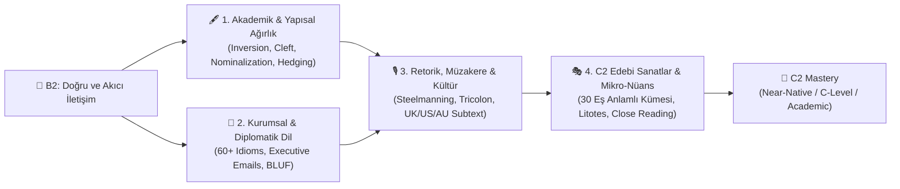

# 🐉 İleri Seviye (C1 - C2): Ustalık, Akademik Derinlik ve İkna Rehberi

[-8A2BE2?style=for-the-badge)](./README.md)

**[⬅️ Önceki Seviye: B1-B2](../02-Orta-Seviye-B1-B2/README.md) • [🏠 Ana Sayfa](../README.md) • [➡️ Sonraki Modül: Yapay Zeka Promptları](../04-Yapay-Zeka-Promptlari/README.md)**

---

> **🎯 Bu Fazın Amacı:** Sadece "anlaşılır" olmaktan çıkıp **etkileyici, ikna edici, incelikli (*nuanced*) ve entelektüel** bir İngilizceye ulaşmak; akademik makaleleri, felsefi tartışmaları, küresel yönetim kurulu toplantılarını ve üst düzey iş müzakerelerini ana dili İngilizce olan eğitimli bir profesyonel (*Near-Native / Executive*) kadar doğal yönetebilmek.

---

## 🗺️ C1-C2 Ustalık Mimarisi ve Öğrenme Akışı

---

## 🗂️ Bu Modüldeki Rehberler (C1-C2 Ustalık Kütüphanesi)

Bu klasör, C1-C2 ustalığını **5 dev sütunda** işleyen eksiksiz bir başvuru kütüphanesidir:

| # | Rehber Dosyası | Odak Noktası ve Öne Çıkan İçerik | Okuma Süresi | Seviye |
| :- | :--- | :--- | :---: | :---: |
| **1** | **[🐉 C1-C2 Ana Yol Haritası (Bu Dosya)](./README.md)** | 4 katmanlı **Register Switching**, B2 vs. C2 farkı, ince kelime nüansları (*Synonym Precision*), ileri gramer özeti ve **8 Haftalık Ustalık Programı**. | `15 dk` | `C1-C2` |
| **2** | **[🖋️ Akademik ve Profesyonel Yazım Rehberi](./Akademik-ve-Profesyonel-Yazim-Rehberi.md)** | *Inversion, Cleft Sentences, Participle Clauses, Subjunctive Mood*, **Nominalization**, **Hedging**, IMRaD makale/rapor şablonları ve **135 kelimelik "B1 ➡️ C1/C2 Akademik Dönüşüm Sözlüğü"**. | `35 dk` | `C1-C2` |
| **3** | **[🎙️ Münazara, Retorik ve Sunum Teknikleri](./Munazara-Retorik-ve-Sunum-Teknikleri.md)** | Toplantı liderliği (*Executive Presence*), 7 retorik cihaz (*Tricolon, Antithesis, Steelmanning*), Keynote/Pitch Deck kalıpları, Harvard müzakere dili ve **UK vs. US vs. AU kültürel satır arası sözlüğü**. | `30 dk` | `C1-C2` |
| **4** | **[💼 Idioms (Deyimler) ve İş İngilizcesi](./Idioms-ve-Is-Ingilizcesi.md)** | İş, finans, strateji ve entelektüel tartışmalarda kullanılan **60 modern deyim**, *Informal ➡️ Executive Formal* dönüşüm matrisi ve **6 kopyala-kullan kurumsal e-posta şablonu**. | `25 dk` | `C1` |
| **5** | **[🎭 Edebi Sanatlar, Felsefi Metinler ve Nüanslar](./Edebi-Sanatlar-Felsefi-Metinler-ve-Nuanslar.md)** | *Glance/Gaze/Stare/Glare* gibi **30 Eş Anlamlı Kelime Kümesinin mikro-nüansları**, 15 edebi sanat (*Zeugma, Chiasmus, Oxymoron*), Latince/Fransızca entelektüel terimler ve *The Economist / Aeon / New Yorker* tarzı 3 derin metin analizi. | `35 dk` | `C2` |

---

## ⚡ Hızlı Önizleme Kartları (Tıkla & Keşfet)

🔥 <b>Hızlı Önizleme 1: B1/B2 Cümlesini 3 Saniyede C2 Akademik Cümleye Dönüştürme (Tıkla)</b>

* ❌ **B1/B2 (Fiil Odaklı ve Düz):** *"Because people did not trust the banks, they took all their money out very fast."*
* ✅ **C1/C2 (Nominalization + Inversion + C1 Lexis):** ***"So severe was the erosion of public confidence in financial institutions that it precipitated an unprecedented liquidity run."***
* 👉 Bu dönüşümün tüm formülleri için: **[🖋️ Akademik ve Profesyonel Yazım Rehberi](./Akademik-ve-Profesyonel-Yazim-Rehberi.md)**

🇬🇧 <b>Hızlı Önizleme 2: Bir İngiliz Yöneticinin Söylediği vs. Aslında Kastettiği (Tıkla)</b>

* 🗣️ **İngiliz'in Söylediği:** *"With the greatest respect, that is a rather ambitious timeline."*
* 🧠 **Gerçekte Kastettiği:** *"Tamamen saçmalıyorsun, bu takvimin yetişmesi imkânsız."*
* 🗣️ **İngiliz'in Söylediği:** *"The merger is not without its complexities."* (**Litotes**)
* 🧠 **Gerçekte Kastettiği:** *"Bu birleşme tam bir mayın tarlası ve aşırı riskli."*
* 👉 Tüm tablo ve müzakere kalıpları için: **[🎙️ Münazara, Retorik ve Sunum Teknikleri](./Munazara-Retorik-ve-Sunum-Teknikleri.md)**

🔬 <b>Hızlı Önizleme 3: "Bakmak" ve "İnatçı" Kelimelerinin C2 Mikro-Nüansları (Tıkla)</b>

* 👀 **Bakmak (Look):** **Glance** (1 saniye göz atmak) • **Gaze** (hayranlıkla/dalgınca uzun bakmak) • **Glare** (öfkeyle gözünün içine dik dik bakmak) • **Peer** (karanlıkta gözünü kısarak seçmeye çalışmak).
* 🪨 **İnatçı (Stubborn):** **Tenacious / Resolute** (azimli, pes etmeyen - *Olumlu*) • **Obstinate / Mulish** (mantığa rağmen direten, katır inatlı - *Olumsuz*) • **Intransigent** (müzakerede zerre taviz vermeyen - *Resmi*).
* 👉 30 kelime kümesinin tamamı için: **[🎭 Edebi Sanatlar, Felsefi Metinler ve Nüanslar](./Edebi-Sanatlar-Felsefi-Metinler-ve-Nuanslar.md)**

---

## 📑 İçindekiler

1. [🎯 C1-C2 Hedefleri ve Yetkinlik Kontrol Listesi](#-c1-c2-hedefleri-ve-yetkinlik-kontrol-listesi)
2. [🎩 B2 ile C1/C2 Arasındaki Gerçek Fark Nedir?](#-b2-ile-c1c2-arasındaki-gerçek-fark-nedir)
3. [🎛️ Register Switching: Aynı Fikri 4 Farklı Katmanda Söylemek](#️-register-switching-aynı-fikri-4-farklı-katmanda-söylemek)
4. [🔬 C2 Kelime Hassasiyeti: Sık Karıştırılan İnce Nüanslar (Synonym Precision)](#-c2-kelime-hassasiyeti-sık-karıştırılan-ince-nüanslar-synonym-precision)
5. [🏛️ C1-C2 İleri Gramer ve Retorik Yapılar (Özet)](#️-c1-c2-ileri-gramer-ve-retorik-yapılar-özet)
6. [✍️ Akademik ve Profesyonel Söylem Belirteçleri (Discourse Markers)](#️-akademik-ve-profesyonel-söylem-belirteçleri-discourse-markers)
7. [🎓 IELTS (7.5 - 8.5+) ve TOEFL (105 - 115+) Ustalık Stratejileri](#-ielts-75---85-ve-toefl-105---115-ustalık-stratejileri)
8. [🗓️ B2'den C2'ye 8 Haftalık Ustalık Antrenman Programı](#️-b2den-c2ye-8-haftalık-ustalık-antrenman-programı)
9. [📚 C1-C2 İçin En İyi Ücretsiz Kaynaklar](#-c1-c2-için-en-iyi-ücretsiz-kaynaklar)

---

## 🎯 C1-C2 Hedefleri ve Yetkinlik Kontrol Listesi

- [ ] Ortama göre dilin resmilik tonunu (**Register**: *Casual, Neutral, Executive Formal, Academic*) saniyeler içinde değiştirebilirim.
- [ ] *Inversion*, *Cleft Sentences*, *Subjunctive Mood* ve *Participle Clauses* gibi ileri vurgu yapılarını konuşma ve yazmada doğal olarak kullanırım.
- [ ] Fiil odaklı basit cümleleri **Nominalization** (isimleştirme) ve **Hedging** (ihtiyatlı dil) ile akademik standartta yeniden kurgulayabilirim.
- [ ] *The Economist*, *Harvard Business Review*, *Aeon* veya hakemli akademik makaleleri sözlüğe neredeyse hiç bakmadan okuyup eleştirel analiz yapabilirim.
- [ ] İroni, *litotes* (çift olumsuzlama), *zeugma*, İngiliz *understatement* (azımsama) mizahı ve satır arası imaları (*reading between the lines*) anında yakalarım.
- [ ] Karmaşık bir teknik, ekonomik veya felsefi konuda 30 dakikalık doğaçlama bir sunum yapabilir ve düşmanca sorulara diplomatik yanıtlar verebilirim.

---

## 🎩 B2 ile C1/C2 Arasındaki Gerçek Fark Nedir?

B2 seviyesindeki bir kişi fikrini doğru anlatır; C1/C2 seviyesindeki bir kişi ise **aynı fikri en zarif, en kesin ve en ikna edici kelimelerle** anlatır:

| Durum | B2 Seviyesi (Doğru ama Düz) | C1 - C2 Seviyesi (Doğal, Zarif ve Güçlü) |
| :--- | :--- | :--- |
| **Fikir Belirtme** | *I think this plan has many problems.* | *It appears that this proposal overlooks several critical pitfalls.* |
| **Karşı Çıkma** | *I don't agree with you.* | *I see where you're coming from, yet the empirical data suggest otherwise.* |
| **Neden-Sonuç** | *Because of the bad economy, sales dropped.* | *Owing to the macroeconomic downturn, revenue declined sharply.* |
| **Vurgu Yapma** | *We really need to focus on security now.* | *What we must prioritize above all else is robust security.* |
| **Kesinlik Yumuşatma** | *This will solve the problem.* | *This approach is highly likely to mitigate the underlying issue.* |
| **Risk Bildirme** | *If we do this, it will be very dangerous.* | *Pursuing this trajectory is fraught with regulatory and operational perils.* |
| **Eksiklik Vurgusu** | *There is not enough research on this topic.* | *There remains a conspicuous paucity of longitudinal research on this phenomenon.* |

---

## 🎛️ Register Switching: Aynı Fikri 4 Farklı Katmanda Söylemek

Gerçek C2 ustalığı, "her yerde ağdalı kelimeler kullanmak" değildir; arkadaşınızla kahve içerken akademik konuşursanız yapay durursunuz, yönetim kurulunda sokak diliyle konuşursanız ciddiyetinizi kaybedersiniz. **Ustalık, bağlama göre doğru katmanı (Register) seçmektir:**

| Anlam / Mesaj | 1️⃣ Casual (Arkadaş Ortamı / Slack) | 2️⃣ Neutral Professional (Günlük İş) | 3️⃣ Executive / Diplomatic (Yönetim Kurulu) | 4️⃣ Academic / Legal (Makale & Hukuk) |
| :--- | :--- | :--- | :--- | :--- |
| **"Bu plan çok pahalı ve işe yaramaz."** | *This plan costs a fortune and won't work.* | *This plan exceeds our budget and may not deliver the expected results.* | *At this valuation, the unit economics don't quite pencil out for our current roadmap.* | *The proposed intervention proves fiscally prohibitive and lacks empirical efficacy.* |
| **"Daha fazla bilgiye ihtiyacımız var."** | *We need more info before we jump in.* | *We need to gather more data before making a final decision.* | *We require deeper visibility into the cohort metrics prior to committing capital.* | *Further empirical investigation is warranted prior to formulating definitive conclusions.* |
| **"Küçük bir hata yaptık ama düzelttik."** | *We messed up a bit, but it's fixed now.* | *We found a small error and have already resolved it.* | *We identified a minor discrepancy during QA and deployed an immediate hotfix.* | *An inadvertent methodological anomaly was detected and subsequently rectified.* |
| **"Bu kural artık çok eskidi."** | *This rule is totally outdated.* | *This policy is out of date and needs to be updated.* | *Our legacy compliance framework no longer reflects current market realities.* | *The statutory provision has been rendered obsolete by technological advancements.* |

---

## 🔬 C2 Kelime Hassasiyeti: Sık Karıştırılan İnce Nüanslar (Synonym Precision)

İleri seviyede en çok yapılan hata, sözlükte Türkçe karşılığı aynı görünen iki kelimenin **farklı bağlamlara** ait olduğunu gözden kaçırmaktır:

| Kelime Çifti | 1. Kelimenin Tam Nüansı | 2. Kelimenin Tam Nüansı | Doğru Kullanım Örnekleri |
| :--- | :--- | :--- | :--- |
| **Imply** vs. **Infer** | **Imply (İma etmek):** Konuşmacının/yazarın satır arasında üstü kapalı mesaj vermesi. | **Infer (Çıkarım yapmak):** Dinleyicinin/okuyucunun kanıtlardan sonuç çıkarması. | *The CFO **implied** that layoffs were coming; analysts **inferred** a 10% headcount reduction.* |
| **Disinterested** vs. **Uninterested** | **Disinterested (Tarafsız/Çıkarsız):** Olayda şahsi çıkarı olmayan, adil hakem (*impartial*). | **Uninterested (İlgisiz/Sıkılmış):** Konuya ilgi duymayan (*bored*). | *A judge must remain **disinterested**, but never **uninterested** in the trial.* |
| **Economic** vs. **Economical** | **Economic (İktisadi):** Ekonomi bilimi veya ülke/şirket maliyesiyle ilgili. | **Economical (Tasarruflu/Hesaplı):** Para veya kaynak israf etmeyen, verimli. | *The **economic** downturn forced consumers to switch to more **economical** hybrid vehicles.* |
| **Historic** vs. **Historical** | **Historic (Tarihi önemde/Çığır açan):** Tarihe geçecek kadar önemli ve unutulmaz olay. | **Historical (Tarihsel/Geçmişe ait):** Geçmişte yaşanmış her türlü veri veya olay. | *Looking at **historical** inflation data, this peace treaty is a truly **historic** milestone.* |
| **Continuous** vs. **Continual** | **Continuous (Kesintisiz):** Hiç durmadan, sıfır ara ile devam eden. | **Continual (Sürekli tekrarlayan):** Aralıklı olarak sık sık tekrar eden (genelde can sıkıcı). | *The server requires **continuous** power, yet we faced **continual** network interruptions.* |
| **Mitigate** vs. **Eradicate** | **Mitigate (Hafifletmek):** Bir riskin/zararın şiddetini azaltmak. | **Eradicate (Kökünü kazımak):** Tamamen yok etmek, sıfırlamak. | *Diversification **mitigates** market risk, whereas vaccines helped **eradicate** smallpox.* |
| **Comprise** vs. **Compose** | **Comprise (Kapsamak/Oluşmak):** Bütün parçaları kapsar (*The whole comprises the parts*). | **Compose (Oluşturmak):** Parçalar bütünü oluşturur (*Parts compose the whole*). | *The committee **comprises** ten experts.* (= *is composed of* — ❌ *is comprised of* yapısından kaçının). |

---

## 🏛️ C1-C2 İleri Gramer ve Retorik Yapılar (Özet)

> 📖 **Detaylı konu anlatımı, tüm kurallar ve alıştırmalar için:** [🖋️ Akademik ve Profesyonel Yazım Rehberi](./Akademik-ve-Profesyonel-Yazim-Rehberi.md)

Konuşmanıza ve yazılarınıza C1-C2 ağırlığı katan 5 temel yapı:

### 1. Inversion (Devrik Cümle ile Güçlü Vurgu)
Olumsuz veya kısıtlayıcı zarfları (*Never, Rarely, Seldom, Not only, Little, Only after, Under no circumstances*) cümlenin başına alıp soru cümlesi dizilimi yaparak dramatik bir vurgu oluşturulur:
* **Normal (B2):** *I have never seen such a well-designed architecture.*
* **Inversion (C1):** ***Never have I seen** such a well-designed architecture.*
* **Normal (B2):** *It not only reduces costs, but it also improves speed.*
* **Inversion (C1):** ***Not only does it** reduce costs, **but it also** improves speed.*
* **Normal (B2):** *They didn't know what was about to happen.*
* **Inversion (C2):** ***Little did they know** what was about to unfold.*

### 2. Cleft Sentences (`What... is...` / `It is... that...` Odaklama Yapıları)
Cümlenin belirli bir öğesine spot ışığı tutmak için kullanılır:
* **Normal:** *Clear communication matters most in remote teams.*
* **Wh-Cleft:** ***What matters most** in remote teams **is** clear communication.*
* **It-Cleft:** ***It was** the lack of testing **that led to** the system outage.*

### 3. Participle Clauses (Ortaç Yapılarıyla Akıcı Birleştirme)
`Because`, `After`, `When` bağlaçlarını kısaltarak daha edebi ve profesyonel cümleler kurma:
* ***Having completed** the audit, the team published the final report.* (*After they had completed...* yerine)
* ***Faced with** tight deadlines, we decided to automate the workflow.* (*Because we were faced with...* yerine)

### 4. Subjunctive Mood (Resmi Gereklilik Kipi)
Öneri ve zorunluluk bildiren `mandate, insist, recommend, imperative, paramount` kelimelerinden sonra `that + Özne + Yalın Fiil (V1 / be V3)` kullanımı:
* *It is **paramount that** every node **be synchronized** prior to deployment.*

### 5. Hedging (Akademik ve Diplomatik Yumuşatma)
Üst düzey İngilizcede `%100 kesin` konuşmak yerine kanıta dayalı ihtiyatlı bir dil (*Hedging*) kullanılır:
* *This **tends to** indicate that...* (Bu durum ... olduğunu gösterme eğilimindedir.)
* *The findings **seem to suggest** a strong correlation between...*
* *It **could plausibly be argued that**...* (... olduğu makul biçimde öne sürülebilir.)

---

## ✍️ Akademik ve Profesyonel Söylem Belirteçleri (Discourse Markers)

Üst düzey bir makale, rapor veya IELTS/TOEFL kompozisyonu yazarken kullanabileceğiniz **Söylem Belirteçleri**:

| İşlev | B1-B2 (Kaçının) | C1-C2 Profesyonel Alternatifler |
| :--- | :--- | :--- |
| **Ek Bilgi Ekleme** | *Also, Plus, And* | *Furthermore, Moreover, In addition to this, Equally important, By the same token* |
| **Zıtlık Belirtme** | *But, Anyway* | *Nevertheless, Nonetheless, Conversely, Notwithstanding, Whereas, Albeit* |
| **Sebep Gösterme** | *Because of* | *Owing to, Due to the fact that, Stemming from, In light of, On account of* |
| **Sonuç Bildirme** | *So, That's why* | *Consequently, Therefore, Thus, Hence, Accordingly, As a corollary* |
| **Örnek Verme** | *Like, For example* | *For instance, Notably, A case in point is..., To illustrate, Chief among these is* |
| **Özetleme** | *In short, Finally* | *In conclusion, To synthesize, All things considered, Ultimately, In essence* |

---

## 🎓 IELTS (7.5 - 8.5+) ve TOEFL (105 - 115+) Ustalık Stratejileri

Uluslararası dil sınavlarında en üst dilime girmek sadece İngilizce bilmek değil, **değerlendiricinin (examiner) aradığı C1-C2 kriterlerini bilinçli olarak sergilemektir**:

1. **Speaking (Konuşma):**
   * Asla *Yes/No* ile yetinmeyin. **AREA Tekniğini** kullanın: **A**nswer (Doğrudan cevap) -> **R**eason (Sebep) -> **E**xample (Somut örnek) -> **A**lternative/Conclusion (Karşıt görüş veya toparlama).
   * Ezberlenmiş kalıplar yerine doğal *Discourse Markers* (*"Well, to be perfectly candid...", "That's a multifaceted question...", "If we look at it from a macroeconomic standpoint..."*) kullanın.
   * Konuşma içinde en az bir kez **Hypothetical Inversion** (*"Were governments to subsidize..."*) ve bir kez **Cleft Sentence** (*"What strikes me most about this trend is..."*) kullanarak gramer puanınızı tavana çıkarın.
2. **Writing (Yazma):**
   * Aynı kelimeyi iki kez kullanmayın (**Lexical Resource**): *important* -> *crucial, vital, paramount, indispensable*.
   * Her paragrafta mutlaka sadece **1 ana fikir (Topic Sentence)** bulunsun ve bunu **Nominalization** ve **Hedging** ile destekleyin.

---

## 🗓️ B2'den C2'ye 8 Haftalık Ustalık Antrenman Programı

| Hafta | Odak Alanı | Günlük Somut Görev (45 Dakika) |
| :--- | :--- | :--- |
| **1-2. Hafta** | **İleri Sözdizimi ve Vurgu** | [Akademik Yazım Rehberi](./Akademik-ve-Profesyonel-Yazim-Rehberi.md) içindeki *Inversion, Cleft* ve *Participle* yapılarını çalışın. Her gün *The Economist*'ten 1 makale okuyup içindeki devrik ve ortaçlı cümlelerin altını çizin. |
| **3-4. Hafta** | **Nominalization & Akademik Sözlük** | 135 kelimelik **B1 ➡️ C2 Dönüşüm Sözlüğünü** 10'arlı gruplar halinde cümle içinde kullanarak öğrenin. Kendi yazdığınız eski e-posta veya yazıları *Nominalization* ve *Hedging* ile yeniden yazın. |
| **5-6. Hafta** | **İş İngilizcesi, Deyimler ve Retorik** | [Deyimler ve İş İngilizcesi](./Idioms-ve-Is-Ingilizcesi.md) dosyasındaki 60 deyimi ve [Münazara Rehberi](./Munazara-Retorik-ve-Sunum-Teknikleri.md) içindeki *Steelmanning, Tricolon* ve *UK/US/AU* satır arası farklarını çalışın. |
| **7-8. Hafta** | **Edebi Sanatlar, Mikro-Nüans & Derin Okuma** | [Edebi Sanatlar ve Nüanslar](./Edebi-Sanatlar-Felsefi-Metinler-ve-Nuanslar.md) dosyasındaki 30 eş anlamlı kelime kümesini ve *Close Reading* metinlerini inceleyin. *Oxford Union* münazaralarında *Shadowing* yapın. |

---

## 📚 C1-C2 İçin En İyi Ücretsiz Kaynaklar

### 📰 Üst Düzey Okuma ve Analiz Siteleri
* **[Aeon Magazine](https://aeon.co/)** (`C1-C2`): Felsefe, bilim, psikoloji ve kültür üzerine dünyanın en iyi akademisyenleri tarafından yazılan ücretsiz derinlikli makaleler.
* **[The Economist](https://www.economist.com/) & [Financial Times](https://www.ft.com/)** (`C1-C2`): Kusursuz kelime seçimi, keskin metaforlar ve üst düzey ekonomi/politika dili.
* **[Harvard Business Review (HBR)](https://hbr.org/)** (`C1-C2`): İş dünyası, liderlik ve yönetim terminolojisi için bir numaralı kaynak.
* **[MIT Technology Review](https://www.technologyreview.com/)** (`B2-C2`): Yapay zeka, yazılım ve derin teknoloji makaleleri.
* **[Manchester Academic Phrasebank](https://www.phrasebank.manchester.ac.uk/)** (`C1-C2`): Akademik makale yazanlar için dünyanın en kapsamlı ücretsiz kalıp bankası.

### 🎧 Podcastler ve Tartışma (Debate) Kanalları
* **[The Oxford Union](https://www.youtube.com/@OxfordUnion)** (`C1-C2`): Dünya liderleri, düşünürler ve akademisyenlerin yaptığı üst düzey münazaralar. İkna ve hitabet sanatı için eşsizdir.
* **[Intelligence Squared Debates](https://www.intelligencesquared.com/)** (`C1-C2`): Oxford formatında, iki karşıt görüşün kanıtlarla çarpıştığı entelektüel münazaralar.
* **[Lex Fridman Podcast](https://www.youtube.com/@lexfridman)** (`C1-C2`): Bilim insanları, mühendisler ve filozoflarla 2-3 saatlik derin sohbetler.
* **[Huberman Lab](https://www.youtube.com/@hubermanlab)** (`C1-C2`): Nörobilim ve sağlık üzerine akademik ama anlaşılır üst düzey anlatım.
* **[In Our Time (BBC Radio 4)](https://www.bbc.co.uk/programmes/b006qykl)** (`C2`): İngiliz akademisyenlerle tarih, felsefe ve bilim üzerine saf C2 düzeyinde tartışmalar.

---

### 🚀 C1-C2 Modülündeki Tüm Rehberlere Hızlı Geçiş:
1. ➡️ **[🖋️ Akademik ve Profesyonel Yazım Rehberi](./Akademik-ve-Profesyonel-Yazim-Rehberi.md)** *(135 Kelimelik B1->C2 Dönüşüm Sözlüğü, Nominalization, Hedging ve İleri Gramer)*
2. ➡️ **[🎙️ Münazara, Retorik ve Sunum Teknikleri](./Munazara-Retorik-ve-Sunum-Teknikleri.md)** *(Liderlik, Keynote Sunum, Müzakere Dili ve UK/US/AU Kültür Farkları)*
3. ➡️ **[💼 Idioms (Deyimler) ve Profesyonel İş İngilizcesi](./Idioms-ve-Is-Ingilizcesi.md)** *(60 Modern Deyim, Kurumsal Dönüşüm Matrisi ve 6 E-posta Şablonu)*
4. ➡️ **[🎭 Edebi Sanatlar, Felsefi Metinler ve Nüanslar](./Edebi-Sanatlar-Felsefi-Metinler-ve-Nuanslar.md)** *(30 Eş Anlamlı Kelime Kümesi, 15 Edebi Sanat, Latince Terimler ve C2 Okuma Analizleri)*
