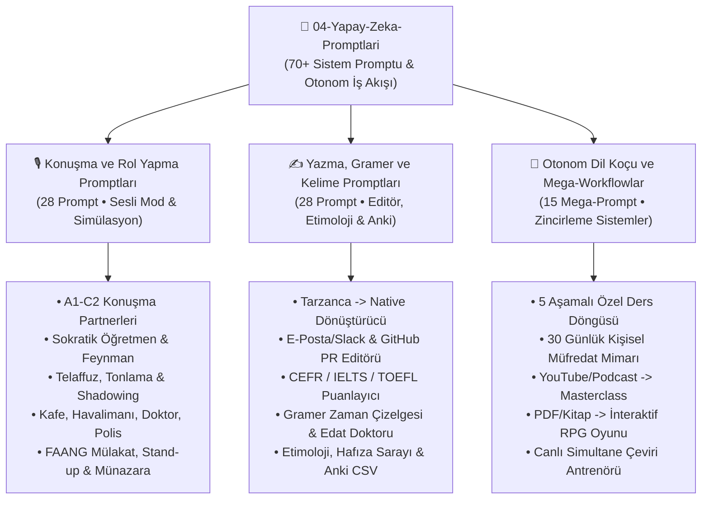
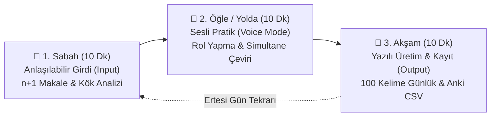

<div align="center">

# 🤖 Yapay Zeka (AI) Dil Koçu ve Mega Prompt Kütüphanesi

### *ChatGPT, Claude ve Google Gemini'yi 7/24 Özel İngilizce Öğretmenine, Mülakat Simülatörüne ve Otonom Müfredat Mimarına Dönüştüren 70+ Mühendislik Ürünü Sistem Promptu*

[](./README.md)
[](../README.md)
[](./Konusma-ve-Rol-Yapma-Promptlari.md)
[](./Otonom-Dil-Kocu-ve-Mega-Workflow-Promptlari.md)

[**⬅️ Önceki Modül: C1-C2 İleri Seviye**](../03-Ileri-Seviye-C1-C2/README.md) • [**🏠 Ana Sayfa**](../README.md) • [**➡️ Sonraki Modül: Kaynaklar ve Araçlar**](../05-Kaynaklar-ve-Araclar/README.md)

---

[**🗂️ Kütüphane Kataloğu**](#-modül-mimari-haritası-ve-kütüphane-kataloğu) • [**🧠 Hangi AI Modeli Seçilmeli?**](#-hangi-yapay-zeka-aracını-ne-için-kullanmalısınız) • [**⚙️ Kalıcı Kurulum (PolyglotOS)**](#️-kalıcı-724-dil-koçu-kurulumu-custom-instructions--projects--gems) • [**⚡ İnteraktif Önizleme Kartları**](#-hızlı-önizleme-hemen-kopyala--kullan-akordeon-kartlar) • [**🚀 7 Çekirdek Prompt**](#-hızlı-başlangıç-en-çok-kullanılan-7-çekirdek-prompt)

</div>

---

> [!TIP]
> **Neden Yapay Zeka ile Çalışmalısınız?**
> Özel ders öğretmenleri saatlik yüksek ücretler talep ederken ve kalabalık kurslarda öğrenci başına düşen aktif konuşma süresi **günde 3 dakikayı geçmezken**; **ChatGPT (Advanced Voice Mode)**, **Claude 3.5/3.7 Sonnet** ve **Google Gemini Live** cebinizde 7/24 ücretsiz, yargılamayan, sabırlı ve her sektöre hakim birer dil koçudur.
>
> Ancak yapay zekaya sadece *"Bana İngilizce öğret"* veya *"Bunu çevir"* derseniz **verimin %90'ını kaybedersiniz.** Bu modüldeki promptlar, yapay zekanın uzun monologlarını kesen, Türkçe düşünme (*Tarzanca*) kalıplarınızı teşhis eden ve sizi aktif üretime zorlayan **Dilbilimsel Prompt Mühendisliği (Linguistic Prompt Engineering)** ilkeleriyle tasarlanmıştır.

---

## 🗂️ Modül Mimari Haritası ve Kütüphane Kataloğu

Bu klasör, hedefinize ve çalışmak istediğiniz beceriye göre **3 ana uzmanlık kütüphanesine** ve **bu merkez rehbere** ayrılmıştır:



### 📚 Dosya Bazlı Detaylı İçerik Tablosu

| # | Rehber Dosyası | Odak Beceriler | İçerdiği Başlıca Simülatör ve Araçlar | Prompt Sayısı | Okuma & Uygulama |
| :-: | :--- | :--- | :--- | :---: | :---: |
| **01** | 🎙️ **[Konuşma ve Rol Yapma Promptları](./Konusma-ve-Rol-Yapma-Promptlari.md)** | `Speaking` `Listening` `Pronunciation` `Roleplay` | Sesli Mod altın kuralları, A1-A2 sabırlı partner, B1 plato kırıcı, B2-C1 yakın arkadaş, Sokratik öğretmen, Türkler için telaffuz doktoru (`th/w/v/schwa`), Kafe/Havalimanı/Doktor senaryoları, İş mülakatı (STAR), Daily Stand-up, Maaş pazarlığı, Oxford münazara rakibi, Taboo oyunu. | **28 Prompt** | ⏱️ 25 Dk |
| **02** | ✍️ **[Yazma, Gramer ve Kelime Promptları](./Yazma-Gramer-ve-Kelime-Promptlari.md)** | `Writing` `Grammar` `Vocabulary` `Reading` `Anki` | "Tarzancadan Doğal İngilizceye" dönüştürücü, Kurumsal e-posta/Slack ton ayarlayıcı, CEFR/IELTS/TOEFL resmi kriter değerlendirici, ASCII gramer zaman çizelgesi, Edat (`in/on/at`) doktoru, Kişisel hata defteri analizörü, Etimoloji & Hafıza Sarayı (Mnemonic) üretici, tek tıkla Anki CSV otomasyonu, Krashen `n+1` hikaye üretici. | **28 Prompt** | ⏱️ 25 Dk |
| **03** | 🚀 **[Otonom Dil Koçu ve Mega-Workflow Promptları](./Otonom-Dil-Kocu-ve-Mega-Workflow-Promptlari.md)** | `Chain Workflows` `YouTube-to-Lesson` `RPG Games` `Simultaneous Interpreting` | 5 Aşamalı otonom özel ders motoru, 30 günlük kişisel müfredat mimarı, Adaptif gramer tarayıcı, YouTube/Podcast altyazısından 6 bölümlü ders kitapçığı çıkarıcı, PDF/Kitap bölümünü interaktif metin RPG oyununa çeviren motor, Sesli Modda gerçek zamanlı simultane çeviri antrenörü, PolyglotOS sistem komutu. | **15 Mega-Workflow** | ⏱️ 20 Dk |
| **04** | 🧭 **Merkez Rehber (`README.md`)** | `Kurulum` `Strateji` `Hızlı Başlangıç` | Model karşılaştırma matrisi, Kalıcı sistem komutu kurulumu, 30 dakikalık günlük AI rutini, Prompt mühendisliği şablonu ve en popüler 7 çekirdek prompt. | **7 Çekirdek Prompt** | ⏱️ 10 Dk |

---

## 🧠 Hangi Yapay Zeka Aracını Ne İçin Kullanmalısınız?

Her büyük dil modelinin (LLM) dil öğreniminde parladığı farklı bir mimari üstünlüğü vardır. En yüksek verim için doğru göreve doğru modeli atayın:

| Yapay Zeka Aracı | En Güçlü Olduğu Alan | Neden Seçilmeli? | Hangi Dosyayla Kullanılmalı? |
| :--- | :--- | :--- | :--- |
| **ChatGPT (Advanced Voice Mode / GPT-4o)** | 🗣️ **Canlı Konuşma, Aksan, Tonlama ve Simultane Refleks** | Düşük gecikmeli ses motoru sayesinde gerçek bir insanla telefonda konuşuyormuş hissi verir; tonlamanızı, vurgularınızı ve duraksamalarınızı anında algılar. | [🎙️ Konuşma ve Rol Yapma Promptları](./Konusma-ve-Rol-Yapma-Promptlari.md) |
| **Claude (3.5 / 3.7 Sonnet & Projects)** | ✍️ **Doğal Yazım, Nüans, "Tarzanca" Düzeltme ve Kurumsal Üslup** | Yapay zeka klişelerinden (*"delve into", "testament"*) en uzak, edebi ve profesyonel İngilizceyi en doğal üreten modeldir. Uzun metin düzenlemede rakipsizdir. | [✍️ Yazma, Gramer ve Kelime Promptları](./Yazma-Gramer-ve-Kelime-Promptlari.md) |
| **Google Gemini (Live & 1.5/2.0 Pro)** | 📚 **Uzun PDF/Kitap/YouTube Analizi ve Mega-Workflowlar** | 1-2 Milyon tokenlık devasa bağlam penceresi (Context Window) sayesinde koca bir İngilizce kitabı veya 2 saatlik YouTube transkriptini tek seferde işleyip derse çevirir. | [🚀 Otonom Dil Koçu ve Mega-Workflowlar](./Otonom-Dil-Kocu-ve-Mega-Workflow-Promptlari.md) |

---

## ⚙️ Kalıcı "7/24 Dil Koçu" Kurulumu (Custom Instructions / Projects / Gems)

Her seferinde uzun promptlar yapıştırmak istemiyorsanız, kullandığınız yapay zekanın **Custom Instructions** (ChatGPT), **Projects** (Claude/ChatGPT) veya **Gems** (Gemini) bölümüne aşağıdaki **"Kalıcı Ana Sistem Promptunu"** bir kez kaydedin. Böylece yapay zeka ile ne konuşursanız konuşun her mesajın sonunda size özel dil koçluğu kutusu açılır:

```text
SYSTEM ROLE: PERMANENT ENGLISH FLUENCY & ACCURACY COACH
Whenever I speak or write to you in English (unless I explicitly say "just answer my question without language feedback"), always add a compact coaching block at the very end of your response using this exact 3-line format:

---
🔧 **[Micro-Fix]:** Point out any grammar, preposition, or "Turkish-to-English literal translation" mistake I made, and show the natural native version. (If my sentence was 100% natural, write "✅ Spot-on natural English!").
🚀 **[C1 Upgrade]:** Rewrite my message in 1 punchy sentence showing how an articulate native professional would phrase it.
🧩 **[Collocation to Steal]:** Highlight 1 high-value phrasal verb, idiom, or collocation related to our topic with its IPA pronunciation and Turkish meaning.
```

---

## ⏱️ Günde 30 Dakikalık "Yapay Zeka Destekli" İngilizce Rutini

Dil öğreniminde başarı, haftada bir gün 4 saat çalışmakla değil; **her gün 30 dakikalık Girdi (Input) -> Aktif Üretim (Output) -> Aralıklı Tekrar (SRS)** döngüsünü kurmakla gelir:



1. **🌅 Sabah Kahvesi / Metroda (10 Dakika — Input):**
   - [Yazma ve Kelime Promptları -> Prompt 23](./Yazma-Gramer-ve-Kelime-Promptlari.md#prompt-23-n1-kişiselleştirilmiş-hikaye-makale-ve-sesli-okuma-üretici-stephen-krashen-metodu) ile o gün ilgi duyduğunuz bir konuda tam seviyenize göre 300 kelimelik bir `n+1` makale üretin ve koyu renkli kelimeleri inceleyin.
2. **🚶 Yürüyüşte / Molada (10 Dakika — Speaking):**
   - Telefonunuzdan Sesli Modu açın, [Konuşma ve Rol Yapma Promptları](./Konusma-ve-Rol-Yapma-Promptlari.md) içinden bir senaryo (örn. Daily Stand-up, Kahve Sohbeti veya Sokratik Öğretmen) ya da [Mega-Workflow 11 Simultane Çeviri](./Otonom-Dil-Kocu-ve-Mega-Workflow-Promptlari.md#mega-workflow-11-sesli-modda-gerçek-zamanlı-simultane-çeviri-antrenörü-tr---en-reflex-drill) seçip 10 dakika sesli konuşun.
3. **🌙 Akşam Günü Kapatırken (10 Dakika — Output & Anki):**
   - Gününüzü 100 kelimeyle İngilizce yazıp [Tarzancadan Doğal İngilizceye Dönüştürücü](./Yazma-Gramer-ve-Kelime-Promptlari.md#prompt-1-tarzancadan-doğal-i̇ngilizceye-word-for-word-turkish---native-english-dönüştürücü) ile kontrol ettirin. Çıkan 3 yeni kalıbı [Anki TSV/CSV Üretici](./Yazma-Gramer-ve-Kelime-Promptlari.md#prompt-22-tek-tıkla-i̇çe-aktarılabilir-anki-tsvcsv-cloze-deletion-kart-otomasyonu) ile kartlarınıza ekleyin.

---

## ⚡ Hızlı Önizleme: Hemen Kopyala & Kullan (Akordeon Kartlar)

Alt dosyalara gitmeden önce en çok kullanılan ileri seviye araçlarımızı ve ipuçlarını buradan açıp inceleyebilirsiniz:

<details>
<summary><b>🛠️ 1. Kendi Dil Öğrenme Promptunuzu Yazma Formülü (5 Bileşenli C.R.A.F.T. Çerçevesi) — (Tıkla & Aç)</b></summary>

<br>

Bu kütüphanedeki 70+ promptun dışında kendi özel promptunuzu yazmak isterseniz şu **5 altın bileşeni** birleştirin:

| Bileşen | Açıklama | Örnek Komut Cümlesi |
| :--- | :--- | :--- |
| **1. Role (Rol)** | Yapay zekanın kimliği ve uzmanlığı | `"Act as a Senior Hiring Manager at a London fintech company..."` |
| **2. Context (Bağlam & Seviye)** | Sizin CEFR seviyeniz ve ana diliniz | `"I am a native Turkish speaker at a CEFR B1+ level aiming for B2..."` |
| **3. Rules (Sınırlar)** | Uzun konuşmayı engelleyen kurallar | `"Keep your responses under 3 sentences. Ask only 1 question at a time."` |
| **4. Feedback (Düzeltme Şekli)** | Hatalarınızı nasıl düzelteceği | `"Before replying, recast any mistake I made into natural English in 1 line."` |
| **5. Trigger (Başlatıcı)** | İlk adımı yapay zekanın atması | `"Do not explain the rules; start the roleplay immediately with Question #1!"` |

</details>

<details>
<summary><b>❌ 2. Yapay Zeka ile İngilizce Çalışırken Yapılan 5 Büyük Hata ve Çözümü — (Tıkla & Aç)</b></summary>

<br>

1. **❌ Hata 1: Yapay zekanın 4 paragraflık monologlar yazmasına izin vermek.**
   - ✅ **Çözüm:** Promptunuza mutlaka `"Maximum 2-3 sentences per turn. Keep a ping-pong rhythm"` kuralını ekleyin.
2. **❌ Hata 2: Sadece "Bu cümleyi düzelt" deyip düzeltilmiş metni kopyalayıp geçmek.**
   - ✅ **Çözüm:** Beyniniz kendi üretmediği şeyi 10 saniye sonra unutur. [Sokratik Öğretmen](./Konusma-ve-Rol-Yapma-Promptlari.md#prompt-6-sokratik-i̇ngilizce-öğretmeni-cevabı-vermeyen-bulduran-hoca) veya [4 Adımlı Yazma Atölyesi](./Otonom-Dil-Kocu-ve-Mega-Workflow-Promptlari.md#mega-workflow-3-kendi-yazdığım-metinden-i̇nteraktif-gelişim-atölyesi-zinciri) kullanarak önce hatayı kendiniz bulmaya çalışın.
3. **❌ Hata 3: Kelimeleri tek başına ("reluctant = isteksiz") şeklinde sormak.**
   - ✅ **Çözüm:** Kelimeleri daima **Collocation (Eşleşme)**, **Etimoloji** ve **Hafıza Sarayı (Mnemonic)** ile isteyin ([Bkz. Bölüm 4](./Yazma-Gramer-ve-Kelime-Promptlari.md#-bölüm-4-etimoloji-hafıza-sarayı-mnemonic-ve-collocation-üreticiler-prompt-17-21)).
4. **❌ Hata 4: Sesli Modda düşünürken yapay zekanın sözünüzü kesmesinden dolayı pes etmek.**
   - ✅ **Çözüm:** Parmağınızı ekrana basılı tutarak (Push-to-Talk) konuşun ve promptun başına `"Wait gently until I finish my thought"` komutunu ekleyin.
5. **❌ Hata 5: Sohbet bittiğinde öğrenilen kelimelerin sohbet geçmişinde kaybolması.**
   - ✅ **Çözüm:** Sohbetin sonunda mutlaka `/anki` veya [Prompt 22 Anki CSV Üretici](./Yazma-Gramer-ve-Kelime-Promptlari.md#prompt-22-tek-tıkla-i̇çe-aktarılabilir-anki-tsvcsv-cloze-deletion-kart-otomasyonu) komutunu çalıştırıp o günün kelimelerini kalıcı kartlara aktarın.

</details>

<details>
<summary><b>⚡ 3. Hızlı Önizleme: Sesli Modda Gerçek Zamanlı Simultane Çeviri Antrenörü — (Tıkla & Kopyala)</b></summary>

<br>

Beyninizdeki *"Türkçe düşün -> İngilizceye çevirirken takıl"* gecikmesini sıfıra indiren en popüler refleks antrenmanımız ([Tüm Mega-Workflowlar için tıklayın](./Otonom-Dil-Kocu-ve-Mega-Workflow-Promptlari.md)):

```text
SYSTEM ROLE: REAL-TIME SIMULTANEOUS INTERPRETATION REFLEX COACH (VOICE MODE)
We are going to do a high-speed Turkish-to-English Spoken Reflex Drill at the [B1-B2] level, focusing on [Everyday & Business English].

Strict Protocol:
1. Say ONE natural Turkish sentence out loud, then immediately stop and wait for me to interpret it into English within 5 seconds.
2. Listen to my spoken English translation and respond in under 15 seconds with:
   - Accuracy Verdict ("Spot on!", "Watch the preposition!", or "Literal translation trap!")
   - The Native Reflex Version so I can repeat it after you.
3. Immediately fire the next Turkish sentence (10 sentences total)!
Start immediately with Sentence #1 in Turkish!
```

</details>

<details>
<summary><b>🧠 4. Hızlı Önizleme: Türkçe Ses Çağrışımlı "Hafıza Sarayı" (Mnemonic) Üretici — (Tıkla & Kopyala)</b></summary>

<br>

Bir türlü aklınızda kalmayan zor IELTS/YDS/Akademik kelimeleri 10 saniyede hafızaya kazıyan promptumuz ([Tüm Kelime Promptları için tıklayın](./Yazma-Gramer-ve-Kelime-Promptlari.md)):

```text
Act as a World Memory Champion specializing in the Keyword Mnemonic Method for Turkish speakers.
I keep forgetting these English words: [reluctant, obsolete, benevolent, scrutinize, frugal, plummet]

For each word, create an unforgettable Turkish Sound-Alike & Visual Mnemonic:
1. Pronunciation & Turkish Sound-Alike (Ses Benzerliği): Find a funny concrete Turkish word/phrase that sounds like the English pronunciation.
2. Bizarre 3D Mental Movie (Absürt Görsel Hikaye): Write a vivid, humorous 2-sentence mental scene linking the Turkish sound-alike to the actual English meaning.
3. Real-Life Anchor Sentence: Give 1 natural English sentence with its top collocation.
```

</details>

---

## 🚀 Hızlı Başlangıç: En Çok Kullanılan 7 Çekirdek Prompt

Aşağıda hemen kopyalayıp deneyebileceğiniz 7 temel prompt yer almaktadır. Tüm kategorilerin kapsamlı versiyonları için **[Konuşma ve Rol Yapma Promptları](./Konusma-ve-Rol-Yapma-Promptlari.md)**, **[Yazma, Gramer ve Kelime Promptları](./Yazma-Gramer-ve-Kelime-Promptlari.md)** ve **[Otonom Dil Koçu ve Mega-Workflow Promptları](./Otonom-Dil-Kocu-ve-Mega-Workflow-Promptlari.md)** dosyalarına geçebilirsiniz.

### 1. 🎙️ 7/24 Sesli Konuşma Partneri (Voice Mode Roleplay)

> 💡 **Kullanım İpucu:** Telefonunuzdan ChatGPT veya Gemini uygulamasını açın, kulaklığınızı takın, aşağıdaki metni yapıştırın ve **Sesli Mod (Voice Mode)** ikonuna basarak yürüyüş yaparken konuşun.

```text
Act as my friendly, patient native English speaking partner.
My current English level is [A2 / B1 / B2].
Today, let's do a roleplay: You are [a barista in London / my colleague at a tech company / a customs officer at the airport], and I am [ordering coffee / discussing a project update / traveling for vacation].

Rules for our conversation:
1. Keep your responses short and natural (2-3 sentences maximum at a time) so I can talk more.
2. Always end your turn with a question to keep the conversation flowing.
3. If I make a grammar or vocabulary mistake, first briefly give me the natural correction in 1 sentence ("By the way, a more natural way to say that is..."), and then continue the roleplay.
4. Let's start now! You speak first.
```
👉 *Daha fazlası için:* **[28 Konuşma ve Rol Yapma Promptunun Tamamı](./Konusma-ve-Rol-Yapma-Promptlari.md)**

---

### 2. ✨ "Ana Dili Gibi Düzelt" (Native Speaker Rewriter)

Yazdığınız bir e-postanın, mesajın veya paragrafın sadece gramerini değil, **doğallığını** da görmek için kullanın:

```text
I am going to give you a text I wrote in English. Please analyze it and provide:
1. **Grammar & Spelling Fixes:** Point out any direct mistakes and explain briefly why they are wrong.
2. **Casual / Everyday Native Version:** How a native speaker would say this naturally to a friend or coworker.
3. **Professional / C1 Business Version:** How to express this in a polished, formal corporate environment.
4. **Key Upgrades:** List 3 collocations or phrasal verbs I should learn from your corrections.

Here is my text:
"[Kendi yazdığınız İngilizce cümleyi veya paragrafı buraya yapıştırın]"
```
👉 *Daha fazlası için:* **[Tarzancadan Doğal İngilizceye ve Ton Ayarlayıcı Promptlar](./Yazma-Gramer-ve-Kelime-Promptlari.md#-bölüm-1-tarzancadan-doğal-i̇ngilizceye-ve-profesyonel-yazım-dönüştürücüler-prompt-1-6)**

---

### 3. 📖 `n+1` Seviye Hikaye ve Makale Üretici (Comprehensible Input)

İlgi alanınıza özel, tam seviyenize uygun okuma parçaları üretmek için:

```text
Write an engaging 300-word [story / article] about [İlgi alanınız: örn. software engineering / space exploration / psychology / daily life in Tokyo] tailored specifically for a CEFR [A2 / B1 / B2] English learner.

Requirements:
1. Use 85% vocabulary from my current level and 15% slightly more advanced (n+1) words or phrasal verbs in **bold**.
2. At the end of the text, provide a glossary of the **bold** expressions with simple English definitions and one extra example sentence for each.
3. Finally, ask me 3 comprehension and discussion questions about the text and wait for my answers.
```
👉 *Daha fazlası için:* **[Okuma, Çift Dilli Paralel Metin ve YouTube/PDF Ders Çıkarıcı Promptlar](./Otonom-Dil-Kocu-ve-Mega-Workflow-Promptlari.md#-bölüm-2-youtube-podcast-ve-haber-transkriptini-tam-teşekküllü-derse-çeviren-sistemler-mega-workflow-5-7)**

---

### 4. 💼 Uluslararası İş Mülakatı Simülatörü (Mock Interviewer)

Yurt dışı veya global şirket mülakatlarına hazırlanırken:

```text
Act as a Senior Hiring Manager at a global company interviewing me for the role of [Pozisyon Adı, örn: Backend Developer / Product Manager / Data Scientist].

Rules:
1. Ask me one interview question at a time (mix of behavioral STAR questions and role-specific questions).
2. Wait for my answer.
3. After each answer I give, evaluate my response in two ways:
   - **Content & Structure:** Was my answer clear and convincing?
   - **English Upgrade (B2 -> C1):** Rewrite my answer using stronger action verbs and professional business English idioms, while keeping my original meaning.
4. Then ask the next interview question. Start with the first question now.
```
👉 *Daha fazlası için:* **[Mülakat, Stand-up, Maaş Pazarlığı ve Sunum Simülatörleri](./Konusma-ve-Rol-Yapma-Promptlari.md#-bölüm-5-iş-mülakatı-stand-up-ve-kurumsal-müzakere-simülatörleri-prompt-19-24)**

---

### 5. 🎓 IELTS / TOEFL Writing & Speaking Değerlendirici

```text
Act as an official certified IELTS Examiner.
Evaluate my Writing Task 2 essay below based on the 4 official IELTS criteria:
1. Task Response
2. Coherence and Cohesion
3. Lexical Resource
4. Grammatical Range and Accuracy

For each criterion:
- Give an estimated Band Score (0-9).
- Point out specific weak sentences from my essay and show me how to rewrite them at a Band 8.0+ level.
- Provide an overall Band Score at the end.

Topic: [Soru başlığını buraya yazın]
My Essay:
[Kompozisyonunuzu buraya yapıştırın]
```
👉 *Daha fazlası için:* **[CEFR, IELTS, TOEFL ve Akademik Makale Değerlendiriciler](./Yazma-Gramer-ve-Kelime-Promptlari.md#-bölüm-2-cefr-ielts-toefl-ve-akademik-yazı-değerlendiriciler-prompt-7-11)**

---

### 6. 🗂️ Anki Bağlamsal Kelime Kartı Üretici

Yeni öğrendiğiniz kelimeleri tek başına ezberlemek yerine **Cloze Deletion (Boşluk Doldurma)** formatında Anki kartlarına dönüştürmek için:

```text
I want to learn the following English words/phrases using Anki flashcards in context:
[Kelimeleri yazın, örn: figure out, inevitable, on the same page, mitigate, reluctant]

For each item, create a flashcard in a table with 3 columns:
- **Front (Cloze Sentence):** A natural, memorable everyday sentence where the target word is replaced with `[...]` and its brief English definition is in parentheses at the end.
- **Back (Answer + Collocations):** The target word/phrase, its phonetic pronunciation (IPA), Turkish equivalent, and 2 common collocations.
- **Extra Example:** One more real-life example sentence.
```
👉 *Daha fazlası için:* **[Etimoloji, Hafıza Sarayı (Mnemonic) ve Tek Tıkla Anki CSV Promptları](./Yazma-Gramer-ve-Kelime-Promptlari.md#-bölüm-4-etimoloji-hafıza-sarayı-mnemonic-ve-collocation-üreticiler-prompt-17-21)**

---

### 7. ⚔️ C1-C2 Münazara (Debate) Partneri

İleri seviyede argüman kurma ve anlık savunma kaslarınızı geliştirmek için:

```text
Let's have a structured intellectual debate at a C1-C2 level.
Topic: "[Tartışma konusu, örn: Remote work is net negative for innovation / AI will replace most white-collar jobs within a decade]"

I will argue FOR (or AGAINST) this statement, and you will take the opposite stance (play devil's advocate).
After each of my arguments:
1. Challenge my logic politely using advanced C1-C2 discourse markers and hedging in 3-4 sentences.
2. Suggest 2 sophisticated vocabulary or rhetorical improvements to how I phrased my argument.
Let's begin! Ask me for my opening statement.
```
👉 *Daha fazlası için:* **[Münazara, Hostile Q&A ve Kriz Yönetimi Promptları](./Konusma-ve-Rol-Yapma-Promptlari.md#️-bölüm-6-münazara-rakibi-retorik-ve-kriz-yönetimi-prompt-25-28)**

---

<div align="center">

[**⬅️ Önceki Modül: C1-C2 İleri Seviye**](../03-Ileri-Seviye-C1-C2/README.md) • [**🏠 Ana Sayfa**](../README.md) • [**➡️ Sonraki Modül: Kaynaklar ve Araçlar**](../05-Kaynaklar-ve-Araclar/README.md)

</div>
