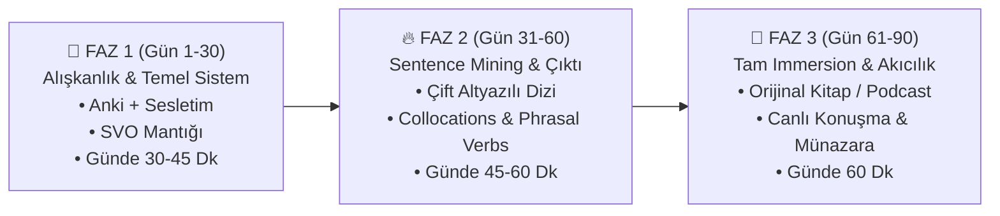
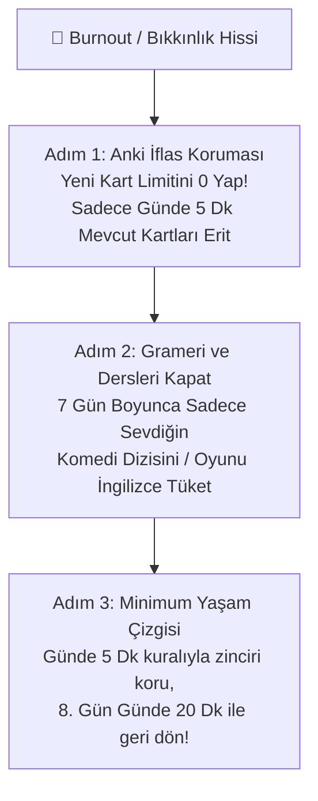

# 🗓️🔥 90 Günlük Sıfırdan Akıcılığa Çalışma Takvimi (Bootcamp), Odak Yönetimi ve Konuşma Kulüpleri Rehberi

[⬅️ Anki ve Araçlar Kurulum Kılavuzu](./Anki-ve-Araclar-Kurulum-Kilavuzu.md) | [🧰 Kaynaklar Ana Sayfası](./README.md) | [🏠 Ana Sayfa](../README.md)

> **Bu Rehberin Amacı:** *"Nereden başlayacağımı bilmiyorum, 3 gün çalışıp 2 hafta bırakıyorum"* döngüsünü tamamen kırmak. Bu kılavuzda; gün gün işaretleyebileceğiniz (`[ ]`) **90 Günlük Sprint & Bootcamp Takvimini**, beyninizi yormadan çalışmanızı sağlayacak **Pomodoro & Dopamin Yönetimini**, **Dil Öğrenme Tükenmişliği (Burnout) Kurtarma Protokolünü** ve tek kuruş harcamadan gerçek insanlarla konuşabileceğiniz **Discord / Tandem / HelloTalk / Free4Talk Güvenli Kullanım Kılavuzunu** bulacaksınız.

---

## 📑 İçindekiler

1. [🧭 90 Günlük Bootcamp Mimarisi (3 Fazlı İlerleme Planı)](#-90-günlük-bootcamp-mimarisi-3-fazlı-ilerleme-planı)
2. [📅 FAZ 1: Gün 1 – 30 | Temel İnşası, Kulak Açma ve Alışkanlık Kilitleme](#-faz-1-gün-1--30--temel-inşası-kulak-açma-ve-alışkanlık-kilitleme)
3. [🚀 FAZ 2: Gün 31 – 60 | Cümle Madenciliği, Doğal Kalıplar ve Aktif Üretim](#-faz-2-gün-31--60--cümle-madenciliği-doğal-kalıplar-ve-aktif-üretim)
4. [👑 FAZ 3: Gün 61 – 90 | Tam Immersion, Akıcı Konuşma ve Plato Yıkımı](#-faz-3-gün-61--90--tam-immersion-akıcı-konuşma-ve-plato-yıkımı)
5. [⏱️ Dil Öğreniminde Pomodoro, Dopamin Yönetimi ve Nöro-Verimlilik](#️-dil-öğreniminde-pomodoro-dopamin-yönetimi-ve-nöro-verimlilik)
6. [🧯 Dil Öğrenme Tükenmişliği (Burnout) Önleme ve Kurtarma Rehberi](#-dil-öğrenme-tükenmişliği-burnout-önleme-ve-kurtarma-rehberi)
7. [🌍 Ücretsiz Konuşma Kulüpleri ve Discord / Tandem / HelloTalk Güvenli Kullanım Kılavuzu](#-ücretsiz-konuşma-kulüpleri-ve-discord--tandem--hellotalk-güvenli-kullanım-kılavuzu)

---

## 🧭 90 Günlük Bootcamp Mimarisi (3 Fazlı İlerleme Planı)

90 gün (12 hafta + 6 gün değerlendirme), insan beyninin yeni bir nöral yolu kalıcı alışkanlığa dönüştürmesi ve dilde **en az 1 tam CEFR alt seviyesi (Örn: A1→A2 veya B1→B2)** sıçrama yapması için en ideal süredir.



### 📌 Takvimi Kullanma Kuralları
1. **Bu dosyayı kendi bilgisayarınıza veya Notion/Obsidian'a kopyalayın** ve bitirdiğiniz her günün kutucuğunu `[x]` olarak işaretleyin.
2. **İki Gün Üst Üste Boş Bırakmama Kuralı (Never Miss Twice):** Çok yoğun bir günde 45 dakikalık görevi yapamıyorsanız bile **5 dakika Anki bakıp** o günün kutusunu işaretleyin.
3. **Seviye Uyarlaması:** Görevler modülerdir; A1-A2 iseniz `01-Temel-Seviye` materyalleriyle, B1-B2 iseniz `02-Orta-Seviye` materyalleriyle aynı günlük görevi uygulayın.

---

## 📅 FAZ 1: Gün 1 – 30 | Temel İnşası, Kulak Açma ve Alışkanlık Kilitleme

> **Faz 1 Hedefi:** Çalışma sistemini kurmak, Türklerin en sık yaptığı telaffuz ve cümle kurulum (SVO) hatalarını temizlemek ve ilk **250 bağlamsal cümle kartını** Anki'ye kodlamak.

### 🗓️ 1. Hafta: Sistem Kurulumu, Sesletim ve Cümle İskeleti (Gün 1 – 7)
- [ ] **Gün 1:** [Seviye Tespit Sınavını](../08-Pratik-Alistirmalar-ve-Seviye-Testleri/Kapsamli-Seviye-Tespit-Sinavi-A1-C2.md) çöz, başlangıç puanını kaydet. [Anki kurulumunu ve FSRS ayarlarını](./Anki-ve-Araclar-Kurulum-Kilavuzu.md) tamamla.
- [ ] **Gün 2:** Tarayıcıya **Language Reactor** ve **Readlang** eklentilerini kur. İlk 10 Cloze cümle kartını Anki'ye ekle.
- [ ] **Gün 3:** Türkçe (SOV) vs İngilizce (SVO) cümle mantığını çalış ([Temel Gramer Mantığı](../01-Temel-Seviye-A1-A2/Temel-Gramer-Mantigi-ve-Zamanlar.md)). Anki tekrarını yap + 10 sesli SVO cümlesi kur.
- [ ] **Gün 4:** [Temel Telaffuz Rehberinden](../01-Temel-Seviye-A1-A2/Temel-Telaffuz-ve-Sesletim-Rehberi.md) **`th` (`/θ/` ve `/ð/`)** ile **`w` vs `v`** seslerini çalış; YouGlish'te 15 kelime dinleyip tekrar et.
- [ ] **Gün 5:** İngilizcenin en önemli sesi olan **Schwa (`/ə/`)** ve **Silent Letters (Okunmayan Harfler)** tablosunu sesli çalış + 15 dk Graded Reader oku.
- [ ] **Gün 6:** *Extra English* (A1-A2) veya *Friends* (B1+) 1. bölümünü Language Reactor ile izle; sadece **5 günlük kalıp** seçip Anki'ye ekle.
- [ ] **Gün 7 (Haftalık Tekrar & Dinlenme):** Yeni kelime ekleme! Haftanın tüm Anki tekrarlarını sıfırla, ses kaydediciyi açıp **"Kendimi ve neden İngilizce öğrendiğimi anlatıyorum"** konulu **1 dakikalık ilk ses kaydını** al (90. günde karşılaştırmak için sakla!).

### 🗓️ 2. Hafta: Günlük Rutinler, Zaman Mantığı ve İlk Dinleme Döngüsü (Gün 8 – 14)
- [ ] **Gün 8:** Anki (10 dk) + *Present Simple vs Present Continuous* mantığını çalış + sabahtan akşama kendi gününü anlatan 10 cümle yaz.
- [ ] **Gün 9:** Anki (10 dk) + *VOA Learning English* veya *BBC 6 Minute English* 1 bölümünü **3 Tur Tekniğiyle** (1. Kör dinleme, 2. Transkript analizi, 3. Gölgeleme) bitir.
- [ ] **Gün 10:** Anki (10 dk) + [Günlük Hayat Senaryolarından](../01-Temel-Seviye-A1-A2/Gunluk-Hayat-Senaryolari-ve-Diyaloglar.md) **Kafe, Restoran ve Market** diyaloglarını sesli canlandır.
- [ ] **Gün 11:** Anki (10 dk) + [Yapay Zeka Konuşma Promptlarından](../04-Yapay-Zeka-Promptlari/Konusma-ve-Rol-Yapma-Promptlari.md) "Kafe Siparişi / Small Talk" promptunu kopyalayıp AI ile 10 dakika sesli rol yap.
- [ ] **Gün 12:** Anki (10 dk) + *Past Simple* ve en sık kullanılan düzensiz fiilleri hikaye içinde çalış; dün yaptığın 5 şeyi sesli anlat.
- [ ] **Gün 13:** Anki (10 dk) + *News in Levels* veya *Engoo Daily News* üzerinden seviyene uygun 2 güncel haberi sesli oku ve özetle.
- [ ] **Gün 14 (Haftalık Tekrar):** Anki tekrarlarını sıfırla + [Hata Defterine (Error Log)](./Anki-ve-Araclar-Kurulum-Kilavuzu.md#şablon-2-notion--obsidian-hata-ve-düzeltme-veritabanı-error-log-table) bu hafta yaptığın 5 hatayı kaydet.

### 🗓️ 3. Hafta: Edatlar, Seyahat Senaryoları ve Graded Reader Okuması (Gün 15 – 21)
- [ ] **Gün 15:** Anki (10 dk) + `in / on / at` zaman ve mekan edatlarının mantığını çalış + seviyene uygun bir **Graded Reader** kitaba başla (1. Bölüm).
- [ ] **Gün 16:** Anki (10 dk) + Graded Reader 2. Bölüm (sesli kitabıyla birlikte takip ederek) + 5 yeni cümle madenciliği.
- [ ] **Gün 17:** Anki (10 dk) + **Havalimanı, Pasaport Kontrolü ve Otel** senaryolarını çalış + AI ile 10 dk "Havalimanı Görevlisi" rol yapma pratiği.
- [ ] **Gün 18:** Anki (10 dk) + *Future (will vs going to)* ve *Modal Verbs (can, could, should, must)* yapılarını çalış; gelecek yıl planlarını anlatan 8 cümle yaz.
- [ ] **Gün 19:** Anki (10 dk) + Graded Reader 3. ve 4. Bölümleri bitir + **PlayPhrase.me** üzerinde bugün öğrendiğin 3 kalıbın film sahnelerini izle.
- [ ] **Gün 20:** Anki (10 dk) + YouTube'dan ilgi alanına göre (*Kurzgesagt, MKBHD, OverSimplified*) 1 videoyu İngilizce altyazıyla izle ve 5 kalıp çıkar.
- [ ] **Gün 21 (Haftalık Tekrar):** İlk Graded Reader kitabını bitir! Kitabın özetini kendi cümlelerinle 2 dakika boyunca sesli anlat.

### 🗓️ 4. Hafta: Present Perfect Köprüsü ve 1. Ay Kilometre Taşı (Gün 22 – 30)
- [ ] **Gün 22:** Anki (10 dk) + Türklerin en çok zorlandığı *Present Perfect Tense (`I have done` vs `I did`)* farkını çalış.
- [ ] **Gün 23:** Anki (10 dk) + *BBC 6 Minute English* 1 bölüm (3 Tur Tekniği) + bölümdeki 6 hedef kelimeyle kendi cümlelerini kur.
- [ ] **Gün 24:** Anki (10 dk) + **Doktor, Eczane ve Acil Durum** diyaloglarını çalış + sesli gölgeleme (Shadowing).
- [ ] **Gün 25:** Anki (10 dk) + [Türklerin En Sık Yaptığı 100 Hata](../08-Pratik-Alistirmalar-ve-Seviye-Testleri/Turklerin-En-Sik-Yaptigi-100-Hata.md) rehberinden **ilk 25 hatayı** incele ve kendinde olanları işaretle.
- [ ] **Gün 26:** Anki (10 dk) + Language Reactor ile 1 dizi bölümü izle (`A` ve `S` tuşlarıyla en az 10 cümleyi sesli taklit et).
- [ ] **Gün 27:** Anki (10 dk) + Cambridge *Write & Improve* sitesine girip 100-150 kelimelik bir yazı yaz ve geri bildirim al.
- [ ] **Gün 28:** Anki (10 dk) + AI Sesli Mod ile 15 dakika kesintisiz sohbet et (konu: izlediğin son film/dizi).
- [ ] **Gün 29:** Anki (10 dk) + 1. Ayın tüm Hata Defteri (Error Log) kayıtlarını gözden geçir.
- [ ] **Gün 30 (🏆 1. AY KİLOMETRE TAŞI):** 1. Günde aldığın ses kaydını dinle, ardından aynı konuda **yeni bir 2 dakikalık ses kaydı** al. Akıcılık ve özgüven farkını kutla!

---

## 🚀 FAZ 2: Gün 31 – 60 | Cümle Madenciliği, Doğal Kalıplar ve Aktif Üretim

> **Faz 2 Hedefi:** "Kelimesi kelimesine Türkçe düşünerek çeviri (Tarzanca)" alışkanlığını yıkmak; **Collocations (Kelime Ortaklıkları)**, **Phrasal Verbs** ve **Bağlaçlarla** cümleleri uzatıp B1-B2 platosunu kırmak.

### 🗓️ 5. Hafta: Collocations (Doğal Eşdizimler) ve Tarzancayı Yıkmak (Gün 31 – 37)
- [ ] **Gün 31:** Anki (10 dk) + [Collocations ve Doğal İfadeler](../02-Orta-Seviye-B1-B2/Collocations-ve-Dogal-Ifadeler.md) rehberinden `make / do / take / have` kalıplarını çalış.
- [ ] **Gün 32:** Anki (10 dk) + `pay / break / catch / keep / save` eşdizimlerini çalış + **Ozdic.com** kullanarak 5 ismin doğal fiil eşleşmelerini bul.
- [ ] **Gün 33:** Anki (10 dk) + [Türklerin En Sık Yaptığı 100 Hata](../08-Pratik-Alistirmalar-ve-Seviye-Testleri/Turklerin-En-Sik-Yaptigi-100-Hata.md) rehberinden **26–50 arası** hataları çalış.
- [ ] **Gün 34:** Anki (10 dk) + [Dinleme ve Konuşma Senaryolarındaki](../02-Orta-Seviye-B1-B2/Dinleme-ve-Konusma-Pratik-Senaryolari.md) hazır **Shadowing (Gölgeleme)** metinlerini vurgu işaretlerine dikkat ederek 15 dk sesli çalış.
- [ ] **Gün 35:** Anki (10 dk) + 1 podcast bölümü (*Luke's English Podcast* veya *Culips*) dinle + 5 doğal cümle avla.
- [ ] **Gün 36:** Anki (10 dk) + [Çeviri Atölyesi](../08-Pratik-Alistirmalar-ve-Seviye-Testleri/Ceviri-Atolyesi-Turkceden-Ingilizceye-100-Cumle.md) içinden seviyenize uygun 15 cümleyi Türkçeden İngilizceye çevirip kontrol et.
- [ ] **Gün 37 (Haftalık Tekrar):** Anki sıfırlama + Haftanın öğrendiğin 10 Collocation kalıbını kullanarak 150 kelimelik bir hikaye yaz.

### 🗓️ 6. Hafta: Phrasal Verbs Mantığı ve Dizi Madenciliği (Gün 38 – 44)
- [ ] **Gün 38:** Anki (10 dk) + [Phrasal Verbs Rehberinden](../02-Orta-Seviye-B1-B2/Phrasal-Verbs-Rehberi.md) edat/parçacık mantığını (`up = artış/tamamlanma`, `out = dışarı/tükenme`, `off = ayrılma/iptal`) kavra.
- [ ] **Gün 39:** Anki (10 dk) + Günlük hayatta ve iş yerinde en sık kullanılan 25 Phrasal Verb'ü bağlam içinde çalış.
- [ ] **Gün 40:** Anki (10 dk) + *Friends / The Good Place / The Office* 1 bölüm izle; bölümde geçen Phrasal Verb'leri yakala.
- [ ] **Gün 41:** Anki (10 dk) + **STAR Tekniği** (*Situation, Task, Action, Result*) ile başından geçen zorlu bir olayı 3 dakikada sesli anlat.
- [ ] **Gün 42:** Anki (10 dk) + 2. Kitabına başla (*The Curious Incident of the Dog...*, *Atomic Habits* veya Stage 3-4 Graded Reader) – ilk 15 sayfa.
- [ ] **Gün 43:** Anki (10 dk) + Kitaptan 15 sayfa oku + Readlang/Yomitan ile 5 cümle kartı üret.
- [ ] **Gün 44 (Haftalık Tekrar):** Anki sıfırlama + AI ile 15 dk "Sokratik Öğretmen / Fikir Savunma" sohbeti yap.

### 🗓️ 7. Hafta: Bağlaçlar, Kompozisyon ve Koşul Cümleleri (Gün 45 – 51)
- [ ] **Gün 45:** Anki (10 dk) + [Bağlaçlar ve Kompozisyon Rehberinden](../02-Orta-Seviye-B1-B2/Baglaclar-ve-Kompozisyon-Rehberi.md) *Conditionals (Type 0, 1, 2, 3 ve Mixed)* yapılarını çalış.
- [ ] **Gün 46:** Anki (10 dk) + Sebep-sonuç ve zıtlık bağlaçlarını (*although, despite, however, therefore, furthermore*) çalış; `but` ve `because` kullanmadan 10 cümle yaz.
- [ ] **Gün 47:** Anki (10 dk) + *Relative Clauses (who, which, that, whose)* ve *Passive Voice* yapılarını haber metinleri üzerinde incele.
- [ ] **Gün 48:** Anki (10 dk) + **Ludwig.guru** kullanarak resmi/yarı-resmi bir İngilizce e-posta (izin isteme, proje güncellemesi veya başvuru) yaz.
- [ ] **Gün 49:** Anki (10 dk) + Kitaptan 20 sayfa oku + 1 TED-Ed videosu izleyip özetini sesli çıkar.
- [ ] **Gün 50:** Anki (10 dk) + [Türklerin En Sık Yaptığı 100 Hata](../08-Pratik-Alistirmalar-ve-Seviye-Testleri/Turklerin-En-Sik-Yaptigi-100-Hata.md) rehberinden **51–75 arası** (Edat ve False Friends) tuzaklarını bitir.
- [ ] **Gün 51 (Haftalık Tekrar):** Anki sıfırlama + 250 kelimelik bir görüş yazısı (Opinion Essay) yazıp AI Writing Promptu ile C1 seviyesine yükselttir.

### 🗓️ 8. Hafta: Sokak Dili, Kendi Kendine Konuşma ve 2. Ay Kilometre Taşı (Gün 52 – 60)
- [ ] **Gün 52:** Anki (10 dk) + Günlük Amerikan/İngiliz kısaltmalarını ve doğal tepkileri çalış + YouGlish'te 10 argo/günlük kalıp dinle.
- [ ] **Gün 53:** Anki (10 dk) + Kitaptan 20 sayfa + sesli okuma (pronunciation & linking kontrolü).
- [ ] **Gün 54:** Anki (10 dk) + **Free4Talk** veya **Discord English** sunucusunda ilk kez gerçek insanlarla 15-20 dakika sesli odaya katıl (Dinleyici veya konuşmacı olarak).
- [ ] **Gün 55:** Anki (10 dk) + [Çeviri Atölyesi](../08-Pratik-Alistirmalar-ve-Seviye-Testleri/Ceviri-Atolyesi-Turkceden-Ingilizceye-100-Cumle.md) içinden 20 orta-ileri cümleyi çevir.
- [ ] **Gün 56:** Anki (10 dk) + Yabancı bir YouTube videosunu **altyazısız** izle; ne kadarını anladığını test et, sonra İngilizce altyazıyla kontrol et.
- [ ] **Gün 57:** Anki (10 dk) + [Türklerin En Sık Yaptığı 100 Hata](../08-Pratik-Alistirmalar-ve-Seviye-Testleri/Turklerin-En-Sik-Yaptigi-100-Hata.md) rehberinden **76–100 arası** maddeleri ve sonundaki 20 soruluk Hata Avı testini çöz.
- [ ] **Gün 58:** Anki (10 dk) + Kitabını bitir veya son bölümlerini özetle.
- [ ] **Gün 59:** Anki (10 dk) + Hata defterindeki (Error Log) en sık tekrarlanan 10 hatayı Cloze kartı olarak Anki'ye ekle.
- [ ] **Gün 60 (🏆 2. AY KİLOMETRE TAŞI):** Hiç duraksamadan ve kağıda bakmadan **3 dakika boyunca** tartışmalı bir konu hakkında (*"Uzaktan çalışma vs Ofis"* veya *"Yapay zekanın geleceği"*) İngilizce konuş ve sesini kaydet!

---

## 👑 FAZ 3: Gün 61 – 90 | Tam Immersion, Akıcı Konuşma ve Plato Yıkımı

> **Faz 3 Hedefi:** "İngilizce öğrenen biri" kimliğinden çıkıp **"İngilizceyi kullanan biri"** kimliğine geçmek. Profesyonel/mesleki iletişim, münazara, deyimler (idioms) ve tam kapsamlı medya tüketimi.

### 🗓️ 9. Hafta: Profesyonel & Mesleki İngilizce ve Deyimler (Gün 61 – 67)
- [ ] **Gün 61:** Anki (10 dk) + [Idioms ve İş İngilizcesi](../03-Ileri-Seviye-C1-C2/Idioms-ve-Is-Ingilizcesi.md) rehberinden kurumsal deyimleri ve toplantı kalıplarını çalış.
- [ ] **Gün 62:** Anki (10 dk) + [Yazılımcı ve Mesleki İngilizce](../07-Yazilimci-ve-Mesleki-Ingilizce/README.md) modülünden asenkron iletişim, Slack/Email ve dokümantasyon kalıplarını incele.
- [ ] **Gün 63:** Anki (10 dk) + [Global İş Bulma, CV ve Mülakat Rehberinden](../07-Yazilimci-ve-Mesleki-Ingilizce/Global-Is-Bulma-CV-Mulakat-Rehberi.md) kendi İngilizce CV'ni / LinkedIn profilini Action Verbs ile güncelle.
- [ ] **Gün 64:** Anki (10 dk) + En sık sorulan mülakat sorularından 5 tanesine **STAR tekniğiyle** sesli cevap ver; AI Mülakat Simülatörü ile prova yap.
- [ ] **Gün 65:** Anki (10 dk) + *The Journal (WSJ)*, *Freakonomics* veya *TED Talks Daily* podcast'lerinden 1 bölümü transkriptiyle analiz et.
- [ ] **Gün 66:** Anki (10 dk) + C1 seviyesi bir makale (*The Economist, Harvard Business Review, Medium*) oku ve 5 akademik/profesyonel kalıp çıkar.
- [ ] **Gün 67 (Haftalık Tekrar):** Anki sıfırlama + 5 dakikalık bir ürün/proje sunumu (Pitch) hazırla ve sesli sun.

### 🗓️ 10. Hafta: Akademik Yazım, Retorik ve Münazara (Gün 68 – 74)
- [ ] **Gün 68:** Anki (10 dk) + [Akademik ve Profesyonel Yazım Rehberinden](../03-Ileri-Seviye-C1-C2/Akademik-ve-Profesyonel-Yazim-Rehberi.md) *Hedging, Inversion* ve *B1 -> C1 Kelime Dönüşüm Tablosunu* çalış.
- [ ] **Gün 69:** Anki (10 dk) + [Münazara, Retorik ve Sunum Tekniklerinden](../03-Ileri-Seviye-C1-C2/Munazara-Retorik-ve-Sunum-Teknikleri.md) diplomatik itiraz etme ve ikna kalıplarını çalış.
- [ ] **Gün 70:** Anki (10 dk) + AI Münazara Rakibi promptunu kullanarak yapay zekaya karşı 15 dakikalık bir münazara yap.
- [ ] **Gün 71:** Anki (10 dk) + İngiliz (UK) vs Amerikan (US) kelime, gramer ve telaffuz farklarını karşılaştır; *The Crown* (UK) veya *Succession* (US) 1 bölüm izle.
- [ ] **Gün 72:** Anki (10 dk) + [Sınav Hazırlık Rehberinden](../06-Sinav-Hazirlik-IELTS-TOEFL-YDS/README.md) IELTS/TOEFL okuma (Skimming & Scanning) tekniklerini 1 uzun makale üzerinde uygula.
- [ ] **Gün 73:** Anki (10 dk) + 40 dakikada 250 kelimelik tam bir IELTS Writing Task 2 / akademik kompozisyon yaz.
- [ ] **Gün 74 (Haftalık Tekrar):** Anki sıfırlama + Konuşma kulübünde (Free4Talk / Discord / Tandem) 25 dakika canlı sohbet.

### 🗓️ 11. Hafta: Altyazısız Medya, Hızlı Konuşma ve Nüanslar (Gün 75 – 81)
- [ ] **Gün 75:** Anki (10 dk) + Hızlı konuşulan bir YouTube videosunu (*Fireship, Vox, Conan O'Brien*) %100 odaklanarak izle ve özetle.
- [ ] **Gün 76:** Anki (10 dk) + Eş anlamlı kelimeler arasındaki ince nüansları ve edebi sanatları incele.
- [ ] **Gün 77:** Anki (10 dk) + [Çeviri Atölyesindeki](../08-Pratik-Alistirmalar-ve-Seviye-Testleri/Ceviri-Atolyesi-Turkceden-Ingilizceye-100-Cumle.md) son C1-C2 cümlelerini çevirip Native alternatifleriyle karşılaştır.
- [ ] **Gün 78:** Anki (10 dk) + Orijinal bir kitaptan (*Sapiens, 1984, Atomic Habits*) 25 sayfa kesintisiz okuma yap.
- [ ] **Gün 79:** Anki (10 dk) + **Simultane Paraphrasing (Yeniden İfade Etme) Antrenmanı:** Okuduğun 5 paragrafı aynı kelimeleri kullanmadan kendi cümlelerinle sesli açıkla (Feynman Tekniği).
- [ ] **Gün 80:** Anki (10 dk) + 1 uzun filmi (*Before Sunrise, The Social Network, The King's Speech*) sadece İngilizce altyazıyla (mümkünse altyazıyı gizleyerek) izle.
- [ ] **Gün 81 (Haftalık Tekrar):** Anki sıfırlama + Haftalık konuşma kulübü pratiği (30 dk).

### 🗓️ 12. Hafta & Mezuniyet Sprinti: Tam Immersion ve Final Testi (Gün 82 – 90)
- [ ] **Gün 82:** **"24 Saat İngilizce Düşünme Günü":** Telefon/bilgisayar dilini İngilizceye al, gün içindeki tüm iç sesini (Self-Talk) ve Google aramalarını İngilizce yap.
- [ ] **Gün 83:** Anki (10 dk) + Uzun bir podcast bölümünü (*Huberman Lab, Lex Fridman, Freakonomics*) yürüyüş yaparken dinle ve 3 ana fikri sesli özetle.
- [ ] **Gün 84:** Anki (10 dk) + Hata defterindeki (Error Log) 90 günlük tüm kayıtları baştan sona tara; artık yapmadığın hataların üzerini çiz!
- [ ] **Gün 85:** Anki (10 dk) + Hazırlıksız Konuşma (Impromptu Speaking): Rastgele seçtiğin 3 soyut konu hakkında 2'şer dakika duraksamadan konuş.
- [ ] **Gün 86:** Anki (10 dk) + Profesyonel/Akademik bir konuda 300 kelimelik bir makale veya blog yazısı kaleme al.
- [ ] **Gün 87:** Anki (10 dk) + Canlı konuşma partnerinle veya AI ile 30 dakikalık tam kapsamlı mülakat / tartışma simülasyonu yap.
- [ ] **Gün 88:** Anki destendeki tüm birikmiş kartları sıfırla ve "Favori 50 Kalıbım" listesini çıkar.
- [ ] **Gün 89:** [Kapsamlı Seviye Tespit Sınavını (60 Soru)](../08-Pratik-Alistirmalar-ve-Seviye-Testleri/Kapsamli-Seviye-Tespit-Sinavi-A1-C2.md) tekrar çöz ve **1. Gündeki puanınla karşılaştır!**
- [ ] **Gün 90 (🎓 MEZUNİYET GÜNÜ):** 1. Gün ve 30. Günde aldığın ses kayıtlarını dinle. Ardından **5 dakikalık "90 Günde Neler Öğrendim ve Nasıl Değiştim?"** konuşmanı kaydet. Artık ömür boyu sürecek kendi kendine öğrenme sistemin hazır!

---

## ⏱️ Dil Öğreniminde Pomodoro, Dopamin Yönetimi ve Nöro-Verimlilik

Dil çalışırken 2 saat masada oturup ilk 15 dakikadan sonra Instagram/YouTube Shorts kaydırmaya başlıyorsanız sorun iradenizde değil, **dopamin ve çalışma bloğu tasarımınızdadır**.

### 1. Klasik Pomodoro (25+5) Neden Dil Öğreniminde Eksiktir?
Dil öğrenimi tek tip bir bilişsel yük değildir. **Anki çözmek** yüksek odak (prefrontal korteks) isterken, **dizi/podcast dinlemek** orta odak, **konuşmak** ise yüksek enerji ister. Bunun yerine **"Üçlü Mikro-Blok (15 + 20 + 10)"** sistemini kullanın:

| Blok | Süre | Aktivite Türü | Bilişsel Mod | Kural |
| :--- | :---: | :--- | :--- | :--- |
| **Blok 1 (Sabah Kahvesi)** | **15 Dk** | 🃏 **Anki + Hata Defteri** | Yüksek Analitik Odak | Uyandıktan sonraki ilk 1 saat içinde (sosyal medyaya girmeden önce!) yapılır. |
| **Blok 2 (Öğle / Akşamüstü)** | **20 Dk** | 📖🎧 **Okuma veya Podcast (Input)** | Akış (Flow) Modu | Telefon "Rahatsız Etmeyin" modunda; sadece 5 yeni kalıp avlanır. |
| **Blok 3 (Akşam)** | **10 Dk** | 🗣️ **Shadowing veya AI Sesli Sohbet (Output)** | Aktif Üretim Modu | Ayakta veya yürürken sesli yapılır; beyni uykudan önce kodlamaya hazırlar. |

### 2. Dopamin Tuzaklarını Kırma Kuralları
1. **"Önce Üretim, Sonra Tüketim" Kuralı:** Beyniniz sabah uyanır uyanmaz kısa videolarla (Reels/Shorts/TikTok) yüksek dopamin alırsa, 10 dakikalık İngilizce makale okumak beyninize **işkence** gibi gelir. Sabah ilk 15 dakikalık Anki bloğunu bitirmeden sosyal medya açmayın.
2. **Sürtünmeyi Sıfırlayın (Zero-Friction):** Akşam çalışacağınız dizinin sekmesi, okuyacağınız kitabın sayfası veya AI promptunuz bir önceki geceden açık/hazır olsun. *"Bugün ne çalışsam?"* diye düşünmek 15 dakikalık iradeyi tüketir.
3. **Zeigarnik Etkisini Kullanın:** Bir kitabı veya diziyi tam en heyecanlı yerinde (bölümün sonunda değil, bir sonraki bölümün 2. dakikasında) bırakın. Beyniniz yarım kalan işi tamamlamak için ertesi gün masaya oturmaya can atacaktır.

---

## 🧯 Dil Öğrenme Tükenmişliği (Burnout) Önleme ve Kurtarma Rehberi

İngilizce öğrenenlerin %80'i **3. hafta ile 6. hafta arasında** tükenmişlik (burnout) yaşar.

### 🚨 Tükenmişlik Belirtileri ve Nedenleri
* **Belirti 1:** Anki'yi açtığınızda **300+ birikmiş tekrar kartı** görmek ve uygulamayı kapatmak. *(Neden: Günde 30-40 yeni kart ekleme açgözlülüğü).*
* **Belirti 2:** *"Çalışıyorum ama hala filmleri altyazısız anlayamıyorum, hiçbir ilerleme yok"* hissi. *(Neden: B1 "Orta Seviye Platosu" – ilerleme artık dikey değil yatay olduğu için gözle görülmez).*
* **Belirti 3:** Gramer kurallarından ve ders videolarından midenin bulanması.

### 🚑 3 Adımlı "Acil Burnout Kurtarma Protokolü" (7 Günlük Detoks)

Eğer çalışmaktan nefret etme noktasına geldiyseniz **bırakmayın, sadece vitesi küçültün:**



1. **Anki "Yeni Kart" Sayısını Hemen `0` Yapın:** 1 hafta boyunca desteye tek bir yeni kelime bile eklemeyin. Sadece günde 5-10 dakika ayırarak birikmiş tekrar yığınını eritin.
2. **Ders Kitaplarını Kapatıp "Suçlu Zevk (Guilty Pleasure)" Moduna Geçin:** 1 hafta boyunca gramer veya akademik makale okumayın. Sadece sevdiğiniz bir bilgisayar oyununu İngilizce oynayın, sevdiğiniz yabancı şarkıların sözlerini (*LyricsTraining / LingoClip*) çalışın veya sevdiğiniz bir sitcom'u izleyin.
3. **Kıyaslamayı Dışarıya Değil, Geçmişteki Kendinize Yapın:** Kendinizi ana dili İngilizce olanlarla değil, **30 gün önceki ses kaydınızla** kıyaslayın.

---

## 🌍 Ücretsiz Konuşma Kulüpleri ve Discord / Tandem / HelloTalk Güvenli Kullanım Kılavuzu

Yurt dışına gitmeden veya özel derse binlerce lira vermeden gerçek insanlarla konuşabileceğiniz **en iyi 5 ücretsiz platform** ve bu platformlarda zaman kaybetmeden kaliteli partner bulma stratejileri:

### 1. En İyi 5 Ücretsiz Konuşma Platformu Karşılaştırması

| Platform | Tür | Seviye | Nasıl Çalışır ve En Büyük Avantajı Nedir? |
| :--- | :--- | :---: | :--- |
| **[Free4Talk.com](https://www.free4talk.com/)** | Tarayıcı İçi Canlı Sesli Odalar | A2 – C2 | **Kayıt ve indirme gerektirmez (Google ile tek tık).** Dünyanın her yerinden insanların açtığı 2-6 kişilik seviye odalarına (*"B1 Chill Talk"*, *"IELTS Speaking Practice"*) girip anında sesli konuşursunuz. |
| **[Discord – "English" Resmi Sunucusu](https://discord.gg/english)** | Sesli Kanallar & Okuma Kulüpleri | A1 – C2 | **700.000+ üyeli devasa topluluk.** Seviye rozetinizi seçip `A1-A2 Voice`, `B1-B2 Voice` veya `Reading Practice` (herkesin sırayla paragraf okuduğu ve ana dili İngilizce olanların telaffuz düzelttiği) odalara katılabilirsiniz. |
| **[Tandem](https://www.tandem.net/)** | 1'e 1 Dil Değişimi (Mobil/Web) | A2 – C1 | **Dil Takası (Language Exchange):** Türkçe öğrenmek isteyen bir Amerikalı/İngiliz/Alman ile eşleşirsiniz; 15 dakika Türkçe, 15 dakika İngilizce konuşursunuz. |
| **[HelloTalk](https://www.hellotalk.com/)** | Sosyal Akış + Sesli Odalar (Mobil) | A1 – C1 | **Moments (Anlar) Özelliği:** İngilizce 3-4 cümlelik bir durum veya ses kaydı paylaşırsınız; ana dili İngilizce olanlar cümlenizi uygulama içindeki kırmızı kalem aracıyla ücretsiz düzeltir. |
| **[ConversationExchange.com](https://www.conversationexchange.com/)** | Uzun Vadeli Partner Bulma (Web) | B1 – C2 | Flört uygulaması havasından uzak, tamamen eski usul ve ciddi **haftalık Zoom/Skype/Discord konuşma partneri (Study Buddy)** bulmak için en temiz platformdur. |

---

### 🛡️ İnternette Dil Partneri Bulurken "Altın Güvenlik ve Verimlilik" Kuralları

Tandem, HelloTalk veya Discord'da insanların %90'ı sadece *"Hi, how are you? Where are you from?"* yazıp 3 dakika sonra sohbeti bitirir. Kaliteli bir öğrenme ortağı bulmak ve güvenliğinizi korumak için şu **5 kuralı** uygulayın:

#### 1. Kişisel Güvenlik ve Gizlilik Sınırları (Önce Güvenlik!)
* **Asla Erken Kişisel Bilgi Vermeyin:** İlk görüşmelerde telefon numaranızı (WhatsApp), Instagram hesabınızı, tam soyadınızı veya ev/iş adresinizi **paylaşmayın**. Tüm sesli görüşmeleri uygulamanın kendi içinden veya anonim bir **Discord** hesabı üzerinden yapın.
* **Flört/Dolandırıcılık Filtresi:** Profil fotoğrafı aşırı yapay olan, ilk mesajdan özel hayatınızı soran veya sizi *"Kripto/Yatırım"* sohbetlerine çekmeye çalışan profilleri saniyesinde engelleyin. **Kural:** Kendi cinsiyetinizden veya profilinde açıkça *"IELTS / TOEFL / Career Speaking Partner"* yazan ciddi öğrencilerle eşleşin.

#### 2. sadece "Native Speaker" Takıntısından Kurtulun!
* Bir İspanyol, Japon, Brezilyalı veya Alman yazılımcı/öğrenci ile **B2 seviyesinde İngilizce konuşmak**, çoğu zaman sabırsız bir Amerikalıyla konuşmaktan **çok daha verimlidir!**
* **Neden?** Çünkü dünyada İngilizce konuşmaların %75'i ana dili İngilizce olmayan insanlar arasında (*English as a Lingua Franca*) gerçekleşir ve sizinle aynı seviyede çalışan bir partner saatlerce bıkmadan pratik yapmaya isteklidir.

#### 3. "Hi, how are you?" Tuzağını Kıran İlk Mesaj Şablonu (Kopyala & Gönder)
Partner bulma uygulamalarında karşı tarafa asla sadece *"Hello"* yazmayın. Şu şablonu gönderdiğinizde ciddi çalışma ortaklarından **%90 geri dönüş** alırsınız:

```text
Hi [İsim]! 👋 I saw on your profile that you're also practicing English for [career / IELTS / fluency]. 
I'm currently at a [B1/B2] level and looking for a consistent speaking partner to do 20-30 minute voice calls once or twice a week (we can pick a specific topic or article beforehand so we never run out of things to talk about!). 
Let me know if you'd be interested in doing a quick 15-minute practice session this week!
```

#### 4. "15 + 15 Dakika" ve "Konulu Görüşme" Protokolü
Sesli aramaya başlamadan önce partnerinizle şu 2 kuralda anlaşın:
* **Konu Seçimi:** Görüşmeden 1 saat önce ikiniz de aynı **6 dakikalık BBC/TED videosunu** izleyin ve görüşmede o videoyu tartışın. Böylece *"Şimdi ne konuşacağız?"* sessizliği asla yaşanmaz.
* **Düzeltme İzni:** Görüşmenin başında şunu söyleyin:
  > *"Please feel free to interrupt or write in the chat whenever I make a naturalness or pronunciation mistake—I really want to fix my errors!"*

---

[⬅️ Anki ve Araçlar Kurulum Kılavuzu](./Anki-ve-Araclar-Kurulum-Kilavuzu.md) | [🧰 Kaynaklar Ana Sayfası](./README.md) | [🏠 Ana Sayfa](../README.md)
