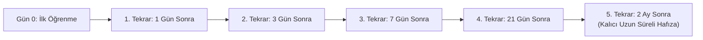

# 🧠🛠️ Anki, Cümle Madenciliği (Sentence Mining) ve Dijital Araçlar Kurulum Kılavuzu

[⬅️ Kitap, Dizi, Film ve Podcast Rehberi](./Kitap-Dizi-Film-ve-Podcast-Rehberi.md) | [🧰 Kaynaklar Ana Sayfası](./README.md) | [🏠 Ana Sayfa](../README.md) | [➡️ 90 Günlük Çalışma Takvimi](./90-Gunluk-Sifirdan-Akiciliga-Calisma-Takvimi.md)

> **Bu Kılavuzun Amacı:** Kelime defterlerine yazıp bir hafta sonra unuttuğunuz binlerce kelimenin kaderini değiştirmek. Nörobilim tabanlı **Aralıklı Tekrar (SRS)** sistemini, **Anki**'nin sıfırdan ileri seviyeye kurulumunu, poliglotların **Cümle Madenciliği (Sentence Mining)** iş akışını, 7 süper tarayıcı aracını ve **Notion / Obsidian** dil takip sistemlerini adım adım kuruyoruz.

---

## 📑 İçindekiler

1. [🧬 Aralıklı Tekrar (Spaced Repetition / SRS) Bilimi ve Unutma Eğrisi](#-aralıklı-tekrar-spaced-repetition--srs-bilimi-ve-unutma-eğrisi)
2. [⚙️ Sıfırdan İleriye Anki Kurulumu ve Optimum Ayarlar (FSRS Dahil)](#️-sıfırdan-ileriye-anki-kurulumu-ve-optimum-ayarlar-fsrs-dahil)
3. [⛏️ Cümle Madenciliği (Sentence Mining) ve En İyi Anki Kart Şablonları](#️-cümle-madenciliği-sentence-mining-ve-en-iyi-anki-kart-şablonları)
4. [🌐 7 Süper Dil Aracı ve Tarayıcı Eklentisi Kullanım Rehberi](#-7-süper-dil-aracı-ve-tarayıcı-eklentisi-kullanım-rehberi)
   * [1. Language Reactor](#1-language-reactor-netflix--youtube-laboratuvarı)
   * [2. Readlang](#2-readlang-web-makaleleri-ve-e-kitap-okuyucu)
   * [3. Yomitan (Eski Adıyla Yomichan)](#3-yomitan-anlık-pop-up-sözlük-ve-tek-tıkla-anki-kart-üretici)
   * [4. YouGlish](#4-youglish-gerçek-bağlamda-telaffuz-ve-aksan-motoru)
   * [5. PlayPhrase.me](#5-playphraseme-sinema-sahneleriyle-kalıp-kodlama)
   * [6. Ozdic Collocation Dictionary](#6-ozdic-collocation-dictionary-doğal-kelime-ortaklıkları)
   * [7. Ludwig.guru](#7-ludwigguru-akıcı-yazım-ve-cümle-karşılaştırma-motoru)
5. [📓 Notion ve Obsidian İçin Dil Takip Şablonları (Kopyala & Kullan)](#-notion-ve-obsidian-için-dil-takip-şablonları-kopyala--kullan)

---

## 🧬 Aralıklı Tekrar (Spaced Repetition / SRS) Bilimi ve Unutma Eğrisi

1885 yılında Alman psikolog **Hermann Ebbinghaus**, insan hafızasının yeni öğrendiği bir bilgiyi ne kadar sürede unuttuğunu matematiksel olarak kanıtladı (**Ebbinghaus Forgetting Curve**):
* Yeni öğrendiğiniz bir İngilizce kelimeyi tekrar etmezseniz **24 saat sonra %50-60'ını**, **1 hafta sonra ise %80-90'ını** unutursunuz.
* Ancak o bilgiyi her gün papağan gibi tekrar etmek de zaman kaybıdır. Beyin bir bilgiyi **en güçlü şekilde tam unutmak üzereyken (hatırlamakta hafif zorlandığı anda)** tekrar ettiğinde sinaptik bağları kalınlaştırır.



İşte **SRS (Spaced Repetition System)** algoritmaları her bir kelime kartı için sizin hatırlama performansınızı ölçer:
* Kolay hatırladığınız kartı **1 ay** sonraya atar.
* Zorlandığınız kartı **yarın** tekrar karşınıza çıkarır.
* Böylece bildiğiniz kelimelerle vakit kaybetmez, günde sadece **10-15 dakika** ayırarak binlerce kelime ve kalıbı kalıcı hafızanıza (Long-Term Memory) kilitlersiniz.

---

## ⚙️ Sıfırdan İleriye Anki Kurulumu ve Optimum Ayarlar (FSRS Dahil)

### 1. Doğru Uygulamayı İndirin (Sahte Uygulamalara Dikkat!)
App Store veya Google Play'de "Anki" adıyla satılan ücretli kopya uygulamalardan uzak durun. Resmi ekosistem tamamen senkronize çalışır:
* **Bilgisayar (Windows / macOS / Linux):** [apps.ankiweb.net](https://apps.ankiweb.net/) (**%100 Ücretsiz** – Kurulumu ve kart eklemeyi bilgisayardan yapın).
* **Web:** [ankiweb.net](https://ankiweb.net/) (**%100 Ücretsiz** – Bulut senkronizasyonu için ücretsiz hesap açın).
* **Android:** **AnkiDroid** (Google Play'de **%100 Ücretsiz** ve açık kaynaklı).
* **iOS (iPhone/iPad):** **AnkiMobile Flashcards** (Geliştiricinin tek gelir kaynağı olduğu için ücretlidir; ancak iPhone'da Safari üzerinden `ankiweb.net`'i ücretsiz olarak ana ekrana ekleyip kullanabilirsiniz).

### 2. Tek Deste (Master Deck) Kuralı
`Fiiller`, `Sıfatlar`, `Dizi Kelimeleri`, `Ünite 1` gibi 20 farklı deste **açmayın**. Beyin gerçek hayatta bir kelimeyi hangi kategoriden geldiğini bilmeden hatırlar.
* Sadece tek bir ana deste oluşturun: **`🇬🇧 English Master Deck`** (İhtiyaç duyarsanız kartları etiketlerle `#business`, `#phrasal-verb`, `#idiom` şeklinde ayırın).

### 3. En Verimli Deste Ayarları (Deck Options) ve FSRS Algoritması
Anki'nin varsayılan ayarları 1990'lardan kalmadır. Deste yanındaki **⚙️ (Çark) -> Options (Seçenekler)** menüsüne girip şu modern ayarları yapın:

| Ayar Bölümü | Önerilen Değer | Neden Bu Değer Seçilmeli? |
| :--- | :--- | :--- |
| **New cards/day (Günlük Yeni Kart)** | **`10` veya `15`** | Varsayılan `20` çok yüksektir! Günde 10 yeni kart, 2 ay sonra günlük ~70 tekrar kartı demektir. Sürdürülebilirlik için 10-15 altın orandır. |
| **Maximum reviews/day (Maks. Tekrar)** | **`9999`** | Günlük tekrarlara sınır koyarsanız algoritma bozulur; o gün gelen tüm tekrarlar bitirilmelidir. |
| **FSRS (Free Spaced Repetition Scheduler)** | **`AÇIK (Enabled)`** | Anki 23.10+ sürümüyle gelen makine öğrenmesi tabanlı yeni algoritmadır. Eski SM-2 algoritmasına göre **%20-30 daha az tekrar** yaptırarak aynı hatırlama oranını sağlar. |
| **Desired Retention (Hedef Hatırlama)** | **`0.90` (%90)** | FSRS altında `%90` idealdir (`0.95` yaparsanız tekrar sayınız ikiye katlanır). |
| **Burying (İlişkili Kartları Göm)** | **`Hepsi AÇIK`** | Aynı cümlenin farklı boşluklarını aynı gün sormasını engeller. |

### 4. Olmazsa Olmaz 4 Anki Eklentisi (Add-ons)
Bilgisayarda `Tools (Araçlar) -> Add-ons (Eklentiler) -> Get Add-ons` menüsüne şu kodları yapıştırıp Anki'yi yeniden başlatın:
1. **`HyperTTS - Add speech to your flashcards` (Kod: `111623432`):** Kartlarınıza tek tıkla ultra doğal Amerikan/İngiliz seslendirmesi ekler.
2. **`Review Heatmap` (Kod: `1771074083`):** GitHub'daki yeşil kutucuklar gibi Anki ana ekranına çalışma zincirinizi (streak) gösteren bir takvim ekler; motivasyonu uçurur.
3. **`Image Occlusion Enhanced` (Kod: `1374772155`):** Görsel sözlüklerin veya diyagramların üzerindeki kelimeleri kapatarak görsel kartlar üretmenizi sağlar.
4. **`AnkiConnect` (Kod: `2055492159`):** Tarayıcı eklentilerinin (Yomitan, Language Reactor) tek tıkla Anki'ye otomatik kart göndermesini sağlayan köprü eklentisidir.

---

## ⛏️ Cümle Madenciliği (Sentence Mining) ve En İyi Anki Kart Şablonları

### Cümle Madenciliği (Sentence Mining) Nedir?
Hazır indirilmiş 5.000 kelimelik Anki desteleriyle çalışmak **verimsizdir**, çünkü o kelimelerle hiçbir duygusal veya görsel anınız yoktur.
**Sentence Mining**, kendi izlediğiniz diziden, okuduğunuz kitaptan veya dinlediğiniz podcast'ten **içinde sadece 1 bilmediğiniz kelime/kalıp (`i + 1`) bulunan gerçek cümleleri** avlayıp kendi destenize ekleme sanatıdır.

---

### ❌ Kötü Kart vs ✅ Mükemmel Kart Karşılaştırması

| Kart Türü | Ön Yüz (Soru) | Arka Yüz (Cevap) | Sonuç |
| :--- | :--- | :--- | :--- |
| **❌ KÖTÜ KART (Tek Kelime)** | `to call off` | `iptal etmek` | Beyin bunu soyut bir şifre gibi ezberler; konuşurken hangi nesneyle kullanacağını bilemez. |
| **✅ MÜKEMMEL KART (Bağlamsal Cloze)** | `They had to {{c1::call off}} the outdoor concert because of the heavy storm.` <br> *(İpucu: cancel / iptal etmek)* | **call off** <br> 🔊 *(Cümlenin tam sesli okunuşu)* <br> 💡 **Eş Anlam:** cancel <br> 📝 **Örnek 2:** *Let's call off the meeting.* | Beyin `call off the concert / meeting` eşleşmesini (collocation) ve telaffuzu bir bütün olarak kodlar! |

---

### 🏆 En İyi 3 Anki Kart Şablonu (Kopyala & Kullan)

#### Şablon 1: Bağlamsal Boşluk Doldurma (Contextual Cloze Deletion – En Hızlısı)
Anki'de kart türünü **`Cloze`** seçin ve hedef kelimeyi `Ctrl+Shift+C` ile paranteze alın:
```text
[Text Alanı]:
We need to {{c1::come up with::bulmak / üretmek (fikir, çözüm)}} a better strategy before Friday's meeting.

[Back Extra Alanı]:
🔊 Telaffuz: /kʌm ʌp wɪð/
💡 Kalıp: come up with + an idea / a plan / a solution / an excuse
❌ Hata Uyarısı: "find an idea" yerine doğal İngilizcede "come up with an idea" kullanılır.
```
* **Ön yüzde nasıl görünür?** `We need to [bulmak / üretmek (fikir, çözüm)] a better strategy before Friday's meeting.`
* **Siz ne yaparsınız?** Boşluğu sesli olarak `come up with` diye tamamlayıp tüm cümleyi okursunuz!

#### Şablon 2: `i + 1` Anlama ve Dinleme Kartı (Dizi/Podcast Madenciliği İçin)
Özellikle Language Reactor veya Yomitan ile dizi/video çalışırken kullanılır:
* **Ön Yüz (Front):**
  * 🎬 **Cümle:** *"I don't want to **jump the gun**, let's wait for the official results."*
  * 🔊 **Ses:** *(Sahnedeki oyuncunun orijinal sesi)*
* **Arka Yüz (Back):**
  * 🎯 **Hedef Kalıp:** **to jump the gun** = *Dereyi görmeden paçaları sıvamak / aceleci davranıp erken harekete geçmek.*
  * 🖼️ **Sahne Görseli:** *(Dizideki o anın ekran görüntüsü – görsel hafızayı tetikler)*

#### Şablon 3: Aktif Üretim / "Tarzancadan Doğal İngilizceye" Kartı (Konuşma Odaklı)
B1-C1 arasında konuşurken takılanlar için en güçlü şablondur:
* **Ön Yüz (Front):**
  * 🇹🇷 *"Uzun çalışma saatleri yüzünden teklifi kabul etmekte **isteksizdi / çekimserdi**."*
  * 🎯 Anahtar Kelime İpucu: **`r _ _ _ _ _ _ _ t`** (`to be ... to do sth`)
* **Arka Yüz (Back):**
  * 🇬🇧 **"She was **reluctant** to accept the offer because of the long hours."**
  * 🔊 *(Sesli okunuş)*

---

## 🌐 7 Süper Dil Aracı ve Tarayıcı Eklentisi Kullanım Rehberi

Aşağıdaki 7 araç bir araya geldiğinde internet tarayıcınız dünyanın en gelişmiş dil laboratuvarına dönüşür:

### 1. [Language Reactor](https://www.languagereactor.com/) (Netflix & YouTube Laboratuvarı)
* **Nedir?** Chrome/Edge eklentisidir. Netflix ve YouTube videolarının altına çift dilde etkileşimli altyazı ve sağ tarafa tam zamanlı transkript paneli ekler.
* **Adım Adım Nasıl Kullanılır?**
  1. Eklentiyi kurup bir YouTube videosu açın (Sağ üstteki `LLN/LR` anahtarını aktif edin).
  2. Ayarlardan **"Hide translations"** seçeneğini işaretleyin (Türkçe çeviri bulanıklaşır, sadece fareyle üzerine gelince görünür).
  3. Videoda bilmediğiniz bir kelimeye tıkladığınızda video otomatik durur, kelimenin bağlamsal anlamı ve örnek cümleleri açılır.
  4. Kelimenin yanındaki yıldız (`⭐`) ikonuna basarak cümleyi kaydedin, çalışma sonunda **Export to Anki** ile tüm cümleleri sesleriyle birlikte Anki'ye aktarın.

### 2. [Readlang](https://readlang.com/) (Web Makaleleri ve E-Kitap Okuyucu)
* **Nedir?** Yabancı haber sitelerini (*BBC, The Guardian, Medium*) veya kendi yüklediğiniz `.epub`/`.txt` kitapları okurken sözlüğe gitme zahmetini bitiren web okuyucusu ve Chrome eklentisidir.
* **Adım Adım Nasıl Kullanılır?**
  1. Herhangi bir İngilizce makaledeyken tarayıcıdaki Readlang (`R`) simgesine tıklayın.
  2. Bilmediğiniz bir kelimenin veya **3-4 kelimelik bir deyimin** üzerine tıkladığınızda (veya sürükleyip seçtiğinizde) kelimenin hemen üstünde Türkçe karşılığı belirir.
  3. Tıkladığınız her kelimeyi **bulunduğu tam cümleyle birlikte** arka planda kaydeder; bunları CSV/Anki formatında indirebilirsiniz.

### 3. [Yomitan](https://yomitan.wiki/) *(Anlık Pop-up Sözlük ve Tek Tıkla Anki Kart Üretici)*
* **Nedir?** Poliglot topluluklarının en büyük sırrıdır. Tarayıcıda herhangi bir kelimenin üzerine `Shift` tuşuna basılı tutarak geldiğinizde 0.1 saniyede çevrimdışı sözlük penceresi açar ve **tek bir tuşla (`+`)** o cümleyi, kelimenin sesini ve sözlük tanımını Anki'ye kart olarak gönderir.
* **Kurulum Özeti:**
  1. Chrome/Firefox'a **Yomitan** eklentisini ve Anki'ye **AnkiConnect** (`2055492159`) eklentisini kurun.
  2. Yomitan ayarlarından İngilizce-İngilizce (Oxford/Collins) veya İngilizce-Türkçe ZIP sözlüğünü içeri aktarın.
  3. `Anki` sekmesinden `{expression}`, `{sentence}`, `{audio}` alanlarını kendi Anki kart şablonunuzla eşleştirin. Artık makale okurken 1 saniyede profesyonel Anki kartı üretebilirsiniz!

### 4. [YouGlish](https://youglish.com/) (Gerçek Bağlamda Telaffuz ve Aksan Motoru)
* **Nedir?** Sözlüklerdeki robotik sesler yerine, aradığınız kelime veya kalıbın gerçek insanların konuşmalarında (TED konuşmaları, röportajlar, dersler) nasıl telaffuz edildiğini gösteren arama motorudur.
* **Nasıl Kullanılır?**
  1. Arama kutusuna telaffuzundan emin olmadığınız bir kelime (`squirrel`, `comfortable`, `entrepreneur`) veya bağlaç (`nevertheless`) yazın.
  2. Alt kısımdan aksan seçin: **`US` (Amerikan)**, **`UK` (İngiliz)** veya **`AUS` (Avustralya)**.
  3. Video tam o kelimenin söylendiği saniyede başlar. Mavi ileri (`⏭️`) butonuna basarak 5 farklı konuşmacıdan aynı kelimeyi dinleyin ve peşlerinden tekrar edin!

### 5. [PlayPhrase.me](https://www.playphrase.me/) (Sinema Sahneleriyle Kalıp Kodlama)
* **Nedir?** Bir kelimeyi değil, **bir cümle kalıbını** yazdığınızda o kalıbın geçtiği ünlü film ve dizi sahnelerini 3'er saniyelik klipler halinde peş peşe oynatan araçtır.
* **Nasıl Kullanılır?**
  * Örneğin yeni öğrendiğiniz `I might as well` veya `It goes without saying` kalıbını aratın.
  * 5 farklı filmde karakterlerin bu kalıbı hangi yüz ifadesiyle ve hangi ses tonuyla (vurguyla) söylediklerini 30 saniye içinde izleyin; o kalıbı bir daha asla unutmazsınız.

### 6. [Ozdic Collocation Dictionary](https://ozdic.com/) (Doğal Kelime Ortaklıkları)
* **Nedir?** *"Hata yapmak"* derken `do a mistake` mi yoksa `make a mistake` mi denir? *"Yoğun trafik"* derken `crowded traffic` mi yoksa `heavy traffic` mi? Ozdic bu soruları çözen en hızlı **Collocation (Eşdizim)** sözlüğüdür.
* **Nasıl Kullanılır?**
  * Arama kutusuna sadece **İsmi (Noun)** yazın (Örn: `effort`, `advantage`, `crime`, `exam`).
  * Size o isimle birlikte kullanılan tüm **Fiilleri (Verbs)**, **Sıfatları (Adjectives)** ve **Edatları (Prepositions)** kategorize edilmiş şekilde listeler. Kompozisyon ve e-posta yazarken yan sekmede mutlaka açık olmalıdır!

### 7. [Ludwig.guru](https://ludwig.guru/) (Akıcı Yazım ve Cümle Karşılaştırma Motoru)
* **Nedir?** İngilizce bir cümle yazdınız ama *"Acaba bir Amerikalı/İngiliz bunu böyle mi yazar?"* diye şüpheye düştünüz. Ludwig, cümlenizi *The New York Times, BBC, ScienceDirect, The Economist* gibi güvenilir kaynaklardaki milyonlarca gerçek cümleyle karşılaştırır.
* **Güçlü Operatörleri:**
  * **Yıldız (`*`) Jokeri:** `take * into account` veya `apologize * delaying` yazarak araya hangi edatın veya kelimenin geleceğini görün.
  * **Karşılaştırma (`vs`):** `interested in vs interested to` yazarak hangi kullanımın yüzde kaç oranında tercih edildiğini istatistiksel olarak görün.

---

## 📓 Notion ve Obsidian İçin Dil Takip Şablonları (Kopyala & Kullan)

Dil öğreniminde sürekliliği sağlayan şey motivasyon değil, **görünür sistemlerdir**. Aşağıdaki şablonları doğrudan **Obsidian** (`.md` dosyası olarak) veya **Notion** sayfasına yapıştırarak kendi dil üssünüzü kurabilirsiniz.

### Şablon 1: Günlük "Mikro-Immersion" ve Çıktı Günlüğü (Daily English Log)

```markdown
# 🇬🇧 Günlük İngilizce Kayıt Defteri — {{Tarih: YYYY-AA-GG}}

## ⚡ Günlük 4 Sütun Kontrol Listesi (Minimum 30-45 Dk)
- [ ] 🃏 **Anki Tekrarları Sıfırlandı** (Süre: ___ dk | Yeni Eklenen Kart: ___ adet)
- [ ] 🎧 **Anlaşılabilir Dinleme / İzleme (Input)** (Kaynak: _______________ | Süre: ___ dk)
- [ ] 📖 **Okuma (Reading)** (Kaynak: _______________ | Sayfa/Makale: ___)
- [ ] 🗣️ **Aktif Üretim / Çıktı (Output)** (Shadowing / Kendi Kendine Konuşma / AI Sohbet: ___ dk)

---

## ⛏️ Günün Cümle Madenciliği (Bugün Avladığım 3 Doğal Kalıp)
> *Tek kelime değil, tam bağlam ve eşdizim (collocation) kaydet!*

1. **Kalıp:** `_________________________`
   - **Karşılaştığım Cümle:** "..."
   - **Benim Kurduğum Örnek Cümle:** "..."
2. **Kalıp:** `_________________________`
   - **Karşılaştığım Cümle:** "..."
   - **Benim Kurduğum Örnek Cümle:** "..."
3. **Kalıp:** `_________________________`
   - **Karşılaştığım Cümle:** "..."
   - **Benim Kurduğum Örnek Cümle:** "..."

---

## ✍️ 3 Cümlelik Günlük Özeti (Micro-Journaling)
*(Bugün ne yaptığını veya ne düşündüğünü bugün öğrendiğin en az 1 kalıbı kullanarak İngilizce yaz)*
1. ...
2. ...
3. ...
```

---

### Şablon 2: Notion / Obsidian "Hata ve Düzeltme Veritabanı" (Error Log Table)

Konuşurken veya yazarken yaptığınız (veya yapay zekanın düzelttiği) hataları kaydettiğiniz bu tablo, kişisel gelişiminizin en değerli hazinesidir:

```markdown
## 🛠️ Kişisel Hata ve Doğal İfade Dönüşüm Tablom (Error Log)

| Tarih | Kategori | ❌ Benim Kurduğum (Tarzanca / Hatalı) | ✅ Doğal Karşılığı (Native / Doğru) | 💡 Kural / Neden? | Anki'ye Eklendi mi? |
| :--- | :---: | :--- | :--- | :--- | :---: |
| 2026-05-01 | Edat (Prep) | *I am married with a doctor.* | **I am married to a doctor.** | "Married" her zaman **to** edatı alır, *with* almaz. | [x] |
| 2026-05-02 | Collocation | *I did a big mistake in the report.* | **I made a big mistake in the report.** | "Mistake" kelimesi *do* ile değil **make** ile kullanılır. | [x] |
| 2026-05-03 | Gramer | *I am working here since 3 years.* | **I have been working here for 3 years.** | Geçmişten bugüne süren eylemlerde *Present Perfect Cont.* + süreç için **for** kullanılır. | [x] |
| 2026-05-04 | Kelime Seçimi | *Can you open the light?* | **Can you turn on / switch on the light?** | Elektronik cihazlar ve ışıklar için *open/close* değil **turn on/off** kullanılır. | [ ] |
```

---

### Şablon 3: Medya Kütüphanesi ve Immersion Takipçisi (Immersion Tracker)

```markdown
## 🎬📚 Yıllık İngilizce Medya Tüketim Takipçim

| Tür | İçerik Adı | Seviye | Durum | Süre / Sayfa | Öğrendiğim En İyi Kalıp | Puanım |
| :---: | :--- | :---: | :---: | :---: | :--- | :---: |
| 📖 Kitap | *The Curious Incident of the Dog...* | B1 | ✅ Bitti | 226 Sayfa | `prime number`, `to figure out` | ⭐⭐⭐⭐⭐ |
| 📺 Dizi | *The Good Place (Sezon 1)* | B1-B2 | 🔄 İzleniyor | 13 Bölüm | `for crying out loud`, `forked up` | ⭐⭐⭐⭐⭐ |
| 🎙️ Podcast | *BBC 6 Minute English (#1-#20)* | B1-B2 | ✅ Bitti | 120 Dk | `procrastination`, `burnout` | ⭐⭐⭐⭐⭐ |
| 📺 YouTube | *Kurzgesagt - Immune System* | B2 | ✅ Bitti | 45 Dk | `trench warfare`, `simultaneously` | ⭐⭐⭐⭐ |
```

---

[⬅️ Kitap, Dizi, Film ve Podcast Rehberi](./Kitap-Dizi-Film-ve-Podcast-Rehberi.md) | [🧰 Kaynaklar Ana Sayfası](./README.md) | [🏠 Ana Sayfa](../README.md) | [➡️ 90 Günlük Çalışma Takvimi](./90-Gunluk-Sifirdan-Akiciliga-Calisma-Takvimi.md)
