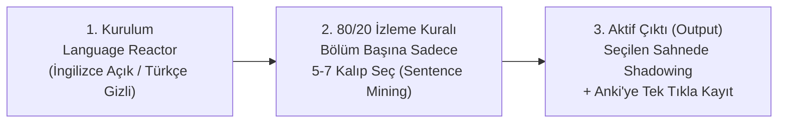

# 📚🎬🎧 Kitap, Dizi, Film, YouTube ve Podcast Rehberi (A1 - C2 Medya Katalogu)

[⬅️ Kaynaklar ve Araçlar Ana Sayfası](./README.md) | [🏠 Ana Sayfa](../README.md) | [➡️ Anki ve Araçlar Kurulum Kılavuzu](./Anki-ve-Araclar-Kurulum-Kilavuzu.md)

> **Bu Rehberin Amacı:** Ders kitaplarının steril ve yapay dilinden çıkıp gerçek dünyadaki doğal İngilizceye (**Immersion / Dille Çevrelenme**) adım atmanızı sağlamak. Hangi seviyede hangi kitabı okumalı, hangi diziyi neden izlemeli ve çift altyazıyı bir öğrenme laboratuvarına nasıl dönüştürmelisiniz? Tüm cevaplar bu kapsamlı katalogda yer alıyor.

---

## 📑 İçindekiler

1. [🎯 Stephen Krashen "Anlaşılabilir Girdi" (Comprehensible Input / i+1) Kuralı](#-stephen-krashen-anlaşılabilir-girdi-comprehensible-input--i1-kuralı)
2. [📖 Seviye Seviye Kitap Önerileri (Graded Readers & Orijinal Kitaplar: A1 → C2)](#-seviye-seviye-kitap-önerileri-graded-readers--orijinal-kitaplar-a1--c2)
3. [🍿 Dil Öğrenimine En Uygun Diziler ve Filmler (Seviye ve Analizleriyle)](#-dil-öğrenimine-en-uygun-diziler-ve-filmler-seviye-ve-analizleriyle)
4. [🛠️ Çift Altyazı ve Dizi İzleyerek İngilizce Öğrenme Metodolojisi](#️-çift-altyazı-ve-dizi-izleyerek-ingilizce-öğrenme-metodolojisi)
5. [📺 İlgi Alanlarına Göre YouTube Kanalları (Bilim, Yazılım, Tarih, Psikoloji, Komedi)](#-ilgi-alanlarına-göre-youtube-kanalları-bilim-yazılım-tarih-psikoloji-komedi)
6. [🎙️ Transkriptli Podcast Listeleri (A1'den C2'ye)](#-transkriptli-podcast-listeleri-a1den-c2ye)

---

## 🎯 Stephen Krashen "Anlaşılabilir Girdi" (Comprehensible Input / i+1) Kuralı

Dil bilimci Stephen Krashen'a göre bir dili edinmenin tek gerçek yolu **Anlaşılabilir Girdi (Comprehensible Input)** almaktır. Formül basittir: **`i + 1`**
* **`i`:** Şu anki dil seviyeniz.
* **`+1`:** Mevcut seviyenizin sadece **bir tık** üstündeki içerik.

> ⚠️ **En Büyük Tuzak:** A2 seviyesindeyken *Sherlock* veya *Game of Thrones* izlemeye çalışmak ya da *Harry Potter*’ın orijinalini okumaya kalkmak `i + 5` yapmaktır. Her satırda sözlüğe bakarsınız, beyniniz yorulur ve 3 gün sonra bırakırsınız.
>
> ✅ **Altın Oran (%95 - %98 Kuralı):** Okuduğunuz bir sayfadaki veya izlediğiniz bir sahnedeki kelimelerin **en az %90-95'ini** sözlüğe bakmadan anlayabiliyorsanız, o kaynak sizin için mükemmel `i + 1` kaynağıdır. Kalan %5-10'luk kısmı beyniniz bağlamdan (context) otomatik olarak çıkarır ve kalıcı hafızaya kaydeder.

---

## 📖 Seviye Seviye Kitap Önerileri (Graded Readers & Orijinal Kitaplar: A1 → C2)

### 1. Graded Readers Nedir ve Neden A1-B1 Arasında Şarttır?
**Graded Readers (Seviyelendirilmiş Kitaplar)**, dünya klasiklerinin veya özgün hikayelerin belirli kelime sınırları (headwords) ve gramer yapılarına göre yeniden yazılmış halleridir.

#### En İyi Graded Readers Yayınevleri ve Seviye Tablosu

| CEFR Seviyesi | Kelime Havuzu (Headwords) | Oxford Bookworms | Penguin Readers | Cambridge English Readers | Macmillan Readers |
| :--- | :--- | :--- | :--- | :--- | :--- |
| **A1 (Starter / Beginner)** | 250 – 400 kelime | Starter / Stage 1 | Easystarts / Level 1 | Starter / Level 1 | Starter / Beginner |
| **A2 (Elementary)** | 600 – 800 kelime | Stage 2 | Level 2 | Level 2 | Elementary |
| **B1 (Pre-Int / Intermediate)** | 1.000 – 1.400 kelime | Stage 3 & Stage 4 | Level 3 & Level 4 | Level 3 & Level 4 | Pre-Intermediate & Intermediate |
| **B2 (Upper-Intermediate)** | 1.700 – 2.500 kelime | Stage 5 & Stage 6 | Level 5 & Level 6 | Level 5 & Level 6 | Upper-Intermediate |

> 💡 **Ücretsiz Alternatifler:**
> * **[English e-Reader (english-e-reader.net)](https://english-e-reader.net/):** A1'den C1'e kadar yüzlerce seviyelendirilmiş kitabı ve sesli kitap (audiobook) versiyonlarını ücretsiz okuyup dinleyebileceğiniz muazzam bir kütüphane.
> * **[News in Levels](https://www.newsinlevels.com/) & [Engoo Daily News](https://engoo.com/app/daily-news):** Kitap okumaya vakti olmayanlar için her gün güncel dünya haberlerini Level 1 (A1-A2), Level 2 (B1) ve Level 3 (B2-C1) olarak sunan ücretsiz platformlar.

---

### 2. A1 - C2 Seviye Seviye Kitap Katalogu

#### 🌱 A1 – Başlangıç (Graded Readers & Çizgi Romanlar)
Bu seviyede orijinal roman okunmaz; görsel destekli veya 300-400 kelimelik basitleştirilmiş kitaplar okunur:
1. **The Adventures of Tom Sawyer** *(Penguin Readers Easystarts / Level 1)* – Kısa cümleler, Present Simple ve temel fiillerle akıcı macera.
2. **Sherlock Holmes: The Emerald Crown** *(Oxford Bookworms Starter)* – Çizgi roman/resimli formatta, diyalog ağırlıklı polisiye.
3. **Marcel and the Shakespeare Letters** *(Stephen Rabley - Penguin)* – A1 seviyesinde en sevilen, Paris'te geçen dedektiflik faresi hikayesi.
4. **peanuts (Snoopy) / Garfield Comic Strips** – Günlük 3-4 karelik karikatürler; konuşma dilindeki kısa tepkileri (*Good grief!, Whatever, I guess so*) öğrenmek için birebirdir.

#### 🌿 A2 – Temel (Graded Readers Stage 2 & İlk Kısa Çocuk Kitapları)
1. **Robinson Crusoe / Treasure Island** *(Oxford Bookworms Stage 2)* – Geçmiş zaman (Past Simple) yapılarını pekiştirmek için en iyi macera klasikleri.
2. **Diary of a Wimpy Kid (Saftirik Greg'in Günlüğü) – Jeff Kinney** *(Orijinal)* – Çizimlerle desteklenen, Amerikan günlük okul/aile dilini ve *phrasal verb*'leri en doğal haliyle öğreten ilk orijinal kitap.
3. **Fantastic Mr. Fox / The Magic Finger – Roald Dahl** *(Orijinal)* – Kısa, eğlenceli, kelime tekrarı yüksek ve dili son derece sade hikayeler.
4. **The Little Prince (Küçük Prens) – Antoine de Saint-Exupéry** – Hikayeyi zaten Türkçe bildiğiniz için İngilizce versiyonunda kelimeleri bağlamdan çıkarmak çok kolaydır.

#### 🌳 B1 – Orta Seviye (Orijinal Kitaplara Geçiş Köprüsü)
B1, çocuk/gençlik edebiyatından (Young Adult) yetişkin edebiyatına geçiş evresidir:
1. **The Curious Incident of the Dog in the Night-Time – Mark Haddon**
   * **Neden Okunmalı?** Kitap, Asperger sendromlu 15 yaşındaki bir çocuğun gözünden anlatılır. Anlatıcı metaforları ve karmaşık edebî sanatları sevmediği için cümleler **son derece net, mantıksal ve doğrudan** kurulmuştur. B1 seviyesinde bitirebileceğiniz ilk yetişkin romanıdır.
2. **Charlotte's Web – E.B. White**
   * **Neden Okunmalı?** Amerikan İngilizcesinin en duru, en sıcak ve gramer açısından en temiz klasiklerinden biridir.
3. **The Giver (Seçilmiş Kişi) – Lois Lowry**
   * **Neden Okunmalı?** Distopik bir dünya anlatmasına rağmen dili şaşırtıcı derecede sadedir; soyut kavramları basit kelimelerle nasıl ifade edebileceğinizi öğretir.
4. **The Alchemist (Simyacı) – Paulo Coelho**
   * **Neden Okunmalı?** Çeviri bir eser olduğu için ağır yerel deyimler içermez; evrensel ve akıcı bir İngilizcesi vardır.
5. **Harry Potter and the Philosopher's Stone (1. ve 2. Kitaplar) – J.K. Rowling**
   * **Neden Okunmalı?** B1'in ikinci yarısında başlanmalıdır. Büyü terimleri dışında diyalogları çok doğal İngiliz İngilizcesi kalıpları içerir.

#### 🔥 B2 – Ortanın Üstü (Modern Romanlar ve Popüler Kurgu Dışı / Non-Fiction)
B2 seviyesinde özellikle **Kişisel Gelişim, İş Dünyası ve Popüler Bilim (Non-Fiction)** kitapları romanlardan daha kolay anlaşılır çünkü yazarın amacı edebiyat yapmak değil, fikri en net şekilde aktarmaktır:
1. **Atomic Habits – James Clear** *(Non-Fiction)*
   * **Neden Okunmalı?** Modern iş ve günlük İngilizcede en sık kullanılan sebep-sonuç bağlaçlarını, alışkanlık ve psikoloji terminolojisini çok akıcı bir dille öğretir.
2. **The Subtle Art of Not Giving a F*ck – Mark Manson** *(Non-Fiction)*
   * **Neden Okunmalı?** Sokak dili, günlük konuşma kalıpları, *idiom*'lar ve samimi Amerikan üslubunu öğrenmek için eşsizdir.
3. **Animal Farm (Hayvan Çiftliği) – George Orwell** *(Kurgu)*
   * **Neden Okunmalı?** Orwell sade ve keskin yazımıyla ünlüdür. Politik, toplumsal ve ikna edici İngilizce (persuasive language) kelime dağarcığını hızla geliştirir.
4. **The Hunger Games – Suzanne Collins** *(Kurgu)*
   * **Neden Okunmalı?** Şimdiki zaman (Present Tense) ile birinci tekil şahıs ("I") ağzından yazıldığı için aksiyon fiillerini (action verbs) ve iç ses ifadelerini çok hızlı kavratır.
5. **Norwegian Wood (İmkansızın Şarkısı) – Haruki Murakami** *(Kurgu)*
   * **Neden Okunmalı?** Japoncadan İngilizceye çevrildiği için dili kristal berraklığındadır; günlük diyaloglar ve duygusal tasvirler B2 için idealdir.

#### 💎 C1 – İleri Seviye (Edebi Kurgu, Derin Analiz ve Akademik/Entelektüel Eserler)
1. **Sapiens: A Brief History of Humankind – Yuval Noah Harari** *(Non-Fiction)*
   * **Neden Okunmalı?** IELTS/TOEFL okuma parçalarında karşınıza çıkacak tarih, antropoloji, ekonomi ve biyoloji kelimelerinin neredeyse tamamını tek bir kitapta bağlam içinde görürsünüz.
2. **1984 – George Orwell** *(Kurgu)*
   * **Neden Okunmalı?** *Animal Farm*'a göre çok daha yoğun bir felsefi ve bürokratik kelime dağarcığına sahiptir.
3. **Thinking, Fast and Slow (Hızlı ve Yavaş Düşünme) – Daniel Kahneman** *(Non-Fiction)*
   * **Neden Okunmalı?** Akademik makale diline, bilişsel psikolojiye ve veri/istatistik yorumlama kalıplarına (`correlate with`, `susceptible to`, `cognitive bias`) hakimiyet kazandırır.
4. **The Great Gatsby – F. Scott Fitzgerald** *(Kurgu)*
   * **Neden Okunmalı?** Zengin sıfatlar, 1920'lerin Amerikan aristokrasisi ve şiirsel betimlemelerle edebi C1 kelime hazinesini zirveye taşır.

#### 👑 C2 – Ustalık / Ana Dili Seviyesi (Felsefi, Ağır Edebi ve Arkaik/Modern Başyapıtlar)
1. **Dune – Frank Herbert** / **The Lord of the Rings – J.R.R. Tolkien** – Epik dünya inşası, arkaik yapılar ve çok katmanlı politik/ekolojik terminoloji.
2. **Catch-22 – Joseph Heller** – İroni, kelime oyunları (wordplay), bürokratik hiciv ve doğrusal olmayan anlatım.
3. **To the Lighthouse – Virginia Woolf** – Bilinç akışı (stream of consciousness) tekniği ve en üst düzey gramer esnekliği.
4. **The Economist & The New Yorker Makaleleri** – C2 seviyesinin günlük antrenmanı; yoğun kültürel referanslar, deyimsel başlıklar (puns) ve kusursuz retorik.

---

## 🍿 Dil Öğrenimine En Uygun Diziler ve Filmler (Seviye ve Analizleriyle)

Her dizi dil öğrenmek için uygun **değildir**. Örneğin hastane dizileri (*House M.D.*), ağır dönem dizileri (*Peaky Blinders*) veya bilim kurgu dizileri ilk aşamada moral bozar. Dil öğrenimi için en iyi yapımlar **günlük hayatın içinde geçen, diyalog odaklı (sitcom ve dram)** yapımlardır.

### 📺 Seviyelere Göre En İyi Diziler Tablosu

| Seviye | Dizi Adı | Aksan | Neden Bu Seviye İçin En İyisi? |
| :--- | :--- | :--- | :--- |
| **A1 – A2** | **Extra English** *(YouTube - 30 Bölüm)* | 🇬🇧 UK & 🇺🇸 US | Doğrudan İngilizce öğrenenler için BBC/Channel 4 formatında çekilmiş *Friends* tarzı bir sitcom. Oyuncular tane tane konuşur, görsel şakalar anlamayı kolaylaştırır. |
| **A2** | **Peppa Pig** | 🇬🇧 UK | Küçümsemeyin! Günlük ev hayatı (*hacer/make breakfast, muddy puddles, go to the dentist*), temiz İngiliz telaffuzu ve tekrar eden kalıplar için en iyi A2 dinleme kaynağıdır. |
| **A2 – B1** | **Avatar: The Last Airbender** | 🇺🇸 US | Yetişkinlerin de keyifle izleyebileceği derin bir hikayeye sahip olmasına rağmen seslendirme kadrosu stüdyo ortamında çok net ve anlaşılır konuşur. |
| **B1** | **Friends** | 🇺🇸 US | Dil öğreniminin altın standardı. Kafe, ev, iş ve ilişki diyalogları; aşırı sokak argosu içermez, beden dili çok güçlüdür. |
| **B1** | **How I Met Your Mother** | 🇺🇸 US | *Friends*'e göre daha modern (2000'ler) günlük kalıplar, flört/arkadaşlık dili ve anlatıcı (narrator) sesi sayesinde takip etmesi kolaydır. |
| **B1 – B2** | **The Good Place** | 🇺🇸 US | Başrol Kristen Bell ve Ted Danson çok temiz bir diksiyonla konuşur. Hem günlük espriler hem de ahlak/felsefe terimleri dengeli şekilde harmanlanmıştır. |
| **B1 – B2** | **Modern Family** | 🇺🇸 US | Sahte belgesel (mockumentary) formatında olduğu için karakterler kameraya dönüp yaşanan olayı özetler; bu da bağlamı kaçırmanızı önler. Farklı yaş gruplarının dilini öğretir. |
| **B2** | **The Office (US)** | 🇺🇸 US | İş yeri İngilizcesi (ofis toplantıları, telefon görüşmeleri, e-posta/satış terimleri) ve Amerikan kuru mizahını (deadpan humor) öğrenmek için en iyi kaynaktır. |
| **B2** | **Brooklyn Nine-Nine** | 🇺🇸 US | Hızlı diyaloglar, ekip içi iletişim, raporlama dili ve modern Amerikan espri kültürü. |
| **B2 – C1** | **The Crown** | 🇬🇧 UK (RP) | Kraliçe İngilizcesi (Received Pronunciation), diplomatik nezaket kalıpları, politik tartışmalar ve üst düzey resmi İngilizce için bir başyapıttır. |
| **C1** | **Succession** / **House of Cards** | 🇺🇸 US / 🇬🇧 UK | Kurumsal savaşlar, C-level yönetim kurulu toplantıları, finans/medya jargonu, üstü kapalı tehditler ve yüksek retorik. |
| **C1 – C2** | **Sherlock (BBC)** / **Black Mirror** | 🇬🇧 UK | Çok hızlı konuşma temposu (Benedict Cumberbatch), bilimsel/teknolojik terminoloji ve farklı İngiliz bölgesel aksanları. |

---

### 🎬 Seviyelere Göre En İyi Filmler

1. **A2 – B1: Animasyon Filmleri (Pixar & Disney – *Toy Story, Finding Nemo, Inside Out, Zootopia, Coco*)**
   * **Neden?** Animasyonlarda sesler gerçek sette değil, yalıtımlı ses stüdyolarında profesyonel seslendirmenler tarafından kaydedilir. Arka plan gürültüsü, mırıldanma (mumbling) yoktur; her hece kristal netliğindedir. Özellikle *Inside Out* duyguları anlatan kelimeler için harikadır.
2. **B1: Romantik Komediler ve Aile Filmleri (*The Intern, Notting Hill, The Terminal, Forrest Gump*)**
   * **Forrest Gump:** Başrol karakteri yavaş ve tane tane konuşur; Amerikan tarihini ve kültürünü sade cümlelerle anlatır.
   * **The Intern (Stajyer):** Robert De Niro ve Anne Hathaway'in başrolde olduğu film, modern e-ticaret/ofis ortamını ve kuşaklar arası kibar iletişimi çok net bir dille sunar.
   * **Notting Hill:** Amerikan (Julia Roberts) ve İngiliz (Hugh Grant) aksanlarını aynı sahnede karşılaştırmak için mükemmeldir.
3. **B2: Dram ve Biyografi Filmleri (*The Truman Show, The Social Network, Catch Me If You Can, The King's Speech*)**
   * **The King's Speech:** Doğrudan diksiyon, telaffuz ve konuşma heyecanını yenme üzerine kurulu olduğu için hem ilham verici hem de dil açısından çok zengindir.
4. **C1 – C2: Diyalog Başyapıtları (*Before Sunrise üçlemesi, 12 Angry Men, Pulp Fiction, Oppenheimer*)**
   * **Before Sunrise:** İki karakterin Viyana sokaklarında 1,5 saat boyunca hayat, aşk, ölüm ve sanat üzerine kesintisiz, doğal sohbet etmesi; C1 konuşma akıcılığı için en iyi modeldir.
   * **12 Angry Men:** Tek bir odada 12 jüri üyesinin birbirini ikna etme (persuasion, debate, logical fallacies) mücadelesi.

---

## 🛠️ Çift Altyazı ve Dizi İzleyerek İngilizce Öğrenme Metodolojisi

Diziyi Türkçe altyazıyla arkana yaslanıp izlemek **İngilizce çalışmak değildir**, sadece dizi izlemektir (beyin her zaman kolay yolu seçer ve sadece Türkçeyi okur). Buna karşılık 20 dakikalık bölümü 2 saatte durdura durdura izlemek de motivasyonu öldürür.

İşte poliglotların kullandığı **3 Aşamalı Aktif İzleme ve Çift Altyazı Metodolojisi**:

### Adım 1: Doğru Altyazı Ayarı ("Hover to Reveal" Tekniği)
* Tarayıcınıza **[Language Reactor](https://www.languagereactor.com/)** eklentisini kurun.
* Ana altyazıyı **İngilizce**, ikincil (çeviri) altyazıyı **Türkçe** seçin ama Türkçe altyazıyı **"Gizle (Hide translation until hover)"** moduna alın.
* Böylece gözünüz sadece İngilizce metni görür ve kulağınız sesi takip eder. Anlamadığınız bir cümle geldiğinde farenizi o cümlenin üzerine götürerek Türkçe çevirisine sadece 1 saniyeliğine bakıp devam edersiniz.

### Adım 2: "Bölüm Başına Maksimum 7 Cümle" Kuralı (Tükenmişliği Önleme)
20 dakikalık bir sitcom bölümünde bilmediğiniz 40 kelime çıkabilir. **Hepsini not etmeye çalışmayın!**
* Sadece şu 2 kriterden birine uyan **5 ila 7 cümleyi** seçin:
  1. *"Ben bu cümleyi yarın günlük hayatımda veya işimde kesin kullanırım!"* dediğiniz doğal kalıplar (Örn: `I'll take a rain check` – *Bu seferlik pas geçeyim, sonra telafi ederiz*).
  2. Bölüm boyunca 2-3 kez tekrar ettiğini fark ettiğiniz yüksek frekanslı kelimeler.

### Adım 3: Kısayol Tuşlarıyla Mikro-Pratik (A / S / Space Tekniği)
Language Reactor açıkken eliniz klavyedeki üç tuşta olsun:
* **`A` Tuşu:** Bir önceki cümlenin başına sarar. Oyuncunun kelimeleri birbirine nasıl bağladığını (linking) anlamadığınızda `A` tuşuna basıp o 3 saniyelik cümleyi 3 kez üst üste dinleyin.
* **`S` Tuşu:** Mevcut cümleyi tekrar oynatır ve hemen durdurur (**Shadowing / Gölgeleme** yapmak için oyuncunun hemen ardından aynı tonlamayla cümleyi sesli tekrar edin).
* **`D` Tuşu:** Bir sonraki cümleye geçer.

### Adım 4: Tekرار İzleme (Re-watch) Gücü
Daha önce Türkçe izlediğiniz ve konusunu ezbere bildiğiniz bir diziyi (örneğin *Friends* veya *How I Met Your Mother*) **sadece İngilizce altyazıyla** baştan izleyin. Olay örgüsünü zaten bildiğiniz için beyniniz "Acaba şimdi ne olacak?" stresine girmez ve %100 enerjisini dil kalıplarını çözmeye harcar.

---

## 📺 İlgi Alanlarına Göre YouTube Kanalları (Bilim, Yazılım, Tarih, Psikoloji, Komedi)

En iyi İngilizce pratiği, İngilizce öğrenmek için değil **merak ettiğiniz bir konuyu öğrenmek için** video izlediğinizde gerçekleşir.

### 🔬 1. Bilim ve Doğa (Science & Nature)
| Kanal Adı | Seviye | Aksan | İçerik ve Neden İzlenmeli? |
| :--- | :---: | :---: | :--- |
| **[Kurzgesagt – In a Nutshell](https://www.youtube.com/@kurzgesagt)** | B1 – C1 | 🇬🇧 UK | Muazzam animasyonlar ve dünyanın en net İngiliz anlatıcı (Steve Taylor) sesiyle uzay, bağışıklık sistemi ve felsefe. |
| **[Veritasium](https://www.youtube.com/@veritasium)** | B1 – C1 | 🇺🇸/🇦🇺 | Sokak röportajları, bilimsel deneyler ve mühendislik hikayeleri. Hem akademik hem günlük konuşma dilini bir arada sunar. |
| **[SmarterEveryDay](https://www.youtube.com/@smartereveryday)** | B1 – B2 | 🇺🇸 US | Bir mühendisin samimi anlatımıyla ağır çekim (slow-motion) fizik deneyleri. |
| **[SciShow](https://www.youtube.com/@SciShow)** | B2 | 🇺🇸 US | 5-10 dakikalık kısa videolarla günlük bilimsel soruların cevapları (TOEFL/IELTS hazırlığı için harika kelime havuzu). |

### 💻 2. Yazılım, Teknoloji ve Mühendislik (Tech & Software)
| Kanal Adı | Seviye | Aksan | İçerik ve Neden İzlenmeli? |
| :--- | :---: | :---: | :--- |
| **[Marques Brownlee (MKBHD)](https://www.youtube.com/@mkbhd)** | B1 – B2 | 🇺🇸 US | Kristal netliğinde Amerikan telaffuzuyla teknoloji ve ürün incelemeleri. |
| **[Fireship](https://www.youtube.com/@Fireship)** | B2 – C1 | 🇺🇸 US | *"100 Seconds of..."* serisiyle tüm yazılım dillerini ve çerçevelerini hızlı, esprili ve yoğun teknik terimlerle özetler. |
| **[CS50 (Harvard University)](https://www.youtube.com/@cs50)** | B1 – C1 | 🇺🇸 US | Prof. David Malan'ın efsanevi sunumu; akademik ama aşırı anlaşılır bilgisayar bilimi İngilizcesi. |
| **[ThePrimeagen](https://www.youtube.com/@ThePrimeagen)** / **[Theo - t3.gg](https://www.youtube.com/@t3dotgg)** | C1 | 🇺🇸 US | Gerçek yazılım mühendislerinin makale okurken ve mimari tartışırken kullandığı doğaçlama, hızlı sektör dili. |

### 🏛️ 3. Tarih, Coğrafya ve Jeopolitik (History & Geopolitics)
| Kanal Adı | Seviye | Aksan | İçerik ve Neden İzlenmeli? |
| :--- | :---: | :---: | :--- |
| **[OverSimplified](https://www.youtube.com/@OverSimplified)** | B1 – B2 | 🇺🇸 US | Dünya savaşlarını ve tarihi devrimleri esprili çizimler ve günlük diyaloglarla anlatır; asla sıkmaz. |
| **[Vox](https://www.youtube.com/@vox)** | B2 – C1 | 🇺🇸 US | Harita, grafik ve veri gazeteciliğiyle dünyadaki olayların arka planını açıklar (IELTS Writing Task 1-2 için çok faydalıdır). |
| **[Johnny Harris](https://www.youtube.com/@johnnyharris)** | B1 – B2 | 🇺🇸 US | Hikaye anlatıcılığı (storytelling) çok güçlü, görsel haritalarla desteklenen tarih ve seyahat belgeselleri. |
| **[History Matters](https://www.youtube.com/@HistoryMatters)** | B2 – C1 | 🇬🇧 UK | 3-4 dakikalık videolarla *"Neden X ülkesi Y'yi yapmadı?"* sorularına hızlı, kuru İngiliz mizahıyla cevap verir. |

### 🧠 4. Psikoloji, Felsefe ve Kişisel Gelişim (Psychology & Philosophy)
| Kanal Adı | Seviye | Aksan | İçerik ve Neden İzlenmeli? |
| :--- | :---: | :---: | :--- |
| **[The School of Life](https://www.youtube.com/@theschooloflife)** | B1 – C1 | 🇬🇧 UK | Alain de Botton'un sakin, tane tane İngiliz aksanıyla ilişkiler, duygusal zeka, edebiyat ve felsefe analizleri. |
| **[TED-Ed](https://www.youtube.com/@TEDEd)** | B1 – C1 | Karışık | 5 dakikalık animasyon dersler; profesyonel seslendirme ve %100 doğru insan yapımı altyazı garantisi. |
| **[HealthyGamerGG (Dr. K)](https://www.youtube.com/@HealthyGamerGG)** | B2 – C1 | 🇺🇸 US | Harvard mezunu bir psikiyatristin odaklanma, erteleme, kaygı ve modern hayat sorunlarını çok doğal bir dille açıklaması. |
| **[Ali Abdaal](https://www.youtube.com/@aliabdaal)** | B1 – B2 | 🇬🇧 UK | Çok anlaşılır modern İngiliz aksanıyla verimlilik, kitap özetleri ve çalışma sistemleri. |

### 😂 5. Komedi, Kültür ve Günlük Sohbet (Comedy & Entertainment)
| Kanal Adı | Seviye | Aksan | İçerik ve Neden İzlenmeli? |
| :--- | :---: | :---: | :--- |
| **[Conan O'Brien (Team Coco)](https://www.youtube.com/@TeamCoco)** | B2 – C1 | 🇺🇸 US | Özellikle *Conan Without Borders* (seyahat) ve *Clueless Gamer* serileri Amerikan mizahını ve doğaçlama şakaları anlamak için harikadır. |
| **[BBC Learning English](https://www.youtube.com/@bbclearningenglish)** | A2 – B2 | 🇬🇧 UK | Kısa komedi skeçleri ve *6 Minute English* serisiyle günlük İngiliz kalıpları. |
| **[Trevor Noah](https://www.youtube.com/@trevornoah)** | B2 – C1 | 🇿🇦/🇺🇸 | Farklı aksanları taklit etme yeteneği ve kültürlerarası gözlemleriyle stand-up komedisine en anlaşılır giriş. |
| **[Jolly](https://www.youtube.com/@jolly)** | B1 – B2 | 🇬🇧 UK | İki İngiliz arkadaşın (Josh ve Ollie) farklı kültürleri ve yemekleri denerken kurduğu en doğal, samimi arkadaşlık diyalogları. |

---

## 🎙️ Transkriptli Podcast Listeleri (A1'den C2'ye)

Podcast dinlerken **transkript (yazılı metin)** olması kritik önem taşır. İlk dinlemede kulağınızın kaçırdığı kelimeleri transkriptten kontrol edip ikinci kez dinlediğinizde beyniniz ses ile kelimeyi kalıcı olarak eşleştirir.

| Seviye | Podcast Adı | Süre | Transkript Durumu ve Özellikleri |
| :--- | :--- | :---: | :--- |
| **A1 – A2** | **[British Council LearnEnglish Podcasts](https://learnenglish.britishcouncil.org/general-english/audio-zone)** | 5-15 dk | ✅ **Tam Ücretsiz Transkript & Etkileşimli Egzersiz.** Günlük hayat diyalogları, yavaş-orta tempo ve her bölüm sonunda anlama soruları. |
| **A2 – B1** | **[Voice of America (VOA) Learning English](https://learningenglish.voanews.com/)** | 5-10 dk | ✅ **Tam Metin & Ses Senkronlu.** Normal konuşma hızından %30 daha yavaş ve 1.500 temel kelimeyle hazırlanan güncel haber, bilim ve kültür yayınları. |
| **A2 – B1** | **[Culips Everyday English Podcast](https://www.culips.com/)** | 15-25 dk | ✅ **Web sitesinde ve Spotify'da özet/metin destekli.** Ana dili İngilizce olan sunucuların deyimleri ve günlük konuşma kalıplarını doğal sohbet içinde açıkladığı çok başarılı bir seri. |
| **B1 – B2** | **[BBC 6 Minute English](https://www.bbc.co.uk/learningenglish/english/features/6-minute-english)** | 6 dk | ✅ **Tam Ücretsiz PDF Transkript + Kelime Listesi.** İki BBC sunucusunun ilginç bir konuyu (Örn: *Kahve neden bizi uyandırır?*) 6 dakikada tartışıp 6 hedef kelimeyi öğrettiği efsanevi podcast. |
| **B1 – B2** | **[Luke's English Podcast](https://teacherluke.co.uk/)** | 30-60 dk | ✅ **Web sitesinde tam transkriptli bölümler.** Stand-up komedyeni ve İngilizce öğretmeni Luke Thompson'ın İngiliz kültürünü, mizahını ve kelime kalıplarını anlattığı ödüllü podcast. |
| **B1 – B2** | **[All Ears English Podcast](https://www.allearsenglish.com/episodes/)** | 15-20 dk | ✅ *"Connection NOT Perfection"* mottosuyla Amerikan İngilizcesinde doğal konuşma, small talk ve iş İngilizcesi ipuçları. |
| **B2 – C1** | **[TED Talks Daily](https://www.ted.com/podcasts/ted-talks-daily)** | 10-20 dk | ✅ **TED.com üzerinde 40+ dilde interaktif transkript.** Dünyanın en iyi konuşmacılarından teknoloji, psikoloji ve gelecek vizyonu. |
| **B2 – C1** | **[The Journal (WSJ)](https://www.wsj.com/podcasts/the-journal)** / **[The Daily (NYT)](https://www.nytimes.com/column/the-daily)** | 20-30 dk | ✅ **Web sitelerinde tam transkript.** İş dünyası, ekonomi ve küresel siyasetin en kaliteli hikaye anlatımıyla sunumu. |
| **C1 – C2** | **[Freakonomics Radio](https://freakonomics.com/)** | 45-60 dk | ✅ **Her bölümün kelimesi kelimesine tam transkripti web sitesinde ücretsizdir.** Hayatın gizli kalmış ekonomik ve sosyolojik yönlerini akademisyenlerle tartışır. |
| **C1 – C2** | **[Huberman Lab](https://www.hubermanlab.com/)** / **[Lex Fridman Podcast](https://lexfridman.com/podcast/)** | 1-3 saat | ✅ **YouTube/Spotify otomatik zaman damgalı transkript.** Nörobilim, yapay zeka, felsefe ve derin akademik sohbetler. |

---

### 💡 Podcast Çalışma Rutini: "3 Tur Tekniği" (6 Dakikalık Bölümler İçin 20 Dakika)

Özellikle **BBC 6 Minute English** gibi kısa bir bölümü şu 3 adımla çalışırsanız veriminiz **5 kat** artar:
1. **1. Tur (Kör Dinleme - 6 dk):** Transkripte hiç bakmadan dinleyin ve konunun genel hatlarını (%60-70) anlamaya çalışın.
2. **2. Tur (Metinle Analiz - 8 dk):** Transkripti açın, 1. turda kulağınızın yakalayamadığı yerlerin nedenini görün (*"Ha, kelimeyi bilmiyormuşum"* veya *"Biliyormuşum ama birbirine bağlayarak okuduğu için tanıyamamışım"*).
3. **3. Tur (Gölgeleme & Kapanış - 6 dk):** Metni kapatın, yürürken veya gözünüz kapalıyken tekrar dinleyin; bu kez ilk turda duymadığınız her kelimenin kulağınıza ne kadar net geldiğine şaşıracaksınız!

---

[⬅️ Kaynaklar ve Araçlar Ana Sayfası](./README.md) | [🏠 Ana Sayfa](../README.md) | [➡️ Anki ve Araçlar Kurulum Kılavuzu](./Anki-ve-Araclar-Kurulum-Kilavuzu.md)
