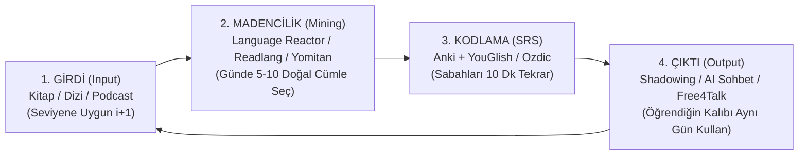

<div align="center">

# 🧰 Kaynaklar, Araçlar ve Çalışma Sistemleri Kütüphanesi

**Poliglotların ve Dil Bilimcilerin Kullandığı Ücretsiz Dijital Araçlar, A1–C2 Medya Katalogu, Anki SRS Kurulumu ve 90 Günlük Bootcamp Sistemi**

[](./README.md)
[-10b981?style=for-the-badge)](../README.md)
[](#-bu-modüldeki-kapsamlı-rehberler-tam-katalog)
[](#-sözlük-telaffuz-ve-bağlam-araçları-her-gün-kullanılacaklar)

[⬅️ Yapay Zeka Promptları](../04-Yapay-Zeka-Promptlari/README.md) • [🏠 Ana Sayfa](../README.md) • [➡️ IELTS, TOEFL ve YDS Sınav Rehberi](../06-Sinav-Hazirlik-IELTS-TOEFL-YDS/README.md)

</div>

---

> **🎯 Bu Kütüphanenin Amacı:** İnternetteki binlerce uygulama, web sitesi ve rastgele tavsiye arasında kaybolmadan; dil bilimcilerin ve poliglotların (çok dilli insanların) aktif olarak kullandığı **en yüksek verimli ücretsiz araçları, seviyelendirilmiş medya kataloglarını, Anki hafıza sistemlerini ve 90 günlük çalışma takvimini** tek bir merkezde toplamak.

---

## 📂 Bu Modüldeki Kapsamlı Rehberler (Tam Katalog)

Bu klasör birbirini tamamlayan **4 ana kılavuzdan** oluşur. İhtiyacınıza göre aşağıdaki rehberlere doğrudan geçiş yapabilirsiniz:

| # | Rehber Dosyası | İçerik Özeti | Hedef Seviye & Okuma Süresi |
| :-: | :--- | :--- | :---: |
| **01** | **[🧰 Kaynaklar & Araçlar Ana Kütüphanesi (Bu Sayfa)](./README.md)** | • Poliglotların 4 adımlı döngüsel öğrenme sistemi<br>• Günlük sözlük, telaffuz ve bağlam araçları matrisi<br>• 4 temel beceri (Okuma, Dinleme, Yazma, Konuşma) için ücretsiz platformlar<br>• 15 / 45 / 90 dakikalık hazır günlük çalışma rutinleri ve Habit Tracker | **A1 – C2**<br>⏱️ *10 Dk* |
| **02** | **[📚🎬🎧 Kitap, Dizi, Film, YouTube ve Podcast Rehberi](./Kitap-Dizi-Film-ve-Podcast-Rehberi.md)** | • Stephen Krashen `i+1` kuralı ve Graded Readers yayınevi karşılaştırması<br>• A1'den C2'ye **Graded Readers** ve orijinal roman/non-fiction kitap önerileri<br>• Seviye ve aksan analizli **en iyi diziler & filmler**<br>• **Çift Altyazı (Language Reactor)** ile dizi izleme metodolojisi<br>• 5 ilgi alanına göre **YouTube kanalları** ve **Transkriptli Podcast** listeleri | **A1 – C2**<br>⏱️ *20 Dk* |
| **03** | **[🧠🛠️ Anki ve Dijital Araçlar Kurulum Kılavuzu](./Anki-ve-Araclar-Kurulum-Kilavuzu.md)** | • **Aralıklı Tekrar (SRS)** bilimi ve Ebbinghaus Unutma Eğrisi<br>• Sıfırdan ileriye **Anki kurulumu (FSRS algoritması)** ve en iyi 4 eklenti kodu<br>• **Cümle Madenciliği (Sentence Mining)** ve kopyalanabilir 3 kart şablonu<br>• **7 Süper Araç:** *Language Reactor, Readlang, Yomitan, YouGlish, PlayPhrase.me, Ozdic, Ludwig.guru*<br>• Kopyalanabilir **Notion & Obsidian** dil ve hata takip şablonları | **A1 – C2**<br>⏱️ *20 Dk* |
| **04** | **[🗓️🔥 90 Günlük Sıfırdan Akıcılığa Çalışma Takvimi (Bootcamp)](./90-Gunluk-Sifirdan-Akiciliga-Calisma-Takvimi.md)** | • Gün gün, hafta hafta işaretlenebilir (`[ ]`) **90 Günlük Sprint Takvimi**<br>• Dil öğreniminde **Pomodoro (15+20+10) ve Dopamin Yönetimi**<br>• **Dil Öğrenme Tükenmişliği (Burnout)** 7 günlük kurtarma protokolü<br>• **Ücretsiz Konuşma Kulüpleri** (*Free4Talk, Discord, Tandem, HelloTalk*) güvenli kullanım ve ilk mesaj şablonları | **A1 – C2**<br>⏱️ *25 Dk* |

---

## ⚡ Hızlı Önizleme Kartları (Tıkla & Hemen Uygula)

<details>
<summary><b>⚡ 1. Hangi Seviyede Hangi Kitabı ve Diziyi Seçmeliyim? (Hızlı Eşleşme Tablosu)</b></summary>

<br>

| CEFR Seviyesi | 📖 Kitap Önerisi | 🍿 Dizi / Film Önerisi | 🎙️ Podcast Önerisi |
| :--- | :--- | :--- | :--- |
| **A1 – A2** | *Oxford Bookworms Stage 1-2*, *Diary of a Wimpy Kid*, *The Little Prince* | *Extra English* (YouTube), *Peppa Pig*, *Toy Story / Inside Out* | *British Council LearnEnglish*, *VOA Learning English* |
| **B1** | *The Curious Incident of the Dog in the Night-Time*, *Charlotte's Web*, *The Giver* | *Friends*, *How I Met Your Mother*, *The Good Place*, *Forrest Gump* | *BBC 6 Minute English*, *Culips Everyday English* |
| **B2** | *Atomic Habits*, *Animal Farm*, *The Hunger Games*, *Norwegian Wood* | *Modern Family*, *The Office (US)*, *Brooklyn Nine-Nine*, *The Truman Show* | *Luke's English Podcast*, *All Ears English*, *TED Talks Daily* |
| **C1 – C2** | *Sapiens*, *1984*, *Thinking, Fast and Slow*, *The Great Gatsby*, *Dune* | *The Crown*, *Succession*, *Sherlock (BBC)*, *Before Sunrise*, *12 Angry Men* | *Freakonomics Radio*, *The Journal (WSJ)*, *Huberman Lab* |

👉 **Detaylı incelemeler ve çift altyazı metodolojisi için:** [Kitap, Dizi, Film ve Podcast Rehberi](./Kitap-Dizi-Film-ve-Podcast-Rehberi.md)

</details>

<details>
<summary><b>⚡ 2. Kusursuz Bir Anki Kelime Kartı Nasıl Görünmeli? (Kopyalanabilir Cloze Şablonu)</b></summary>

<br>

Tek kelimelik (`reluctant = isteksiz`) kartlar beyninizde kalıcı bağ kurmaz. Bunun yerine Anki'de **`Cloze` (Boşluk Doldurma)** kart tipini seçip şu şablonu kullanın:

```text
[Text Alanı]:
We need to {{c1::come up with::bulmak / üretmek (fikir, çözüm)}} a better strategy before Friday's meeting.

[Back Extra Alanı]:
🔊 Telaffuz: /kʌm ʌp wɪð/
💡 Eşdizim (Collocation): come up with + an idea / a plan / a solution / an excuse
❌ Türk Öğrenci Tuzağı: "find an idea" yerine doğal İngilizcede "come up with an idea" kullanılır.
```

👉 **FSRS algoritması ayarları ve Yomitan/Language Reactor otomasyonu için:** [Anki ve Araçlar Kurulum Kılavuzu](./Anki-ve-Araclar-Kurulum-Kilavuzu.md)

</details>

<details>
<summary><b>⚡ 3. Bugün Sadece 15 Dakikam Var, Zinciri Kırmamak İçin Ne Yapmalıyım?</b></summary>

<br>

Çok yoğun iş veya sınav günlerinde **"Acil Durum 15 Dakika Protokolünü"** uygulayın:
1. **Dakika 00–07 (Sabah Kahvesi / Toplu Taşıma):** Telefonundan Anki'yi aç, yeni kart eklemeden sadece o günün tekrarlarını sesli mırıldanarak bitir.
2. **Dakika 07–13 (Yürürken):** *BBC 6 Minute English*'ten 1 bölüm dinle.
3. **Dakika 13–15 (Akşam):** Kendi kendine sesli olarak o gün yaptığın veya yarın yapacağın 3 işi İngilizce söyle (*Self-Talk*).

👉 **90 günlük tam bootcamp listesi ve tükenmişlik (burnout) rehberi için:** [90 Günlük Sıfırdan Akıcılığa Çalışma Takvimi](./90-Gunluk-Sifirdan-Akiciliga-Calisma-Takvimi.md)

</details>

---

## 🔄 Poliglotların Döngüsel Öğrenme Sistemi (Nasıl Çalışmalısınız?)

Araçları tek başına indirmek işe yaramaz; onları birbirini besleyen bir **sistem (pipeline)** içinde kullanmalısınız:



---

## 🔍 Sözlük, Telaffuz ve Bağlam Araçları (Her Gün Kullanılacaklar)

Google Translate tek kelimelerde bağlamı kaçırır. Bunun yerine şu **7 profesyonel aracı** tarayıcınızın yer imlerine (bookmarks) ekleyin:

| Araç Adı | Ne İşe Yarar? | Neden Kullanmalısınız? |
| :--- | :--- | :--- |
| **[Cambridge Dictionary](https://dictionary.cambridge.org/)** | İngilizce-İngilizce & İngilizce-Türkçe Sözlük | Kelimenin CEFR seviyesini (`A1`, `B2`, `C1`), hem İngiliz (`UK`) hem Amerikan (`US`) sesli okunuşunu ve en doğal örnek cümlelerini verir. |
| **[Longman (LDOCE)](https://www.ldoceonline.com/)** | İleri Öğrenenler İçin Frekans Sözlüğü | Kelimenin konuşma dilinde (`S1-S3`) mi yoksa yazı dilinde (`W1-W3`) mi en sık kullanılan ilk 3.000 kelimede yer aldığını gösterir ve tüm tanımlarını sadece en basit 2.000 kelimeyle açıklar. |
| **[YouGlish](https://youglish.com/)** | Gerçek Videolarda Telaffuz Arama Motoru | Aradığınız kelimeyi veya kalıbı yazın; YouTube'daki binlerce TED konuşması ve videoda o kelimenin geçtiği saniyeyi anında açar! |
| **[Ozdic Collocation Dictionary](https://ozdic.com/)** | Kelime Ortaklıkları (Collocations) Sözlüğü | *"Decision"* kelimesini yazdığınızda hangi fiillerle (*make a decision, reach a decision*) ve hangi sıfatlarla (*tough decision*) kullanıldığını gösterir. |
| **[Ludwig.guru](https://ludwig.guru/)** | Gerçek Kaynaklı Cümle Arama Motoru | Yazdığınız cümlenin *NYT, BBC, The Economist* gibi kaynaklarda nasıl kullanıldığını gösterir; iki kullanım arasında kaldığınızda istatistiksel karşılaştırma yapar. |
| **[PlayPhrase.me](https://www.playphrase.me/)** | Film ve Dizilerde Kalıp Arama | Bir cümle kalıbı yazın, o kalıbın geçtiği 5 farklı film/dizi sahnesini ardı ardına izleyin. |
| **[Forvo](https://forvo.com/)** | Ana Dili Konuşmacılarından Ses Bankası | Özel isimlerin, şehirlerin ve zor kelimelerin yerel insanlar tarafından kaydedilmiş telaffuzlarını içerir. |

> 👉 **Bu araçların adım adım kullanımı ve kısayolları için:** [Anki ve Araçlar Kurulum Kılavuzu](./Anki-ve-Araclar-Kurulum-Kilavuzu.md#-7-süper-dil-aracı-ve-tarayıcı-eklentisi-kullanım-rehberi)

---

## 🌐 4 Temel Beceri İçin En İyi Ücretsiz Web Platformları

| Beceri Alanı | Ücretsiz Platform | Seviye | Nasıl Kullanılmalı? |
| :--- | :--- | :---: | :--- |
| **📖 Okuma (Reading)** | **[News in Levels](https://www.newsinlevels.com/)** & **[Engoo Daily News](https://engoo.com/app/daily-news)** | A1 – C1 | Her gün 1 güncel haberi kendi seviyenizde sesli okuyun; altındaki tartışma sorularını sesli yanıtlayın. |
| **📖 Okuma (Kitap)** | **[English e-Reader](https://english-e-reader.net/)** & **[Project Gutenberg](https://www.gutenberg.org/)** | A1 – C2 | A1-B2 arası Graded Readers kitaplarını sesli kitap (mp3) eşliğinde okuyun; C1+ için Gutenberg'den klasikleri indirin. |
| **🎧 Dinleme (Listening)** | **[BBC Learning English](https://www.bbc.co.uk/learningenglish/)** & **[TED-Ed](https://ed.ted.com/)** | A2 – C1 | *6 Minute English* ve 5 dakikalık animasyon dersleri interaktif transkriptleriyle 3 tur tekniğiyle dinleyin. |
| **🎧 Dinleme (Testli)** | **[ELLLO.org](https://www.elllo.org/)** & **[Randall's ESL Cyber Listening Lab](https://www.esl-lab.com/)** | A1 – B2 | Dünyanın dört bir yanından farklı aksanlarla kaydedilmiş binlerce kısa ses kaydı, transkript ve boşluk doldurma testi. |
| **✍️ Yazma (Writing)** | **[Write & Improve (Cambridge)](https://writeandimprove.com/)** | A1 – C2 | Cambridge Üniversitesi'nin ücretsiz aracı. Yazınızı yapıştırın; saniyeler içinde CEFR seviyenizi (`B1`, `B2`) ve cümle bazlı hatalarınızı işaretlesin. |
| **🗣️ Konuşma & Telaffuz** | **[ELSA Speak (Ücretsiz Günlük Modül)](https://elsaspeak.com/)** & **[Free4Talk](https://www.free4talk.com/)** | A2 – C1 | ELSA ile fonetik hatalarınızı görün; Free4Talk'ta dünyanın her yerinden İngilizce pratik yapan insanlarla ücretsiz sesli odalarda konuşun. |

---

## 🧠 Anki ile Aralıklı Tekrar (Spaced Repetition) Özeti

Yeni öğrendiğiniz bir bilgiyi tekrar etmezseniz **Ebbinghaus Unutma Eğrisi**'ne göre 7 gün içinde %80'ini unutursunuz. **[Anki](https://apps.ankiweb.net/)**, bir kartı tam unutacağınız gün karşınıza çıkaran açık kaynaklı ve ücretsiz (Bilgisayar/Android/Web) bir programdır.

### Altın Anki Kuralları (Nasıl Kart Hazırlanmalı?)
1. **Asla Tek Kelime Yazmayın (Cümle Madenciliği Yapın):**
   * ❌ Ön yüz: `reluctant` -> Arka yüz: `isteksiz` (Bu yöntem işe yaramaz!)
   * ✅ Ön yüz: `She was [...] to accept the offer because of the long hours. (unwilling, hesitant)` -> Arka yüz: **`reluctant`** *(isteksiz / çekimser)*
2. **Günde En Fazla 10-15 Yeni Kart Ekleyin:** Çok fazla kart eklerseniz tekrarlar birikir ve bunalırsınız. Günde 10 kaliteli cümle kartı yılda **3.650 aktif cümle kalıbı** demektir!
3. **Kartları Sesli Okuyun:** Kartı çevirdiğinizde cümleyi mutlaka yüksek sesle okuyun.

> 👉 **FSRS algoritması ayarları, hazır kart şablonları ve eklenti kodları için:** [Anki ve Araçlar Kurulum Kılavuzu](./Anki-ve-Araclar-Kurulum-Kilavuzu.md)

---

## 🧩 Tarayıcı Eklentileri (Dizi & Makale Okuma Araçları)

* **[Language Reactor](https://www.languagereactor.com/)** (`Chrome/Edge Eklentisi`): YouTube ve Netflix üzerinde çift altyazı açmanızı, Türkçe çeviriyi fareyle üzerine gelene kadar gizlemenizi (`Hide translation`) ve `A` / `S` tuşlarıyla cümle cümle tekrar dinlemenizi sağlar.
* **[Readlang](https://readlang.com/)** (`Web & Chrome Eklentisi`): Yabancı haber sitelerini veya makaleleri okurken bilmediğiniz kelimelere tıkladığınızda akışı bozmadan anlamını gösterir ve otomatik kelime kartına dönüştürür.
* **[Yomitan](https://yomitan.wiki/)** (`Chrome/Firefox Eklentisi`): Metin okurken `Shift` tuşuyla anlık pop-up sözlük açar ve AnkiConnect aracılığıyla tek tıkla sesli cümle kartı oluşturur.
* **[Grammarly](https://www.grammarly.com/)** / **[LanguageTool](https://languagetool.org/)**: İngilizce e-posta veya metin yazarken anlık gramer, noktalama ve ton düzeltmesi yapar.

---

## 📺 İlgi Alanlarına Göre İngilizce YouTube Kanalları (Özet Seçki)

B1 seviyesinden sonra "İngilizce dersi" videoları izlemeyi azaltıp, **normalde Türkçe izlediğiniz konuları İngilizce kanallardan** izlemeye geçmelisiniz:

### 💻 Yazılım, Teknoloji ve Bilgisayar Bilimleri
* **[Fireship](https://www.youtube.com/@Fireship)** (`B2-C1`): 100 saniyede teknoloji özetleri ve güncel yazılım haberleri (Hızlı konuşma pratiği için harikadır).
* **[freeCodeCamp](https://www.youtube.com/@freecodecamp)** & **[CS50](https://www.youtube.com/@cs50)** (`B1-C1`): Ücretsiz üniversite ve sektör seviyesi programlama dersleri.
* **[Marques Brownlee (MKBHD)](https://www.youtube.com/@mkbhd)** (`B1-B2`): Çok net Amerikan aksanıyla teknoloji incelemeleri.
* **[Computerphile](https://www.youtube.com/@Computerphile)** (`B2-C1`): İngiliz akademisyenlerden bilgisayar bilimi kavramları.

### 🧪 Bilim, Psikoloji ve Genel Kültür
* **[Kurzgesagt – In a Nutshell](https://www.youtube.com/@kurzgesagt)** (`B1-C1`): Kusursuz anlatım ve görsellerle uzay, biyoloji ve felsefe.
* **[Veritasium](https://www.youtube.com/@veritasium)** (`B1-C1`): Günlük hayattaki bilimsel gizemler ve deneyler.
* **[The School of Life](https://www.youtube.com/@theschooloflife)** (`B1-C1`): Sakin İngiliz aksanıyla psikoloji, felsefe ve duygusal zeka.

### 🌍 Tarih, Seyahat, Kültür ve Belgesel
* **[OverSimplified](https://www.youtube.com/@OverSimplified)** (`B1-B2`): Dünya tarihini animasyon ve mizahla anlatan efsanevi kanal.
* **[Yes Theory](https://www.youtube.com/@YesTheory)** (`B1-B2`): Konfor alanından çıkma ve dünya kültürleri üzerine samimi vloglar.
* **[Vox](https://www.youtube.com/@vox)** (`B2-C1`): Dünyadaki güncel olayları harita ve grafiklerle açıklayan mini belgeseller.

> 👉 **Kitap, Dizi, Film, YouTube ve Transkriptli Podcast'lerin tam listesi için:** [Kitap, Dizi, Film ve Podcast Rehberi](./Kitap-Dizi-Film-ve-Podcast-Rehberi.md)

---

## ⏱️ Günlük Vaktinize Göre Hazır Çalışma Rutinleri (15 / 45 / 90 Dakika)

Çok yoğun olduğunuz günlerde bile **zinciri kırmamak** için aşağıdaki 3 moddan o günkü enerjinize uygun olanı seçin:

| Mod | Süre | Dağılım ve Uygulama Planı |
| :--- | :---: | :--- |
| **🟢 Mod 1: Acil Durum / Minimum Doz** *(Çok yoğun iş/sınav günleri)* | **15 Dk** | • **7 dk:** Yolda veya kahve içerken Anki günlük tekrarlarını sıfırla.<br>• **6 dk:** *BBC 6 Minute English* veya 1 kısa YouTube videosu dinle.<br>• **2 dk:** Günün özeti olarak kendi kendine sesli 3 İngilizce cümle kur. |
| **🔵 Mod 2: Standart İlerleme Rutini** *(İstikrarlı gelişim için ideal)* | **45 Dk** | • **10 dk:** Anki tekrarları (kartları sesli okuyarak).<br>• **20 dk:** Graded Reader / Makale okuma **veya** Language Reactor ile 1 bölüm sitcom (*Friends/Modern Family*) izleyip 5 yeni cümle avlama.<br>• **15 dk:** Yapay zeka ile sesli sohbet veya *Shadowing* (gölgeleme) pratiği. |
| **🔥 Mod 3: Yoğun Immersion Kampı** *(Hızlı seviye atlamak isteyenler)* | **90 Dk** | • **15 dk:** Anki + önceki günün hata defteri (Error Log) tekrarı.<br>• **30 dk:** Aktif dinleme/izleme + cümle madenciliği (Sentence Mining).<br>• **25 dk:** Seviyene uygun kitap okuma (Sesli kitap eşliğinde).<br>• **20 dk:** Aktif üretim (150 kelimelik yazı yazıp *Write & Improve* / AI ile kontrol etme + 10 dk sesli konuşma). |

> 👉 **Gün gün işaretlenebilir 90 günlük çalışma programı için:** [90 Günlük Sıfırdan Akıcılığa Çalışma Takvimi](./90-Gunluk-Sifirdan-Akiciliga-Calisma-Takvimi.md)

---

## ✅ Haftalık Alışkanlık Takip Çizelgesi (Habit Tracker Şablonu)

Bu tabloyu kendi not uygulamanıza (Notion, Obsidian veya bir deftere) kopyalayın ve her hafta zinciri kırmadan (`[x]`) doldurun:

```markdown
### 📅 Hafta #1 İlerleme Tablom

| Gün | 🃏 Anki Tekrarı (10 dk) | 🎧 Dinleme / Video (15 dk) | 📖 Okuma (10 dk) | 🗣️ Shadowing / AI Konuşma (10 dk) | 📝 Günün 3 Yeni Kalıbı |
| :--- | :---: | :---: | :---: | :---: | :--- |
| **Pazartesi** | [ ] | [ ] | [ ] | [ ] | 1. ... 2. ... 3. ... |
| **Salı** | [ ] | [ ] | [ ] | [ ] | 1. ... 2. ... 3. ... |
| **Çarşamba** | [ ] | [ ] | [ ] | [ ] | 1. ... 2. ... 3. ... |
| **Perşembe** | [ ] | [ ] | [ ] | [ ] | 1. ... 2. ... 3. ... |
| **Cuma** | [ ] | [ ] | [ ] | [ ] | 1. ... 2. ... 3. ... |
| **Cumartesi** | [ ] | [ ] | [ ] | [ ] | 1. ... 2. ... 3. ... |
| **Pazar** | [ ] | [ ] | [ ] | [ ] | Haftalık Tekrar & Dinlenme |
```

---

[⬅️ Yapay Zeka Promptları](../04-Yapay-Zeka-Promptlari/README.md) | [🏠 Ana Sayfa](../README.md) | [➡️ IELTS, TOEFL ve YDS Sınav Rehberi](../06-Sinav-Hazirlik-IELTS-TOEFL-YDS/README.md)
