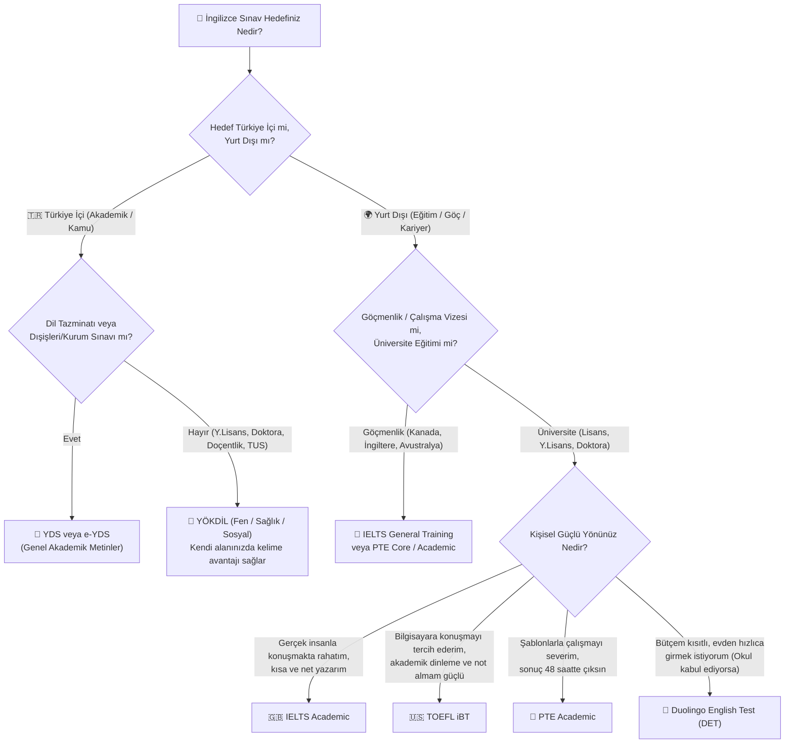
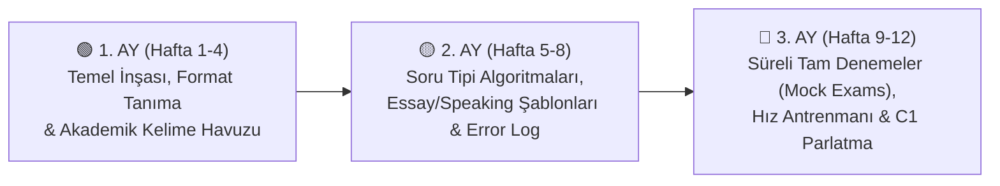

# 🎯 Uluslararası ve Ulusal Sınavlara Hazırlık Rehberi
### *IELTS (Academic & General) • TOEFL iBT • PTE Academic • Duolingo (DET) • YDS / e-YDS • YÖKDİL*

[-blue?style=for-the-badge)](#-2-cefr-ielts-toefl-pte-duolingo-ve-yds-puan-dönüşüm-tablosu)

[⬅️ Önceki Modül: Kaynaklar ve Araçlar](../05-Kaynaklar-ve-Araclar/README.md) • [🏠 Ana Sayfa](../README.md) • [➡️ Sonraki Modül: Yazılımcı ve Mesleki İngilizce](../07-Yazilimci-ve-Mesleki-Ingilizce/README.md)

---

> **Bu Modülün Amacı:** Yurt dışı eğitim (lisans, yüksek lisans, doktora), göçmenlik (İngiltere, Kanada, Avustralya), uluslararası çalışma vizesi veya Türkiye'deki akademik/kamu kariyeri (Doçentlik, Doktora, Dil Tazminatı) hedefleriniz için girmeniz gereken İngilizce sınavların **formatını, puanlama algoritmalarını, gizli tuzaklarını, yüksek puan şablonlarını ve Band 9.0 tam metin örneklerini** tek bir merkezde sunmak.

> *"Sınav İngilizcesi sadece iyi İngilizce bilmek değildir; sınavı hazırlayan kurumun (Cambridge, ETS veya ÖSYM) sizden hangi kalıpları, hangi düşünce yapısını ve hangi zaman yönetimini beklediğini bilmektir."*

---

## 🗂️ Modül Kataloğu ve Okuma Rotası

Bu modül, sıfırdan sınav stratejisi kuranlar ve yüksek puan (C1/C2) hedefleyenler için **4 uzmanlık rehberinden** oluşur:

| # | Rehber Dosyası | Kapsam ve İçerik Özeti | Hedef Kitle | Tahmini Süre |
| :---: | :--- | :--- | :--- | :---: |
| **01** | 📌 **[Ana Rehber: Sınav Karşılaştırması & 3 Aylık Plan](./README.md)** *(Bu Dosya)* | 6 sınavın (IELTS, TOEFL, PTE, DET, YDS, YÖKDİL) detaylı kıyaslaması, CEFR ve ÖSYM puan dönüşüm tabloları, karar ağacı ve 12 haftalık çalışma programı. | Tüm Sınav Adayları | 20 dk |
| **02** | 🇬🇧 **[IELTS Strateji ve Kalıp Rehberi](./IELTS-Strateji-ve-Kalip-Rehberi.md)** | Listening & Reading tuzakları (*Not Given* şifresi), Writing Task 1 (Grafik/Harita/Mektup) ve Task 2 (5 Essay türü) Band 8.0+ iskeletleri, Speaking Part 1-2-3 kalıpları. | IELTS Academic & General Adayları | 45 dk |
| **03** | 🇺🇸🇹🇷 **[TOEFL iBT ve YDS / YÖKDİL Rehberi](./TOEFL-ve-YDS-YOKDIL-Rehberi.md)** | TOEFL Speaking (Task 1–4) ve Writing şablonları + YDS/YÖKDİL 15 saniyede çeviri tekniği, Bağlaç/Edat matrisi, Paragraf taktikleri ve **150 Akademik Sınav Kelimesi**. | TOEFL iBT, YDS, e-YDS, YÖKDİL & YDT Adayları | 50 dk |
| **04** | 🏆 **[IELTS & TOEFL Yüksek Puanlı Essay ve Speaking Örnekleri](./IELTS-TOEFL-Yuksek-Puanli-Essay-ve-Speaking-Ornekleri.md)** | Tam metin **Band 9.0 IELTS Task 1 & Task 2** kompozisyonları (cümle cümle analizli), **TOEFL 30/30 Writing & Speaking** transkriptleri ve Son 24 Saat Kontrol Listesi. | Band 7.5–9.0 & TOEFL 105+ Hedefleyenler | 40 dk |

---

## ⚡ Hızlı Önizleme Kartları (Tıkla & Hemen İncele)

💡 <b>Hızlı Önizleme 1: IELTS Reading "FALSE" ile "NOT GIVEN" Arasındaki Fark Nedir? (Tıkla & Gör)</b>

Metindeki Cümle: *"More than 60% of university students work part-time to pay their rent."*
* **TRUE:** *The majority of undergraduates have a job alongside their studies to cover accommodation costs.* (Eş anlamlılarla kanıt metinde var).
* **FALSE:** *Only a small minority of university students need to work while studying.* (Metindeki "%60'tan fazlası" bilgisiyle **doğrudan çelişiyor / zıttını söylüyor**).
* **NOT GIVEN:** *Students who work part-time get lower grades than those who do not work.* (Metinde part-time çalışmak var ama **notların (grades) düştüğüne dair tek kelime bilgi yok!** Doğru da olabilir, yanlış da -> **NOT GIVEN**).
👉 *Detaylı okuma ve dinleme tuzakları için: [IELTS Strateji ve Kalıp Rehberi](./IELTS-Strateji-ve-Kalip-Rehberi.md)*

💡 <b>Hızlı Önizleme 2: YDS / YÖKDİL Çeviri Sorularını 15 Saniyede Çözme Sırrı (Tıkla & Gör)</b>

80 soruluk sınavda 6 (YDS) veya 12 (YÖKDİL) çeviri sorusunu baştan sona okumayın:
1. **Ana Fiili (Main Verb) Bulun:** İngilizce cümlenin ana fiili Türkçede **her zaman cümlenin en sonundaki yüklemdir**. Örneğin ana fiil `... have suggested that ...` ise, Türkçe şıkkın sonu **"... ileri sürmüşlerdir"** ile bitmek zorundadır! (3 şık 3 saniyede elenir).
2. **Özneyi Eşleştirin:** Ana fiilden önceki tamlamanın son kelimesi Türkçe öznenin son kelimesidir.
3. **Bağlacı Kontrol Edin:** `Although` (-e rağmen), `Unless` (-medikçe), `Whereas` (-iken) eşleşmesini doğrulayın ve işaretleyin!
👉 *Tüm bağlaç tabloları ve 150 akademik kelime için: [TOEFL ve YDS/YÖKDİL Rehberi](./TOEFL-ve-YDS-YOKDIL-Rehberi.md)*

💡 <b>Hızlı Önizleme 3: Band 6.0 Cümlesi Nasıl Band 8.5+ Akademik Cümleye Dönüşür? (Tıkla & Gör)</b>

* ❌ **Band 6.0:** *Watching too much TV and phone is very bad for children's health and lessons.*
* ✅ **Band 8.5+:** *Excessive screen time has a detrimental impact not only on children's physical well-being, such as leading to a sedentary lifestyle, but also on their cognitive development and academic performance.*
👉 *Tam metin Band 9.0 Essay ve Speaking örnekleri için: [IELTS & TOEFL Yüksek Puanlı Örnekler](./IELTS-TOEFL-Yuksek-Puanli-Essay-ve-Speaking-Ornekleri.md)*

---

## 🔍 1. 6 Büyük Sınavın Detaylı Karşılaştırması

Sınava hazırlanmaya başlamadan önce **doğru sınavı seçmek**, hazırlık sürenizi yarı yarıya kısaltabilir. Aşağıdaki tablo ulusal ve uluslararası en popüler 6 sınavın güncel formatlarını karşılaştırmaktadır:

| Özellik | IELTS (Academic & General) | TOEFL iBT (Yeni Format) | PTE Academic | Duolingo English Test (DET) | YDS / e-YDS | YÖKDİL |
| :--- | :--- | :--- | :--- | :--- | :--- | :--- |
| **Geçerlilik Alanı** | İngiltere, Avrupa, Kanada, Avustralya, ABD (3000+ kurum), Türkiye'de birçok üniversite (Muafiyet) | ABD, Kanada, Avrupa, Asya (12.000+ kurum) ve Türkiye'de ÖSYM eşdeğerliği (Devlet/Akademik) | Avustralya, Yeni Zelanda, İngiltere, Kanada göçmenlik ve üniversiteler + ÖSYM eşdeğerliği | 5000+ uluslararası üniversite (ABD, Kanada, Avrupa) — *ÖSYM eşdeğerliği yoktur* | Türkiye'de Kamu, Akademik Kadro, Doçentlik, Doktora, Dil Tazminatı | Türkiye'de Yüksek Lisans, Doktora, TUS/DUS/YDUS ve Doçentlik (*Dil tazminatı hariç*) |
| **Ölçülen Beceriler** | Listening, Reading, Writing, Speaking (4 Beceri) | Reading, Listening, Speaking, Writing (4 Beceri) | Speaking & Writing (Birleşik), Reading, Listening | Okuma, Dinleme, Yazma, Konuşma (Bütünleşik ve Uyarlanabilir / Adaptive) | Sadece Okuma, Gramer, Kelime ve Çeviri (Çoktan seçmeli 80 soru) | Sadece Okuma, Gramer, Kelime ve Çeviri (Sosyal, Fen veya Sağlık alanına özel 80 soru) |
| **Sınav Süresi** | ~2 saat 45 dakika | ~1 saat 56 dakika (Dünyanın en hızlı akademik 4 beceri sınavlarından biri) | ~2 saat | ~1 saat | 180 dakika (3 saat) | 180 dakika (3 saat) |
| **Sınav Ortamı** | Kağıt üzerinde (Paper-based) veya Bilgisayar üzerinden (Computer-delivered) | Bilgisayar üzerinden (Sınav merkezi veya Home Edition)* | Tamamen bilgisayar üzerinden ve %100 Yapay Zeka (AI) puanlamalı | Evden, kendi bilgisayarınızla (Kamera/Mikrofon gözetimli) | Kağıt üzerinde (YDS) veya ÖSYM E-Sınav Merkezlerinde (e-YDS) | Kağıt üzerinde veya elektronik (e-YÖKDİL) |
| **Konuşma (Speaking) Formatı** | Gerçek bir sınav görevlisiyle (Examiner) yüz yüze veya görüntülü 11-14 dk sohbet | Bilgisayara karşı (Kulaklık + Mikrofon ile 4 görev, toplam ~16 dk) | Bilgisayara karşı (Sesli okuma, cümle tekrarı, görsel anlatımı) | Bilgisayara karşı (Kamera açıkken sesli ve yazılı yanıtlar) | **Yok** | **Yok** |
| **Puan Aralığı** | 0.0 – 9.0 (0.5'lik dilimlerle) | 0 – 120 (Her bölüm 0–30 puan) | 10 – 90 puan | 10 – 160 puan (5'er puanlık dilimlerle) | 0 – 100 (Her soru 1.25 puan, yanlış doğruyu götürmez) | 0 – 100 (Her soru 1.25 puan, yanlış doğruyu götürmez) |
| **Sonuç Açıklanma Süresi** | Bilgisayarlı: 1–5 gün / Kağıt: 13 gün | 4 – 8 gün | Genellikle **24 – 48 saat** içinde | **48 saat** içinde | e-YDS: Aynı gün akşam / YDS: ~2-3 hafta | ~2-3 hafta (e-YÖKDİL: Aynı gün) |
| **Geçerlilik Süresi** | 2 Yıl | 2 Yıl | 2 Yıl | 2 Yıl | 5 Yıl (Kamu/Akademik kuruma göre değişebilir) | 5 Yıl |

> [!WARNING]
> **ÖSYM Eşdeğerlik Kuralı (Türkiye İçin Kritik Uyarı):** Türkiye'de yüksek lisans, doktora, doçentlik veya kamu kurumları için uluslararası bir sınav (TOEFL iBT veya PTE Academic) kullanacaksanız; **IELTS'in ÖSYM eşdeğerliği bulunmamaktadır** (sadece üniversitelerin kendi hazırlık atlama veya özel başvuru şartlarında geçerlidir). Ayrıca TOEFL iBT veya PTE sınavına **Türkiye'de giriyorsanız, sınav merkezinin bir devlet üniversitesi binasında olması** ve **Home Edition (Evden sınav) olmaması** şarttır!

---

## 📊 2. CEFR, IELTS, TOEFL, PTE, Duolingo ve YDS Puan Dönüşüm Tablosu

Aşağıdaki tablo, uluslararası standart olan **CEFR (Avrupa Dilleri Ortak Çerçeve Programı)** seviyelerine göre sınav puanlarının yaklaşık karşılıklarını ve ÖSYM denkliğini gösterir:

| CEFR Seviyesi | Yetkinlik Tanımı | IELTS (Band) | TOEFL iBT (0-120) | PTE Academic (10-90) | Duolingo (DET) (10-160) | YDS / YÖKDİL (Yaklaşık / ÖSYM) | Hedeflenen Kullanım Alanı |
| :---: | :--- | :---: | :---: | :---: | :---: | :---: | :--- |
| **C2** | Ustalık (Mastery) | **8.5 – 9.0** | 115 – 120 | 85 – 90 | 155 – 160 | **95 – 100** | Oxford/Cambridge/Ivy League Hukuk, Tıp, Edebiyat ve Üst Düzey Akademi |
| **C1+** | İleri Üstü | **7.5 – 8.0** | 102 – 114 | 76 – 84 | 140 – 150 | **85 – 92.5** | Top 50 Dünya Üniversitesi Yüksek Lisans/Doktora, Kanada Express Entry (CLB 9-10) |
| **C1** | İleri (Advanced) | **7.0** | 94 – 101 | 65 – 75 | 125 – 135 | **80 – 84** | Yurt Dışı Yüksek Lisans/Doktora Standart Şartı, İngiltere/Avustralya Nitelikli Göç |
| **B2+** | Orta Üstü (Güçlü) | **6.5** | 79 – 93 | 58 – 64 | 115 – 120 | **65 – 78** | Yurt Dışı Lisans & Birçok Yüksek Lisans, Türkiye Üniversite Hazırlık Atlama |
| **B2** | Bağımsız (Upper-Int.) | **5.5 – 6.0** | 46 – 78 | 42 – 57 | 95 – 110 | **55 – 64** | Türkiye Doçentlik (65) / Doktora (55) Barajı, Yurt Dışı Ön Lisans / Foundation |
| **B1** | Eşik Seviye (Interm.) | **4.0 – 5.0** | 31 – 45 | 30 – 41 | 65 – 90 | **40 – 54** | İngiltere Aile Birleşimi / Süresiz Oturum (B1), Bazı Tezli Yüksek Lisans Barajları (50) |
| **A1-A2** | Temel (Basic) | **1.0 – 3.5** | 0 – 30 | 10 – 29 | 10 – 60 | **0 – 39** | Temel Aile Birleşimi Vizeleri (A1/A2) |

> [!TIP]
> **ÖSYM Resmi Eşdeğerlik Notu:** ÖSYM'nin güncel uluslararası yabancı dil sınavları eşdeğerlik tablosunda örneğin **TOEFL iBT 84 puan = YDS 70 puan**, **TOEFL iBT 96 puan = YDS 80 puan**, **TOEFL iBT 108 puan = YDS 90 puan** olarak kabul edilmektedir. Başvuru yapacağınız tarihteki güncel ÖSYM duyurusunu mutlaka kontrol edin.

---

## 🧭 3. Karar Matrisi: Hangi Sınav Kime Uygun?

Hangi sınava gireceğinize karar vermek için aşağıdaki akış şemasını ve karakter analizini kullanın:

### 🧠 Karakterinize ve Becerilerinize Göre Sınav Seçimi:

1. **Neden IELTS Seçmelisiniz?**
   * Mikrofona ve ekrandaki geri sayım sayacına karşı konuşurken geriliyorsanız, karşınızda size gülümseyen ve başıyla onaylayan gerçek bir insanla (*Examiner*) sohbet etmek çok daha doğaldır.
   * Dinleme ve Okuma bölümleri birbirine karışmaz (**Entegre değildir**). Yani Listening'de kaçırdığınız bir detay Writing puanınızı etkilemez!
   * **General Training** modülü sayesinde Kanada (Express Entry) ve İngiltere göçmenlik süreçlerinde en geniş kabul gören sınavdır.

2. **Neden TOEFL iBT Seçmelisiniz?**
   * Temmuz 2023 sonrası yapılan dev güncelleme ile sınav süresi **3.5 saatten 2 saatin altına** düşürüldü!
   * Konuşma ve Yazma bölümleri **Integrated (Bütünleşik)** yapıdadır: Önce kısa bir metin okur, sonra o konuda bir ders dinler ve ikisini birleştirerek konuşur/yazarsınız. Yani "Benim genel kültürüm yok, aklıma fikir gelmiyor" diyenler için harikadır çünkü **tüm fikirler zaten okuma ve dinleme metninde size verilir!**
   * Türkiye'de ÖSYM eşdeğerliği olduğu için hem yurt dışı başvurularında hem de Türkiye'de YDS yerine kullanılabilir (Devlet üniversitesi merkezinde girilmesi şartıyla).

3. **Neden PTE Academic Seçmelisiniz?**
   * Sınavda hiçbir insan faktörü yoktur; konuşmanız ve yazınız %100 yapay zeka algoritması tarafından değerlendirilir.
   * Belirli konuşma ve yazma şablonları, akıcılık (*Oral Fluency*) ve telaffuz (*Pronunciation*) kuralları doğru uygulandığında kısa sürede çok yüksek puan alınabilir.

4. **Neden YÖKDİL (YDS Yerine) Seçmelisiniz?**
   * Amacınız Türkiye'de yüksek lisans, doktora, TUS/DUS veya doçentlik ise ve **dil tazminatı (maaş eki)** hedefiniz yoksa kesinlikle önce **YÖKDİL** tercih edilmelidir.
   * YDS'de bir mühendise sanat tarihi veya tıp paragrafı çıkabilirken; YÖKDİL'de **Fen Bilimleri**, **Sağlık Bilimleri** veya **Sosyal Bilimler** alanlarından birini seçersiniz. Ayrıca YÖKDİL'de YDS'nin en zorlayıcı bölümlerinden olan *Diyalog Tamamlama* ve *Yakın Anlamlı Cümle (Restatement)* soruları yoktur; bunun yerine daha kolay puan toplanan çeviri ve paragraf soruları ağırlıktadır.

---

## 🗓️ 4. Sıfır Panik: 3 Aylık (12 Haftalık) Sınav Hazırlık Planı

Hangi sınava (IELTS, TOEFL veya YDS/YÖKDİL) hazırlanırsanız hazırlanın, **B1 (Orta) seviyesinden başlayıp 12 haftada C1 (IELTS 7.0+ / TOEFL 95+ / YDS 80+) seviyesine** çıkmak için tasarlanmış bilimsel çalışma programı:

### 🟢 1. Ay (Hafta 1 – 4): Temel İnşası, Kelime Dağarcığı ve Format Tanıma
> **Hedef:** Sınav formatını %100 öğrenmek, kronik gramer eksiklerini kapatmak ve akademik kelime havuzunu inşa etmek (Süre tutmadan doğruluk odaklı çalışma).

| Hafta | Odak Alanı | IELTS / TOEFL (4 Beceri) Adayları İçin Görevler | YDS / YÖKDİL Adayları İçin Görevler |
| :---: | :--- | :--- | :--- |
| **1. Hafta** | **Teşhis & Format** | • Tam kapsamlı 1 deneme çözüp mevcut seviyenizi (Baseline) belirleyin. • Sınavın puanlama kriterlerini (*Rubrics / Band Descriptors*) okuyun. • Günlük 30 dk *BBC 6 Minute English* veya *TED-Ed* dinleyip gölgeleme (Shadowing) yapın. | • Geçmiş yıllara ait 1 çıkmış YDS/YÖKDİL sınavı çözüp netinizi görün. • Tense (Zamanlar), Passive (Edilgen) ve Modal yapılarının "Zaman Uyumu" (Tense Agreement) kurallarını bitirin. • Günlük 20 akademik kelimeyi cümle içinde Anki'ye ekleyin. |
| **2. Hafta** | **Okuma Anatomisi & Bağlaçlar** | • *Skimming* (Göz gezdirme) ve *Scanning* (Anahtar kelime tarama) tekniklerini öğrenin. • IELTS Reading *True/False/Not Given* ve TOEFL *Factual Information* soru tiplerinden 5'er pasaj çözün. • Akademik bağlaçları (*Although, Despite, Whereas, Consequently*) öğrenin. | • Sınavın kalbi olan **Zıtlık (Contrast)** ve **Neden-Sonuç (Cause & Effect)** bağlaçlarını (*even though, notwithstanding, owing to, thereby*) örneklerle çalışın. • Günde 3 akademik makale/paragraf çevirisi (Özne-Yüklem analiziyle) yapın. |
| **3. Hafta** | **Dinleme / Çeviri & Cümle Yapıları** | • IELTS Listening Part 1-2 veya TOEFL Campus Conversation tuzaklarını (fikir değiştirme / düzeltme) çalışın. • Writing için *Relative Clauses*, *Participle Clauses* ve *Passive* yapılarını kullanarak günde 10 karmaşık (Complex) cümle yazın. | • *Relative Clauses* (Sıfat Cümlecikleri), *Noun Clauses* (İsim Cümlecikleri) ve *Reduction* (Kısaltma: `V-ing / V3 / to V1`) konularını tamamlayın. • Çıkmış **İngilizce-Türkçe / Türkçe-İngilizce Çeviri** sorularından 100 soru çözün (Fiil ve bağlaç eşleştirme tekniğiyle). |
| **4. Hafta** | **Edatlar & 1. Ay Değerlendirmesi** | • IELTS Writing Task 1 (Grafik/Tablo) veya TOEFL Integrated Writing şablonlarını ezberleyin ve 4 örnek rapor yazın. • Speaking Part 1 / Independent Speaking için 20 temel konuda ses kaydı alarak 2'şer dakika konuşun. | • *Gerund & Infinitive*, *Conditionals (If / Unless / Provided that / Were to)* ve **Akademik Edatlar (Prepositions)** listesini bitirin. • 200 soruluk *Cloze Test* ve *Cümle Tamamlama* maratonu yapın. |

---

### 🟡 2. Ay (Hafta 5 – 8): Strateji, Şablon Oturtma ve Soru Tiplerinde Ustalaşma
> **Hedef:** Her soru tipinin çözüm algoritmasını otomatikleştirmek, yazma/konuşma şablonlarını kas hafızasına kazımak ve **Hata Defteri (Error Log)** tutmak.

| Hafta | Odak Alanı | IELTS / TOEFL (4 Beceri) Adayları İçin Görevler | YDS / YÖKDİL Adayları İçin Görevler |
| :---: | :--- | :--- | :--- |
| **5. Hafta** | **Zorlu Okuma Soru Tipleri** | • IELTS *Matching Headings* (Başlık Eşleştirme) veya TOEFL *Inference & Rhetorical Purpose* sorularına odaklanın. • Her yanlış soruyu **"Neden yanlış yaptım? (Kelime mi, Tuzak mı, Dikkat mi?)"** diye Hata Defterine yazın. | • **Cümle Tamamlama (Sentence Completion)** sorularında zaman uyumu, bağlaç yönü (+/-) ve zamir takibi (*this, such, they*) tekniğiyle 150 soru çözün. • İlk 4 haftanın kelimelerini tekrar edin. |
| **6. Hafta** | **Akademik Yazım (Essay) Kampı** | • IELTS Task 2'deki 5 Essay türünü (Opinion, Discussion, Problem-Solution, Advantage-Disadvantage, Double Question) veya TOEFL Academic Discussion yazılarını çalışın. • Haftada 4 Essay yazıp [04-Yapay-Zeka-Promptlari](../04-Yapay-Zeka-Promptlari/README.md) içindeki değerlendirici prompt ile AI'a puanlatın. | • **Paragraf Tamamlama** ve **Anlam Bütünlüğünü Bozan Cümle (Roma Rakamlı)** sorularına geçiş yapın. • Giriş-Gelişme-Sonuç akışı ve konu daraltma teknikleriyle günde 25'er soru çözün. |
| **7. Hafta** | **Akademik Dinleme & İleri Konuşma** | • IELTS Listening Part 3-4 (Akademik tartışma ve ders) veya TOEFL Lecture (5 dakikalık üniversite dersi dinleyip Cornell tekniğiyle not alma) pratiği yapın. • IELTS Speaking Part 2 (2 dk kesintisiz konuşma) ve Part 3 (Soyut tartışma) kalıplarını uygulayın. | • **Diyalog Tamamlama** ve **Yakın Anlamlı Cümle (Restatement)** (YDS adayları için) veya alan bazlı (Fen/Sağlık/Sosyal) **Okuma Parçaları (Reading Passages)** (YÖKDİL adayları için) çalışın. • Günde 5 okuma parçası (20 soru) çözüp bilmediğiniz kelimeleri çıkarın. |
| **8. Hafta** | **Yarı Yol Simülasyonu** | • Süre tutarak 2 tam deneme (Mock Exam) çözün. • En düşük puan aldığınız alt beceriyi (Örn: Writing Task 2 veya Reading) belirleyip hafta sonunu sadece o beceriye ayırın. | • Süre tutarak 2 çıkmış sınav çözün. • İlk 36 soruyu (Kelime + Gramer + Cloze + Cümle Tamamlama) **maksimum 45-50 dakikada** bitirme antrenmanı yapın. |

---

### 🔴 3. Ay (Hafta 9 – 12): Hız, Dayanıklılık ve Tam Zamanlı Deneme Kampı
> **Hedef:** Biyolojik saati sınav saatine (genellikle sabah 09:00 veya 10:00) ayarlamak, süre yönetimini kusursuzlaştırmak ve sınav stresini sıfırlamak.

| Hafta | Odak Alanı | IELTS / TOEFL (4 Beceri) Adayları İçin Görevler | YDS / YÖKDİL Adayları İçin Görevler |
| :---: | :--- | :--- | :--- |
| **9. Hafta** | **Süreli Bölüm Denemeleri** | • Reading bölümünü 60 dk yerine **50 dakikada** bitirmeye çalışın (Zaman tamponu oluşturma). • Writing Task 1 (18 dk) + Task 2 (37 dk) + 5 dk kontrol şeklinde süreye karşı yazın. | • Günde 10 okuma parçası (40 soru) çözerek beyin dayanıklılığını artırın. • En sık çıkan 150 akademik kelime ve Phrasal Verb listesini baştan sona tarayın. |
| **10. Hafta** | **Tam Kapsamlı Denemeler (Mock Exams)** | • Haftada 3 adet resmi deneme (*Cambridge IELTS 15-19* veya *ETS TOEFL Official Tests*) çözün. • Her deneme sonrası 2 saat boyunca yanlış analizini yapın (Analiz edilmeyen deneme zaman kaybıdır!). | • Haftada 3 adet son 5 yılın çıkmış YDS/YÖKDİL sınavını sabah 10:15'te masaya oturarak tek oturuşta (180 dk) çözün. • Denemedeki tüm bağlaç ve kelime şıklarını (yanlış şıklar dahil) analiz edin. |
| **11. Hafta** | **Zayıf Halka Tamiri & Polishi** | • Yazma ve Konuşma için "C1 Parlatma" haftası: [Yüksek Puanlı Essay & Speaking Örnekleri](./IELTS-TOEFL-Yuksek-Puanli-Essay-ve-Speaking-Ornekleri.md) dosyasındaki Band 9.0 kalıplarını kendi cümlelerinize entegre edin. • Dinlemede 1.25x hızda pratik yapın. | • Hata Defterinizde biriken tüm yanlış soruları tekrar çözün. • Turlama tekniğini (uzun ve boğucu sorularda 2 dakikadan fazla takılmadan işaret koyup geçme) oturtun. |
| **12. Hafta** | **Zihinsel Hazırlık & Sınav Haftası** | • Son 3 gün yeni konu çalışmayı bırakın. • Sadece kendi hazırladığınız Writing/Speaking şablonlarını ve kelime kartlarını gözden geçirin. • Sınav sabahı sınava gitmeden önce 15 dk İngilizce podcast dinleyerek **beyninizi İngilizce moduna açın (Warm-up)!** | • Son 3 gün yeni deneme çözmeyin (Moral bozukluğu riskini sıfırlayın). • Sadece bağlaç tablolarını, edat kombinasyonlarını ve çeviri kısayollarını tekrar edin. • Sınav sabahı hafif bir kahvaltı yapın ve kodlama stratejinizi netleştirin. |

---

## ⏱️ 5. Sınav Günü Psikolojisi ve Zaman Yönetimi Kuralları

Sınavlarda B2 seviyesindeki bir adayın C1 seviyesindeki bir adaydan daha yüksek puan almasının tek sebebi **stratejik zaman ve kriz yönetimidir**:

1. **🎧 Sınav Sabahı "Soğuk Motorla" Sınava Girmeyin:**
   * Özellikle IELTS ve TOEFL'da sınav **Listening veya Reading** ile başlar. Sabah uyanıp hiç İngilizce duymadan doğrudan sınava girerseniz ilk 10 dakika beyniniz İngilizceye adapte olmaya çalışırken ilk soruları kaçırırsınız. Sınav merkezine giderken yolda mutlaka 15-20 dakika sevdiğiniz bir İngilizce podcast dinleyin.
2. **⏭️ "Batık Maliyet Yanılgısına" (Sunk Cost Fallacy) Düşmeyin:**
   * Bir Reading veya YDS sorusuna 2 dakika harcadınız ve hala iki şık arasındasınız. *"2 dakika verdim, boşa gitmesin"* diyerek 3 dakika daha harcarsanız sınavın sonundaki **çok kolay 5 soruyu göremezsiniz**. Her sorunun puan değeri eşittir! Zor soruyu tahmin edip işaretleyin (*Flag*) ve hemen bir sonrakine geçin.
3. **👂 Dinlemede (Listening) Geriye Bakmak Yasaktır:**
   * IELTS veya TOEFL Listening'de bir soruyu kaçırdığınız an **o soruyu unutun**. Kaçırdığınız soruyu düşünürken ses kaydı akmaya devam eder ve sıradaki 3 soruyu da zincirleme kaybedersiniz. Her zaman ses kaydının **bir soru önünde** olun (soruyu önceden okumuş olun).
4. **✍️ Yazmada (Writing) İlk 5 Dakika Klavyeye/Kaleme Dokunmayın:**
   * Konuyu okur okumaz yazmaya başlayanlar, yazının ortasında fikir bulamaz veya konudan sapar (*Off-topic*). İlk 4-5 dakikayı mutlaka **Outline (Taslak)** çıkarmaya ayırın: *Ana fikrim ne? 1. gelişme paragrafımda ne diyeceğim, örneğim ne olacak? 2. paragrafta hangi zıtlığı kullanacağım?* Taslağı hazır olan bir yazı 25 dakikada su gibi akar.

---

## 🚀 Şimdi Hangi Dosyadan Devam Etmelisiniz?

Hedeflediğiniz sınava göre aşağıdaki 3 uzmanlık rehberinden birine tıklayarak hemen çalışmaya başlayın:

* 👉 **[🇬🇧 IELTS Academic & General Strateji ve Kalıp Rehberi](./IELTS-Strateji-ve-Kalip-Rehberi.md)** *(Listening/Reading tuzakları, Writing Task 1 & 2 Band 8.0+ şablonları, Speaking Part 1-2-3 kalıpları)*
* 👉 **[🇺🇸🇹🇷 TOEFL iBT ve YDS / YÖKDİL Taktik ve Kelime Rehberi](./TOEFL-ve-YDS-YOKDIL-Rehberi.md)** *(TOEFL Speaking/Writing şablonları, YDS/YÖKDİL çeviri ve bağlaç taktikleri, 150 Akademik Sınav Kelimesi)*
* 👉 **[🏆 IELTS (Band 8.5–9.0) & TOEFL (30/30) Tam Metin Essay ve Speaking Örnekleri](./IELTS-TOEFL-Yuksek-Puanli-Essay-ve-Speaking-Ornekleri.md)** *(Cümle cümle analiz edilmiş tam metin kompozisyonlar, konuşma transkriptleri ve Son 24 Saat Kontrol Listesi)*
