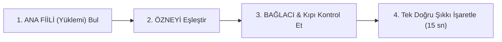

# 🇺🇸🇹🇷 TOEFL iBT ve YDS / YÖKDİL Taktik, Şablon ve Akademik Kelime Rehberi

[⬅️ IELTS Strateji ve Kalıp Rehberi](./IELTS-Strateji-ve-Kalip-Rehberi.md) | [📚 Sınav Hazırlık Ana Sayfası](./README.md) | [🏠 Repo Ana Sayfası](../README.md)

> **Bu Rehberin Amacı:** İlk bölümde **Yeni TOEFL iBT** sınavının Speaking (Task 1–4) ve Writing (Integrated & Academic Discussion) bölümleri için saniye saniye hazır konuşma ve yazma şablonları sunmak; ikinci bölümde ise Türkiye'nin ulusal akademik dil sınavları olan **YDS, e-YDS, YÖKDİL ve YKSDİL (YDT)** için nokta atışı soru çözme algoritmaları (Çeviri, Bağlaç, Edat, Paragraf Tamamlama, Anlam Bozan Cümle) ve sınavlarda en çok çıkan **150 Akademik Sınav Kelimesini** eksiksiz olarak derlemektir.

---

## 📑 İçindekiler

1. [🇺🇸 Bölüm 1: TOEFL iBT Speaking (Task 1–4) Saniye Saniye Şablonları](#-1-bölüm-1-toefl-ibt-speaking-task-14-saniye-saniye-şablonları)
2. [✍️ Bölüm 2: TOEFL iBT Writing (Integrated & Academic Discussion) Şablonları](#️-2-bölüm-2-toefl-ibt-writing-integrated--academic-discussion-şablonları)
3. [🇹🇷 Bölüm 3: YDS & YÖKDİL Bağlaç ve Edat (Conjunctions & Prepositions) Taktikleri](#-3-bölüm-3-yds--yökdil-bağlaç-ve-edat-conjunctions--prepositions-taktikleri)
4. [⚡ Bölüm 4: YDS & YÖKDİL 15 Saniyede Çeviri Sorusu Çözme Tekniği](#-4-bölüm-4-yds--yökdil-15-saniyede-çeviri-sorusu-çözme-tekniği)
5. [🧩 Bölüm 5: Paragraf Tamamlama ve Anlam Bütünlüğünü Bozan Cümle Şifreleri](#-5-bölüm-5-paragraf-tamamlama-ve-anlam-bütünlüğünü-bozan-cümle-şifreleri)
6. [🏛️ Bölüm 6: Sınavlarda En Sık Çıkan 150 Akademik Sınav Kelimesi (Tam Liste)](#️-6-bölüm-6-sınavlarda-en-sık-çıkan-150-akademik-sınav-kelimesi-tam-liste)

---

## 🇺🇸 1. Bölüm 1: TOEFL iBT Speaking (Task 1–4) Saniye Saniye Şablonları

TOEFL Speaking toplam **~16 dakika** sürer ve **4 görevden** oluşur. Kulaklıkla dinler, kağıda not alır ve mikrofona konuşursunuz. Değerlendirme hem **ETS yapay zekası (SpeechRater)** hem de **insan değerlendiriciler** tarafından yapılır.

> [!TIP]
> **TOEFL Speaking Altın Kuralı:** Yapay zeka puanlayıcı **uzun duraksamaları (sessizliği)** cezalandırır. 45 veya 60 saniyelik sürenin sonuna kadar kesintisiz, doğal bir hızda ve bağlaçlarla konuşmak için aşağıdaki şablonları kas hafızanıza kazıyın!

---

### 🎙️ Task 1: Independent Speaking (Kişisel Tercih)
* **Format:** İki seçenekli bir soru sorulur (*"Do you agree or disagree?"* veya *"Some people prefer X, others prefer Y"*). **15 saniye hazırlık**, **45 saniye konuşma**.
* **Hazırlık (15 sn):** Kağıda sadece `Seçimim + Sebep 1 (Anahtar kelime) + Sebep 2 / Örnek` yazın.

```markdown
[0:00 - 0:08 | Doğrudan Cevap]
"Personally, I strongly believe that [Seçtiğiniz Fikir] is far more beneficial than the alternative for two main reasons."

[0:08 - 0:25 | 1. Sebep + Kısa Örnek]
"First of all, [1. Sebep]. To be more specific, when people [Açıklama], they are able to [Olumlu Sonuç]. For instance, in my own experience last year, [1 cümlelik somut kişisel örnek]."

[0:25 - 0:42 | 2. Sebep + Sonuç]
"Moreover, another crucial factor is that [2. Sebep]. In other words, without [X], it would be extremely difficult to [Y]. For these reasons, I definitely feel that [Seçiminiz] is the better choice."
```

---

### 🏫 Task 2: Integrated — Campus Announcement + Conversation (Kampüs Duyurusu)
* **Format:** Üniversite yönetimi/gazetesinden kısa bir duyuru okursunuz (**45-50 sn**), ardından biri bu karara şiddetle katılan veya karşı çıkan iki öğrencinin konuşmasını dinlersiniz (**~60 sn**). **30 saniye hazırlık**, **60 saniye konuşma**.
* **⚠️ Tuzak:** Kendi fikrinizi **ASLA** söylemeyin! Sadece öğrencinin fikrini ve 2 gerekçesini özetleyin (Zamanın %20'si okumaya, %80'i dinlemeye ayrılmalıdır).

```markdown
[0:00 - 0:12 | Okuma Özeti (Reading)]
"According to the announcement, the university plans to [Okumadaki Değişiklik/Karar] because [Okumadaki 1. ve 2. Sebep]."

[0:12 - 0:20 | Konuşmacının Tutumu]
"In the conversation, the man/woman strongly opposes (veya supports) this proposal for two main reasons."

[0:20 - 0:40 | Dinlemedeki 1. Argüman]
"First, he/she points out that [Öğrencinin 1. İtirazı/Argümanı]. He/she explains that [Detay], which means that [Sonuç]."

[0:40 - 0:60 | Dinlemedeki 2. Argüman]
"Second, the student argues that [Öğrencinin 2. İtirazı/Argümanı]. Specifically, he/she mentions that [Detaylar]. Therefore, he/she believes the university's plan is impractical (veya a great idea)."
```

---

### 🧠 Task 3: Integrated — Academic Concept + Lecture (Akademik Kavram)
* **Format:** Psikoloji, biyoloji veya işletme alanında akademik bir terimi açıklayan kısa bir metin okursunuz (**45-50 sn**), ardından profesörün bu kavramı **1 veya 2 somut örnekle** açıkladığı dersi dinlersiniz. **30 saniye hazırlık**, **60 saniye konuşma**.

```markdown
[0:00 - 0:15 | Kavramın Tanımı (Reading)]
"The reading passage introduces the concept of [Kavramın Adı], which refers to [Okuma metnindeki 1 cümlelik tanım]."

[0:15 - 0:38 | Profesörün 1. Örneği (Listening)]
"In the lecture, the professor illustrates this concept with an example of [Hayvan / Şirket / Deney Adı]. First, he/she explains that [Örneğin başlangıç durumu ve nasıl işlediği]."

[0:38 - 0:60 | Örneğin Sonucu / 2. Örnek]
"Furthermore, the professor notes that when [Durum değiştiğinde], [Sonuç gerçekleşir]. This clearly demonstrates how [Kavramın Adı] works in practice."
```

---

### 🎓 Task 4: Integrated — Academic Lecture Summary (Akademik Ders Özeti)
* **Format:** Okuma metni yoktur! Bir profesörün bir konunun **2 alt türünü, 2 adaptasyonunu veya 2 etkisini** anlattığı ~2 dakikalık dersini dinlersiniz. **20 saniye hazırlık**, **60 saniye konuşma**.

```markdown
[0:00 - 0:10 | Ana Konu Girişi]
"In the lecture, the professor discusses two main ways/types of [Dersin Ana Konusu]."

[0:10 - 0:35 | 1. Alt Başlık + Örnek]
"The first type/strategy is [1. Alt Başlık]. The professor explains that this helps [Açıklama]. To illustrate this, he/she gives the example of [Profesörün verdiği 1. örnek ve detayı]."

[0:35 - 0:60 | 2. Alt Başlık + Örnek]
"The second type/strategy is [2. Alt Başlık]. According to the professor, this occurs when [Açıklama]. For instance, he/she mentions [Profesörün verdiği 2. örnek ve sonucu]."
```

---

## ✍️ 2. Bölüm 2: TOEFL iBT Writing (Integrated & Academic Discussion) Şablonları

Yeni TOEFL iBT Writing bölümü **29 dakika** sürer ve 2 görevden oluşur:

### 🔄 Görev 1: Integrated Writing (20 Dakika | İdeal: 220–280 Kelime)
* **Format:** 3 dakika boyunca 4 paragraflık bir akademik metin okursunuz (Yazar bir tez ve **3 argüman** sunar). Ardından ~2 dakikalık bir ses kaydında profesör yazarın **3 argümanını tek tek çürütür (veya destekler)**. Sizden bu çelişkiyi özetlemeniz istenir (Yazarken okuma metni ekranda açık kalır!).

#### 📝 30/30 Puanlık Integrated Writing Şablonu:

```markdown
[GİRİŞ PARAGRAFI]
The reading passage and the lecture both examine the issue of [Ana Konu]. While the author of the reading argues that [Yazarın Ana Tezi], the lecturer casts serious doubt on these claims, contending that the author's arguments are flawed and unconvincing.

[1. GELİŞME PARAGRAFI (1. Nokta Karşılaştırması)]
First and foremost, the reading states that [Okumanın 1. Argümanı]. However, the professor directly refutes this point by explaining that [Profesörün 1. Karşı Argümanı]. Specifically, he/she points out that [Dinlemedeki spesifik detay/kanıt], which undermines the author's premise.

[2. GELİŞME PARAGRAFI (2. Nokta Karşılaştırması)]
Secondly, the author claims that [Okumanın 2. Argümanı]. In contrast, the lecturer rebuts this assertion by stating that [Profesörün 2. Karşı Argümanı]. According to the lecture, [Dinlemedeki detaylar], meaning that the reading's explanation is inaccurate.

[3. GELİŞME PARAGRAFI (3. Nokta Karşılaştırması)]
Finally, whereas the reading posits that [Okumanın 3. Argümanı], the professor counters that [Profesörün 3. Karşı Argümanı]. He/she elaborates on this by mentioning that [Dinlemedeki son kanıt]. Consequently, this contradicts the optimistic/pessimistic view presented in the reading passage.
```

---

### 💬 Görev 2: Writing for an Academic Discussion (10 Dakika | İdeal: 120–160 Kelime)
* **Format (Yeni!):** Bir üniversite forumunda profesör bir tartışma sorusu sorar; **Öğrenci A (Örn: Kelly)** ve **Öğrenci B (Örn: Paul)** kendi fikirlerini yazar. Sizden **10 dakika içinde** tartışmaya yeni bir bakış açısı katan en az 100 kelimelik bir yanıt yazmanız beklenir.

#### 📝 30/30 Puanlık Academic Discussion Şablonu:

```markdown
While both [Öğrenci A] and [Öğrenci B] raise valid points regarding [Tartışma Konusu], I find myself aligning more closely with [Katıldığınız Öğrencinin Adı]'s perspective that [O öğrencinin fikrinin paraphrase edilmiş hali]. 

However, I would like to add a crucial dimension that has not been mentioned yet: [Sizin eklediğiniz YENİ argüman]. Specifically, when [Sebep-sonuç açıklaması], it inevitably leads to [Olumlu/Olumsuz sonuç]. 

For example, in many modern cities/companies, [1-2 cümlelik somut örnek]. Although [Diğer Öğrencinin Adı] rightly points out that [Diğer öğrencinin endişesi], this issue can easily be mitigated by [Çözüm önerisi]. Therefore, I firmly believe that [Ana Teziniz] is the most effective approach.
```

---

## 🇹🇷 3. Bölüm 3: YDS & YÖKDİL Bağlaç ve Edat (Conjunctions & Prepositions) Taktikleri

YDS ve YÖKDİL sınavlarının **%65'i doğrudan veya dolaylı olarak bağlaç (Conjunction) bilgisine** dayanır (Gramer, Cloze Test, Cümle Tamamlama, Çeviri ve Paragraf Tamamlama).

### ➕➖ Taktik 1: Artı / Eksi (`+ / -`) Kutup ve Yapı Analizi

Bir bağlaç sorusunu çözerken cümleyi baştan sona çevirmeden önce şu **2 filtreyi** uygulayın:
1. **Gramer Filtresi (`Cümle (SVO)` mu, `İsim (Noun Phrase / V-ing)` mi?):**
   * Boşluktan sonra **tam bir cümle (Özne + Çekimli Fiil)** varsa; şıklardaki edatları (*despite, in spite of, because of, due to, owing to, prior to, during*) **anında eleyin!**
   * Boşluktan sonra **sadece bir isim tamlaması (`the high cost of living`)** varsa; şıklardaki tam cümle bağlaçlarını (*although, even though, because, since, whereas, while*) **anında eleyin!**
2. **Anlam Yönü Filtresi (`+ / -`):**
   * 1. cümle **olumlu (`+`)**, 2. cümle **olumsuz (`-`)** ise (veya beklenmedik bir durum varsa) -> **Zıtlık (Contrast)** bağlacı seçin.
   * 1. ve 2. cümle birbirini mantıksal olarak doğuruyorsa (`Sebep -> Sonuç`) -> **Neden-Sonuç** bağlacı seçin.

### 📊 YDS & YÖKDİL Hayat Kurtaran Bağlaçlar Matrisi

| Kategori | Arkasından TAM CÜMLE (`S + V`) Alanlar | Arkasından İSİM / `V-ing` (`Noun Phrase`) Alanlar | Cümle Başı Geçiş İfadeleri (` Nokta / ; + Bağlaç, `) |
| :--- | :--- | :--- | :--- |
| **⚡ Zıtlık & Beklenmedik Durum (Contrast / Concession)** | • **Although / Even though / Though** (-e rağmen)<br>• **Much as** (-e rağmen - *Örn: Much as I respect him...*)<br>• **Whereas / While** (Taban tabana zıtlık: *-iken*)<br>• **Even if** (-se bile)<br>• **No matter how/what** (Ne kadar ... olursa olsun) | • **Despite / In spite of** (-e rağmen)<br>• **Notwithstanding** (-e rağmen)<br>• **Regardless of / Irrespective of** (-e bakılmaksızın)<br>• **Contrary to / Unlike / In contrast to** (-nın aksine)<br>• **As opposed to** (-den ziyade / aksine) | • **However / Nevertheless / Nonetheless** (Bununla birlikte, yine de)<br>• **Even so / All the same** (Yine de)<br>• **Conversely / On the contrary** (Tam aksine)<br>• **On the other hand** (Öte yandan) |
| **🔗 Neden (Cause / Reason)** | • **Because / As / Since / In that** (-dığı için / -ması bakımından)<br>• **Now that / Seeing that** (Mademki, -dığına göre)<br>• **Given that / Considering that** (-dığı düşünüldüğünde) | • **Because of / Due to / Owing to** (-den dolayı)<br>• **On account of / By virtue of** (-nın sayesinde / nedeniyle)<br>• **Thanks to** (Sayesinde)<br>• **As a result of / As a consequence of** (-nın sonucunda)<br>• **In view of / In light of** (-nın ışığında) | *(Neden bildirenler cümle başında sonuç bağlacına dönüşür)* |
| **🎯 Sonuç (Effect / Result)** | • **So + Sıfat/Zarf + that** (O kadar ... ki)<br>• **Such + (a/an) + Sıfat + İsim + that** (Öyle bir ... ki)<br>• **..., thereby + V-ing** (Böylece ... yaparak) | • **Lead to / Result in / Give rise to / Bring about / Trigger** (-e yol açmak - *Fiil*)<br>• **Stem from / Result from / Arise from** (-den kaynaklanmak - *Fiil*) | • **Therefore / Thus / Hence / Consequently** (Bu yüzden, dolayısıyla)<br>• **As a result / Accordingly** (Sonuç olarak, buna göre) |
| **🛡️ Koşul (Condition)** | • **If / Provided (that) / Providing (that)** (-mesi şartıyla)<br>• **As long as / So long as** (-dığı sürece)<br>• **Unless** (-medikçe / `If... not`)<br>• **On condition that** (Şartıyla)<br>• **Only if** (Ancak ... ise -> *Ana cümleyi devrik yapar!*)<br>• **Suppose / Supposing (that)** (Diyelim ki) | • **In case of / In the event of** (-durumunda / halinde)<br>• **Without / But for** (... olmasaydı) | • **Otherwise / Or else** (Aksi takdirde, yoksa) |
| **🚀 Amaç (Purpose)** | • **So that / In order that** (-sın diye -> *Genellikle `can/could/will/would` ile kullanılır*)<br>• **Lest / For fear that** (-mesin diye / korkusuyla -> *`should` ile*) | • **In order to / So as to + V1** (-mek için)<br>• **With a view to / With the aim of + V-ing** (-mek amacıyla)<br>• **For the purpose of + V-ing** (-mek amacıyla) | — |
| **➕ Ek Bilgi & Paralellik** | • **Not only ... but also ...** (Sadece ... değil, aynı zamanda ...)<br>• **Both ... and ...** (Hem ... hem de ...)<br>• **Neither ... nor ...** (Ne ... ne de ...)<br>• **Just as ... so ...** (Tıpkı ... olduğu gibi ... da) | • **Besides / In addition to / Along with / As well as** (-nın yanı sıra, -e ek olarak)<br>• **Apart from / Aside from** (-den başka, -nın yanı sıra) | • **Furthermore / Moreover / In addition / What is more** (Dahası, üstelik)<br>• **Likewise / Similarly** (Benzer şekilde) |

---

### 📌 Taktik 2: YDS / YÖKDİL'de En Çok Çıkan Edat (Preposition) Şifreleri

Edat sorularında boşluktan **hemen önceki fiil/sıfat/isme** veya **hemen sonraki isme** bakın:

* **`throughout` + Zaman / Mekan:** Boyunca / her yerinde (*throughout history* = tarih boyunca, *throughout the world/body* = dünyanın/vücudun her yerinde).
* **`across` + Coğrafya / Alan:** Çapında, genelinde (*across the globe / across Europe / across different cultures*).
* **`beyond` + Soyut İsim:** Ötesinde (*beyond doubt* = şüphe götürmez, *beyond expectations* = beklentilerin ötesinde, *beyond reach* = ulaşılmaz).
* **`within` + Süre / Sınır:** İçinde, zarfında (*within two weeks / within normal limits / within the framework of*).
* **`beneath / underneath` + Yüzey:** Altında (*beneath the surface of the ocean / beneath the earth's crust*).
* **`among` (3+ şey arasında) vs `between` (2 şey arasında veya `between X and Y`):** *conflict between the two nations* / *popular among teenagers*.
* **`by` + Miktar / Yüzde / V-ing:** Kadar (fark), yoluyla (*increased by 15%* = %15 oranında arttı, *by inhibiting the enzyme* = enzimi baskılayarak).
* **Sabit İkili Kalıplar:**
  * *associated **with** / linked **to** / related **to*** (... ile bağlantılı)
  * *vulnerable **to** / susceptible **to** / prone **to** / exposed **to*** (-e karşı savunmasız / yatkın / maruz)
  * *dependent **on/upon** / rely **on** / based **on*** (-e bağımlı / dayalı)
  * *deprived **of** / devoid **of** / short **of*** (-den yoksun)
  * *insight **into** / investigation **into** / research **into*** (... üzerine içgörü / araştırma)
  * *threat **to** / solution **to** / key **to** / contribution **to*** (-e tehdit / çözüm / anahtar / katkı)
  * *impact **on** / effect **on** / influence **on*** (... üzerindeki etki)

---

## ⚡ 4. Bölüm 4: YDS & YÖKDİL 15 Saniyede Çeviri Sorusu Çözme Tekniği

YDS'de **6 soru (7.5 puan)**, YÖKDİL'de ise **12 soru (15 puan!)** doğrudan çeviri sorusudur. Bu soruları baştan sona okuyarak çözmek hem zaman kaybettirir hem de çeldiriciye düşürür. **4 Adımlı Eleme Algoritmasını** kullanın:



1. **Adım 1: Ana Fiili (Main Verb) Bul ve Türkçe Yüklemle Eşleştir!**
   * İngilizce cümlenin ana fiili (Relative clause veya yan cümle içindeki fiil DEĞİL, ana cümlenin fiili!) Türkçede **her zaman cümlenin en sonundaki kelimedir**.
   * **Örnek:** İngilizce cümlede ana fiil `... have suggested that ...` ise, Türkçe şıkkın sonu **"... öne sürmüşlerdir / ileri sürmektedir"** ile bitmek ZORUNDADIR! Sonu *"... öne sürülmüştür (Passive)"*, *"... öne sürebilir (Modal)"* veya *"... sebebiyle oluşmuştur"* diye biten 3-4 şıkkı **sadece son kelimesine bakarak 3 saniyede eleyin!**
2. **Adım 2: Özneyi (Subject) Kesip Eşleştir!**
   * İngilizcede ana fiilden önceki kısım öznedir. Eğer cümle `The rapid growth of urban populations in developing countries has led to...` diye başlıyorsa, Türkçede özne **"... gelişmekte olan ülkelerdeki kentsel nüfusların hızlı artışı"** olmalıdır. *"Kentsel nüfusu hızla artan gelişmekte olan ülkeler..."* diyen şıkkı anında eleyin!
3. **Adım 3: Bağlaç ve "Ki O" (`Relative Clause`) Tuzağını Yakala!**
   * `Although` -> *-e rağmen / -se de*
   * `Unless` -> *-medikçe / -mezse*
   * `Not only X but also Y` -> *Sadece X değil aynı zamanda Y*
   * `The scientists who discovered the virus...` -> *"Virüsü keşfeden bilim insanları"* (Eğer şıkta *"Bilim insanları virüsü keşfetti ve..."* yazıyorsa yanlıştır!).

---

## 🧩 5. Bölüm 5: Paragraf Tamamlama ve Anlam Bütünlüğünü Bozan Cümle Şifreleri

### 🧱 A) Paragraf Tamamlama (Paragraph Completion) Taktikleri
Boşluğun hemen **öncesindeki** ve hemen **sonrasındaki** cümle sizin dedektiflik ipucunuzdur:
1. **Referans Kelime (Zamir) Takibi (`This, These, Such, They, It, Doing so`):**
   * Boşluktan sonraki cümle `However, **this approach** has several drawbacks.` diye başlıyorsa, doğru şıkkın içinde **mutlaka tekil bir yöntem/yaklaşım (`a method / a strategy`)** geçmek zorundadır!
   * Şıkta `Such measures...` (Bu tür önlemler...) varsa, boşluktan önceki cümlede en az bir önlemden bahsedilmiş olmalıdır.
2. **Konu ve Zaman (Tense) Köprüsü:**
   * Boşluktan önceki cümle *19. yüzyıldan (Past Simple)*, boşluktan sonraki cümle *günümüzden (Present)* bahsediyorsa; boşluğa gelecek cümle **geçmişten günümüze geçişi sağlayan (`However, in recent decades...`)** köprü cümledir.

### ❌ B) Anlam Bütünlüğünü Bozan Cümle (Irrelevant Sentence / Roma Rakamlı Sorular)
5 cümlelik (I, II, III, IV, V) paragrafta **4 cümle aynı spesifik açıyı** anlatırken, **1 cümle konunun dışına çıkar**:
1. **"Aynı Kelime = Tuzak" Kuralı:**
   * Paragraf **"Kahvenin kalp sağlığı üzerindeki olumlu etkilerini"** anlatıyorsa; araya sıkıştırılan *"Kahve ilk olarak 15. yüzyılda Etiyopya ve Yemen'de keşfedilmiştir"* cümlesi içinde "kahve" geçmesine rağmen **anlam bütünlüğünü bozan cümledir!** Konu sadece "Kahve" değil, **"Kahve + Kalp Sağlığı"**dır.
2. **İkili Bloklama (Kelepçe) Tekniği:**
   * Eğer **III. cümle** bir iddiada bulunup **IV. cümle** `For example, / This is because / Indeed, they...` diye III. cümleyi açıklıyorsa; **III ve IV birbirine kelepçelidir (ikisi de doğru olamaz)**. Şüpheliyi I, II veya V'te arayın!
3. **I. Cümle Ne Zaman Yanlış Olur?**
   * I. cümleden sonra gelen II, III, IV ve V. cümleler bambaşka bir alt konuyu kendi aralarında kusursuz anlatıyorsa ve II. cümle yeni bir giriş cümlesi gibiyse, cevap **I**'dir.

---

## 🏛️ 6. Bölüm 6: Sınavlarda En Sık Çıkan 150 Akademik Sınav Kelimesi (Tam Liste)

Aşağıdaki **150 kelime**, hem **YDS / YÖKDİL** sınavlarında son 15 yılda en çok sorulan hem de **IELTS / TOEFL** Reading & Writing bölümlerinde Band 7.5+ / 100+ puan getiren çekirdek akademik kelime listesidir:

### 🔥 A) En Kritik 45 Akademik Fiil (Academic Verbs)

| # | Akademik Fiil | Türkçe Anlamı | Sınav Eş Anlamlısı (Synonym) | Örnek Kullanım / Edatı |
| :---: | :--- | :--- | :--- | :--- |
| **1** | **Alleviate** | Hafifletmek, dindirmek (acı, sorun) | *Mitigate, relieve, ease* | *alleviate poverty / symptoms* |
| **2** | **Exacerbate** | Kötüleştirmek, ağırlaştırmak | *Aggravate, worsen, intensify* | *exacerbate the economic crisis* |
| **3** | **Deteriorate** | Kötüye gitmek, bozulmak | *Decline, degenerate, worsen* | *his health deteriorated rapidly* |
| **4** | **Fluctuate** | Dalgalanmak, inip çıkmak | *Vary, oscillate, shift* | *prices fluctuate **between** X and Y* |
| **5** | **Jeopardize** | Tehlikeye atmak, riske sokmak | *Endanger, imperil, threaten* | *jeopardize national security* |
| **6** | **Implement** | Uygulamak, yürürlüğe koymak | *Execute, enforce, put into practice* | *implement new regulations* |
| **7** | **Inhibit** | Engellemek, baskılamak | *Hinder, hamper, impede, curb* | *inhibit bacterial growth* |
| **8** | **Foster** | Teşvik etmek, geliştirmek, beslemek | *Promote, encourage, cultivate* | *foster innovation and creativity* |
| **9** | **Undermine** | Baltalamak, zayıflatmak (gizlice) | *Weaken, erode, sabotage* | *undermine public confidence* |
| **10** | **Accelerate** | Hızlandırmak, ivme kazandırmak | *Speed up, expedite, hasten* | *accelerate climate change* |
| **11** | **Diminish** | Azalmak, azaltmak, küçülmek | *Decrease, dwindle, decline, wane* | *diminish the risk of infection* |
| **12** | **Proliferate** | Hızla çoğalmak, yayılmak | *Multiply, mushroom, escalate* | *nuclear weapons proliferated* |
| **13** | **Trigger** | Tetiklemek, başlatmak | *Spark, initiate, provoke, induce* | *trigger an allergic reaction* |
| **14** | **Eradicate** | Kökünü kazımak, tamamen yok etmek | *Eliminate, wipe out, abolish* | *eradicate infectious diseases* |
| **15** | **Compensate (for)** | Telafi etmek, tazmin etmek | *Make up for, offset, counterbalance* | *compensate **for** the loss of income* |
| **16** | **Attribute (to)** | -e atfetmek, -e bağlamak (sebebi) | *Ascribe to, credit to* | *attribute success **to** hard work* |
| **17** | **Distinguish** | Ayırt etmek, farkını görmek | *Differentiate, tell apart, discern* | *distinguish **between** right and wrong* |
| **18** | **Encompass** | Kapsamak, içermek, kuşatmak | *Include, comprise, embrace, cover* | *encompass a wide range of topics* |
| **19** | **Exceed** | Aşmak, geçmek (sınırı, beklentiyi) | *Surpass, outstrip, transcend* | *exceed expectations / speed limit* |
| **20** | **Facilitate** | Kolaylaştırmak, olanak sağlamak | *Ease, expedite, assist* | *facilitate language acquisition* |
| **21** | **Maintain** | 1) Sürdürmek, korumak 2) İddia etmek | *1) Sustain, preserve 2) Assert, contend* | *maintain a balanced diet* |
| **22** | **Acquire** | Edinmek, kazanmak (bilgi, beceri) | *Obtain, attain, gain, procure* | *acquire a second language* |
| **23** | **Convey** | İletmek, aktarmak (mesaj, duygu) | *Communicate, transmit, express* | *convey a clear message* |
| **24** | **Deplete** | Tüketmek, bitirmek (kaynakları) | *Exhaust, drain, use up* | *deplete natural resources / ozone* |
| **25** | **Harness** | Dizginleyip yararlanmak (enerji, güç) | *Utilize, exploit, tap into* | *harness solar and wind energy* |
| **26** | **Imply** | İma etmek, anlamına gelmek | *Suggest, indicate, hint at* | *the results imply that...* |
| **27** | **Contradict** | Çelişmek, aksini söylemek | *Conflict with, refute, negate* | *contradict previous findings* |
| **28** | **Precede** | -den önce gelmek | *Come before, antedate* | *dark clouds precede the storm* |
| **29** | **Retain** | Muhafaza etmek, tutmak, kaybetmemek | *Keep, preserve, hold on to* | *soil retains moisture* |
| **30** | **Scrutinize** | Kılı kırk yararak incelemek | *Examine closely, inspect, analyze* | *scrutinize the financial data* |
| **31** | **Stimulate** | Uyarmak, canlandırmak, teşvik etmek | *Spur, boost, invigorate, prompt* | *stimulate economic growth* |
| **32** | **Succumb (to)** | Yenik düşmek, boyun eğmek | *Yield to, give in to, surrender* | *succumb **to** pressure / illness* |
| **33** | **Surpass** | Geride bırakmak, üstün gelmek | *Outperform, exceed, eclipse* | *surpass all competitors* |
| **34** | **Sustain** | Sürdürmek, ayakta tutmak | *Maintain, support, uphold* | *sustain life on other planets* |
| **35** | **Withstand** | Dayanmak, direnmek, karşı koymak | *Resist, endure, bear, weather* | *withstand extreme temperatures* |
| **36** | **Abandon** | Terk etmek, vazgeçmek | *Forsake, desert, give up* | *abandon traditional methods* |
| **37** | **Acknowledge** | Kabul etmek, tanımak, onaylamak | *Admit, recognize, concede* | *acknowledge the limitations* |
| **38** | **Allocate** | Tahsis etmek, paylaştırmak (bütçe) | *Assign, distribute, allot* | *allocate funds **to/for** education* |
| **39** | **Alter** | Değiştirmek, üzerinde değişiklik yapmak | *Modify, amend, transform* | *alter the genetic structure* |
| **40** | **Anticipate** | Öngörmek, beklemek, tahmin etmek | *Foresee, predict, expect* | *anticipate potential problems* |
| **41** | **Coincide (with)** | Aynı zamana denk gelmek, çakışmak | *Concur, overlap, correspond* | *coincide **with** the Ice Age* |
| **42** | **Compel** | Zorlamak, mecbur bırakmak | *Force, oblige, coerce* | *compel governments **to** act* |
| **43** | **Conceal** | Gizlemek, saklamak | *Hide, disguise, mask* | *conceal the true motives* |
| **44** | **Conserve** | Korumak, tasarruflu kullanmak | *Preserve, save, protect* | *conserve wildlife and water* |
| **45** | **Counteract** | Etkisiz hale getirmek, karşı koymak | *Neutralize, offset, combat* | *counteract the effects of aging* |

---

### 🌟 B) En Kritik 45 Akademik Sıfat (Academic Adjectives)

| # | Akademik Sıfat | Türkçe Anlamı | Sınav Eş Anlamlısı (Synonym) | Örnek Kullanım / Edatı |
| :---: | :--- | :--- | :--- | :--- |
| **46** | **Crucial** | Çok önemli, hayati | *Vital, pivotal, critical, paramount* | *play a crucial role **in*** |
| **47** | **Indispensable** | Vazgeçilmez, olmazsa olmaz | *Essential, irreplaceable, vital* | *indispensable **to/for** modern life* |
| **48** | **Detrimental** | Zararlı, yıkıcı | *Harmful, deleterious, adverse* | *detrimental **to** human health* |
| **49** | **Vulnerable** | Savunmasız, kırılgan, açık | *Susceptible, prone, fragile* | *vulnerable **to** cyberattacks* |
| **50** | **Abundant** | Bol, bereketli, çok | *Plentiful, ample, copious, profuse* | *abundant natural resources* |
| **51** | **Scarce** | Kıt, nadir, yetersiz | *Rare, scant, insufficient, sparse* | *fresh water is becoming scarce* |
| **52** | **Inevitable** | Kaçınılmaz | *Unavoidable, inescapable, certain* | *an inevitable consequence* |
| **53** | **Irreversible** | Geri döndürülemez | *Irreparable, permanent, final* | *irreversible brain damage* |
| **54** | **Ambiguous** | Belirsiz, iki anlamlı, muğlak | *Vague, obscure, equivocal, unclear* | *an ambiguous statement* |
| **55** | **Explicit** | Açık, net, belirgin | *Clear, overt, definite, unambiguous* | *explicit instructions* |
| **56** | **Implicit** | Üstü kapalı, dolaylı, ima edilen | *Implied, tacit, unspoken* | *implicit bias / agreement* |
| **57** | **Prevalent** | Yaygın, hakim, sık görülen | *Widespread, pervasive, common* | *prevalent **among** young adults* |
| **58** | **Unprecedented** | Eşi benzeri görülmemiş | *Unparalleled, unmatched, novel* | *at an unprecedented rate* |
| **59** | **Plausible** | Makul, akla yatkın, inandırıcı | *Credible, reasonable, believable* | *a plausible explanation* |
| **60** | **Feasible** | Uygulanabilir, yapılabilir | *Viable, practicable, achievable* | *an economically feasible plan* |
| **61** | **Obsolete** | Modası geçmiş, kullanımdan kalkmış | *Outdated, outmoded, archaic* | *render old technology obsolete* |
| **62** | **Lucrative** | Karlı, çok para getiren | *Profitable, remunerative, gainful* | *a lucrative business / market* |
| **63** | **Stringent** | Sıkı, katı, tavizsiz (kural, yasa) | *Strict, rigorous, severe, tight* | *stringent safety regulations* |
| **64** | **Adverse** | Olumsuz, ters, zararlı | *Unfavorable, negative, harmful* | *adverse side effects* |
| **65** | **Profound** | Derin, köklü, kapsamlı | *Deep, far-reaching, intense* | *a profound impact **on** society* |
| **66** | **Negligible** | İhmal edilebilir, önemsiz derecede az | *Insignificant, trivial, minimal* | *a negligible amount of radiation* |
| **67** | **Substantial** | Önemli miktarda, kayda değer | *Considerable, significant, sizable* | *a substantial increase in sales* |
| **68** | **Mutual** | Karşılıklı, ortak | *Reciprocal, shared, common* | *mutual respect and trust* |
| **69** | **Inherent** | Doğasında var olan, doğuştan | *Intrinsic, innate, built-in* | *risks inherent **in** the system* |
| **70** | **Diverse** | Çeşitli, birbirinden farklı | *Varied, multifaceted, heterogeneous* | *a culturally diverse population* |
| **71** | **Coherent** | Tutarlı, mantıklı, bütünlüklü | *Consistent, logical, cohesive* | *a coherent policy / argument* |
| **72** | **Compatible** | Uyumlu, bağdaşır | *Consistent, harmonious, suited* | *compatible **with** existing software* |
| **73** | **Mandatory** | Zorunlu, mecburi | *Compulsory, obligatory, required* | *attendance is mandatory* |
| **74** | **Fragile** | Kırılgan, hassas | *Delicate, brittle, vulnerable* | *a fragile ecosystem / economy* |
| **75** | **Hostile** | Düşmanca, elverişsiz (ortam) | *Unfriendly, aggressive, harsh* | *hostile weather conditions* |
| **76** | **Impartial** | Tarafsız, önyargısız | *Unbiased, objective, neutral* | *an impartial investigation* |
| **77** | **Indigenous** | Yerli, o bölgeye özgü | *Native, aboriginal, endemic* | *indigenous peoples / plants **to*** |
| **78** | **Lethal** | Ölümcül, öldürücü | *Fatal, deadly, mortal* | *a lethal dose of venom* |
| **79** | **Meticulous** | Titiz, aşırı dikkatli | *Thorough, scrupulous, painstaking* | *meticulous research* |
| **80** | **Notorious** | Kötü şöhretli, adı çıkmış | *Infamous, ill-famed* | *notorious **for** its air pollution* |
| **81** | **Perpetual** | Sürekli, daimi, bitmeyen | *Continuous, incessant, eternal* | *in a state of perpetual motion* |
| **82** | **Prominent** | Önde gelen, seçkin, belirgin | *Distinguished, eminent, notable* | *a prominent scientist* |
| **83** | **Reluctant** | İstemeyerek yapan, gönülsüz | *Unwilling, hesitant, disinclined* | *reluctant **to** accept the change* |
| **84** | **Resilient** | Dirençli, çabuk toparlanan | *Tough, adaptable, durable* | *children are remarkably resilient* |
| **85** | **Rigorous** | Titiz, sıkı, çetin (test, eğitim) | *Strict, thorough, demanding* | *undergo rigorous testing* |
| **86** | **Simultaneous** | Eş zamanlı, aynı anda olan | *Concurrent, synchronous* | *simultaneous translation* |
| **87** | **Superficial** | Yüzeysel, üstünkörü | *Shallow, cursory, skin-deep* | *superficial knowledge / changes* |
| **88** | **Susceptible** | Hassas, kolay etkilenen, yatkın | *Prone, vulnerable, sensitive* | *susceptible **to** heart disease* |
| **89** | **Tedious** | Sıkıcı, tekdüze, yorucu | *Monotonous, tiresome, dull* | *a tedious and repetitive task* |
| **90** | **Viable** | Yaşayabilir, uygulanabilir, geçerli | *Feasible, workable, sustainable* | *a viable alternative to fossil fuels* |

---

### ⚡ C) En Kritik 20 Akademik Zarf (Academic Adverbs)

| # | Akademik Zarf | Türkçe Anlamı | Sınav Eş Anlamlısı (Synonym) | Örnek Kullanım |
| :---: | :--- | :--- | :--- | :--- |
| **91** | **Drastically** | Köklü/sert bir şekilde, büyük ölçüde | *Dramatically, radically, severely* | *prices fell drastically* |
| **92** | **Predominantly** | Ağırlıklı olarak, çoğunlukla | *Primarily, mainly, chiefly* | *a predominantly rural area* |
| **93** | **Exclusively** | Sadece, yalnızca, münhasıran | *Solely, only, purely, merely* | *focus exclusively on profit* |
| **94** | **Inevitably** | Kaçınılmaz olarak | *Unavoidably, necessarily* | *inevitably lead to conflict* |
| **95** | **Approximately** | Yaklaşık olarak | *Roughly, around, nearly, about* | *approximately 500 species* |
| **96** | **Virtually** | Neredeyse, hemen hemen (*impossible/all* ile) | *Almost, nearly, practically* | *virtually impossible to detect* |
| **97** | **Successively** | Art arda, peş peşe | *Consecutively, in a row* | *decrease for three years successively* |
| **98** | **Deliberately** | Kasten, bilerek, planlayarak | *Intentionally, purposefully, on purpose* | *deliberately ignore the rules* |
| **99** | **Inadvertently** | Yanlışlıkla, farkında olmadan | *Unintentionally, accidentally* | *inadvertently delete the file* |
| **100** | **Markedly** | Belirgin/göze çarpan bir şekilde | *Noticeably, significantly, decidedly* | *differ markedly from each other* |
| **101** | **Merely** | Sadece, yalnızca, alt tarafı | *Only, simply, solely, just* | *not merely a theory, but a fact* |
| **102** | **Notably** | Özellikle, bilhassa, dikkate değer biçimde | *Particularly, especially, remarkably* | *other countries, notably Japan* |
| **103** | **Ostensibly** | Görünüşte, sözde (gerçekte öyle değil) | *Apparently, seemingly, supposedly* | *ostensibly for security reasons* |
| **104** | **Precisely** | Tam olarak, kesinlikle | *Exactly, accurately, strictly* | *at precisely the same moment* |
| **105** | **Profoundly** | Derinden, büyük ölçüde | *Deeply, greatly, thoroughly* | *profoundly affect human behavior* |
| **106** | **Relatively** | Nispeten, oranla | *Comparatively, proportionately* | *remain relatively stable* |
| **107** | **Scarcely / Hardly** | Hemen hemen hiç, zar zor (*Olumsuzdur!*) | *Barely, seldom, almost not* | *scarcely had enough food* |
| **108** | **Spontaneously** | Kendiliğinden, doğaçlama | *Naturally, instinctively, automatically* | *react spontaneously* |
| **109** | **Thoroughly** | Tamamen, eksiksizce, tepeden tırnağa | *Completely, exhaustively, fully* | *investigate the issue thoroughly* |
| **110** | **Ultimately** | Sonunda, nihayetinde, en sonunda | *Eventually, finally, in the end* | *ultimately depend on the budget* |

---

### 🏛️ D) En Kritik 20 Akademik İsim (Academic Nouns)

| # | Akademik İsim | Türkçe Anlamı | Sınav Eş Anlamlısı (Synonym) | Örnek Kullanım / Edatı |
| :---: | :--- | :--- | :--- | :--- |
| **111** | **Implication** | 1) Olası sonuç/etki 2) İma | *Consequence, ramification, effect* | *profound implications **for** society* |
| **112** | **Discrepancy** | Tutarsızlık, uyuşmazlık, fark | *Inconsistency, disparity, difference* | *discrepancy **between** the two reports* |
| **113** | **Incentive** | Teşvik, özendirici unsur | *Motivation, stimulus, inducement* | *financial incentives **to** recycle* |
| **114** | **Obstacle** | Engel, mani | *Barrier, hurdle, impediment, hindrance* | *overcome major obstacles **to** peace* |
| **115** | **Precaution** | Önlem, tedbir | *Safeguard, preventive measure* | *take precautions **against** fire* |
| **116** | **Controversy** | Tartışma, anlaşmazlık | *Debate, dispute, contention* | *spark fierce controversy **over*** |
| **117** | **Deficiency** | Eksiklik, yetersizlik (vitamin vb.) | *Shortage, lack, deficit, scarcity* | *iron / vitamin D deficiency* |
| **118** | **Deterrent** | Caydırıcı unsur | *Disincentive, curb, restraint* | *act as a deterrent **to** crime* |
| **119** | **Fluctuation** | Dalgalanma, istikrarsızlık | *Variation, oscillation, instability* | *temperature fluctuations **in*** |
| **120** | **Consensus** | Uzlaşma, fikir birliği | *Agreement, harmony, accord* | *reach a consensus **on** the issue* |
| **121** | **Catastrophe** | Felaket, yıkım | *Disaster, calamity, devastation* | *avert an environmental catastrophe* |
| **122** | **Constraint** | Kısıtlama, sınırlama | *Limitation, restriction, restraint* | *budgetary and time constraints* |
| **123** | **Correlation** | İlişki, bağıntı, korelasyon | *Connection, link, association* | *a strong correlation **between** X and Y* |
| **124** | **Counterpart** | Emsal, mevkidaş, karşılık | *Equivalent, peer, match* | *cheaper than their Western counterparts* |
| **125** | **Delusion** | Yanılgı, kuruntu, sanrı | *Illusion, misconception, fallacy* | *under the delusion that...* |
| **126** | **Breakthrough** | Çığır açan buluş, büyük atılım | *Major advance, leap, discovery* | *a major breakthrough **in** medicine* |
| **127** | **Jeopardy** | Tehlike, risk | *Danger, peril, risk, hazard* | *put thousands of jobs **in** jeopardy* |
| **128** | **Prejudice** | Önyargı | *Bias, preconception, discrimination* | *prejudice **against** minorities* |
| **129** | **Proponent** | Savunucu, taraftar (*Zıttı: Opponent*) | *Advocate, supporter, champion* | *proponents **of** nuclear energy* |
| **130** | **Scrutiny** | Titiz/yakın inceleme, denetim | *Close examination, inspection* | *come under close public scrutiny* |

---

### 🚀 E) Sınavların Vazgeçilmezi: 20 Akademik Phrasal Verb

YDS ve YÖKDİL'de her sınavda **en az 2 soru** doğrudan bu tablodaki *Phrasal Verb* listesinden çıkar; IELTS ve TOEFL'da ise kullanıldığında puanınızı doğrudan C1 seviyesine taşır:

| # | Phrasal Verb | Türkçe Anlamı | Akademik Tek Kelime Karşılığı | Örnek Cümle |
| :---: | :--- | :--- | :--- | :--- |
| **131** | **Bring about** | Neden olmak, yol açmak | *Cause, generate, induce* | *The Industrial Revolution **brought about** massive social changes.* |
| **132** | **Carry out** | Yürütmek, gerçekleştirmek (deney, araştırma) | *Conduct, perform, execute* | *Scientists **carried out** extensive clinical trials.* |
| **133** | **Account for** | 1) Oluşturmak (% pay) 2) Açıklamak (nedenini) | *1) Constitute, make up 2) Explain* | *Renewable energy **accounts for** 30% of total consumption.* |
| **134** | **Stem from** | -den kaynaklanmak, köken almak | *Originate from, arise from, result from* | *Many phobias **stem from** childhood traumas.* |
| **135** | **Give rise to** | Yol açmak, doğurmak | *Lead to, trigger, provoke* | *Poor sanitation **gives rise to** infectious diseases.* |
| **136** | **Cope with** | Başa çıkmak, üstesinden gelmek | *Deal with, handle, manage, tackle* | *Organisms must adapt to **cope with** harsh environments.* |
| **137** | **Rule out** | İhtimal dışı bırakmak, elemek | *Exclude, eliminate, dismiss* | *Doctors have not **ruled out** the possibility of genetic factors.* |
| **138** | **Wipe out** | Tamamen yok etmek, kökünü kazımak | *Eradicate, destroy, annihilate* | *A single asteroid impact **wiped out** the dinosaurs.* |
| **139** | **Make up for** | Telafi etmek | *Compensate for, offset* | *Nothing can **make up for** the loss of biodiversity.* |
| **140** | **Point out** | Dikkat çekmek, belirtmek | *Indicate, highlight, note* | *Researchers **point out** that further data is needed.* |
| **141** | **Put forward** | Öne sürmek, ortaya atmak (teori, öneri) | *Propose, suggest, posit* | *Einstein **put forward** the theory of relativity in 1905.* |
| **142** | **Call for** | Gerektirmek, çağrıda bulunmak | *Require, demand, entail* | *This crisis **calls for** immediate international action.* |
| **143** | **Come up with** | Bulmak, üretmek (fikir, çözüm) | *Devise, invent, formulate* | *Engineers **came up with** an innovative cooling system.* |
| **144** | **Turn down** | Reddetmek, geri çevirmek | *Reject, decline, refuse* | *The committee **turned down** the initial proposal.* |
| **145** | **Put off** | Ertelemek | *Postpone, delay, defer* | *Do not **put off** medical check-ups until symptoms worsen.* |
| **146** | **Do away with** | Yürürlükten kaldırmak, son vermek | *Abolish, eliminate, get rid of* | *Several countries have **done away with** short-haul flights.* |
| **147** | **Fall behind** | Gerisinde kalmak | *Lag behind, fail to keep up* | *Developing nations risk **falling behind** in AI research.* |
| **148** | **Keep pace with** | Ayak uydurmak, aynı hızda gitmek | *Keep up with, match* | *Legislation often fails to **keep pace with** technological advances.* |
| **149** | **Pass down** | Nesilden nesile aktarmak | *Transmit, hand down, bequeath* | *Oral traditions are **passed down** from generation to generation.* |
| **150** | **Rest on / Rely on** | -e dayanmak, -e bel bağlamak | *Depend on, be based on, hinge on* | *The validity of the study **rests on** accurate sampling.* |

---

## 🎯 Kendinizi Test Edin ve Yapay Zeka İle Pratik Yapın!

Bu rehberdeki kalıpları ve 150 kelimeyi öğrendikten sonra:
* Tam metin **Band 9.0 IELTS & 30/30 TOEFL Essay ve Speaking** örneklerini cümle cümle incelemek için 👉 **[IELTS & TOEFL Yüksek Puanlı Essay ve Speaking Örnekleri](./IELTS-TOEFL-Yuksek-Puanli-Essay-ve-Speaking-Ornekleri.md)** rehberine geçin.
* Yazdığınız IELTS Task 1/2 veya TOEFL Essay'lerini puanlatmak ve Speaking simülasyonu yapmak için 👉 **[04-Yapay-Zeka-Promptlari](../04-Yapay-Zeka-Promptlari/README.md)** modülündeki hazır öğretmen promptlarını kullanın.
* Genel seviyenizi ve Türklerin sık yaptığı hataları test etmek için 👉 **[08-Pratik-Alistirmalar-ve-Seviye-Testleri](../08-Pratik-Alistirmalar-ve-Seviye-Testleri/README.md)** modülüne göz atın.

[⬆️ Başa Dön](#-toefl-ibt-ve-yds--yökdil-taktik-şablon-ve-akademik-kelime-rehberi) | [⬅️ IELTS Rehberi](./IELTS-Strateji-ve-Kalip-Rehberi.md) | [🏆 Yüksek Puanlı Örnekler](./IELTS-TOEFL-Yuksek-Puanli-Essay-ve-Speaking-Ornekleri.md) | [📚 Sınav Hazırlık Ana Sayfası](./README.md)
