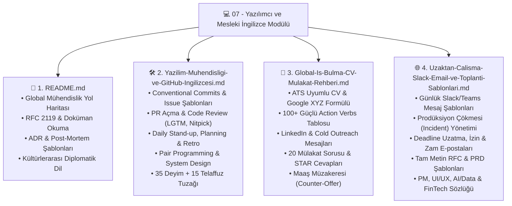
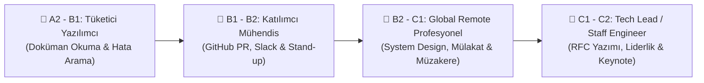

<div align="center">

# 💻 Yazılımcı, Mühendis ve Profesyoneller İçin Global & Remote İngilizce Rehberi

[](#)
[](#-bu-modüldeki-rehberler-dosya-haritası)
[](#)
[](#)

**[⬅️ Önceki Modül: Sınav Hazırlık (IELTS/TOEFL/YDS)](../06-Sinav-Hazirlik-IELTS-TOEFL-YDS/README.md) • [🏠 Ana Sayfa](../README.md) • [➡️ Sonraki Modül: Pratik Alıştırmalar ve Seviye Testleri](../08-Pratik-Alistirmalar-ve-Seviye-Testleri/README.md)**

</div>

---

> **🎯 Bu Modülün Amacı:** Yazılım geliştiricilerin, mühendislerin, ürün yöneticilerinin (PM), UI/UX tasarımcılarının, veri bilimcilerin ve global/uzaktan (*remote*) çalışmak isteyen tüm teknoloji profesyonellerinin; açık kaynak projelerde katkı sağlamasını, uluslararası ekiplerde asenkron/senkron iletişim kurmasını, teknik dokümantasyon (RFC, ADR, PRD, Post-Mortem) yazmasını ve global iş mülakatlarını yüksek maaş teklifleriyle geçmesini sağlamak.

---

## 📑 İçindekiler

1. [🌍 Global Teknoloji Dünyasında Nasıl Bir İngilizce Gerekir?](#-global-teknoloji-dünyasında-nasıl-bir-ingilizce-gerekir)
2. [🗺️ Bu Modüldeki Rehberler (4 Dosyalık Master Harita)](#️-bu-modüldeki-rehberler-4-dosyalık-master-harita)
3. [⚡ Hızlı Önizleme Kartları (Tıkla & Hemen Kullan)](#-hızlı-önizleme-kartları-tıkla--hemen-kullan)
4. [🧭 Yazılımcılar İçin Seviyeye Göre İngilizce Yol Haritası](#-yazılımcılar-için-seviyeye-göre-ingilizce-yol-haritası)
5. [📖 Teknik Dokümantasyon Okuma Stratejileri (RFC, Docs, Stack Overflow)](#-teknik-dokümantasyon-okuma-stratejileri-rfc-docs-stack-overflow)
6. [✍️ Teknik Dokümantasyon Yazma Rehberi (README, ADR, Post-Mortem)](#️-teknik-dokümantasyon-yazma-rehberi-readme-adr-post-mortem)
7. [🌐 Uzaktan (Remote) Çalışma ve Asenkron İletişim Kültürü (Slack, Notion, Jira)](#-uzaktan-remote-çalışma-ve-asenkron-iletişim-kültürü-slack-notion-jira)
8. [🤝 Kültürlerarası İletişim: "Doğrudan" vs "Diplomatik" Geri Bildirim](#-kültürlerarası-iletişim-doğrudan-vs-diplomatik-geri-bildirim)
9. [🎧 Yazılımcılar İçin Günlük İngilizce Maruz Kalma (Immersion) Kaynakları](#-yazılımcılar-için-günlük-ingilizce-maruz-kalma-immersion-kaynakları)

---

## 🌍 Global Teknoloji Dünyasında Nasıl Bir İngilizce Gerekir?

Pek çok yazılımcı ve mühendis, *"IELTS'ten 8.0 almadan veya C2 seviyesinde edebiyat konuşmadan yurt dışına iş yapamam"* yanılgısına düşer. Oysa global teknoloji şirketlerinde (Silicon Valley start-up'larından Avrupa merkezli scale-up'lara kadar) aranan İngilizce **"Edebi İngilizce"** değil, **"Yüksek Netlikli Mühendislik İletişimi" (High-Clarity Engineering Communication)** becerisidir.

Global bir ekipte başarılı olmanız için gereken **4 Temel Sütun**:

| Sütun | Neden Kritik? | Hedef Seviye | İlgili Rehber Dosyamız |
| :--- | :--- | :---: | :--- |
| **1. Teknik Okuma & Araştırma** | Resmi dokümantasyonları, RFC'leri, GitHub Issue tartışmalarını ve hata mesajlarını çeviri aracına ihtiyaç duymadan hızla taramak. | **B1 - B2** | [Ana Rehber (Bu Dosya)](./README.md) |
| **2. Mühendislik & GitHub İletişimi** | PR açmak, yapıcı Code Review yapmak, Daily Stand-up'ta 90 saniyede özet geçmek ve System Design tartışmalarında *trade-off* anlatmak. | **B2** | [Yazılım Mühendisliği & GitHub İngilizcesi](./Yazilim-Muhendisligi-ve-GitHub-Ingilizcesi.md) |
| **3. Global İş Bulma & Mülakat** | ATS uyumlu CV hazırlamak, LinkedIn'den recruiter/manager'lara ulaşmak, 20 klasik mülakat sorusunu STAR tekniğiyle yanıtlamak ve maaş pazarlığı yapmak. | **B2 - C1** | [Global İş Bulma, CV & Mülakat Rehberi](./Global-Is-Bulma-CV-Mulakat-Rehberi.md) |
| **4. Remote Çalışma & Kriz Yönetimi** | Slack/Teams asenkron mesajlaşmaları, prodüksiyon çökmesi (Incident) yönetimi, deadline/zam/izin e-postaları ve RFC/PRD dokümanları yazmak. | **B2 - C1** | [Uzaktan Çalışma, Slack, E-posta & RFC Şablonları](./Uzaktan-Calisma-Slack-Email-ve-Toplanti-Sablonlari.md) |

> 💡 **Altın Kural (Clear over Clever):** Mühendislik İngilizcesinde süslü ve karmaşık cümleler kurmak bir artı değil, eksi puandır. Global ekiplerde en iyi iletişimciler, karmaşık bir sistem mimarisini **en sade, en net ve en az belirsizlik içeren (unambiguous)** cümlelerle anlatabilenlerdir.

---

## 🗺️ Bu Modüldeki Rehberler (4 Dosyalık Master Harita)

Bu klasör, kariyerinizin her aşamasında elinizin altında açık tutacağınız **4 dev kılavuzdan** oluşur:



| # | Dosya Adı | İçerik Özeti | Tahmini Okuma & Uygulama |
| :---: | :--- | :--- | :---: |
| **1** | **[README.md (Ana Rehber)](./README.md)** *(Şu an buradasınız)* | Global çalışma kültürü, teknik okuma/yazma (ADR, RFC, Post-Mortem), Slack/Jira görgü kuralları ve yazılımcı rutini. | ⏱️ 20 dk |
| **2** | **[Yazilim-Muhendisligi-ve-GitHub-Ingilizcesi.md](./Yazilim-Muhendisligi-ve-GitHub-Ingilizcesi.md)** | PR açma, Code Review kalıpları (*LGTM, nitpick, blocking*), Git Commit & Issue şablonları, Agile/Scrum (*Daily, Planning, Retro*), Pair Programming, System Design tartışmaları ve teknik sözlük. | ⏱️ 35 dk |
| **3** | **[Global-Is-Bulma-CV-Mulakat-Rehberi.md](./Global-Is-Bulma-CV-Mulakat-Rehberi.md)** | ATS uyumlu CV ve *Action Verbs*, LinkedIn & *Cold Outreach* mesajları, en sık sorulan 20 HR/Behavioral/Teknik mülakat sorusu ve STAR cevapları, Maaş Müzakeresi (*Salary Negotiation*) şablonları. | ⏱️ 40 dk |
| **4** | **[Uzaktan-Calisma-Slack-Email-ve-Toplanti-Sablonlari.md](./Uzaktan-Calisma-Slack-Email-ve-Toplanti-Sablonlari.md)** | Slack/Teams mesaj şablonları, canlı ortam çökmesi (*Incident War Room*) duyuruları, deadline uzatma / izin / zam isteme / kötü haber verme e-postaları, tam metin RFC & PRD şablonları ve PM, UI/UX, Veri Bilimi/AI, FinTech terimleri. | ⏱️ 35 dk |

---

## ⚡ Hızlı Önizleme Kartları (Tıkla & Hemen Kullan)

Acil bir toplantınız, PR incelemeniz veya mülakatınız mı var? Aşağıdaki kutulara tıklayarak en sık kullanılan şablonları saniyeler içinde kopyalayın:

<details>
<summary><b>🔥 1. 90 Saniyelik Hazır Daily Stand-up Konuşma Şablonu (Tıkla & Aç)</b></summary>

<br>

> *"Morning everyone! **Yesterday**, I wrapped up the pagination logic for the orders API and opened PR #214—it's currently awaiting review. **Today**, I'm picking up JIRA-508 to integrate the new SendGrid email templates. **No blockers** on my end, though I might ping @alex later today to double-check one of the webhook payload fields. That's it from me!"*

👉 Daha fazla Stand-up, Sprint Planning ve Retro kalıbı için: **[Yazılım Mühendisliği ve GitHub İngilizcesi](./Yazilim-Muhendisligi-ve-GitHub-Ingilizcesi.md)**

</details>

<details>
<summary><b>🔍 2. En Sık Kullanılan 5 Code Review Yorumu Kalıbı (Tıkla & Aç)</b></summary>

<br>

* **`[blocking]` (Hata/Risk):** *"I think there might be a race condition here if two requests arrive simultaneously. What if we wrap this block in a database transaction?"*
* **`suggestion:` (Temiz Kod):** *"Suggestion: We could extract this validation logic into a separate helper function to keep the controller lean and easier to unit-test."*
* **`question:` (Anlama):** *"Could you walk me through the reasoning behind caching this in memory rather than Redis? Curious about multi-instance behavior."*
* **`nit:` (Ufak Detay):** *"Nit: Could we rename `d` to `expirationDays` so the unit of time is immediately obvious? Non-blocking!"*
* **`Approval` (Onay):** *"LGTM! 🚀 Super clean implementation. Left one minor non-blocking nit, approving in advance so you're not blocked."*

👉 Tüm PR ve Code Review şablonları için: **[Yazılım Mühendisliği ve GitHub İngilizcesi](./Yazilim-Muhendisligi-ve-GitHub-Ingilizcesi.md)**

</details>

<details>
<summary><b>💰 3. Teklifi $5,000 – $20,000 Yukarı Çeken Maaş Pazarlığı (Counter-Offer) Kalıbı (Tıkla & Aç)</b></summary>

<br>

> *"Thank you again for extending the offer! After reviewing the package, I'd love to discuss the base salary component. Given my 5+ years of experience with Go and distributed systems, my track record of scaling high-throughput APIs, and current market rates for similar senior remote roles, I was hoping we could bring the base salary closer to **$95,000**. If we can bridge that gap, I would be thrilled to sign the offer letter today!"*

👉 Tüm CV, STAR mülakat cevapları ve maaş müzakeresi e-postaları için: **[Global İş Bulma, CV ve Mülakat Rehberi](./Global-Is-Bulma-CV-Mulakat-Rehberi.md)**

</details>

<details>
<summary><b>🚨 4. Canlı Sistem Çöktüğünde (Production Incident) Slack'e Yazılacak İlk Mesaj (Tıkla & Aç)</b></summary>

<br>

> 🔴 **[INC-509 | SEV-1] Investigating Elevated 5xx Errors on Checkout API**
> *"I'm on-call and investigating the PagerDuty alert for elevated HTTP 502/504 errors on `api.company.com/checkout`. Impact started at **11:14 UTC**. Spinning up a Zoom war room here: [Link]. I will post updates in this thread every 15 minutes."*

👉 Kriz yönetimi, deadline uzatma ve RFC/PRD şablonları için: **[Uzaktan Çalışma: Slack, E-posta ve Toplantı Şablonları](./Uzaktan-Calisma-Slack-Email-ve-Toplanti-Sablonlari.md)**

</details>

---

## 🧭 Yazılımcılar İçin Seviyeye Göre İngilizce Yol Haritası



### Aşama 1: A2'den B1'e Geçiş — "Tüketici Yazılımcı"dan Çıkış
* **Mevcut Durum:** Kod yazabiliyorsunuz, hata mesajlarını Google'da aratıp Stack Overflow'daki kod bloğunu kopyalıyorsunuz ama açıklamalardaki uzun paragrafları atlıyorsunuz.
* **Yapılacaklar:**
  1. Kullandığınız IDE (VS Code, IntelliJ), işletim sistemi, terminal ve Git arayüzlerini tamamen İngilizce yapın.
  2. Türkçe video kurslar yerine resmi dokümantasyonları (MDN, React Docs, Python Docs, Go by Example) yüksek sesle okuyarak çalışın.
  3. Kendi kişisel projelerinizde bile **tüm değişken adlarını, yorum satırlarını (`// TODO`, `// FIXME`) ve Git commit mesajlarını** İngilizce yazmaya hemen bugün başlayın.

### Aşama 2: B1'den B2'ye Geçiş — "Katılımcı Mühendis"
* **Mevcut Durum:** Dokümanları ve teknik videoları %80 anlıyorsunuz ancak canlı toplantıda konuşurken veya PR'a uzun bir yorum yazarken tıkanıyorsunuz.
* **Yapılacaklar:**
  1. Açık kaynak (Open Source) projelerdeki tartışmaları (GitHub Issues & Pull Requests) okuyun ve küçük katkılar (doküman düzeltmesi, bug raporu) yaparak gerçek mühendislerle yazışın.
  2. Kod yazarken kendi kendinize sesli olarak ne yaptığınızı İngilizce anlatın (**Rubber Duck Debugging in English**): *"Okay, so this function takes a user payload and validates the JWT token before hitting the database..."*
  3. [Yazılım Mühendisliği ve GitHub İngilizcesi](./Yazilim-Muhendisligi-ve-GitHub-Ingilizcesi.md) rehberindeki Stand-up ve Code Review kalıplarını günlük işinizde kullanın.

### Aşama 3: B2'den C1'e Geçiş — "Global Remote Profesyonel & Tech Lead"
* **Mevcut Durum:** Günlük işleri rahatça yürütüyorsunuz; hedefiniz mimari kararları (System Design) ikna edici biçimde savunmak, üst düzey mülakatları geçmek ve kriz anlarını (Incident Management) yönetmek.
* **Yapılacaklar:**
  1. Büyük teknoloji şirketlerinin mühendislik bloglarını (Netflix TechBlog, Uber Engineering, Cloudflare Blog, Stripe Engineering) okuyup mimari argümanların nasıl kurulduğunu analiz edin.
  2. Tasarım dokümanları (RFC / ADR) ve olay sonrası analiz raporları (Blameless Post-Mortem) yazma pratiği yapın.
  3. [Global İş Bulma, CV ve Mülakat Rehberi](./Global-Is-Bulma-CV-Mulakat-Rehberi.md) içindeki STAR hikayelerinizi hazırlayıp sesli prova (Mock Interview) yapın.

---

## 📖 Teknik Dokümantasyon Okuma Stratejileri (RFC, Docs, Stack Overflow)

Teknik metinler roman gibi baştan sona aynı hızda okunmaz. Profesyonel mühendisler **3 Katmanlı Okuma Tekniği** kullanır:

### 1. Katman: Tarama (Skimming & Scanning) — 30 Saniye
* Başlıkları (`H1, H2, H3`), kod bloklarını, uyarı kutularını (`Note`, `Warning`, `Deprecated`, `Breaking Change`) ve kalın yazılmış terimleri gözle tarayın.
* **Kritik Sinyal Kelimeleri:**
  * **`Deprecated`:** Kullanımdan kaldırılıyor (yakında silinecek, yeni projede kullanma).
  * **`Breaking Change`:** Geriye dönük uyumluluğu bozan değişiklik (versiyon yükseltirken kodunuzu kırabilir).
  * **`Caveat` / `Gotcha`:** Dikkat edilmesi gereken ince tuzak / istisnai durum.
  * **`Idempotent`:** Aynı işlemin birden fazla kez uygulanmasının ilk uygulamadan farklı bir sonuç üretmemesi.
  * **`Out of the box`:** Ekstra ayar gerektirmeden, kurulduğu haliyle hazır çalışan.
  * **`Under the hood`:** Arka planda, kaputun altında (iç çalışma mekanizması).
  * **`Boilerplate`:** Her projede tekrar tekrar yazılması gereken standart/kalıp kod.
  * **`Opinionated`:** Klasör yapısını ve kurallarını kendisi dayatan framework (örn. Next.js, Angular, NestJS).
  * **`Unopinionated`:** Mimari kararları yazılımcıya bırakan esnek kütüphane (örn. Express.js, React).

### 2. Katman: RFC (Request for Comments) ve Spesifikasyon Okuma
IETF standartlarında ve kurumsal mimari dokümanlarda geçen modal fiillerin **özel ve kesin anlamları** vardır (RFC 2119 standardı):

| Kelime | Teknik Dokümandaki Kesin Anlamı | Örnek Cümle |
| :--- | :--- | :--- |
| **`MUST` / `REQUIRED` / `SHALL`** | **Kesin zorunluluk.** Uyulmazsa sistem/protokol çalışmaz veya standart dışı kalır. | *All API requests **MUST** include a valid `Authorization` header.* |
| **`MUST NOT` / `SHALL NOT`** | **Kesin yasak.** Asla yapılmamalıdır. | *Plaintext passwords **MUST NOT** be logged under any circumstances.* |
| **`SHOULD` / `RECOMMENDED`** | **Güçlü tavsiye.** Çok geçerli bir mimari sebep yoksa mutlaka uygulanmalıdır. | *Responses **SHOULD** be cached for at least 60 seconds to reduce load.* |
| **`SHOULD NOT` / `NOT RECOMMENDED`** | **Güçlü kaçınma tavsiyesi.** Özel bir durum yoksa yapılmamalıdır. | *Synchronous calls **SHOULD NOT** be used for heavy batch processing.* |
| **`MAY` / `OPTIONAL`** | **Tamamen isteğe bağlı.** Uygulanıp uygulanmaması geliştiriciye/sisteme kalmıştır. | *The client **MAY** retry the request using exponential backoff.* |

---

## ✍️ Teknik Dokümantasyon Yazma Rehberi (README, ADR, Post-Mortem)

İyi bir mühendisi "kıdemli" (Senior/Staff) yapan en önemli farklardan biri, kendisinden sonra gelecek yazılımcılar için **net ve yaşayan dokümantasyon** yazabilmesidir.

### Teknik Yazımda 5 Altın Kural
1. **Edilgen (Passive) Yerine Etken (Active) Cümle Kurun:**
   * ❌ *Zayıf (Passive):* *The configuration file is read by the server on startup.*
   * ✅ *Güçlü (Active):* *The server reads the configuration file on startup.*
2. **Belirsiz Zamirlerden (`It`, `This`, `They`) Kaçının:**
   * ❌ *Belirsiz:* *When the service calls the database, it may time out if it is overloaded.* (`it` hangisi? Servis mi, veritabanı mı?)
   * ✅ *Net:* *When the auth service queries the database, the query may time out if the database is overloaded.*
3. **Emir Kipini (Imperative Mood) Adımlarda Kullanın:**
   * Kurulum adımlarında *"You should run..."* veya *"Now we will install..."* yerine doğrudan fiille başlayın: *"Run the migration script"*, *"Install the dependencies"*, *"Set the environment variables"*.
4. **Kısa Cümleler ve Madde İşaretleri (Bullet Points) Kullanın:**
   * 30 kelimelik tek bir paragraf yerine 3 maddelik bir liste, teknik okuyucu tarafından 3 kat daha hızlı anlaşılır.
5. **Önce "Ne" ve "Neden", Sonra "Nasıl":**
   * Bir dokümana doğrudan kod bloğuyla başlamayın. İlk paragrafta bu modülün **hangi problemi çözdüğünü** tek cümleyle açıklayın.

---

### Şablon 1: Mimari Karar Kaydı — ADR (Architecture Decision Record)
Takım içinde alınan önemli teknik kararların (neden PostgreSQL seçtik, neden GraphQL yerine REST kullandık vb.) kaybolmaması için yazılan standart şablondur:

```markdown
# ADR-004: Adopt Redis for Distributed Session Caching

* **Status:** Accepted (2026-11-15)
* **Deciders:** Backend Platform Team

## Context and Problem Statement
Our authentication service currently stores user sessions in memory on individual nodes. As we scale horizontally behind a load balancer, sticky sessions have become unreliable, causing intermittent logouts during deployments. We need a shared, low-latency session store.

## Considered Options
1. **PostgreSQL (Existing Primary DB):** No new infrastructure, but adds high read/write pressure on the primary database.
2. **Redis Cluster:** Sub-millisecond latency, built-in TTL (Time-To-Live) support for session expiration, battle-tested for caching.
3. **Stateless JWT Only:** Zero server-side storage, but makes immediate token revocation (e.g., on password reset) difficult.

## Decision Outcome
Chosen option: **Option 2 (Redis Cluster)**, because it provides sub-millisecond lookups, native TTL expiration, and allows instant session invalidation without overloading our primary relational database.

## Consequences
* **Positive:** Seamless horizontal scaling; zero downtime during rolling deployments; instant logout/revocation capability.
* **Negative / Risks:** Introduces an additional infrastructure dependency; requires configuring Redis Sentinel/Cluster for high availability.
```

---

### Şablon 2: Suçlamasız Olay Sonrası Raporu — Blameless Post-Mortem (Incident Report)
Canlı ortamda (Production) bir çökme veya kesinti yaşandığında, kişileri suçlamadan (*blameless*) kök nedeni ve alınan önlemleri paylaşmak için kullanılır:

```markdown
# Incident Post-Mortem: Checkout API Outage (INC-402)

* **Date:** November 14, 2026
* **Duration:** 42 minutes (14:10 UTC – 14:52 UTC)
* **Impact:** ~18% of checkout requests failed with HTTP 504 Gateway Timeout.

## Executive Summary
At 14:10 UTC, following the deployment of `v2.14.0`, the Checkout API experienced connection pool exhaustion on the primary database. The root cause was a newly introduced query lacking a composite index on the `orders` table, which triggered full table scans under peak traffic. Service was fully restored at 14:52 UTC by rolling back to `v2.13.9`.

## Timeline (UTC)
* **14:08:** Deployment of `v2.14.0` completed in production.
* **14:10:** PagerDuty alert triggered for elevated HTTP 5xx error rates and DB CPU reaching 98%.
* **14:18:** On-call engineer identified slow queries locking DB connections via APM traces.
* **14:35:** Decision made to roll back `v2.14.0` rather than hotfix in place.
* **14:52:** Rollback completed; connection pool and latency returned to baseline.

## Root Cause Analysis (5 Whys)
1. **Why did requests fail?** The API gateway timed out waiting for the Checkout service.
2. **Why was the Checkout service unresponsive?** All database connections in the pool were exhausted.
3. **Why was the pool exhausted?** Queries were taking >12 seconds instead of <15ms.
4. **Why were queries slow?** A new filter on `(user_id, status, created_at)` performed a sequential scan on a 40M-row table.
5. **Why wasn't this caught in staging?** The staging database only contains 50,000 rows, where sequential scans remain fast.

## Action Items
- [ ] **[Immediate]** Add composite index `idx_orders_user_status_created` using `CREATE INDEX CONCURRENTLY`. *(Owner: @backend-team)*
- [ ] **[Short-term]** Add automated `EXPLAIN ANALYZE` checks in CI for new database migrations. *(Owner: @devops-team)*
- [ ] **[Long-term]** Seed the performance testing environment with production-scale synthetic data. *(Owner: @platform-team)*
```

---

## 🌐 Uzaktan (Remote) Çalışma ve Asenkron İletişim Kültürü (Slack, Notion, Jira)

Global remote şirketlerde (GitLab, Automattic, Zapier vb.) farklı saat dilimlerindeki (Time Zones) mühendisler birlikte çalışır. Bu yüzden **Asenkron İletişim (Async Communication)** hayati önem taşır.

### 1. "No Hello" Kuralı (Asla Sadece "Hi" Yazıp Beklemeyin!)
Remote kültürde bir iş arkadaşınıza Slack veya Teams üzerinden sadece *"Hi Sarah, are you there?"* yazıp cevabını beklemek büyük bir zaman kaybı ve görgü hatası olarak kabul edilir ([nohello.net](https://nohello.net/)).

* ❌ **Yanlış (Senkron Zorlama):**
  > **You (10:00):** Hi Alex!
  > **You (10:01):** Quick question when you have a sec.
  > *(Alex 2 saat sonra görür: "Hey, sure, what's up?" yazar, bu sefer siz yemekte olursunuz. Tek bir soru 5 saate yayılır.)*

* ✅ **Doğru (Asenkron & Bağlam Dolu Mesaj):**
  > **You (10:00):** *"Hey Alex! Hope your week is going well. Quick question regarding the Stripe webhook handler in PR #342: I noticed we're not handling the `invoice.payment_failed` event yet. Was that intentionally deferred to the next sprint, or should I include it in my current ticket (JIRA-891)? No rush at all—whenever you're online!"*

### 2. Slack / Teams İçin En Sık Kullanılan Mesaj Kalıpları

| Durum | Doğal ve Profesyonel Kalıp (Slack / Teams) | Türkçe Karşılığı / Kullanım Amacı |
| :--- | :--- | :--- |
| **Acil Olmayan Soru Sorma** | *"Async question — no rush on this: ..."* | Acelesi yok, müsait olduğunda bakabilirsin. |
| **Herkese Duyuru / Bilgi** | *"FYI / Heads-up for the team: we're deploying `v1.8` to staging in 10 mins."* | Bilginize / Önden uyarı: 10 dk içinde staging'e çıkıyoruz. |
| **Uzun Mesajın Özeti** | *"TL;DR: We decided to postpone the migration until Monday to avoid Friday risks."* | Özetle (Too Long; Didn't Read): Göç işlemini Pazartesiye erteledik. |
| **İlgili Kişiyi Etiketleme** | *"Looping in @david since he wrote the original auth middleware."* | Orijinal kodu yazdığı için @david'i de konuya dahil ediyorum. |
| **Topu Başkasına Atma** | *"Deferring to @elena on this as she owns the billing service."* | Faturalandırma servisinin sahibi olduğu için sözü/kararı @elena'ya bırakıyorum. |
| **Mesai Bitişi / Mola Bildirimi** | *"Stepping away for a dentist appointment, back online in ~90 mins."* | Dişçi randevusu için ayrılıyorum, ~90 dk sonra tekrar çevrimiçiyim. |
| **Günü Kapatma** | *"Wrapping up for the day! Feel free to leave comments on PR #112 and I'll address them first thing tomorrow morning."* | Günü kapatıyorum! PR #112'ye yorum bırakabilirsiniz, yarın sabah ilk iş bakacağım. |
| **Hatayı Üstlenme** | *"My bad! I pushed to the wrong branch. Reverting it right now."* | Benim hatam! Yanlış branch'e attım, hemen geri alıyorum. |

### 3. Slack / GitHub Kısaltmaları Sözlüğü

* **`AFAIK`** (*As Far As I Know*): Bildiğim kadarıyla.
* **`IIRC`** (*If I Recall Correctly*): Yanlış hatırlamıyorsam.
* **`IMHO` / `IMO`** (*In My Humble Opinion*): Bence / Naçizane fikrime göre.
* **`ETA`** (*Estimated Time of Arrival*): Tahmini bitiş/teslim süresi (*"Do we have an ETA for the hotfix?"*).
* **`EOD` / `COB`** (*End of Day / Close of Business*): Mesai bitimine kadar (*"I'll have the PR ready by EOD"*).
* **`EOY` / `EOQ` / `EOW`**: Yıl sonu / Çeyrek sonu / Hafta sonu (*End of Week*).
* **`OOO`** (*Out of Office*): İzinde / Ofis dışında (*"I'll be OOO next Friday"*).
* **`PTO`** (*Paid Time Off*): Ücretli izin.
* **`WIP`** (*Work In Progress*): Üzerinde çalışılıyor, henüz bitmedi.
* **`POC`** (*Proof of Concept* / *Point of Contact*): Kavram kanıtı (prototip) VEYA İlgili iletişim kişisi.
* **`TBD` / `TBC`** (*To Be Determined / To Be Confirmed*): Henüz netleşmedi / Onaylanacak.
* **`WFM`** (*Works For Me*): Bende çalışıyor / Benim için uygun.

---

## 🤝 Kültürlerarası İletişim: "Doğrudan" vs "Diplomatik" Geri Bildirim

Türkçeden İngilizceye doğrudan çeviri yaptığımızda, özellikle İngiliz (UK) ve Kuzey Amerika (US) çalışma kültüründe **fazla sert veya emredici (blunt/demanding)** duyulabiliriz.

Aşağıdaki tablo, düşüncenizi kırmadan ama netliğinden de ödün vermeden nasıl **diplomatik mühendislik diline** dönüştüreceğinizi gösterir:

| Ne Demek İstiyorsunuz? | ❌ Fazla Sert / Doğrudan (Kaçının) | ✅ Profesyonel, Yapıcı ve Doğal (Kullanın) |
| :--- | :--- | :--- |
| **"Bu kod yanlış çalışıyor."** | *This code is wrong and breaks the app.* | *It looks like this logic might cause an edge-case failure when the input is null. What if we add a guard clause here?* |
| **"Bunu daha önce söylemiştim."** | *As I already told you yesterday...* | *Echoing my earlier note from yesterday's thread, we'll need to...* |
| **"Bu yetişmez, imkansız."** | *We can't finish this by Friday. It's impossible.* | *Given our current bandwidth, delivering the full scope by Friday is a stretch. We can either ship the core MVP by Friday or push the full release to Tuesday—which do you prefer?* |
| **"Neden böyle yaptın?"** | *Why did you write it this way?* | *Could you walk me through the reasoning behind this approach? I'm curious how it compares to using X.* |
| **"Dokümanı okumamışsın."** | *You didn't read the documentation.* | *I've documented the setup steps in the README [link]—let me know if any part of that flow is unclear!* |
| **"Toplantı konudan saptı."** | *Stop talking about this, it's off-topic.* | *In the interest of time, shall we take this discussion offline and get back to the main agenda?* |

---

## 🎧 Yazılımcılar İçin Günlük İngilizce Maruz Kalma (Immersion) Kaynakları

Yabancı bir dilde teknik akıcılık kazanmanın en hızlı yolu, **zaten öğrenmek zorunda olduğunuz mühendislik konularını İngilizce kaynaklardan** takip etmektir:

### 🎙️ Yazılım & Mühendislik Podcastleri (Dinleme + Jargon)
1. **[Syntax.fm](https://syntax.fm/)** (`B1-B2`): Web geliştirme, frontend/backend trendleri ve günlük yazılımcı sohbetleri. Çok doğal ve samimi bir konuşma dili vardır.
2. **[Software Engineering Daily](https://softwareengineeringdaily.com/)** (`B2-C1`): Sistem mimarisi, bulut teknolojileri ve veritabanları üzerine derinlemesine teknik mülakatlar.
3. **[The Pragmatic Engineer Podcast](https://podcast.pragmaticengineer.com/)** (`B2-C1`): Gergely Orosz'un Big Tech (FAANG) mühendislik kültürü, kariyer basamakları ve sistem tasarımı üzerine sohbetleri.
4. **[Changelog](https://changelog.com/podcast)** & **[Go Time](https://changelog.com/gotime)** (`B2`): Açık kaynak dünyası, Go, altyapı ve yazılım kültürü.
5. **[Darknet Diaries](https://darknetdiaries.com/)** (`B1-B2`): Siber güvenlik, hack hikayeleri ve ağ güvenliği üzerine hikaye anlatıcılığıyla (storytelling) kurgulanmış sürükleyici bir podcast.

### 📺 YouTube Kanalları (Sunum & Teknik Anlatım)
* **[Fireship](https://www.youtube.com/@Fireship):** *100 Seconds of Code* serisi ile hızlı, yoğun ve esprili teknoloji özetleri.
* **[ByteByteGo](https://www.youtube.com/@ByteByteGo):** System Design mülakatlarında kullanacağınız cümle kalıplarını görsel animasyonlarla öğreten bir numaralı kanal.
* **[Hussein Nasser](https://www.youtube.com/@hnasr):** Backend mühendisliği, veritabanı iç yapıları, ağ protokolleri ve gerçek dünya mimari tartışmaları.
* **[Theo - t3.gg](https://www.youtube.com/@t3dotgg)** & **[ThePrimeagen](https://www.youtube.com/@ThePrimeagen):** Güncel yazılım tartışmaları, mühendislik makalesi okumaları ve doğal Amerikan yazılımcı argosu/idiomları.

### 📰 Mühendislik Blogları ve Bültenler (Okuma + Yazım Stili)
* **[The Pragmatic Engineer Newsletter](https://blog.pragmaticengineer.com/)**
* **[ByteByteGo Newsletter](https://blog.bytebytego.com/)**
* **[Hacker News (Y Combinator)](https://news.ycombinator.com/):** Sadece haber başlıklarını değil, altındaki mühendis yorumlarını okuyun; tartışma ve argüman kurma dilini öğrenmek için eşsizdir.
* **[Martin Fowler's Blog](https://martinfowler.com/):** Yazılım mimarisi ve temiz kod üzerine C1 seviyesinde kusursuz teknik yazım örnekleri.

---

## 🚀 Modüldeki Diğer 3 Rehbere Hemen Geçin!

1. 🛠️ **[Yazılım Mühendisliği ve GitHub İngilizcesi](./Yazilim-Muhendisligi-ve-GitHub-Ingilizcesi.md):** Pull Request (PR), Code Review, Git Commit, Daily Stand-up, Pair Programming ve System Design kalıpları.
2. 🎯 **[Global İş Bulma, CV ve Mülakat Rehberi](./Global-Is-Bulma-CV-Mulakat-Rehberi.md):** ATS uyumlu CV, 100+ Action Verbs, LinkedIn Cold Message, 20 Mülakat Sorusu (STAR cevaplarıyla) ve Maaş Müzakeresi.
3. 🌐 **[Uzaktan Çalışma: Slack, E-posta, Kriz Yönetimi ve Sektörel İngilizce Şablonları](./Uzaktan-Calisma-Slack-Email-ve-Toplanti-Sablonlari.md):** Günlük Slack mesajları, prodüksiyon krizi (Incident) yönetimi, deadline/izin/zam e-postaları, RFC/PRD şablonları ve PM, UI/UX, AI/Veri Bilimi, FinTech terimleri.
