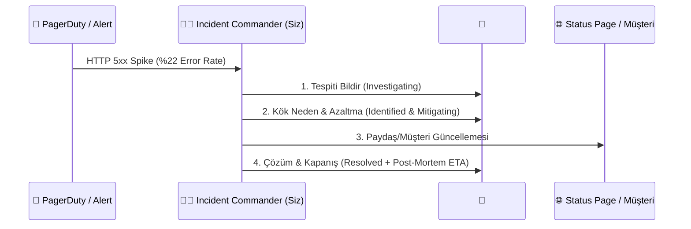

# 🌐 Uzaktan Çalışma (Remote Work): Slack, E-posta, Kriz Yönetimi, RFC/PRD ve Sektörel İngilizce Şablonları

[⬅️ Önceki Dosya: Global İş Bulma, CV ve Mülakat Rehberi](./Global-Is-Bulma-CV-Mulakat-Rehberi.md) | [🏠 Modül Ana Sayfası](./README.md) | [➡️ Sonraki Modül: Pratik Alıştırmalar ve Seviye Testleri](../08-Pratik-Alistirmalar-ve-Seviye-Testleri/README.md)

> **Bu Rehberin Amacı:** Global bir şirkette işe girdikten sonraki **ilk günden liderlik aşamasına kadar** karşılaşacağınız tüm yazılı ve sözlü iletişim senaryolarını (Slack/Teams asenkron mesajları, canlı sistem çökmesi / Incident yönetimi, deadline uzatma, izin ve zam isteme, müşteriye kötü haber verme, tam metin RFC ve PRD doküman şablonları) ve **4 farklı disiplin için (Ürün Yönetimi/PM, UI/UX Tasarım, Veri Bilimi/AI, FinTech/Finans) sektörel İngilizce sözlüğünü** kopyala-yapıştır formatında sunmak.

---

## 📑 İçindekiler

1. [💬 Slack & Microsoft Teams Asenkron Mesajlaşma Şablonları (Günlük Senaryolar)](#-slack--microsoft-teams-asenkron-mesajlaşma-şablonları-günlük-senaryolar)
2. [🚨 Prodüksiyon Çökmesi ve Kriz İletişimi (Incident Management & War Room)](#-prodüksiyon-çökmesi-ve-kriz-iletişimi-incident-management--war-room)
3. [📧 Kritik Kurumsal E-posta ve Mesaj Şablonları (Deadline, İzin, Zam, Kötü Haber)](#-kritik-kurumsal-e-posta-ve-mesaj-şablonları-deadline-izin-zam-kötü-haber)
4. [📐 Teknik Tasarım Dokümanı (RFC) ve Ürün Gereksinim Dokümanı (PRD) Tam Şablonları](#-teknik-tasarım-dokümanı-rfc-ve-ürün-gereksinim-dokümanı-prd-tam-şablonları)
5. [🎙️ Online Toplantı (Zoom / Meet) Yönetimi ve Sunum Kalıpları](#️-online-toplantı-zoom--meet-yönetimi-ve-sunum-kalıpları)
6. [🏢 Sektörel İngilizce Sözlüğü: PM, UI/UX, Data Science/AI ve FinTech](#-sektörel-ingilizce-sözlüğü-pm-uiux-data-scienceai-ve-fintech)

---

## 💬 Slack & Microsoft Teams Asenkron Mesajlaşma Şablonları (Günlük Senaryolar)

Remote çalışan ekiplerde yüz yüze mimikler olmadığı için kısa mesajlar yanlış anlaşılabilir. Aşağıdaki şablonlar hem **net (clear)** hem de **kibar ve işbirlikçi (collaborative)** bir ton sağlar:

### 1. Ekibe İlk Gün Tanışma Mesajı (`#general` veya `#engineering` Kanalı)
```text
Hey everyone! 👋 Thrilled to join the team today as a [Your Role, e.g., Senior Backend Engineer] on the [Squad/Team Name] squad!

A quick bit about me: I'm based in [City, Turkey (UTC+3)] and have spent the last [X] years working primarily with [Tech 1, Tech 2, Tech 3]. Outside of work, I'm a big fan of [Hobby 1, e.g., specialty coffee] and [Hobby 2, e.g., hiking / sci-fi books].

I'm spending my first few days setting up my local environment and reading through the onboarding docs, so please feel free to say hi or drop any tips my way. Looking forward to building great things together! 🚀
```

### 2. Başka Bir Ekipten / Kişiden Yardım İsteme (Blocker Çözme)
```text
Hey @channel / @name 👋 Hope your week is going smoothly!

**Context:** I'm currently working on [Ticket ID: e.g., ENG-412] to integrate the new billing webhook.
**Issue:** When I call `POST /v2/subscriptions/preview` in the staging environment, I'm consistently getting a `403 Forbidden (Invalid Scope)` error even though my service token has `billing:write` permissions.
**What I've tried:**
1. Regenerated the staging API credentials via Vault.
2. Verified the token payload against the OpenAPI spec.

**Ask:** Is there an additional internal header or IP allowlist required for staging calls? (Logs & curl snippet attached in thread 🧵). No rush if you're heads-down—thanks in advance!
```

### 3. Nazikçe Hatırlatma Yapma (Gentle Follow-up / Ping)
Bir PR incelemesi veya cevabı geciktiğinde karşı tarafı sıkboğaz etmeden hatırlatma:
* **24 Saat Sonra:** *"Hey @sarah, gentle ping on this thread whenever you come up for air! Let me know if you need any extra context from my side."*
* **Bloklandığınızda:** *"Hi @david, floating this back to the top of your inbox—we're hoping to merge this before tomorrow's staging cut. Would you have 10 minutes today to take a look, or should I reassign the review to someone else on the squad?"*

### 4. Fazla İş Yükünü Kibarca Reddetme (Pushing Back / Managing Bandwidth)
* *"Hey @manager, I'd love to help out with the analytics migration, but I'm currently heads-down on the Q4 checkout release which is due Friday. If the analytics task is higher priority, which of my current sprint tickets should we deprioritize or hand off to make room for it?"*

---

## 🚨 Prodüksiyon Çökmesi ve Kriz İletişimi (Incident Management & War Room)

Canlı sistem (Production) çöktüğünde herkes gergindir. Bu anlarda **kısa, zaman damgalı ve panik yaratmayan** mesajlar yazmak sizi anında lider konumuna taşır.



### 1. Olayı İlk Üstlenme (`Investigating`)
> 🔴 **[INC-509 | SEV-1] Investigating Elevated 5xx Errors on Checkout API**
> *"I'm on-call and investigating the PagerDuty alert for elevated HTTP 502/504 errors on `api.company.com/checkout`. Impact started at **11:14 UTC**. Spinning up a Zoom war room here: [Link]. I will post updates in this thread every 15 minutes."*

### 2. Kök Nedeni Bulma ve Müdahale (`Identified & Mitigating`)
> 🟡 **[INC-509 Update — 11:24 UTC]**
> *"We've identified the root cause: a spike in unindexed queries following the `v4.2.0` release at 11:10 UTC has saturated primary DB CPU at 100%. We are currently rolling back `v4.2.0` to `v4.1.9` and killing long-running PIDs. ETA for recovery: ~10 minutes."*

### 3. Кrizin Çözüldüğünü Duyurma (`Resolved`)
> 🟢 **[INC-509 Resolved — 11:36 UTC]**
> *"Rollback to `v4.1.9` is complete. Error rates and p95 latency have returned to normal baseline levels for the past 10 minutes. Total customer-facing impact was **22 minutes** (11:14 – 11:36 UTC). I'll circulate the draft Blameless Post-Mortem doc by EOD tomorrow. Thanks @elena and @cem for jumping in quickly!"*

---

## 📧 Kritik Kurumsal E-posta ve Mesaj Şablonları (Deadline, İzin, Zam, Kötü Haber)

### Şablon 1: Teslim Tarihinin (Deadline) Sarkacağını Önceden Bildirme
> 💡 **Kural:** Teslim tarihini **son gün** değil, risk ortaya çıktığı anda **çözüm önerisiyle** birlikte bildirin!

```text
Subject: Heads-up: Timeline update for [Feature/Project Name] (JIRA-710)

Hi [Manager / PM Name],

I wanted to give you an early heads-up regarding the timeline for the [Feature Name] release, currently targeted for [Original Date, e.g., Friday, Nov 20].

While implementing the third-party payment webhook, we uncovered an undocumented rate-limit constraint in the vendor's API that requires us to add an asynchronous queueing layer. Because of this extra architectural work, completing the full scope will take an additional [X days, e.g., 3 business days], shifting our target launch to [New Date, e.g., Wednesday, Nov 25].

To minimize the impact on our sprint goals, we have two options:
1. **Option A (Recommended):** Ship the core flow without bulk-import on Friday as planned, and release bulk-import on Wednesday.
2. **Option B:** Hold the entire release until Wednesday so everything goes out together.

Please let me know which option works best from a product perspective!

Best,
[Your Name]
```

---

### Şablon 2: İzin İsteme (PTO / Vacation Request) ve "Out of Office" (OOO) Otomatik Yanıtı

**Yöneticiden İzin İsteme Mesajı:**
```text
Hi [Manager Name],

I'd like to request PTO from [Start Date] through [End Date] (returning on [Return Date]).

Before I head out, I'll make sure all my current sprint tickets for [Project X] are merged and documented, and @[Teammate Name] has kindly agreed to cover any urgent questions on the billing service while I'm away.

Let me know if those dates work on your end—I'll log it in [HR Tool: Deel / BambooHR / Workday] once approved!
```

**Otomatik E-posta Yanıtı (Out of Office Auto-Reply):**
```text
Subject: Out of Office: [Your Name] (Returning [Date])

Hi there,

Thanks for your email! I am currently out of the office on PTO from [Start Date] to [End Date] with no access to email or Slack. I will respond to your message as soon as I return on [Return Date].

• For urgent engineering issues related to [Service/Team Name], please reach out to @[Teammate Name] ([teammate@company.com]) or post in [#team-channel].
• For product/roadmap inquiries, please contact @[PM Name] ([pm@company.com]).

Best regards,
[Your Name]
```

---

### Şablon 3: Mevcut Şirkette Maaş Artışı / Terfi Görüşmesi Talep Etme (Raise & Promotion Request)

```text
Subject: Preparing for our upcoming 1:1 — Career Growth & Compensation Review

Hi [Manager Name],

Ahead of our 1:1 on [Day], I'd love to dedicate part of our conversation to reviewing my impact over the past [6 / 12 months] and discussing a compensation adjustment.

Since my last review, my scope has expanded significantly:
• Led the end-to-end architecture and delivery of [Project A], which [quantifiable metric, e.g., reduced infrastructure costs by 28% / unlocked $200k in ARR].
• Took full ownership of [Service B], maintaining 99.98% uptime and reducing on-call alerts by 50%.
• Onboarded and mentored [X] new engineers on the squad.

Based on this expanded scope and current market benchmarks for [Role / Seniority Level], I'd love to discuss adjusting my base compensation to [$Target Amount] (and/or my progression toward [Next Level, e.g., Senior / Staff Engineer]).

I've put together a brief 1-page summary of my key deliverables [Link to Doc] so we can review it together during our call. Looking forward to chatting!

Best,
[Your Name]
```

---

### Şablon 4: Müşteriye / Paydaşa Kötü Haber Verme (Özellik İptali veya Hata Bildirimi)

```text
Subject: Update regarding your request on [Feature / Issue Name]

Hi [Client/Stakeholder Name],

Thank you for your patience while our engineering team investigated the issue you reported with [specific feature].

We identified that the behavior stems from a limitation in how legacy CSV files over 100MB are parsed synchronously. While we've deployed an immediate hotfix so your exports no longer fail for files up to 250MB, full support for multi-gigabyte streaming exports is slated for our Q1 infrastructure overhaul rather than this month's release.

In the meantime, to make sure your team isn't blocked, we've enabled automatic date-range chunking on your account so you can export the full dataset in two clicks.

Please let me know if you'd like to hop on a quick 10-minute call to walk through the workaround!

Warm regards,
[Your Name]
```

---

## 📐 Teknik Tasarım Dokümanı (RFC) ve Ürün Gereksinim Dokümanı (PRD) Tam Şablonları

Büyük ölçekli bir özelliğe kod yazarak başlanmaz; önce **RFC (Request for Comments — Mühendislik Tasarım Dokümanı)** veya **PRD (Product Requirements Document)** yazılır.

### 1. Tam Metin Mühendislik RFC (Request for Comments) Şablonu

```markdown
# RFC-018: Real-Time Webhook Delivery & Retry Pipeline

* **Author:** @your-name
* **Status:** Draft | In Review | Approved
* **Reviewers:** @backend-leads, @sre-team
* **Created:** 2026-11-15

## 1. Objective / Summary
Design a scalable, fault-tolerant outbound webhook delivery pipeline capable of delivering 5,000 events/sec to customer endpoints with at-least-once delivery guarantees and automated exponential backoff retries.

## 2. Non-Goals (Out of Scope)
* **Strictly-once (exactly-once) delivery:** Customers will instead use the provided `X-Webhook-Id` header for idempotency on their side.
* **Custom payload transformations:** All webhooks will follow our standard v2 JSON schema.

## 3. Proposed Architecture
1. **Event Producer:** Core services publish domain events to the `outbound-webhooks` Kafka topic.
2. **Dispatcher Workers (Go):** Stateless consumer group reads events, signs payloads with HMAC-SHA256, and dispatches HTTP POST requests with a 5-second timeout.
3. **Retry Queue (Redis ZSET / Dead Letter Queue):** Failed deliveries (`5xx` or timeout) are scheduled with exponential backoff: `delay = 30s * 2^attempt` (up to 6 attempts over 24 hours).
4. **Circuit Breaker:** If a customer endpoint fails 50 consecutive times within 10 minutes, the endpoint is automatically paused and the customer is notified via email.

## 4. Security & Privacy Considerations
* **SSRF Protection:** Outbound HTTP client must block requests to private IP ranges (`10.0.0.0/8`, `127.0.0.1`, `169.254.169.254` AWS metadata IP) after DNS resolution.
* **Payload Signing:** Every request includes `X-Signature-256` using the tenant's rotating webhook secret.

## 5. Observability & Rollout Plan
* **Metrics:** Track `webhook_delivery_latency_ms`, `webhook_retry_count`, and `dlq_depth` in Prometheus/Grafana.
* **Rollout:** Dark-launch in shadow mode for internal test tenants -> 5% beta customers -> 100% GA over 2 weeks.
```

---

### 2. Ürün Yöneticileri ve Tech Lead'ler İçin PRD (Product Requirements Document) Şablonu

```markdown
# PRD: Self-Serve Team Role-Based Access Control (RBAC)

* **Product Manager:** @pm-name | **Engineering Lead:** @eng-lead | **Designer:** @ux-lead
* **Target Release:** Q1 2027 | **Status:** Ready for Engineering Estimation

## 1. Problem Statement & User Pain Point
Enterprise customers currently have only two permission levels: `Admin` (full access, including billing and API key deletion) and `Member` (read/write everything except billing). **34% of enterprise prospects** in Q3 cited the lack of a `Read-Only / Auditor` role and granular environment permissions as a blocker to signing annual contracts.

## 2. Success Metrics (KPIs)
* **Primary Metric:** Unblock $450k in enterprise pipeline within 60 days of launch.
* **Adoption Metric:** >40% of multi-user workspaces assign at least one non-default role within 30 days.
* **Support Reduction:** Reduce manual permission-change support tickets by 80%.

## 3. User Stories & Acceptance Criteria (MoSCoW)
| Priority | User Story | Acceptance Criteria |
| :---: | :--- | :--- |
| **Must Have (P0)** | As a Workspace Admin, I can assign `Admin`, `Developer`, `Billing Manager`, or `Viewer (Read-Only)` roles to team members. | • `Viewer` cannot trigger deployments or view raw secret values.<br>• `Billing Manager` can view/download invoices without accessing code/API keys. |
| **Should Have (P1)** | As a Security Auditor, I can view an Audit Log of all role changes. | • Every role change logs `actor_id`, `target_user_id`, `old_role`, `new_role`, and `timestamp`. |
| **Won't Have (v1)** | Custom user-defined roles (deferred to v2). | • Fixed set of 4 predefined roles in v1. |
```

---

## 🎙️ Online Toplantı (Zoom / Meet) Yönetimi ve Sunum Kalıpları

Canlı toplantılarda ses kesilmesi, sözün bölünmesi veya konunun dağılması gibi durumlarda anında kullanabileceğiniz **Toplantı Hayatta Kalma Cümleleri**:

| Durum | Doğal ve Profesyonel Kalıp |
| :--- | :--- |
| **Ses / Bağlantı Kontrolü** | • *"Can everyone hear me okay and see my shared tab?"*<br>• *"Sorry, you broke up / froze for a second there—could you repeat the last sentence?"* (Sesin kesildi / dondun, son cümleyi tekrarlar mısın?) |
| **Söz Alma (Araya Girme)** | • *"Sorry to jump in here, but just to add a quick data point on how the API handles that..."*<br>• *"If I could chime in briefly before we move to the next slide..."* |
| **Toplantıyı Başlatma** | • *"Looks like we have a quorum—let's go ahead and kick things off while others trickle in."* (Çoğunluk sağlandı, diğerleri gelirken başlayalım.) |
| **Konuyu Toparlama (Time-Check)** | • *"Just doing a quick time check—we have 10 minutes left and still need to cover the deployment plan."*<br>• *"That's a great point, let's **park that** / **take that offline** in the `#architecture` channel so we don't run over time."* |
| **Bilmediğiniz Bir Soru Geldiğinde** | • *"I don't have the exact numbers in front of me right now—let me double-check the Grafana dashboard after this call and follow up in Slack."* (Asla uydurmayın; kontrol edip döneceğinizi söyleyin!) |
| **Toplantıyı Bitirme** | • *"To recap our action items: I'll update the RFC by Wednesday, and @sarah will share the Figma mocks. Does anyone have anything else? Awesome, giving everyone 5 minutes back—have a great rest of your day!"* |

---

## 🏢 Sektörel İngilizce Sözlüğü: PM, UI/UX, Data Science/AI ve FinTech

Farklı departmanlarla çalışırken veya uzmanlık alanınızda mülakata girerken bilmeniz gereken **4 Sektörel Terminoloji Tablosu**:

### 1. 📊 Ürün Yönetimi (Product Management - PM) & SaaS İngilizcesi
| Terim | Anlamı ve Bağlamsal Kullanımı |
| :--- | :--- |
| **`ARR` / `MRR`** (*Annual / Monthly Recurring Revenue*) | Yıllık / Aylık düzenli tekrarlayan abonelik geliri (*"This enterprise deal adds $120k in ARR"*). |
| **`Churn Rate` vs `Retention`** | **Churn:** Müşteri kaybı oranı. **Retention:** Müşteriyi elde tutma oranı. |
| **`CAC` vs `LTV`** (*Customer Acquisition Cost / Lifetime Value*) | Bir müşteriyi kazanma maliyeti vs. müşterinin şirkete ömür boyu bıraktığı toplam gelir. |
| **`Conversion Funnel` & `Drop-off`** | Kullanıcının kayıt/satın alma hunisi ve huninin hangi adımında vazgeçip çıktığı (*drop-off*). |
| **`Low-hanging fruit`** | Çok az eforla hızlıca büyük getiri sağlayacak kolay işler (*Quick wins*). |
| **`Move the needle`** | Metriklerde gözle görülür, anlamlı bir fark yaratmak (*"Will this feature actually move the needle on retention?"*). |
| **`Dogfooding` / `Beta` / `GA` (General Availability)** | İçeride test etme -> Kısıtlı kullanıcılara açma -> Tüm kullanıcılara tam sürüm olarak açma. |

### 2. 🎨 UI/UX Tasarım ve Frontend Ürün İngilizcesi
| Terim | Anlamı ve Bağlamsal Kullanımı |
| :--- | :--- |
| **`Wireframe` -> `Low-Fi` -> `High-Fi Mockup`** | Kaba taslak çizim -> Düşük detaylı prototip -> Gerçek ürüne birebir benzeyen yüksek detaylı tasarım. |
| **`Design System` & `Design Tokens`** | Renk, tipografi, boşluk (`spacing`) ve bileşenlerin merkezi standart kütüphanesi. |
| **`Affordance` & `Discoverability`** | Bir butonun/öğenin nasıl kullanılacağını dış görünüşüyle belli etmesi ve kolay keşfedilebilir olması. |
| **`Above the fold`** | Sayfayı hiç aşağı kaydırmadan (*scroll* yapmadan) ekranda ilk görünen alan. |
| **`Cognitive Load` & `Friction`** | Kullanıcının ekranı anlamak için harcadığı zihinsel yorgunluk ve akıştaki pürüzler (*"Let's reduce friction in the signup flow"*). |
| **`Accessibility (a11y)`** | Görme/işitme engelli kullanıcılar ve ekran okuyucular (*screen readers*) için erişilebilirlik standartları. |

### 3. 🤖 Veri Bilimi, Yapay Zeka (Data Science, ML & LLM Engineering) İngilizcesi
| Terim | Anlamı ve Bağlamsal Kullanımı |
| :--- | :--- |
| **`Inference` vs `Training / Fine-Tuning`** | **Training:** Modeli eğitmek. **Inference:** Eğitilmiş modeli canlıda çalıştırıp çıktı üretmek (*"Inference latency is 400ms"*). |
| **`RAG` (*Retrieval-Augmented Generation*)** | LLM'in halüsinasyon görmesini engellemek için dış bilgi tabanından (Vector DB) belge çekip prompta ekleme mimarisi. |
| **`Embeddings` & `Vector Similarity`** | Metinlerin anlamsal yakınlığını hesaplamak için çok boyutlu sayı dizilerine (vektörlere) dönüştürülmesi. |
| **`Hallucination` & `Grounding`** | Modelin uydurma bilgi üretmesi (*hallucination*) ve yanıtları gerçek kaynak verilere dayandırma (*grounding*). |
| **`Data Drift` / `Concept Drift`** | Canlı ortamdaki verinin dağılımının zamanla değişerek modelin tahmin başarısını düşürmesi. |
| **`Precision` vs `Recall`** | **Precision:** Pozitif dediklerimizin yüzde kaçı gerçekten pozitif? **Recall:** Gerçek pozitiflerin yüzde kaçını yakalayabildik? |

### 4. 💳 FinTech, Ödeme Sistemleri ve Bankacılık İngilizcesi
| Terim | Anlamı ve Bağlamsal Kullanımı |
| :--- | :--- |
| **`Ledger` & `Double-Entry Bookkeeping`** | Bakiye tutulan muhasebe defteri ve her işlemin alacak/verecek olarak çift taraflı kaydedilmesi prensibi. |
| **`Reconciliation` (Mutabakat)** | İç veritabanındaki işlemlerle banka/ödeme sağlayıcısı (Stripe, Adyen) kayıtlarının kuruşu kuruşuna eşleştirilmesi. |
| **`Settlement` vs `Authorization`** | **Authorization:** Karttan provizyon (bloke) alınması. **Settlement:** Paranın gerçekten hesaba geçmesi (takas). |
| **`Chargeback` & `Dispute`** | Müşterinin bankası üzerinden harcamaya itiraz edip parayı geri çekmesi. |
| **`KYC` (*Know Your Customer*) & `AML` (*Anti-Money Laundering*)** | Kimlik doğrulama ve kara para aklamayı önleme yasal uyumluluk (*compliance*) süreçleri. |

---

👉 **Tüm bu kalıpları interaktif olarak sesli/yazılı pratik etmek için [04 - Yapay Zeka Promptları](../04-Yapay-Zeka-Promptlari/README.md) klasörüne, öğrendiklerinizi sınamak için [08 - Pratik Alıştırmalar ve Seviye Testleri](../08-Pratik-Alistirmalar-ve-Seviye-Testleri/README.md) modülüne geçebilirsiniz!**
