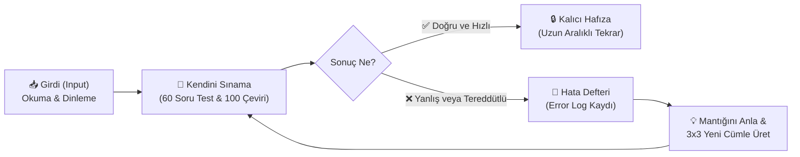
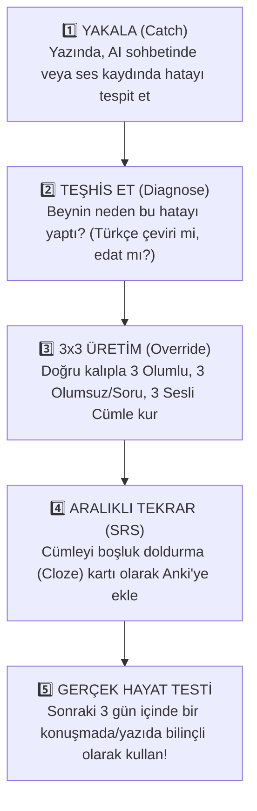

# 🎯 Modül 08: Pratik Alıştırmalar, Öz Değerlendirme ve Seviye Testleri Laboratuvarı

<div align="center">

[](../README.md)
[](./Kapsamli-Seviye-Tespit-Sinavi-A1-C2.md)
[](#-bu-modüldeki-rehber-ve-test-dosyaları)
[](#-hata-defteri-error-log-tutma-metodolojisi)

**[📝 60 Soruluk Seviye Testi](./Kapsamli-Seviye-Tespit-Sinavi-A1-C2.md)** • **[🚨 Türklerin Yaptığı 100 Kronik Hata](./Turklerin-En-Sik-Yaptigi-100-Hata.md)** • **[🏋️‍♂️ 100 Cümlelik Çeviri Atölyesi](./Ceviri-Atolyesi-Turkceden-Ingilizceye-100-Cumle.md)** • **[🏠 Ana Sayfaya Dön](../README.md)**

</div>

---

> *"Practice does not make perfect. Only perfect practice makes perfect."*
> (Pratik mükemmelleştirmez. Sadece doğru ve bilinçli yapılan pratik mükemmelleştirir.) — **Vince Lombardi**

Dil öğreniminde en büyük yanılgılardan biri, sadece video izleyerek veya kuralları okuyarak (**pasif maruz kalma**) konuşma ve yazma kaslarının kendiliğinden kusursuzlaşacağını sanmaktır. Beyin, bilgiyi sadece içeri alırken değil; **o bilgiyi geri çağırmaya zorlandığında (Active Recall)**, **sıfırdan cümle inşa ettiğinde (Active Production)** ve **yaptığı hatayla yüzleşip onu düzelttiğinde (Error Correction)** kalıcı nöral bağlar kurar.

Bu modül; öğrendiklerinizi test etmeniz, mevcut CEFR seviyenizi objektif olarak ölçmeniz, Türkçe düşünceden doğal İngilizceye geçiş kasınızı güçlendirmeniz ve Türklerin İngilizce öğrenirken düştüğü **kemikleşmiş (fossilized) hataları** kökünden temizlemeniz için **interaktif bir pratik laboratuvarı** olarak tasarlanmıştır.

---

## 📑 İçindekiler

1. [📂 Bu Modüldeki Rehber ve Test Dosyaları (Master Tablo)](#-bu-modüldeki-rehber-ve-test-dosyaları)
2. [⚡ Hızlı İnteraktif Önizleme (Hemen Kendini Dene!)](#-hızlı-interaktif-önizleme-hemen-kendini-dene)
3. [🧠 Bilimsel Temel: Neden Kendimizi Test Etmeliyiz?](#-bilimsel-temel-neden-kendimizi-test-etmeliyiz)
4. [📏 Kendi Kendine Seviye Ölçme (Self-Assessment) Metodolojisi](#-kendi-kendine-seviye-ölçme-self-assessment-metodolojisi)
5. [📓 Hata Defteri (Error Log) Tutma Metodolojisi](#-hata-defteri-error-log-tutma-metodolojisi)
6. [🔄 Kemikleşmiş Hataları (Fossilized Errors) Kırma Protokolü](#-kemikleşmiş-hataları-fossilized-errors-kırma-protokolü)
7. [✅ Yazma ve Konuşma İçin "10 Saniyelik Oto-Kontrol" Listesi](#-yazma-ve-konuşma-için-10-saniyelik-oto-kontrol-listesi)
8. [🗓️ Haftalık Pratik ve Öz Değerlendirme Rutini](#️-haftalık-pratik-ve-öz-değerlendirme-rutini)

---

## 📂 Bu Modüldeki Rehber ve Test Dosyaları

Bu klasörde yer alan **3 dev interaktif kaynağı** aşağıdaki sırayla uygulamanız önerilir:

| # | Rehber / Test Dosyası | İçerik, Kapsam ve Özellikler | Hedef Kitle | Süre / Kullanım |
| :-: | :--- | :--- | :--- | :---: |
| **1** | **[📝 Kapsamlı Seviye Tespit Sınavı (A1 – C2)](./Kapsamli-Seviye-Tespit-Sinavi-A1-C2.md)** | • A1'den C2'ye kademeli zorlaşan, her seviyeden 10'ar soruluk **toplam 60 soru**<br>• Gramer, Kelime, Collocation, Pragmatik Anlam ve 6 Okuma Parçası<br>• Her soruda gizli (`<details>`) çözüm, mantık ve **Türk Öğrenci Tuzağı** analizi<br>• Detaylı Puanlama Cetveli ve kişiselleştirilmiş çalışma reçetesi | Başlangıç seviyesini görmek veya seviye atladığını doğrulamak isteyen herkes | **45 – 60 dk**<br>*(Aylık Check-up)* |
| **2** | **[🚨 Türklerin En Sık Yaptığı 100 Kronik Hata](./Turklerin-En-Sik-Yaptigi-100-Hata.md)** | • Ana dili Türkçe olanların en sık düştüğü **100 kronik tuzak**<br>• 5 Kategori: *Tarzanca Çeviri & Collocation (1-25)*, *Gramer & Tense (26-50)*, *Edat Tuzakları (51-70)*, *False Friends / Sahte Dostlar (71-85)*, *Telaffuz & Silent Letters (86-100)*<br>• Her maddede **❌ Yanlış**, **✅ Doğru**, **💡 Mantığı** + **20 Soruluk Hata Avı Testi** | Konuşmasını ve yazısını "Tarzanca" izlerinden arındırmak isteyen A1–C1 öğrencileri | **Günde 10 Madde**<br>*(Başucu Kaynağı)* |
| **3** | **[🏋️‍♂️ Çeviri Atölyesi: Türkçeden İngilizceye 100 Cümle](./Ceviri-Atolyesi-Turkceden-Ingilizceye-100-Cumle.md)** | • "Anlıyorum ama cümle kuramıyorum" sorununu çözen **A1–C2 kademeli 100 çeviri egzersizi**<br>• Her cümlede 4 katmanlı spoiler analizi: **1) ❌ Tarzanca Tuzak**, **2) ✅ Standart Doğru**, **3) 🌟 Native/İleri Alternatif**, **4) 💡 Gramer ve Kelime Röntgeni** | Aktif cümle kurma, konuşma ve yazma kasını geliştirmek isteyen herkes | **Günde 5–10 Cümle**<br>*(Aktif Antrenman)* |

---

## ⚡ Hızlı İnteraktif Önizleme (Hemen Kendini Dene!)

Dosyalara geçmeden önce bu modülün nasıl çalıştığını deneyimlemek için aşağıdaki 3 mini kartu açıp kendinizi sınayın:

<details>
<summary>🧪 <b>Mini Test 1: Bu 3 Cümledeki "Türk Öğrenci Tuzağını" Bulabilir misiniz? (Tıkla & Gör)</b></summary>

1. ❌ *"I am living in Ankara since three years."*
   * ✅ **Doğrusu:** *I **have been living** in Ankara **for** three years.* (Geçmişte başlayıp devam eden süreçler Present Simple/Continuous ile değil, **Present Perfect Continuous** ile kurulur; toplam süre önünde *since* değil **for** kullanılır!)
2. ❌ *"Can you explain me why did you open the light?"*
   * ✅ **Doğrusu:** *Can you **explain to me** why **you turned on** the light?* (**Explain** kişiden önce `to` ister; dolaylı soruda `did` düşer ve düz cümle sırasına geçilir; elektrikli cihazlar *open* ile değil **turn on / switch on** ile açılır!)
3. ❌ *"Everyone in our team are agree that we need more informations."*
   * ✅ **Doğrusu:** *Everyone in our team **agrees** that we need more **information**.* (**Everyone** tekildir; **agree** sıfat değil fiildir (`am/is/are` almaz); **information** sayılamaz ve `-s` almaz!)

👉 *Tamamı için:* **[🚨 Türklerin En Sık Yaptığı 100 Kronik Hata](./Turklerin-En-Sik-Yaptigi-100-Hata.md)**
</details>

<details>
<summary>🏋️‍♂️ <b>Mini Test 2: Bu Türkçe Cümleyi "Tarzanca" Olmadan İngilizceye Çevirebilir misiniz? (Tıkla & Gör)</b></summary>

**🇹🇷 Cümle:** *"Yeni güncellemeyi canlı sunucuya yüklememizle birlikte kullanıcıların giriş hataları bildirmeye başlaması bir oldu."*

* ❌ **Tarzanca Çeviri:** *Our uploading the new update to the live server and users' starting to report login errors became one.*
* ✅ **C1 Standart Doğru:** **Hardly had we deployed the new update to the production server when users began reporting login failures.**
* 🌟 **C2 Native Alternatif:** **Barely had the new release hit production when error reports started flooding in.**

👉 *100 cümlenin tamamı için:* **[🏋️‍♂️ Çeviri Atölyesi: Türkçeden İngilizceye 100 Cümle](./Ceviri-Atolyesi-Turkceden-Ingilizceye-100-Cumle.md)**
</details>

<details>
<summary>📝 <b>Mini Test 3: B2 ve C1 Seviye Tespit Sorusu Önizlemesi (Tıkla & Gör)</b></summary>

**Soru (C1):** *The external audit committee strongly recommended that the company _______ its internal data privacy protocols immediately.*
- A) revises
- B) revised
- C) revise
- D) would revise

* **Doğru Cevap:** **C) revise**
* **💡 Mantığı:** *Recommend, suggest, insist, demand, require* gibi fiillerden sonra gelen `that` cümleciğinde **Subjunctive Mood** kullanılır: Özne tekil (*the company*) ve ana fiil geçmiş zamanda (*recommended*) olsa bile yan cümledeki fiil **yalın (`revise`)** kalır!

👉 *60 soruluk tam sınav için:* **[📝 Kapsamlı Seviye Tespit Sınavı (A1 – C2)](./Kapsamli-Seviye-Tespit-Sinavi-A1-C2.md)**
</details>

---

## 🧠 Bilimsel Temel: Neden Kendimizi Test Etmeliyiz?

Bilişsel psikolojide **"Testing Effect" (Test Etme Etkisi)** veya **"Retrieval Practice" (Geri Çağırma Pratiği)** olarak bilinen prensibe göre (Roediger & Karpicke, 2006):

* Bir konuyu **4 kez üst üste okumak**, bilgiyi kısa süreli hafızada tutar ancak 1 hafta sonra **%60'ından fazlası** unutulur.
* Aynı konuyu **1 kez okuyup 3 kez kendini test etmek**, beynin bilgiye ulaşma yollarını (sinapsları) güçlendirir ve hatırlama oranını **%80'in üzerine** çıkarır.
* **Üretken Başarısızlık (Productive Failure):** Bir soruyu çözerken veya cümleyi çevirirken zorlanmak ve hatta yanlış yapıp hemen ardından **"Neden yanlış yaptım?"** açıklamasını okumak, doğru cevabı ilk başta pasifçe okumaktan **3 kat daha kalıcı** öğrenme sağlar.



---

## 📏 Kendi Kendine Seviye Ölçme (Self-Assessment) Metodolojisi

Birçok öğrenci *"Dizileri anlıyorum, o zaman B2'yim"* der ancak bir e-posta yazmaya veya 2 dakika konuşmaya çalıştığında A2 cümlelerine hapsolduğunu fark eder. Bunun sebebi **Pasif Seviye (Alıcı Beceriler: Reading & Listening)** ile **Aktif Seviye (Üretici Beceriler: Speaking & Writing)** arasındaki farktır.

Gerçek seviyenizi tek bir rakamla değil, **4 becerinin ayrı ayrı röntgeniyle** ölçmelisiniz:

### 1. Dört Beceriyi Tek Başına Ölçme Protokolü (4-Skill Diagnostic)

Ayda bir kez kendinize **30 dakikalık** şu mini check-up'ı uygulayın:

#### 📖 A) Okuma ve Gramer/Kelime Ölçümü (Reading & Use of English)
1. Bu modüldeki **[Kapsamlı Seviye Tespit Sınavı (A1-C2)](./Kapsamli-Seviye-Tespit-Sinavi-A1-C2.md)** dosyasını sözlük kullanmadan çözün.
2. Her 10 soruluk seviye bloğunda (A1, A2, B1, B2, C1, C2) **en az 7/10 (%70)** başarı sağladığınız son basamak, sizin **Pasif/Yapısal** seviyenizdir.

#### 🎧 B) Dinleme Ölçümü (Listening Benchmark)
Rastgele bir TED-Ed videosu veya BBC 6 Minute English bölümü açın ve **altyazıyı kapatın**:
* **A1:** Sadece tek tük tanıdık kelimeleri (isimler, sayılar, temel fiiller) yakalayabiliyorum.
* **A2:** Konunun genel olarak ne hakkında olduğunu anlıyorum ama konuşma hızlandığında kopuyorum.
* **B1:** Ana fikri ve olay örgüsünü (%60-70) anlıyorum; bilmediğim kelimeler yüzünden bazı detaylar kaçıyor.
* **B2:** Standart aksanlı konuşmaların **%85-90'ını** altyazısız, yorulmadan takip edebiliyorum.
* **C1:** Hızlı konuşmaları, deyimleri, imaları (sarcasm/irony) ve farklı aksanları neredeyse eksiksiz anlıyorum.
* **C2:** Arka planda gürültü varken bile hızlı tartışmaları, teknik/akademik nüansları ana dilim gibi yakalıyorum.

#### 🗣️ C) Konuşma Ölçümü: "2 Dakika Ses Kaydı Testi" (Speaking Benchmark)
Telefonunuzun ses kaydedicisini açın. Hazırlık yapmadan şu soruya **2 dakika boyunca duraksamadan** cevap vermeye çalışın:
> *"Geçen yıl hayatınızda aldığınız en önemli karar neydi, neden o kararı aldınız ve bugün geriye dönüp baktığınızda neyi farklı yapardınız?"* (Bu soru aynı anda Past Simple, sebep-sonuç bağlaçları, Present Simple ve Type 3 Conditional/Past Regret yapılarını zorlar!)

Kaydı dinleyin ve kendinizi puanlayın:
* **A1-A2:** 30. saniyede tıkandım, hep *"I went, I did, because it was good"* gibi çok basit cümleler kurdum, Türkçe kelimeler araya girdi.
* **B1:** 2 dakikayı tamamladım ama çok fazla *"ııı / umm"* dedim, aynı kelimeleri (*important, good, thing*) tekrar ettim, *"yapardım"* derken gramerim bozuldu.
* **B2:** Akıcı konuştum, *however, as a result, looking back* gibi bağlaçlar kullandım, *If I had known...* yapısını kurabildim; sadece 1-2 yerde doğal kelime (collocation) aradım.
* **C1-C2:** Düşünmek için değil, vurgu yapmak için duraksadım; *in hindsight, pivotal moment, weigh the pros and cons* gibi üst düzey ifadeleri doğal bir tonlamayla kullandım.

#### ✍️ D) Yazma ve Aktif Cümle Kurma Ölçümü (Writing & Translation Benchmark)
1. **[Çeviri Atölyesi: Türkçeden İngilizceye 100 Cümle](./Ceviri-Atolyesi-Turkceden-Ingilizceye-100-Cumle.md)** dosyasından kendi seviyenizdeki 10 cümleyi seçip yardım almadan çevirin.
2. Ardından otomatik düzeltmeyi (spellcheck) kapatın, **15 dakika** süre tutun ve *"Uzaktan çalışma şirketler ve çalışanlar için kalıcı bir standart olmalı mıdır?"* konusunda 150-200 kelimelik bir görüş yazısı yazıp **[04-Yapay-Zeka-Promptlari](../04-Yapay-Zeka-Promptlari/Yazma-Gramer-ve-Kelime-Promptlari.md)** içindeki **CEFR Yazı Değerlendirici Prompt** ile analiz ettirin.

---

### 2. Pasif vs Aktif Seviye Uçurumu Teşhis Tablosu

| Durumunuz | Teşhis | Reçete (Ne Yapmalısınız?) |
| :--- | :--- | :--- |
| **Testte B2 çıktım ama konuşurken A2 gibiyim** | **Klasik Türkiye Sendromu:** Pasif bilgi yüksek, aktif üretim kası zayıf. | Gramer çalışmayı derhal durdurun. Her gün **[100 Cümlelik Çeviri Atölyesi](./Ceviri-Atolyesi-Turkceden-Ingilizceye-100-Cumle.md)** içinden 10 cümleyi sesli çevirin ve zamanınızın %70'ini **[B1-B2 Dinleme ve Konuşma Pratikleri](../02-Orta-Seviye-B1-B2/Dinleme-ve-Konusma-Pratik-Senaryolari.md)** + **[AI Sesli Pratik](../04-Yapay-Zeka-Promptlari/Konusma-ve-Rol-Yapma-Promptlari.md)** ile geçirin. |
| **Akıcı konuşuyorum ama sürekli aynı basit hataları yapıyorum** | **Kemikleşmiş Hata (Fossilization):** Akıcılık uğruna doğruluk feda edilmiş. | Bu modüldeki **[Türklerin En Sık Yaptığı 100 Hata](./Turklerin-En-Sik-Yaptigi-100-Hata.md)** rehberini bitirin ve bugün bir **Hata Defteri (Error Log)** başlatın. |
| **Gramer sorularını yapıyorum ama okuma parçalarında yavaşım** | **Kelime ve Bağlam Eksikliği:** Kuralları formül olarak biliyorsunuz ama dil maruziyeti az. | **[05-Kaynaklar ve Araçlar](../05-Kaynaklar-ve-Araclar/Kitap-Dizi-Film-ve-Podcast-Rehberi.md)** modülünden seviyenize uygun *Graded Reader* kitaplar ve makalelerle günlük okuma rutini kurun. |

---

## 📓 Hata Defteri (Error Log) Tutma Metodolojisi

İngilizceyi orta seviyeden (B1/B2) ileri seviyeye (C1/C2) taşıyan en güçlü araç yeni konular öğrenmek değil, **mevcut hataları sistemli olarak avlamaktır**.

> [!IMPORTANT]
> **Neden aynı hatayı 100 kez yapıyoruz?**
> Çünkü konuşurken veya yazarken beynimiz "mesajı karşıya iletmeye" odaklanır. Siz *"I am agree with you"* dediğinizde karşı taraf sizi anlar ve sohbet devam eder. Beyniniz **"Mesaj ulaştı, görev başarılı!"** sinyali alır ve yanlış kalıbı ödüllendirir. Hata defteri, bu sahte ödül mekanizmasını bozup hatayı görünür kılar.

### 1. Hataların 5 Ana Kategorisi

Hata defterinize kayıt yaparken hatanızın türünü etiketleyin. 2 hafta sonra hangi kategoride yoğunlaştığınızı şaşkınlıkla göreceksiniz:

1. **`[L1-Çeviri]` (Anadil Girişimi / Tarzanca):** Türkçe düşünüp kelimesi kelimesine çevirmek (Örn: *"Sigara içmek"* -> ~~*drink cigarette*~~ yerine *smoke*).
2. **`[Prep]` (Edat Tuzağı):** Türkçe eklerin (-de, -e, -den) İngilizce edatlarla uyuşmaması (Örn: ~~*married with*~~ yerine *married to*, ~~*depend of*~~ yerine *depend on*).
3. **`[Collocation]` (Kelime Eşleşmesi):** Gramer olarak doğru ama kulağa doğal gelmeyen kelimeler (Örn: ~~*do a mistake*~~ yerine *make a mistake*, ~~*big rain*~~ yerine *heavy rain*).
4. **`[Gramer/Tense]` (Yapı ve Zaman Kayması):** Türkçede geniş/şimdiki zamanla söylenen şeylerin İngilizcede farklı zaman gerektirmesi (Örn: *"2 yıldır İstanbul'da yaşıyorum"* -> ~~*I live in Istanbul for 2 years*~~ yerine *I have been living...*).
5. **`[Telaffuz/Vurgu]` (Sesletim ve Yazım):** Yanlış okunan veya sessiz harfi yutulmayan kelimeler (Örn: *comfortable* kelimesini 4 heceli ~~*kom-for-tey-bıl*~~ okumak yerine `/ˈkʌmf.tə.bəl/` okumak).

---

### 2. Hazır Hata Defteri (Error Log) Şablonu

Aşağıdaki tabloyu Notion sayfanıza, Obsidian'a, Excel'e veya fiziksel bir deftere kopyalayarak hemen kullanmaya başlayabilirsiniz:

```markdown
| Tarih | Kategori | ❌ Yaptığım Hata (Yanlışım) | ✅ Doğru ve Doğal Kullanım | 💡 Neden / Kuralın Mantığı | ✍️ Kendi Ürettiğim 2 Örnek Cümle | Durum |
| :---: | :---: | :--- | :--- | :--- | :--- | :---: |
| 15.11 | `[Prep]` | I listened music yesterday. | I **listened to** music yesterday. | *Hear* nesneyi doğrudan alır ama *listen* yönelme bildirir; bir şeye kulak vermek için daima **to** ister. | 1. What kind of podcasts do you **listen to**?<br>2. She never **listens to** my advice. | 🔄 Tekrarda |
| 16.11 | `[L1-Çeviri]` | Can you open the light? | Can you **turn on / switch on** the light? | *Open* fiziksel olarak kapalı bir mekanizmayı (kapı, kutu, pencere) açmaktır. Elektrikli cihazlar **turn on/off** ile açılır. | 1. Please **turn off** the TV before sleeping.<br>2. Could you **turn on** the air conditioner? | ✅ Çözüldü |
| 18.11 | `[Gramer]` | If I will see him, I will tell him. | If I **see** him, I **will tell** him. | Zaman ve koşul bağlaçlarının (*if, when, as soon as, before*) bağlı olduğu yan cümlede gelecek zaman (**will**) kullanılmaz; Present Simple kullanılır. | 1. When I **finish** the report, I'll send it.<br>2. As soon as she **arrives**, we will start. | 🔥 Kritik |
```

---

## 🔄 Kemikleşmiş Hataları (Fossilized Errors) Kırma Protokolü

Yıllardır yanlış söylediğiniz bir kalıbı (örneğin *"people is"* veya *"I have 25 years old"* ya da *"explain me"*) sadece doğrusunu bir kez okuyarak düzeltemezsiniz. Eski nöral patika çok kalındır; stres altında veya hızlı konuşurken diliniz otomatik olarak eski yanlışa kayar.

Bunu kırmak için **"3x3 Hata Silme Döngüsü"** uygulayın:



### Adım Adım Uygulama Örneği: `explain me` ❌ $\rightarrow$ `explain to me` ✅
1. **Yakala:** Toplantıda *"Can you explain me this issue?"* dediniz ve yanlış olduğunu fark ettiniz.
2. **Teşhis Et:** *Tell me, give me, show me* fiilleri dolaylı tümleci edatsız alır ama **explain, describe, suggest, recommend** fiilleri kişiden önce mutlaka **`to`** ister (*explain something **to** someone* veya *explain **to** someone that...*).
3. **3x3 Üretim (Hemen o an sesli ve yazılı):**
   * *Can you explain **to me** how this algorithm works?*
   * *Let me explain the situation **to you**.*
   * *He never explained his decision **to the team**.*
4. **Anki Kartı:** Ön yüz: `Could you explain {{c1::to me}} why the build failed? (Bana açıklar mısın...)`
5. **Aktif Görev:** Yarınki Daily Stand-up toplantısında veya AI konuşma pratiğinde en az bir kez içinde `explain to ...` geçen bir cümle kurmayı kendinize görev verin.

---

## ✅ Yazma ve Konuşma İçin "10 Saniyelik Oto-Kontrol" Listesi

Bir e-postayı, Slack mesajını veya essay'i "Gönder" tuşuna basmadan önce şu **7 maddelik Türk Öğrenci Radarından** geçirin. Hatalarınızın **%80'ini** daha kimse görmeden yakalayacaksınız:

- [ ] **1. Özne-Fiil Uyumu (3. Tekil Şahıs `-s` ve `People`):** *He/She/It* veya tekil öznelerden (*everyone, nobody, the company*) sonra fiile `-s` koydum mu? *People* kelimesini çoğul fiille (*people are / people think*) kullandım mı?
- [ ] **2. Sayılabilen Tekil İsimler Çıplak Kalmış mı? (`a/an/the`):** Türkçede *"Ben yazılımcıyım"* veya *"Araba aldım"* deriz ama İngilizcede sayılabilen tekil bir isim asla tek başına duramaz (*I am **a** developer*, *I bought **a** car*).
- [ ] **3. "To Be" Fazlalığı Var mı? (`I am agree` tuzağı):** *Agree, depend, happen, rain, seem* birer **fiildir**, sıfat değildir! Önlerine `am/is/are` koymadığımdan emin miyim? (~~*I am agree*~~ $\rightarrow$ *I agree*, ~~*It is depend*~~ $\rightarrow$ *It depends*).
- [ ] **4. Geçmişte Belli Bir Zaman Varsa Present Perfect Kullanmadım, Değil mi?:** Cümlede *yesterday, last week, in 2022, 5 minutes ago, when I was a child* varsa **asla** *have/has V3* kullanılmaz; doğrudan **Past Simple (V2)** kullanılır.
- [ ] **5. `If / When` Yan Cümlesinde `Will` Var mı?:** Gelecekten bahsederken *if, when, after, before, until, as soon as* kelimelerinin hemen yanındaki cümlede `will` varsa silip **Present Simple** yaptım mı?
- [ ] **6. Edatlar Doğal mı?:** *Listen **to**, depend **on**, interested **in**, good **at**, married **to**, look forward **to V-ing*** kalıplarını doğru kullandım mı?
- [ ] **7. Büyük/Küçük `i / İ` Harfi Kontrolü:** İngilizce metinde yanlışlıkla Türkçe noktalı büyük **`İ`** (*İt is, İstanbul*) veya noktasız küçük **`ı`** (*wıth, thıs*) klavye hatası bıraktım mı?

---

## 🗓️ Haftalık Pratik ve Öz Değerlendirme Rutini

Öğrendiklerinizi kalıcı hale getirmek için haftalık çalışma programınıza şu **Pratik Laboratuvar Rutinini** ekleyin:

| Gün / Adım | Süre | Aksiyon | Kullanılacak Kaynak |
| :--- | :---: | :--- | :--- |
| **1. Hata Avı (Günlük)** | 5 dk / gün | Gün içinde AI ile konuşurken veya yazarken yaptığınız **en az 1, en fazla 3 hatayı** Hata Defterinize işleyin. | [AI Yazma ve Hata Analizörü Promptları](../04-Yapay-Zeka-Promptlari/Yazma-Gramer-ve-Kelime-Promptlari.md) |
| **2. Aktif Cümle İnşası (Haftada 4 Gün)** | 10 dk | **[Çeviri Atölyesi: 100 Cümle](./Ceviri-Atolyesi-Turkceden-Ingilizceye-100-Cumle.md)** rehberinden her seferinde **5 Türkçe cümleyi** sesli olarak İngilizceye çevirip Native alternatifleriyle karşılaştırın. | [Çeviri Atölyesi: Türkçeden İngilizceye 100 Cümle](./Ceviri-Atolyesi-Turkceden-Ingilizceye-100-Cumle.md) |
| **3. Kronik Hata Dozu (Haftada 3 Gün)** | 10 dk | **[Türklerin En Sık Yaptığı 100 Hata](./Turklerin-En-Sik-Yaptigi-100-Hata.md)** listesinden her seferinde **10 madde** okuyun ve kendi cümlenizi kurun. | [Türklerin En Sık Yaptığı 100 Hata](./Turklerin-En-Sik-Yaptigi-100-Hata.md) |
| **4. Haftalık Geri Çağırma Testi (Pazar)** | 15 dk | O hafta Hata Defterinize yazdığınız yanlış cümleleri kapatıp sadece Türkçe anlamlarına bakarak İngilizcelerini hatasız söylemeye/yazmaya çalışın. | Kişisel Hata Defteriniz & [Anki Kurulum Kılavuzu](../05-Kaynaklar-ve-Araclar/Anki-ve-Araclar-Kurulum-Kilavuzu.md) |
| **5. Aylık Seviye Check-up (Ay Sonu)** | 45 dk | Seviye tespit sınavındaki ilgili bölümü ve "2 Dakika Ses Kaydı" testini tekrarlayarak geçen aya göre gelişiminizi ölçün. | [Kapsamlı Seviye Tespit Sınavı (A1-C2)](./Kapsamli-Seviye-Tespit-Sinavi-A1-C2.md) |

---

## 🚀 Şimdi Nereden Başlamalısınız?

1. **Mevcut seviyenizi netleştirmek için:** Hemen **[📝 Kapsamlı Seviye Tespit Sınavı (A1 – C2)](./Kapsamli-Seviye-Tespit-Sinavi-A1-C2.md)** dosyasına geçin ve 60 soruluk sınavı çözün.
2. **Konuşma ve yazmanızdaki gizli pürüzleri temizlemek için:** **[🚨 Türklerin En Sık Yaptığı 100 Kronik Hata](./Turklerin-En-Sik-Yaptigi-100-Hata.md)** rehberini açın ve kaç tanesini farkında olmadan yaptığınızı test edin!
3. **Kendi cümlenizi kurma kasınızı çalıştırmak için:** **[🏋️‍♂️ Çeviri Atölyesi: Türkçeden İngilizceye 100 Cümle](./Ceviri-Atolyesi-Turkceden-Ingilizceye-100-Cumle.md)** egzersizlerine başlayın!
4. **Seviyenize uygun konu anlatımlarına dönmek için:**
   * [🐣 01 - Temel Seviye (A1 - A2)](../01-Temel-Seviye-A1-A2/README.md)
   * [🦅 02 - Orta Seviye (B1 - B2)](../02-Orta-Seviye-B1-B2/README.md)
   * [🐉 03 - İleri Seviye (C1 - C2)](../03-Ileri-Seviye-C1-C2/README.md)
   * [🤖 04 - Yapay Zeka (AI) Promptları](../04-Yapay-Zeka-Promptlari/README.md)
   * [🧰 05 - Kaynaklar ve Araçlar](../05-Kaynaklar-ve-Araclar/README.md)
   * [🎓 06 - Sınav Hazırlık (IELTS, TOEFL, YDS)](../06-Sinav-Hazirlik-IELTS-TOEFL-YDS/README.md)
   * [💻 07 - Yazılımcı ve Mesleki İngilizce](../07-Yazilimci-ve-Mesleki-Ingilizce/README.md)
