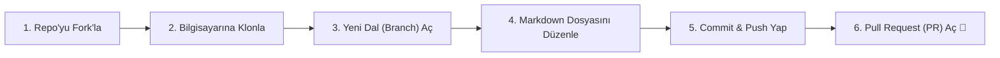

# 🤝 Katkıda Bulunma Rehberi (Contributing Guide)

**Sıfırdan İleriye İngilizce (`A1 – C2`)** açık kaynak projesine katkıda bulunmak istediğiniz için teşekkür ederiz! Bu proje; Türkiye'de İngilizce öğrenmek, uluslararası sınavlara hazırlanmak veya global teknoloji şirketlerinde çalışmak isteyen herkesin **ücretsiz, reklamsız ve bilimsel metodolojiyle** en kaliteli kaynaklara ulaşabilmesi için topluluk tarafından geliştirilmektedir.

---

## 🗺️ Hangi Modüle Katkıda Bulunabilirsiniz?

Kütüphanemiz **8 ana modülden** oluşmaktadır. Eklemek istediğiniz içeriğin hangi klasöre ait olduğunu aşağıdaki tablodan seçebilirsiniz:

| Modül Kodu | Klasör ve Odak Alanı | Kabul Edilen Katkı Türleri |
| :---: | :--- | :--- |
| **`01`** | **[01-Temel-Seviye-A1-A2](./01-Temel-Seviye-A1-A2/README.md)** | Yeni günlük hayat senaryoları, temel diyaloglar, sesletim/telaffuz ipuçları ve A1-A2 mini alıştırmalar. |
| **`02`** | **[02-Orta-Seviye-B1-B2](./02-Orta-Seviye-B1-B2/README.md)** | Doğal *Collocation* örnekleri, *Phrasal Verbs* bağlamları, *Shadowing* metinleri ve *Self-Talk* soruları. |
| **`03`** | **[03-Ileri-Seviye-C1-C2](./03-Ileri-Seviye-C1-C2/README.md)** | Akademik yazım kalıpları, kurumsal deyimler (*Idioms*), retorik/münazara örnekleri ve UK/US/AU nüansları. |
| **`04`** | **[04-Yapay-Zeka-Promptlari](./04-Yapay-Zeka-Promptlari/README.md)** | ChatGPT, Claude veya Gemini üzerinde test edilmiş yeni sesli konuşma, rol yapma, yazma veya Anki kart promptları. |
| **`05`** | **[05-Kaynaklar-ve-Araclar](./05-Kaynaklar-ve-Araclar/README.md)** | Seviyesi belirtilmiş kitap, dizi, film, YouTube kanalı, podcast önerileri ve Anki/Notion/tarayıcı eklentisi rehberleri. |
| **`06`** | **[06-Sinav-Hazirlik-IELTS-TOEFL-YDS](./06-Sinav-Hazirlik-IELTS-TOEFL-YDS/README.md)** | IELTS, TOEFL iBT, PTE, Duolingo ve YDS/YÖKDİL soru çözüm stratejileri, yazma/konuşma şablonları ve akademik kelimeler. |
| **`07`** | **[07-Yazilimci-ve-Mesleki-Ingilizce](./07-Yazilimci-ve-Mesleki-Ingilizce/README.md)** | GitHub/PR/Code Review kalıpları, Agile/Scrum toplantı ifadeleri, System Design terimleri, CV ve STAR mülakat örnekleri. |
| **`08`** | **[08-Pratik-Alistirmalar-ve-Seviye-Testleri](./08-Pratik-Alistirmalar-ve-Seviye-Testleri/README.md)** | Açıklamalı seviye tespit soruları, Türklerin sık yaptığı hatalar (*False Friends / Tarzanca çeviriler*) ve mini testler. |

---

## 📏 Kalite Standartlarımız ve İçerik Kuralları

Repodaki bilgi kalitesini en üst düzeyde tutmak için eklenen içeriklerin aşağıdaki kriterleri sağlaması gerekmektedir:

1. **Ücretsiz ve Yasal Olmalı:** Tamamen ücretli kursların reklam linkleri veya telif hakkı ihlali içeren (korsan PDF vb.) materyaller kesinlikle kabul edilmez.
2. **Bağlam Odaklı Olmalı (*Context is King*):** Tek başına Türkçe-İngilizce kelime listeleri yerine, her kelimenin ve kalıbın **doğal bir örnek cümle ve senaryo içinde** kullanılması zorunludur.
3. **"Ezber Değil Mantık" İlkesi:** Gramer veya sınav kuralı eklerken sadece formül yazmak yerine, *"Bu yapı neden böyle kullanılır? Türkçe düşünen biri nerede hata yapar?"* mantığını açıklayın.
4. **İnteraktif Alıştırma Formatı (`<details>`):** Eklediğiniz test veya alıştırma sorularının cevap anahtarlarını okuyucunun hemen görmemesi için `<details><summary><b>🔑 Cevabı ve Açıklamayı Gör</b></summary> ... </details>` spoiler blokları içine alın.
5. **Kırık Link Kontrolü:** Eklediğiniz tüm dış bağlantıların çalıştığından ve repo içi dosya linklerinin (`./Dosya-Adi.md` veya `../Klasor-Adi/README.md`) doğru yazıldığından emin olun.

---

## 📝 Hazır Katkı Şablonları

İçerik eklerken mevcut dosyaların tasarım bütünlüğünü korumak için aşağıdaki Markdown şablonlarını kullanabilirsiniz:

### 1. Yeni Medya / Kaynak Ekleme Şablonu (`Modül 05`)
```markdown
| Kaynak Adı | Seviye | Aksan / Tür | Neden ve Nasıl Kullanılmalı? |
| :--- | :---: | :---: | :--- |
| **[Kaynak Adı](https://ornek-link.com)** | `B1 - B2` | 🇬🇧 UK / Podcast | Günlük konuşma hızına alışmak için önce transkriptsiz dinleyin, ardından bilmediğiniz 3 kalıbı Anki'ye ekleyin. |
```

### 2. "Tarzanca vs. Doğal İngilizce" Hata Ekleme Şablonu (`Modül 02 & 08`)
```markdown
#### #101. [Hata Başlığı]
* ❌ **Yanlış (Tarzanca):** *"I will open the light."*
* ✅ **Doğru (Native):** **"I will turn on / switch on the light."**
* 💡 **Neden / Mantığı:** Türkçede elektrikli cihazlar için "açmak/kapatmak" denir; ancak İngilizcede `open/close` fiziksel olarak kapı, pencere veya kutu açmak içindir. Elektronik akım için `turn on / turn off` kullanılır.
```

### 3. Yeni Yapay Zeka (AI) Sistem Promptu Şablonu (`Modül 04`)
````markdown
### 🎯 Prompt Adı (Hedef Seviye: B1-C1)
**Kullanım Amacı:** [Bu promptun hangi beceriyi nasıl geliştirdiğini 1 cümleyle açıklayın.]

```text
Act as an expert English coach... [Kopyala-yapıştır yapılabilir tam sistem komutu]
```
````

---

## 🛠️ Adım Adım Pull Request (PR) Gönderme Süreci

GitHub üzerinden katkıda bulunmak oldukça basittir:



1. **Fork'layın:** Bu reponun sağ üst köşesindeki **Fork** butonuna tıklayarak kendi GitHub hesabınıza bir kopyasını alın.
2. **Klonlayın:** Kendi hesabınızdaki repoyu bilgisayarınıza indirin:
   ```bash
   git clone https://github.com/<kullanici-adiniz>/Sifirdan-Ileriye-Ingilizce.git
   cd Sifirdan-Ileriye-Ingilizce
   ```
3. **Yeni Bir Dal (Branch) Oluşturun:** Yapacağınız değişiklik için anlamlı bir dal açın:
   ```bash
   git checkout -b feat/b1-collocation-eklemesi
   ```
4. **Değişikliklerinizi Yapın:** İlgili modüldeki Markdown (`.md`) dosyasını düzenleyin ve tabloların/linklerin düzgün göründüğünü kontrol edin.
5. **Commit'leyin (Conventional Commits):** Değişikliklerinizi açıklayıcı bir mesajla kaydedin:
   ```bash
   git add .
   git commit -m "feat(02-B1-B2): iş dünyası için 10 yeni collocation eklendi"
   ```
6. **Push'layın ve PR Açın:**
   ```bash
   git push origin feat/b1-collocation-eklemesi
   ```
   Ardından GitHub üzerinden **Pull Request** oluşturun.

---

## 💬 Kod Bilmeden Katkıda Bulunma (Issues)

Git veya Markdown kullanmayı bilmiyorsanız hiç sorun değil! Üst menüdeki **Issues** sekmesinden yeni bir başlık açarak:
* Faydasını gördüğünüz kaynak önerilerinizi,
* Rehberlerde fark ettiğiniz yazım hatalarını veya kırık linkleri,
* *"Şu konuda da bir rehber eklense harika olur"* dediğiniz fikirlerinizi bizimle paylaşabilirsiniz.

🏠 **[Ana Sayfaya (README.md) Dön](./README.md)**
